# CREWNBUILD: system connections

This file lists every connection between the four apps, the database and outside services, and what depends on each one. It shows current and target names side by side, for use during the restructure (Octabuild becomes **professional**).

- **Snapshot:** branch `main` at commit `9157af6`, read on 2026-11-12. Only code was read; no code, data or settings were changed.
- **Sources:** the code in `Octabuild/backend`, `Octabuild/frontend 7/frontend`, `Partner/backend` and `Partner/frontend`. Target names come from `docs/CREWNBUILD — Technical Architecture and Design.pdf`, called "the doc" or "arch" below. Some tables in that PDF are garbled in text form, so target table names that had to be rebuilt are marked as such.
- **Rules:** where the code and the doc disagree, this file follows the code and adds a note. Anything that could not be settled from the code is marked `UNKNOWN: <what to check>`. Secret values are never printed.
- **Current schema names:** `octabuild` (target `professional`) and `partner`.

## Contents
1. [Overview](#1-overview)
2. [Connections between the two products](#2-connections-between-the-two-products)
3. [Feature connection map](#3-feature-connection-map)
4. [Real-time connections](#4-real-time-connections)
5. [Authentication and session connections](#5-authentication-and-session-connections)
6. [Outside services](#6-outside-services)
7. [Database relationships](#7-database-relationships)
8. [Background jobs](#8-background-jobs)
9. [Settings map](#9-settings-map)
10. [Risk list](#10-risk-list)

## 1. Overview

Four apps share one PostgreSQL database (`crewnbuild`). **The Octabuild schema is still named `octabuild` in the code.** The target name `professional` does not appear as a schema name anywhere yet (`Octabuild/backend/app/database/session.py` `OCTABUILD_SCHEMA`, `Partner/backend/app/database/session.py` `OCTABUILD_SCHEMA` / `PARTNER_SCHEMA`). The backends never call each other over HTTP. They connect only through the browser hand-off, shared tables and raw SQL, as shown below.

Neither backend has an API prefix today. Octabuild routers are mounted with no prefix (`Octabuild/backend/app/main.py`), and so are Partner's (`Partner/backend/app/main.py`). The target design adds `/professional/api/v1` and `/partner/api/v1`.

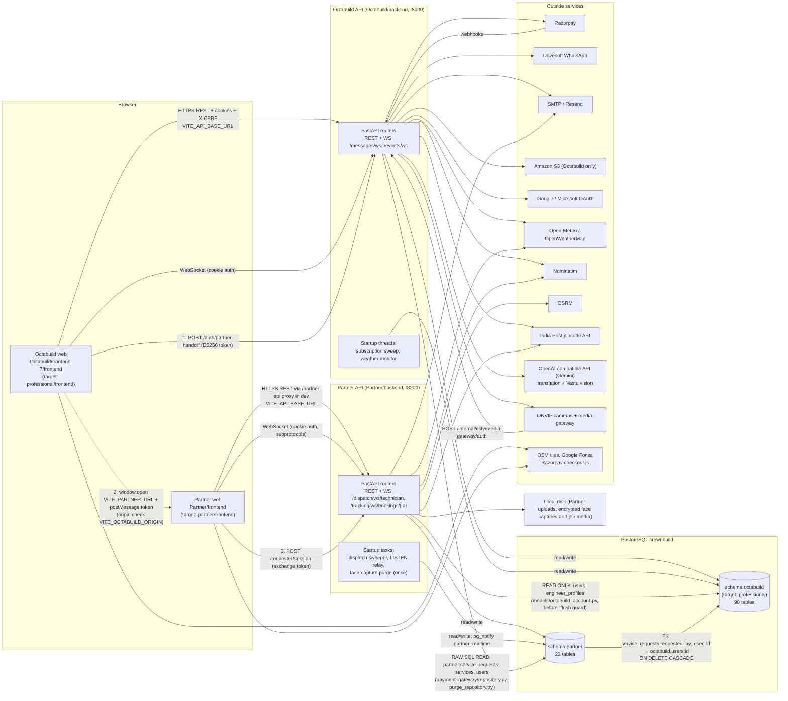

### Connection inventory (summary)

| # | From | To | Kind | Details in |
|---|---|---|---|---|
| 1 | Octabuild web | Octabuild API | REST (335 distinct endpoints called) | Section 3 |
| 2 | Octabuild web | Octabuild API | WebSocket ×2 | Section 4 |
| 3 | Partner web | Partner API | REST (82 distinct endpoints called) | Section 3 |
| 4 | Partner web | Partner API | WebSocket ×2 | Section 4 |
| 5 | Octabuild web → Partner web → Partner API | Book Technician hand-off | Signed token + postMessage | Section 2.1 |
| 6 | Partner API | `octabuild.users`, `octabuild.engineer_profiles` | Read-only ORM mapping | Section 2.2 |
| 7 | `partner.service_requests` | `octabuild.users` | Cross-schema FK | Section 2.3 |
| 8 | Octabuild API | `partner.service_requests`, `partner.services`, `partner.users` | Raw SQL reads (payments, account deletion) | Sections 2.2 and 2.4 |
| 9 | Octabuild migration `0007_user_uuid` | Any schema's FKs to `octabuild.users` | Migration crosses schemas | Section 2.3 |
| 10 | Both APIs | Outside services | HTTP/SMTP/S3/ONVIF | Section 6 |
| 11 | Background jobs | Both schemas | Threads and tasks inside the API processes | Section 8 |

## 2. Connections between the two products

The two products share one PostgreSQL database. In code today, Octabuild's schema is still named **`octabuild`** (`Octabuild/backend/app/database/session.py`, `OCTABUILD_SCHEMA = "octabuild"`; `Octabuild/backend/alembic/env.py`, `OCTABUILD_SCHEMA = "octabuild"`), and Partner's is `partner` (`Partner/backend/app/database/session.py`, `PARTNER_SCHEMA = "partner"`). Note: the target design calls the Octabuild schema `professional`. No code uses `professional` as a schema name yet.

They connect in five places:
1. the Book Technician hand-off (a signed token passed between browser windows);
2. Partner reading `octabuild.users` and `octabuild.engineer_profiles`;
3. one real cross-schema foreign key, `partner.service_requests.requested_by_user_id` → `octabuild.users.id`;
4. Octabuild reading `partner.service_requests`, `partner.services` and `partner.users` with raw SQL (payments and account deletion);
5. Octabuild migration `0007_user_uuid`, which rewrites foreign keys in any schema that point at `octabuild.users`.

---

### 1. Book Technician hand-off, end to end

#### 1.1 Step by step

| # | Step | Where (file → component/function) | Details |
|---|---|---|---|
| 1 | The button is shown (House Owner) | `Octabuild/frontend 7/frontend/src/pages/owner/OwnerDashboard.jsx` → `HomeownerDashboard`, inner function `bookTechnician(trade = null)` | Used as a quick action (`ui.owner.bookTechnician`). It is also passed as `onBookTechnician` to `OwnerOverviewSection.jsx`, which renders `OwnerTechnicianSection` from `pages/owner/ownerDiscovery.jsx` (`onBook`). If `partnerBookingConfigured` is false, it alerts `ui.owner.bookTechnicianNotConfigured`. If the popup is blocked, it alerts `ui.owner.bookTechnicianPopupBlocked`. |
| 1b | The button is shown (Site Engineer) | `Octabuild/frontend 7/frontend/src/pages/engineer/EngineerDashboard.jsx` → `EngineerDashboard`, `const bookTechnician = canBookPartner(user) ? () => {...}` | A quick action. On failure it alerts `ui.engineer.bookTechnicianUnavailable`. The `/engineer/*` route only lets in an `ENGINEER` who is not a store manager (see the auth fragment). |
| 2 | Partner opens in a new window | `Octabuild/frontend 7/frontend/src/services/partnerBooking.js` → `openPartnerBooking(trade)` | Calls `window.open(\`${PARTNER_URL}${path}\`, 'octabuild-partner-booking')`. The path is `/book-technician` or `/book-technician/<slug>`, where the slug is one of `PARTNER_TRADE_SLUGS` = plumber, carpenter, electrician, painter. `PARTNER_URL` comes from **`VITE_PARTNER_URL`**. The window is opened inside the click handler so popup blockers allow it. The opener reference is kept on purpose. A `message` listener `answerPartnerHandoff` is added once. No iframe, no redirect, and no token in the URL. |
| 3 | The Partner page asks the opener for a token | `Partner/frontend/src/services/booking.js` → `startRequesterSessionFromOctabuild()` / `handshakeWithOctabuild()` | Called from `Partner/frontend/src/hooks/useRequesterSession.js` → `useRequesterSession().connect`. That hook is used by `pages/booking/BookTechnicianPage.jsx`, `ServiceListPage.jsx`, `BookServicePage.jsx` and `BookingTrackerPage.jsx`. It needs `window.opener` (otherwise `NO_OPENER`). It sends `opener.postMessage({type: 'PARTNER_BOOKING_READY'}, origin)` to each origin in `OCTABUILD_ORIGINS`, which is **`VITE_OCTABUILD_ORIGIN`** split on commas. It times out after 10 s (`HANDOFF_TIMEOUT_MS`). A module-level `handshakeInProgress` shares one handshake between callers, because React StrictMode runs effects twice. |
| 4 | Octabuild checks the request and asks its backend for a token | `partnerBooking.js` → `answerPartnerHandoff(event)` → `currentHandoffToken()` | **Origin checks:** `event.source === partnerWindow`, `event.origin === partnerOrigin()` (that is `new URL(VITE_PARTNER_URL).origin`), and `event.data.type === 'PARTNER_BOOKING_READY'`. `currentHandoffToken()` first checks `canBookPartner(readStoredUser())` (role `OWNER` or `ENGINEER`), then calls `apiClient.post('/auth/partner-handoff')`. |
| 5 | Octabuild signs the token | Router: `Octabuild/backend/app/shared/auth/routes/auth_routes.py` → `create_partner_handoff` (`POST /auth/partner-handoff`, `Depends(get_current_user)`). Signer: `Octabuild/backend/app/utils/security.py` → `create_partner_handoff_token(user_id)`; gate `partner_handoff_configured()` | Returns 503 when no key is set. Returns 403 unless `user.role == "OWNER"`, or `user.role == "ENGINEER"` with `engineer_profile.specialization.strip() == "Site Engineer"`. Response schema: `Octabuild/backend/app/schemas/auth.py` → `PartnerHandoffResponse` (`handoff_token`, `expires_in_seconds`). This is a cookie-authenticated POST, so `CsrfProtectionMiddleware` requires `X-CSRF-Token`. `Octabuild/backend/app/subscription/signup_checkout.py`: `REFUSED_PATHS = ("/auth/partner-handoff",)` refuses the call for a builder whose paid sign-up is still unpaid. |
| 6 | Token format | `security.py` constants `PARTNER_HANDOFF_ALGORITHM = "ES256"`, `PARTNER_HANDOFF_AUDIENCE = "partner"`, `TOKEN_PARTNER_HANDOFF = "partner_handoff"`, `ACCESS_ISSUER = "octabuild"` | **Algorithm:** ES256 (EC P-256), using `python-jose` `jwt.encode`. **Claims:** `sub` (Octabuild user UUID), `type="partner_handoff"`, `iss="octabuild"`, `aud="partner"`, `jti` (`secrets.token_urlsafe(24)`), `iat`, `exp = iat + partner_handoff_seconds`. **Expiry:** setting `partner_handoff_seconds` (env `PARTNER_HANDOFF_SECONDS`), default 60. The token carries no role claim. |
| 7 | Octabuild sends the token to Partner | `partnerBooking.js` → `answerPartnerHandoff` | Calls `partnerWindow.postMessage({type: 'OCTABUILD_HOUSE_OWNER_HANDOFF', handoffToken}, partnerOrigin())`, sending only to the exact Partner origin. |
| 8 | Partner receives the token | `Partner/frontend/src/services/booking.js` → inner `onMessage(event)` | **Origin checks:** `OCTABUILD_ORIGINS.includes(event.origin)` (setting **`VITE_OCTABUILD_ORIGIN`**), `event.source === window.opener`, `event.data.type === 'OCTABUILD_HOUSE_OWNER_HANDOFF'`, and `handoffToken` is a string. The token is then POSTed once as `bookingClient.post('/requester/session', {handoff_token})`. |
| 9 | Partner swaps the token for a session | Router: `Partner/backend/app/requester/routes/requester_routes.py` → `start_requester_session` (`POST /requester/session`, prefix `/requester`). Service: `Partner/backend/app/requester/services/requester_service.py` → `RequesterIdentityService.verify_handoff`. Session: `Partner/backend/app/shared/sessions/services/session_service.py` → `SessionService.start_requester` | `/requester/session` is in `ORIGIN_ONLY_PATHS` (`Partner/backend/app/utils/csrf.py`), so it needs an allowed Origin but no CSRF token. |
| 10 | Partner verifies the token | `Partner/backend/app/utils/security.py` → `read_octabuild_handoff(token)` | Public key setting: `octabuild_handoff_public_key` (env **`OCTABUILD_HANDOFF_PUBLIC_KEY`**, in `Partner/backend/app/core/config.py`). The key is refused if it is empty or contains "PRIVATE". Decoding uses `algorithms=["ES256"]` (`OCTABUILD_HANDOFF_ALGORITHM`), `audience="partner"` (`PARTNER_AUDIENCE`) and `issuer="octabuild"` (`OCTABUILD_ISSUER`). It then requires `type == "partner_handoff"`, `aud == "partner"` and a non-empty `jti`. It returns `(UUID(sub), jti[:64])`. The key is checked at startup by `validate_handoff_public_key` / `load_handoff_public_key` in `Partner/backend/app/core/config.py`, and production refuses to start without it. |
| 11 | Partner checks the role | `RequesterIdentityService._require_requester` → `RequesterRepository.get` (`Partner/backend/app/requester/repositories/requester_repository.py`) → `OctabuildUser.requester_role` / `is_active` (`Partner/backend/app/models/octabuild_account.py`) | Returns 401 if the account is missing, 403 `NOT_ALLOWED_MESSAGE` unless the role is OWNER, or ENGINEER with `engineer_profiles.specialization == "Site Engineer"`, and 403 `SUSPENDED_MESSAGE` unless `status` is ACTIVE. The same check runs again on every requester request (`dependencies.requester_from_token` → `resolve_account`). |
| 12 | Replay protection | `Partner/backend/app/models/auth_session.py` → `AuthSession.handoff_jti` (String 64) with `UniqueConstraint("handoff_jti", name="uq_auth_sessions_handoff_jti")`, table **`partner.auth_sessions`** (Alembic `0015_auth_sessions`) | `SessionService.start_requester` first calls `repository.exists_handoff(jti)` and raises `session_expired()` if the jti is already used. A race is caught as `IntegrityError` on commit, then rolled back and refused. |
| 13 | The resulting session | `start_requester` → `_issue(PRINCIPAL_REQUESTER, account_id, scope=None, new family, expires_at = now + requester_session_minutes)`. Cookies are set by `Partner/backend/app/utils/session_cookies.py` → `set_requester_cookies` | A row in `partner.auth_sessions` with `principal_type='requester'` and `user_id` = Octabuild user id (no FK). Access JWT: `create_requester_access_token`, HS256 with Partner's `JWT_SECRET_KEY`, `type="requester"`, `iss/aud="partner"`. Cookies: `[__Secure-]partner-requester-access` and `[__Secure-]partner-requester-refresh`. Lifetime: setting `requester_session_minutes` (env `REQUESTER_SESSION_MINUTES`), default 60, never extended. The response body (`RequesterSessionResponse`) has `expires_in_seconds`, a `requester` profile and `csrf_token`. The frontend saves a non-secret hint in sessionStorage key `partner_requester_session` (`apiClient.js` → `storeRequesterSession`). |

**Key pair and settings (names only):**

| Side | Setting (Python attr) | Env name | Notes |
|---|---|---|---|
| Octabuild backend | `partner_handoff_private_key` (SecretStr) | `PARTNER_HANDOFF_PRIVATE_KEY` | ES256 P-256 private key in PEM. Checked by `validate_partner_handoff_key` / `load_partner_handoff_private_key` in `Octabuild/backend/app/core/config.py`. Required in production. |
| Octabuild backend | `partner_handoff_seconds` | `PARTNER_HANDOFF_SECONDS` | Default 60. |
| Octabuild frontend | — | `VITE_PARTNER_URL` | Partner base URL. It is also the exact postMessage target origin. |
| Partner backend | `octabuild_handoff_public_key` | `OCTABUILD_HANDOFF_PUBLIC_KEY` | The matching public key. Partner never sees Octabuild's `JWT_SECRET_KEY`. |
| Partner frontend | — | `VITE_OCTABUILD_ORIGIN` | A comma-separated list of allowed opener origins. |

Note: neither `Octabuild/backend/.env.example` nor `Partner/backend/.env.example` mentions `PARTNER_HANDOFF_PRIVATE_KEY` / `OCTABUILD_HANDOFF_PUBLIC_KEY`. `Partner/backend/.env.example` still lists `OCTABUILD_JWT_SECRET_KEY` and `OCTABUILD_JWT_ALGORITHM`, but `Partner/backend/app/core/config.py` says these are "no longer read", and no Python code references them.

Note: the message type is named `OCTABUILD_HOUSE_OWNER_HANDOFF`, but it is also used for Site Engineers. Both frontends must keep the two names (`PARTNER_BOOKING_READY`, `OCTABUILD_HOUSE_OWNER_HANDOFF`) identical.

#### 1.2 Sequence diagram

```mermaid
sequenceDiagram
    autonumber
    actor U as Owner / Site Engineer
    participant OF as Octabuild web<br/>partnerBooking.js
    participant OB as Octabuild API<br/>auth_routes.create_partner_handoff
    participant PF as Partner web<br/>booking.js (useRequesterSession)
    participant PB as Partner API<br/>requester_routes.start_requester_session
    participant DB as PostgreSQL<br/>octabuild.users / partner.auth_sessions

    U->>OF: click Book Technician (OwnerDashboard / EngineerDashboard)
    OF->>PF: window.open(VITE_PARTNER_URL + /book-technician[/slug])
    PF->>OF: opener.postMessage({type: PARTNER_BOOKING_READY}, each VITE_OCTABUILD_ORIGIN)
    OF->>OF: check event.source == partnerWindow, event.origin == origin(VITE_PARTNER_URL)
    OF->>OB: POST /auth/partner-handoff (cookies + X-CSRF-Token)
    OB->>OB: role check OWNER or ENGINEER + "Site Engineer"
    OB-->>OF: {handoff_token (ES256, aud=partner, jti, exp 60s), expires_in_seconds}
    OF->>PF: partnerWindow.postMessage({type: OCTABUILD_HOUSE_OWNER_HANDOFF, handoffToken}, Partner origin)
    PF->>PF: check event.origin in VITE_OCTABUILD_ORIGIN, event.source == window.opener
    PF->>PB: POST /requester/session {handoff_token} (Origin check only)
    PB->>PB: read_octabuild_handoff (OCTABUILD_HANDOFF_PUBLIC_KEY, ES256, iss=octabuild, aud=partner, type)
    PB->>DB: SELECT octabuild.users + engineer_profiles (requester_role, status)
    PB->>DB: exists_handoff(jti)? INSERT partner.auth_sessions (principal_type=requester, handoff_jti UNIQUE)
    PB-->>PF: Set-Cookie partner-requester-access / -refresh; body {requester, csrf_token, expires_in_seconds}
    PF->>PB: booking calls via bookingClient (/requester/*, X-CSRF-Token)
```

#### 1.3 Target names (arch.txt)

| Today | Target |
|---|---|
| `Octabuild/backend/app/shared/auth/routes/auth_routes.py` (`create_partner_handoff`) | `professional/backend/app/modules/identity/router.py` (section 4.6) |
| `Partner/backend/app/models/octabuild_account.py` | `partner/backend/app/modules/requesters/professional_requester_view.py` (4.6) |
| Partner `requester/` package (session exchange) | Partner module `requesters` ("Hand-off exchange", 4.3) |
| `Partner/frontend/src/services/booking.js` | `partner/frontend/src/features/booking/bookingApi.js` (4.6) |
| `OCTABUILD_HANDOFF_PUBLIC_KEY`, `VITE_OCTABUILD_ORIGIN` | `PROFESSIONAL_HANDOFF_PUBLIC_KEY`, `VITE_PROFESSIONAL_ORIGIN` (section 5.5; old names read as fallbacks for one release) |
| ES256 token, claims without role | Section 6.3 step 6: "Professional signs an **EdDSA** token (sub, **role**, jti, aud=partner, exp 60 s)". This changes both the algorithm and the claims. Note: the code uses ES256 today. |
| `partner.auth_sessions.handoff_jti` | Table renamed `sessions` (section 11; `principal_type` stays technician / requester) |
| Permission | Section 7.2 `handoff:create`: OWNER Yes, SITE_ENGINEER Yes, others No |

---

### 2. Partner's reads of Octabuild tables

#### 2.1 Mapping

File: `Partner/backend/app/models/octabuild_account.py`. The schema comes from `OCTABUILD_SCHEMA = "octabuild"` in `Partner/backend/app/database/session.py`. It is hard-coded, not a setting: Partner's config has no schema setting.

| Partner class | Octabuild table | Columns mapped | Extra |
|---|---|---|---|
| `OctabuildUser` | `octabuild.users` | `id` (Uuid PK), `name` String(150), `email` String(255), `phone` String(30), `role` String(30), `status` String(20), `address` Text, `pincode` String(20), `location` String(180) | `engineer_profile = relationship("OctabuildEngineerProfile", uselist=False, viewonly=True)`. Properties: `is_active` (status, defaulting to ACTIVE), `requester_role` (OWNER → `OWNER`; ENGINEER + `specialization == "Site Engineer"` → `SITE_ENGINEER`; otherwise None), `area` (first comma part of `location`) |
| `OctabuildEngineerProfile` | `octabuild.engineer_profiles` | `id` Integer PK, `user_id` Uuid `ForeignKey("octabuild.users.id")` unique, `specialization` String(160) | This FK exists only in Partner's metadata. Partner never creates it (see 2.2). |

Constants: `OCTABUILD_OWNER_ROLE="OWNER"`, `OCTABUILD_ENGINEER_ROLE="ENGINEER"`, `OCTABUILD_SITE_ENGINEER_CATEGORY="Site Engineer"`, `REQUESTER_ROLES=("OWNER","SITE_ENGINEER")`, `REQUESTER_ROLE_LABELS`. Both classes are re-exported from `Partner/backend/app/models/entities.py`.

Also: `Partner/backend/app/models/service_request.py` → `ServiceRequest.requester = relationship("OctabuildUser", foreign_keys=[requested_by_user_id], viewonly=True)`.

#### 2.2 Guards that block writes

| Guard | Where | What it does |
|---|---|---|
| ORM flush hook | `octabuild_account.py` → `refuse_octabuild_writes`, `@event.listens_for(Session, "before_flush")` | Registered on the SQLAlchemy `Session` class, so it applies to every session in the Partner process. It raises `RuntimeError("Partner must never write to Octabuild tables.")` if an `OctabuildUser` or `OctabuildEngineerProfile` is new, deleted, or modified. |
| Read-only relationships | `viewonly=True` on `OctabuildUser.engineer_profile` and `ServiceRequest.requester` | Changes made through these relationships are never written. |
| Repository has no writes | `RequesterRepository` ("There is no write method") | Only `get(account_id)`, with `joinedload(OctabuildUser.engineer_profile)`. |
| Migration filter | `Partner/backend/alembic/env.py` → `partner_owns(object_, ...)` (only `schema == "partner"`), `include_name` (only reflects schema `partner`) | Keeps `octabuild.*` out of autogenerate. |

Not present: there is no read-only DB role, no separate read-only session, and no DB-level grant in code. Partner connects with the same `DATABASE_URL` user it uses for its own tables (default URL in `Partner/backend/app/core/config.py`, `DEFAULT_DATABASE_URL`).

Note: the docstring in `Partner/backend/app/database/session.py` refers to `app/models/house_owner.py`, which is out of date. The real file is `octabuild_account.py`.

#### 2.3 Every Partner code path that reads them

| Code path (file → function) | What it reads | Who uses it |
|---|---|---|
| `requester/repositories/requester_repository.py` → `RequesterRepository.get` | `users` + `engineer_profiles` (joined) | All requester identity checks |
| `requester/services/requester_service.py` → `RequesterIdentityService._require_requester` / `verify_handoff` / `resolve_account`; `requester_profile()` | id, name, role, status, pincode, address, location (`area`), specialization | `POST /requester/session`, `POST /requester/refresh`, `GET /requester/me`, `GET /requester/session` |
| `dependencies/dependencies.py` → `requester_from_token`, `get_current_requester`, `requester_for_socket`, `requester_socket_still_valid` | The same, again on every request and every socket re-check | Every `/requester/*` route, `/requester/services*` (catalog), the tracking routes for requesters, and the tracking websocket (`shared/tracking/routes/tracking_routes.py` uses `requester_for_socket` and `requester_socket_still_valid`) |
| `requester/services/requester_location_service.py` → `RegisteredLocationService.resolve`, `_place_of`, `_locality`, `_district_and_state` | address, location, pincode | `GET /requester/me/registered-location` |
| `shared/bookings/services/dispatch_service.py` → `create_booking` | address, pincode, `area`. These are copied into `service_requests.service_address`, `service_area` and `pincode` at booking time | `POST /requester/bookings` |
| `dispatch_service.py` → `list_bookings`, `get_booking`, `_locked_for_requester`, `cancel_booking`, `retry_booking` | `requester.id` (ownership filter) | `/requester/bookings*` |
| `shared/bookings/repositories/service_request_repository.py` → `joinedload(ServiceRequest.requester)` | Loads `users` with bookings | Booking/job listings |
| `shared/bookings/services/booking_responses.py` → `job_response` | `booking.requester.name` (first name), `booking.requester.phone`, only when the status is in `CONTACT_VISIBLE_STATUSES` | **Technician-facing** job view (the technician sees the requester's first name and phone) |
| `shared/bookings/services/job_execution_service.py` → `_requester_booking`, `requester_view`, `requester_upload`, `requester_delete`, `requester_content` | `requester.id` | Requester job-execution routes |
| `shared/bookings/services/rating_service.py` → `requester_view`, `submit` | `requester.id` | Rating routes |
| `shared/bookings/services/start_otp_service.py` → `_issue`, `_locked_booking`, `requester_view`, `regenerate` | `requester.id` (and the requester object) | Start-OTP routes |
| `shared/bookings/services/work_bill_service.py` → `_requester_booking`, `requester_view`, `requester_content` | `requester.id` | Work-bill routes |
| `shared/tracking/services/tracking_service.py` → `load_for_requester`, `requester_snapshot`, `set_destination` | `requester.id` | `/tracking/bookings/{id}` (requester side) |

#### 2.4 Octabuild's reads of Partner tables (the other direction)

| File → function | SQL | Purpose |
|---|---|---|
| `Octabuild/backend/app/payment_gateway/repository.py` → `PaymentRepository.completed_bookings_for`, `booking` (constants `BOOKING_COLUMNS`, `BOOKING_FROM`) | `SELECT r.id, r.requested_by_user_id, r.requested_by_role, r.status, r.technician_type, r.quoted_amount, r.currency, r.completed_at, s.service_name, t.name FROM partner.service_requests r LEFT JOIN partner.services s ON s.id = r.service_id LEFT JOIN partner.users t ON t.id = r.technician_id` | Technician booking payments (see section 4) |
| `Octabuild/backend/app/shared/account/repositories/purge_repository.py` → `PurgeRepository.count_open_partner_bookings` (used by `shared/account/services/purge_service.py`) | `to_regclass('partner.service_requests')`, then `count(*) ... WHERE requested_by_user_id = :user_id AND status IN ('SEARCHING','OFFERED','ACCEPTED','EN_ROUTE','ARRIVED','IN_PROGRESS')` | Blocks account deletion while Partner bookings are open, because they would CASCADE-delete |

These are raw `text()` SQL. Partner tables are not in Octabuild's metadata. Renaming `partner.service_requests`, `services`, `users`, or any of the columns listed above will break this SQL silently, with no migration error.

#### 2.5 Comparison with the target view `professional.v_partner_requesters` (arch.txt 11.1)

| Aspect | Today (code) | Target |
|---|---|---|
| Object read | Tables `octabuild.users` + `octabuild.engineer_profiles`, mapped directly | View `professional.v_partner_requesters`, `GRANT SELECT ... TO crewnbuild_partner` |
| Columns | id, name, email, phone, role, status, address, pincode, location, plus `engineer_profiles.specialization` | id, name, email (nullable), phone, status, address, pincode, location, `requester_role` (computed) |
| Role logic | In Python: `OctabuildUser.requester_role` (`specialization == "Site Engineer"`) | In SQL: `CASE WHEN u.role='OWNER' ... WHEN u.role='ENGINEER' AND ep.category='SITE_ENGINEER'`. Note: the target uses column `category` with value `SITE_ENGINEER`, but the code uses column `specialization` with value `"Site Engineer"`. |
| Deleted users | No `deleted_at` filter (no such column is read) | `WHERE u.deleted_at IS NULL` |
| Write guard | `before_flush` hook (`refuse_octabuild_writes`) | DB grant (SELECT only) |
| Schema name | `octabuild` (hard-coded constant) | `professional` (`PROFESSIONAL_SCHEMA` env in 5.5) |

---

### 3. Cross-schema foreign keys

#### 3.1 Live foreign keys (models and migrations)

| From (schema.table.column) | To | ON DELETE | Defined in | Notes |
|---|---|---|---|---|
| `partner.service_requests.requested_by_user_id` | `octabuild.users.id` | **CASCADE** | Model: `Partner/backend/app/models/service_request.py` → `ServiceRequest.requested_by_user_id = ForeignKey("octabuild.users.id", ondelete="CASCADE")`. Migration: `Partner/backend/alembic/versions/0001_partner_initial.py` (column `house_owner_id`, constraint `fk_service_requests_house_owner_id_octabuild_users`, `ondelete="CASCADE"`). Renamed in `0002_onboarding_booking.py` to column `requested_by_user_id`, constraint `fk_service_requests_requested_by_user_id_octabuild_users`, index `ix_service_requests_requested_by_user_id` | **This is the only real cross-schema FK.** Because of it, Partner can only be migrated after Octabuild (`database/session.py` docstring). Deleting an Octabuild user cascades to the user's bookings. Target (arch.txt 11): becomes **RESTRICT** to `professional.users`, with the table renamed `bookings`. |
| `octabuild.engineer_profiles.user_id` (as declared in Partner's model) | `octabuild.users.id` | none (NO ACTION) | `Partner/backend/app/models/octabuild_account.py` → `OctabuildEngineerProfile.user_id` | Same-schema (octabuild → octabuild). It exists only in Partner's metadata so the relationship can join, and Partner never creates it. The real constraint is Octabuild's own. |

Octabuild models: every `ForeignKey` is unqualified (it uses the default MetaData schema `octabuild`). None points at `partner`. `Octabuild/backend/app/payment_gateway/models.py` deliberately has **no** FK for `booking_id` (see section 4). The CCTV models (`Octabuild/backend/app/models/cctv.py`) have "deliberately NOT foreign keys" comments, but those are inside the `octabuild` schema, not cross-schema.

Partner's other models (`auth_session.py`): `AuthSession.user_id` has **no FK**, because it points at either `partner.users` or `octabuild.users`, depending on `principal_type`.

#### 3.2 Cross-schema SQL in migrations

| Migration | Cross-schema action |
|---|---|
| `Partner/backend/alembic/versions/0001_partner_initial.py` → `octabuild_house_owner_id_type()` | Reads `information_schema.columns WHERE table_schema='octabuild' AND table_name='users' AND column_name='id'` to match the FK column type (integer, bigint or uuid). It stops if `octabuild.users` is missing. Offline mode needs `-x octabuild_user_id_type=...`. Creates the FK above. |
| `Partner/backend/alembic/versions/0002_onboarding_booking.py` | `ALTER TABLE partner.service_requests RENAME CONSTRAINT fk_service_requests_house_owner_id_octabuild_users TO fk_service_requests_requested_by_user_id_octabuild_users` |
| `Octabuild/backend/alembic/versions/0003_create_schemas_and_move.py` (`0003_schemas`) | `CREATE SCHEMA IF NOT EXISTS octapartner` (for the old OctaPartner app). The downgrade drops it. |
| `Octabuild/backend/alembic/versions/0007_user_id_to_uuid.py` (`0007_user_uuid`) | `SELECT_REFERENCING_CONSTRAINTS` reads **every FK in any schema** that points at `octabuild.users`. It then drops each one, retypes `users.id` to uuid with `octabuild._user_uuid()`, retypes each referencing column, and re-adds each constraint from `pg_get_constraintdef`. The docstring says this was written for nine `octapartner` columns (`FOREIGN_SCHEMAS = {"octapartner"}`). It would also cover `partner.service_requests` if that table existed when it ran. |
| `Octabuild/backend/alembic/versions/0008_drop_empty_octapartner_schema.py` (`0008_drop_octapartner`) | Drops the `octapartner` schema if it is empty, and `public.alembic_version_octapartner` |
| `Octabuild/backend/alembic/env.py` → `octabuild_owns` | The autogenerate filter. It ignores anything outside `octabuild` (so `partner.*` is never touched). |

---

### 4. Technician booking payment (Octabuild `payment_gateway` ↔ Partner bookings)

**A link exists in code. It is a shared ID with a raw-SQL lookup, not a foreign key.**

| Item | Detail |
|---|---|
| Tables | `octabuild.payment_orders`, `octabuild.payment_transactions`, `octabuild.payment_receipts` (`Octabuild/backend/app/payment_gateway/models.py`, created by `Octabuild/backend/alembic/versions/0019_payment_tables.py`) |
| What `booking_id` holds | The UUID of a Partner booking: `partner.service_requests.id`. It is `Uuid, nullable=False, index=True` on `PaymentOrder` and `PaymentTransaction`, and `unique=True` on `PaymentReceipt`. The models docstring says: "`booking_id` holds its id, without a foreign key across the two applications' schemas". Migration 0019 says the same ("without a cross-schema foreign key"). |
| Integrity in the DB | Partial unique index `uq_payment_orders_booking_paid` (one PAID order per booking). Receipts are unique per booking. The receipt reference `SR-XXXXXXXX` comes from `BookingForPayment.reference` (the first 8 hex digits of the booking UUID, matching Partner's own reference format). |
| Lookup | `Octabuild/backend/app/payment_gateway/repository.py` → `PaymentRepository.booking(booking_id)` and `completed_bookings_for(customer_id)`. Raw SQL on `partner.service_requests` + `partner.services` + `partner.users` (columns in 2.4). The amount is `service_requests.quoted_amount`. `serialize_booking` takes `pg_advisory_xact_lock(hashtext('payment:<booking_id>'))`. |
| Who creates the payment order | The **House Owner, in Octabuild**. Frontend: `Octabuild/frontend 7/frontend/src/payment_gateway/api.js` (`POST /payments/orders {booking_id}`, `GET /payments/technician-bookings`, `POST /payments/verify`), rendered by `payment_gateway/TechnicianPaymentsSection.jsx` inside `pages/owner/OwnerDashboard.jsx`. Backend: `Octabuild/backend/app/payment_gateway/router.py` → `create_payment_order` → `service.py` → `PaymentService.create_order`. That calls `require_owner` (role OWNER only; 403 `NOT_OWNER`), then `_owned_booking`, which needs `booking.requested_by_user_id == user.id` and `requested_by_role == "OWNER"` (otherwise 404). It also needs booking status `COMPLETED` and a quoted amount. It then creates a Razorpay TEST order and inserts `PaymentOrder(booking_id=booking.id, customer_id=user.id, ...)`. |
| Site Engineer bookings | Cannot be paid (`require_owner`, plus the `requested_by_role` check). |
| Partner side | Partner has **no** code that reads or writes `octabuild.payment_*`. No Partner model or route touches payments. `Partner/backend/app/models/technician_earning.py` says "no payment collection and no payout yet". Partner is not told when a booking is paid. |
| FKs | `payment_orders.customer_id` → `octabuild.users.id` ON DELETE CASCADE (same schema). There is no FK from `booking_id` to Partner. |
| Target | arch.txt section 10 (Billing): rename to `booking_payment_orders` / `booking_payment_transactions` / `booking_payment_receipts`, adding **FK `booking_id` → `partner.bookings` RESTRICT** (this would be a new cross-schema FK). Router renamed to `professional/backend/app/modules/billing/booking_payments_router.py` (4.6). |

## 3. Feature connection map

The tables below have one row per feature and endpoint. Octabuild comes first, in three parts, followed by its endpoint coverage check; Partner comes next, with its own coverage check.

### 3.1 Octabuild, part 1: identity, accounts, admin, support, content, files, notifications, billing

App roots used in the cells below:
- Frontend paths (`src/...`) are relative to `Octabuild/frontend 7/frontend/`.
- Backend paths (`app/...`) are relative to `Octabuild/backend/`.

How the endpoints are built:
- `src/services/apiClient.js` creates the axios client with `baseURL = VITE_API_BASE_URL` (fallback `http://localhost:8000` or `http://127.0.0.1:8000`) and `withCredentials: true`. The client adds no `/api` prefix.
- `app/main.py` mounts every router with a bare `app.include_router(router)`, so there is no app-level prefix. The only prefixes come from the routers themselves:
  - `admin_routes` and `admin_account_deletion_routes` use `/admin`.
  - `admin_support_routes` uses `/admin/support`.
  - `support_routes` uses `/support`.
  - `payment_gateway/router.py` uses `/payments`.
  - The other routers in this scope have no prefix.
- Registration order in `main.py` matters: the first matching route wins. In this scope no two paths collide.
- Code says the DB schema is `octabuild` (`app/database/session.py` `OCTABUILD_SCHEMA = "octabuild"`). Note: the target design calls it `professional`.
- Raw SQL in `app/payment_gateway/repository.py` hard-codes the schema names `partner.*` and `octabuild.users`. These strings must change with any schema rename.

Shorthand used in the "Tables read" column:
- **[S]**: the `get_current_user` / `get_current_session` dependencies (`app/dependencies/dependencies.py`).
  - They read `auth_sessions` and `users` (through `SessionService.validate`).
  - For a CONTRACTOR, `get_current_user` also runs `app/subscription/signup_checkout.py` `enforce`, which reads `builder_profiles` and `builder_subscriptions`.
- **[A]**: `current_admin` / `require_admin(...)`. This is [S] plus a read of `admin_profiles`.
- **AuthResponse**: the body built by `AuthService.session_response` / `user_response` (`app/shared/auth/services/auth_service.py`). It reads `users`, `owner_profiles`, `builder_profiles`, `supplier_profiles`, `engineer_profiles` and `builder_subscriptions` (`pending_checkout`).

Target tables follow arch.txt section 10 (professional schema) and section 11 (partner schema). Mappings used in this fragment:

| Current table | Target table |
|---|---|
| `users` | same |
| `auth_sessions` | `user_sessions` |
| `oauth_identities` | `user_oauth_identities` |
| `email_verifications` | `email_verification_codes` |
| `phone_verifications` | `phone_verification_codes` |
| `phone_otp_send_events` | `otp_send_events` |
| `verification_records` | `user_verification_reviews` |
| `*_profiles`, `account_deletion_requests`, `support_tickets`, `support_ticket_messages`, `notifications`, `projects`, `builder_subscriptions`, `subscription_*` | same |
| `audit_events` | `admin_audit_logs` |
| `reports` | `user_reports` |
| `advertisements` | `ads` |
| `advertisement_daily_stats` | `ad_daily_stats` |
| `uploaded_files` | `files` |
| `requests` | `project_requests` + `property_enquiries` (split) |
| `project_media` | `project_photos` |
| `project_timelines` | `project_timeline_entries` |
| `award_offers` | `project_award_offers` |
| `daily_site_records` | `site_daily_records` |
| `daily_record_adjustments` | `site_daily_record_adjustments` |
| `project_material_inventory` | `project_material_stock` |
| `material_order_items` | `purchase_orders` + `purchase_order_items` |
| `supplier_products` | `supplier_listings` |
| `master_*` | `catalog_*` |
| `payment_orders` | `booking_payment_orders` |
| `payment_transactions` | `booking_payment_transactions` |
| `payment_receipts` | `booking_payment_receipts` |
| `estimates` | `cost_estimates` |
| `reviews` | removed |
| `escrow_milestones` | removed |
| `partner.service_requests` | `partner.bookings` |
| `partner.services` | `partner.catalog_services` |
| `partner.users` | `partner.technicians` |

Note: the section 10 table in the PDF is garbled. These pairs are reconstructed from the order of the rows.

Target modules follow arch.txt section 4.3:
- **identity**: sign-up, sign-in, OTP, OAuth, sessions.
- **accounts**: profiles, location, categories, account deletion.
- **admin**: users, administrators, verification, audit, announcements.
- **support**: tickets, contact, user reports.
- **content**: ads, translation, Vastu, estimates, calculators.
- **messaging**: chat, notifications, live events.
- **billing**: booking payments, subscriptions, coupons, webhooks.
- **site_operations**: daily records and costs.
- **marketplace**: includes discovery.
- **files**: uploads.

### Identity: sign-in, sessions, sign-up

| Feature | Role | Frontend route | Page component file | Frontend API function and file | HTTP method + endpoint | Backend router file and handler | Service/repository files | Tables read | Tables written | Target module (new) | Target tables (new names) |
|---|---|---|---|---|---|---|---|---|---|---|---|
| Password sign-in | All (password sign-in limited to admins where WhatsApp sign-in is on) | /login, /account-recovery, /delete-account | src/pages/auth/LoginPage.jsx, AccountRecoveryPage.jsx, src/pages/site/DeleteAccountPage.jsx (via redux thunk `loginWithCredentials`) | `loginUser` src/services/auth.js | POST /auth/login | app/shared/auth/routes/auth_routes.py `login_user` | auth_service.py `AuthService.login`; login_throttle.py (in-memory); session_service.py `SessionService.start`; repositories user_repository.py, auth_session_repository.py | users; AuthResponse tables | auth_sessions | identity | users, user_sessions |
| Dev account-recovery flag | Public | /account-recovery | src/pages/auth/AccountRecoveryPage.jsx | `readAccountRecoveryConfig` src/services/auth.js | GET /auth/recovery/config | auth_routes.py `read_account_recovery_config` | app/core/config.py `dev_account_recovery_on` (settings only) | none | none | identity | none |
| WhatsApp sign-in (verify code) | All signed-in roles incl. admins (admin by admin_profiles.phone) | /login, /delete-account | src/pages/auth/PhoneLogin.jsx (thunk `loginWithWhatsApp`) | `loginWithPhoneCode` src/services/auth.js | POST /auth/phone/login/verify-code | auth_routes.py `verify_phone_login_code` | auth_service.py `login_with_phone`, `login_account_for_phone`; phone_verification_service.py `verify_login_code`; phone_verification_repository.py; user_repository.py; session_service.py | phone_verifications, users, admin_profiles; AuthResponse tables | phone_verifications (marked verified), auth_sessions | identity | phone_verification_codes, users, admin_profiles, user_sessions |
| Session check on load / after OAuth / after category save / checkout | All | every route (AppRouter `verifyStoredSession`), /oauth/callback, /supplier-category, /engineer-category, /subscription-checkout | src/app/router/AppRouter.jsx, src/pages/auth/OAuthCallback.jsx, SupplierCategoryPage.jsx, EngineerCategoryPage.jsx, src/subscription/SubscriptionCheckoutPage.jsx | `verifySession` src/services/auth.js | GET /auth/session | auth_routes.py `read_current_session` | dependencies.py `get_current_session`; auth_service.py `session_response`; app/utils/security.py `csrf_token_for` | [S] (no enforce); AuthResponse tables | none | identity | user_sessions, users, *_profiles, builder_subscriptions |
| Sign-up | OWNER, CONTRACTOR, SUPPLIER, ENGINEER | /signup | src/pages/auth/SignupPage.jsx (thunk `signupWithProfile`) | `signupUser` src/services/auth.js | POST /auth/signup | auth_routes.py `signup_user` | auth_service.py `signup`/`_signup`; email_verification_service.py `require_verified`/`consume`; phone_verification_service.py `require_verified`/`consume`, `send_welcome_message` (background, WhatsApp); app/subscription/signup_checkout.py `remember_signup_plan`; session_service.py `start`; app/shared/email (welcome email) | users, email_verifications, phone_verifications; AuthResponse tables | users, owner_profiles / builder_profiles (incl. signup_plan_code) / supplier_profiles / engineer_profiles, email_verifications (consume), phone_verifications (consume), auth_sessions | identity (+accounts for profiles) | users, owner/builder/supplier/engineer_profiles, email_verification_codes, phone_verification_codes, user_sessions |
| Session refresh (automatic on 401) | All | any (interceptor) | src/services/apiClient.js `refreshSession` (bare axios) | `refreshSession` (internal) src/services/apiClient.js | POST /auth/refresh | auth_routes.py `refresh_access_token` | session_service.py `SessionService.rotate`; auth_service.py `require_session_user`; auth_session_repository.py `lock_by_refresh_hash`, `revoke_family` | auth_sessions, users; AuthResponse tables | auth_sessions (rotate/revoke) | identity | user_sessions, users |
| CSRF token recovery (after reload, on 403 CSRF_FAILED) | All | any (interceptor) | src/services/apiClient.js `recoverCsrfToken` (bare axios) | `recoverCsrfToken` (internal) src/services/apiClient.js | GET /auth/session | auth_routes.py `read_current_session` | as "Session check" row | [S]; AuthResponse tables | none | identity | user_sessions, users |
| Sign-out | All | any (redux `logoutUser`; also visiting "/" when signed in) | src/app/store.js middleware calls `endServerSession` on `logoutUser` | `endServerSession` src/services/apiClient.js (fetch keepalive) | POST /auth/logout | auth_routes.py `logout_user` | session_service.py `end_by_refresh_token`, `end_family`; auth_session_repository.py | auth_sessions | auth_sessions (revoked_at) | identity | user_sessions |
| Google OAuth start | OWNER (default role param) | none (function not imported anywhere) | none | `googleOAuthUrl`, `startGoogleOAuth` src/services/oauth.js: UNUSED in src (grep finds no importer) | GET /auth/oauth/google/start | auth_routes.py `start_google_oauth` (callback `complete_google_oauth` GET /auth/oauth/google/callback redirects to /oauth/callback) | oauth_service.py `OAuthService.start`/`complete`, `resolve_oauth_account`, `create_oauth_user`; user_repository.py; session_service.py | auth_sessions, users, oauth_identities | users, *_profiles (new account), oauth_identities, auth_sessions | identity | users, user_oauth_identities, user_sessions, *_profiles |
| Microsoft OAuth start | OWNER (default) | none | none | `microsoftOAuthUrl`, `startMicrosoftOAuth` src/services/oauth.js: UNUSED | GET /auth/oauth/microsoft/start (+ /callback) | auth_routes.py `start_microsoft_oauth`, `complete_microsoft_oauth` | as Google row | as Google row | as Google row | identity | as Google row |

### Identity: e-mail, phone and password codes

| Feature | Role | Frontend route | Page component file | Frontend API function and file | HTTP method + endpoint | Backend router file and handler | Service/repository files | Tables read | Tables written | Target module (new) | Target tables (new names) |
|---|---|---|---|---|---|---|---|---|---|---|---|
| Sign-up e-mail code: send | Public | /signup | src/pages/auth/PasswordVerification.jsx (in SignupPage) | `sendEmailCode` src/services/emailVerification.js | POST /auth/email/send-code | auth_routes.py `send_email_verification_code` | email_verification_service.py `send_code`, `store_code`; email_verification_repository.py; app/shared/email (send) | email_verifications, users | email_verifications | identity | email_verification_codes, users |
| Sign-up e-mail code: verify | Public | /signup | src/pages/auth/PasswordVerification.jsx | `verifyEmailCode` src/services/emailVerification.js | POST /auth/email/verify-code | auth_routes.py `verify_email_verification_code` | email_verification_service.py `verify_code` | email_verifications | email_verifications | identity | email_verification_codes |
| Profile e-mail: send code | All signed-in roles | /complete-profile, /owner/*, /contractor/*, /supplier/*, /engineer/*, /store-manager/*, /delete-account | src/components/dashboard/EmailVerificationSection.jsx (also in DeleteAccountForm.jsx) | `sendProfileEmailCode` src/services/emailVerification.js | POST /auth/email/profile/send-code | auth_routes.py `send_profile_email_code` | email_verification_service.py `send_profile_code` | [S]; email_verifications, users | email_verifications | identity | email_verification_codes |
| Profile e-mail: verify code (saves e-mail) | All signed-in roles | same as above | src/components/dashboard/EmailVerificationSection.jsx | `verifyProfileEmailCode` src/services/emailVerification.js | POST /auth/email/profile/verify-code | auth_routes.py `verify_profile_email_code` | email_verification_service.py `verify_profile_code`; auth_service.py `user_response` | [S]; email_verifications, users; AuthResponse tables | email_verifications, users (email, email_verified) | identity | email_verification_codes, users |
| WhatsApp check enabled? (config) | Public / signed-in | /login, /signup, /delete-account, profile settings, /admin/mobile | src/hooks/usePhoneConfig.js, src/components/dashboard/PhoneChangeSection.jsx | `readPhoneVerificationConfig` src/services/phoneVerification.js | GET /auth/phone/config | auth_routes.py `read_phone_verification_config` | phone_verification_service.py `public_config` (settings only) | none | none | identity | none |
| WhatsApp code for sign-up / number change: send | Public / signed-in | /signup; PhoneChangeSection (dashboards, /complete-profile, /admin/mobile) | src/pages/auth/PhoneVerification.jsx | `sendPhoneCode` src/services/phoneVerification.js | POST /auth/phone/send-code | auth_routes.py `send_phone_verification_code` | phone_verification_service.py `send_code`, `claim_send`, `check_limits`; phone_verification_repository.py; app/shared/whatsapp/services/dovesoft_client.py; client_address.py | phone_verifications, phone_otp_send_events, users, admin_profiles (`phone_in_use`) | phone_verifications, phone_otp_send_events | identity | phone_verification_codes, otp_send_events |
| WhatsApp code: verify | Public / signed-in | same | src/pages/auth/PhoneVerification.jsx | `verifyPhoneCode` src/services/phoneVerification.js | POST /auth/phone/verify-code | auth_routes.py `verify_phone_verification_code` | phone_verification_service.py `verify_code` | phone_verifications | phone_verifications | identity | phone_verification_codes |
| WhatsApp sign-in: send code | Registered +91 numbers (incl. admins) | /login, /delete-account | src/pages/auth/PhoneLogin.jsx | `sendPhoneLoginCode` src/services/phoneVerification.js | POST /auth/phone/login/send-code | auth_routes.py `send_phone_login_code` | phone_verification_service.py `send_code(purpose=LOGIN)`, `screen_login`; auth_service.py `login_account_for_phone`; user_repository.py `get_admin_by_phone`, `get_by_phone_in_country` | users, admin_profiles, phone_verifications, phone_otp_send_events | phone_verifications, phone_otp_send_events | identity | users, admin_profiles, phone_verification_codes, otp_send_events |
| Change account mobile number | All signed-in roles incl. admins | /owner/*, /contractor/*, /supplier/*, /engineer/*, /store-manager/*, /complete-profile, /admin/mobile | src/components/dashboard/PhoneChangeSection.jsx | `changeAccountPhone` src/services/phoneVerification.js | POST /auth/phone/change | app/shared/account/routes/account_routes.py `change_phone` | app/shared/account/services/account_service.py `change_phone`, `verified_phone_change`; phone_verification_service.py `require_verified`/`consume`; app/admin/services/audit_service.py `record` (admins) | [S]; phone_verifications, users, admin_profiles, auth_sessions | users.phone or admin_profiles.phone; phone_verifications; audit_events + auth_sessions revoke (admin only) | accounts (OTP part identity) | users, admin_profiles, phone_verification_codes, admin_audit_logs, user_sessions |
| Forgot password: send code | Public | /forgot-password | src/pages/auth/PasswordReset.jsx | `sendResetCode` src/services/passwordReset.js | POST /auth/password/forgot | auth_routes.py `start_password_reset` | email_verification_service.py `send_reset_code` | users, email_verifications | email_verifications | identity | email_verification_codes |
| Forgot password: verify code | Public | /forgot-password | src/pages/auth/PasswordReset.jsx | `verifyResetCode` src/services/passwordReset.js | POST /auth/password/verify-code | auth_routes.py `verify_password_reset_code` | email_verification_service.py `verify_reset_code` | email_verifications | email_verifications | identity | email_verification_codes |
| Forgot password: set new password | Public | /forgot-password | src/pages/auth/ForgotPasswordPage.jsx | `resetPassword` src/services/passwordReset.js | POST /auth/password/reset | auth_routes.py `finish_password_reset` | email_verification_service.py `reset_password`; session_service.py `revoke_user_sessions_after_password_reset` | email_verifications, users | users.hashed_password, email_verifications, auth_sessions (revoke all) | identity | users, email_verification_codes, user_sessions |

### Accounts: profile, categories, location

| Feature | Role | Frontend route | Page component file | Frontend API function and file | HTTP method + endpoint | Backend router file and handler | Service/repository files | Tables read | Tables written | Target module (new) | Target tables (new names) |
|---|---|---|---|---|---|---|---|---|---|---|---|
| Complete profile / Profile Settings save | OWNER, CONTRACTOR, SUPPLIER, ENGINEER (incl. Store Manager) | /complete-profile, /owner/*, /contractor/*, /supplier/*, /engineer/*, /store-manager/* | src/pages/auth/CompleteProfilePage.jsx, OwnerDashboard.jsx, ContractorDashboard.jsx, SupplierDashboard.jsx, EngineerDashboard.jsx, StoreManagerDashboard.jsx | `completeUserProfile` src/services/auth.js | PATCH /auth/complete-profile | app/shared/account/routes/account_routes.py `complete_user_profile` | account_service.py `complete_user_profile`; profile_service.py; app/subscription/lead_locations.py `require_location_count`, `require_account_pincode`; phone_verification_service.py; app/shared/projects/services/project_service.py `create_owner_profile_project_if_missing`; app/shared/files/services/file_service.py `release_unreferenced_files`; account_repository.py | [S]; users, *_profiles, builder_subscriptions, projects, phone_verifications, uploaded_files | users, owner_profiles / builder_profiles / supplier_profiles / engineer_profiles, phone_verifications (consume), projects (owner first project), uploaded_files (delete removed media) | accounts | users, *_profiles, phone_verification_codes, projects, files |
| Choose supplier category (onboarding) | SUPPLIER | /supplier-category | src/pages/auth/SupplierCategoryPage.jsx | `saveSupplierCategory` src/services/auth.js | PATCH /auth/supplier-category | account_routes.py `save_supplier_category` | account_service.py `save_supplier_category`; account_repository.py `set_supplier_category_if_empty` | [S]; supplier_profiles | supplier_profiles (insert if missing; supplier_category) | accounts | supplier_profiles |
| Choose engineer category (onboarding) | ENGINEER | /engineer-category | src/pages/auth/EngineerCategoryPage.jsx | `saveEngineerCategory` src/services/auth.js | PATCH /auth/engineer-category | account_routes.py `save_engineer_category` | account_service.py `save_engineer_category`; account_repository.py `set_engineer_category_if_empty` | [S]; engineer_profiles | engineer_profiles (insert if missing; specialization) | accounts | engineer_profiles (target adds category column) |
| Profile photo | All dashboard roles | /owner/*, /contractor/*, /supplier/*, /engineer/*, /store-manager/* | the five *Dashboard.jsx files | `updateUserProfileImage` src/services/auth.js | PATCH /auth/profile-image | account_routes.py `update_profile_image` | account_service.py `update_profile_image`; app/shared/files/services/file_urls.py `own_file_url`; file_service.py `release_unreferenced_files` | [S]; uploaded_files | users.profile_image_url; uploaded_files (delete replaced) | accounts | users, files |
| Business logo | CONTRACTOR, SUPPLIER | /contractor/*, /supplier/* | src/pages/contractor/ContractorDashboard.jsx, src/pages/supplier/SupplierDashboard.jsx | `updateBusinessLogo` src/services/auth.js | PATCH /auth/business-logo | account_routes.py `update_business_logo` | account_service.py `update_business_logo`; file_urls.py; file_service.py | [S]; builder_profiles / supplier_profiles, uploaded_files | builder_profiles.company_logo_url or supplier_profiles.store_logo_url; uploaded_files (delete replaced) | accounts | builder_profiles, supplier_profiles, files |
| Pincode lookup (India Post) | Public (no auth on endpoint) | /complete-profile, /pincode, /estimate, dashboards (property form, profile panels) | src/hooks/usePincodeAreaLookup.js, src/pages/auth/CompleteProfilePage.jsx, src/pages/contractor/ContractorProfileSettings.jsx | `lookupPincodeArea` src/services/location.js | GET /locations/pincode/{pincode} | account_routes.py `lookup_pincode_area` | app/shared/account/services/location_service.py `clean_india_pincode`, `fetch_india_pincode_branches` (external India Post API) | none | none | accounts | none |
| Save account pincode and branch | OWNER, CONTRACTOR, SUPPLIER, ENGINEER | /pincode and dashboards | src/components/common/LocationLeadsPrompt.jsx (in PincodeSetupPage and the 5 dashboards) | `updateUserLocation` src/services/location.js | PATCH /auth/location | account_routes.py `update_user_location` | account_service.py `update_user_location`; location_service.py; lead_locations.py `require_account_pincode` | [S]; builder_profiles, builder_subscriptions | users (pincode, location, address if empty) | accounts | users |

### Accounts: account deletion

| Feature | Role | Frontend route | Page component file | Frontend API function and file | HTTP method + endpoint | Backend router file and handler | Service/repository files | Tables read | Tables written | Target module (new) | Target tables (new names) |
|---|---|---|---|---|---|---|---|---|---|---|---|
| Delete-account page config | Public | /delete-account, /owner/profile/delete | src/pages/site/DeleteAccountPage.jsx | `fetchAccountDeletionConfig` src/services/accountDeletion.js | GET /account-deletion-requests/config | app/shared/account_deletion/routes/account_deletion_routes.py `read_account_deletion_config` | self_deletion_service.py `public_config` (settings) | none | none | accounts | none |
| Delete-account form (prefilled) | All signed-in | /delete-account (after sign-in) | src/components/accountDeletion/DeleteAccountForm.jsx | `fetchDeletionForm` src/services/accountDeletion.js | GET /account/deletion-form | account_deletion_routes.py `read_deletion_form` | self_deletion_service.py `deletion_form` | [S] (get_current_session; no enforce) | none | accounts | users |
| Delete own account (irreversible) | All signed-in (admins refused in service) | /delete-account | src/components/accountDeletion/DeleteAccountForm.jsx | `deleteOwnAccount` src/services/accountDeletion.js | POST /account/delete | account_deletion_routes.py `delete_own_account` | self_deletion_service.py `AccountDeletionService.delete_own_account`; app/shared/account/services/purge_service.py `ensure_account_deletable`, `purge_user_account`; purge_repository.py; upload_service.py (object deletes) | [S]; users, projects, uploaded_files, requests, project_awards, award_offers and others | account_deletion_requests (insert history); deletes/detaches across users, *_profiles, auth_sessions, uploaded_files, messages, conversation_participants, notifications, estimates, reviews, requests, project_awards, award_offers, projects, project_media, project_timelines, project_engineer_assignments, project_supplier_assignments, daily_site_records, site_labour_entries, site_material_usages, site_material_purchases, site_expenses, site_machinery_usages, site_payments, project_material_inventory, builder_workers, builder_offline_suppliers, supplier_products, material_order_items, labour_logs, material_logs, escrow_milestones, labor_requests, equipment_requests, store_site_requests, store_purchase_receipts, store_payment_records (see purge_repository.py for the exact list) | accounts | account_deletion_requests plus the target names of every purged table (e.g. files, project_requests/property_enquiries, site_daily_records, purchase_orders/purchase_order_items, supplier_listings, legacy_labour_logs, legacy_material_logs; reviews/escrow_milestones removed in target. Note: the purge code still deletes from them) |

### Marketplace: profile views and supplier client discovery

| Feature | Role | Frontend route | Page component file | Frontend API function and file | HTTP method + endpoint | Backend router file and handler | Service/repository files | Tables read | Tables written | Target module (new) | Target tables (new names) |
|---|---|---|---|---|---|---|---|---|---|---|---|
| Builder public profile | OWNER, CONTRACTOR, SUPPLIER, ENGINEER (Store Manager) | /contractors/:contractorId, /contractor/*, /engineer/*, /store-manager/*, /complete-profile | src/pages/contractor/ContractorProfileDetails.jsx, ContractorDashboard.jsx, src/pages/engineer/EngineerDashboard.jsx, src/pages/store-manager/StoreBuildersSection.jsx, src/pages/auth/CompleteProfilePage.jsx | `fetchContractorProfile` src/services/profiles.js | GET /contractors/{contractor_id}/profile | app/shared/marketplace/routes/marketplace_routes.py `fetch_contractor_profile` | marketplace_service.py `fetch_contractor_profile`; marketplace_repository.py `find_contractor_user`; profile_service.py `contractor_profile_payload`; message_service.py `can_view_private_contact` (accepted_request_between); file_service.py `can_view_builder_documents` | [S]; users, builder_profiles, requests, admin_profiles; UNKNOWN: whether contractor_profile_payload reads reviews (check profile_service.py) | none | marketplace (discovery) / accounts. UNKNOWN which | users, builder_profiles, project_requests |
| Supplier public profile with listings | OWNER, ENGINEER, CONTRACTOR, SUPPLIER | /owner/*, /engineer/*, /contractor/*, /supplier/*, /complete-profile | src/components/shop/SupplierBrowser.jsx, src/pages/contractor/ContractorDashboard.jsx, src/pages/supplier/SupplierDashboard.jsx, src/pages/auth/CompleteProfilePage.jsx | `fetchSupplierProfile` src/services/profiles.js | GET /suppliers/{supplier_id}/profile | marketplace_routes.py `fetch_supplier_profile` | marketplace_service.py `fetch_supplier_profile`; marketplace_repository.py `find_supplier_user`, `query_supplier_products`; supplier_product_service.py `supplier_product_payload` | [S]; users, supplier_profiles, supplier_products, master_* (via catalog_listings) | none | marketplace | users, supplier_profiles, supplier_listings, catalog_* |
| Supplier "Find clients" | SUPPLIER | /supplier/* | src/pages/supplier/SupplierDashboard.jsx | `fetchSupplierClients` src/services/profiles.js | GET /suppliers/find-clients | marketplace_routes.py `fetch_supplier_clients` | marketplace_service.py `fetch_supplier_clients`; marketplace_repository.py (`list_self_construction_projects_*`, `query_contractors_*`, `list_accepted_*_requests`) | [S]; projects, users, requests, builder_profiles | none | marketplace | projects, users, project_requests, builder_profiles |

### Admin console

All rows: Role is administrator roles (ADMIN_ROLES, from `src/app/roles.js`) under ProtectedRoute `/admin/*`; the page is `src/pages/admin/AdminDashboard.jsx`. Admin GET list calls pass `country` via `scoped()` (src/services/admin.js) for a Global Super Admin.

| Feature | Role | Frontend route | Page component file | Frontend API function and file | HTTP method + endpoint | Backend router file and handler | Service/repository files | Tables read | Tables written | Target module (new) | Target tables (new names) |
|---|---|---|---|---|---|---|---|---|---|---|---|
| Admin identity and permissions | Any admin | /admin/*, /admin/mobile | src/pages/admin/AdminDashboard.jsx | `fetchAdminIdentity` src/services/admin.js | GET /admin/me | app/admin/routes/admin_routes.py `fetch_admin_identity` | dependencies.py `current_admin`; app/admin/services/permissions.py | [A] | none | admin | users, admin_profiles |
| Users list | users.view | /admin/users | AdminDashboard.jsx (UsersPage) | `fetchAdminUsers` src/services/admin.js | GET /admin/users | admin_routes.py `fetch_admin_users` | app/admin/services/account_service.py `fetch_admin_users`; admin_account_repository.py; admin_verification_repository.py `query_current_for_users`; scope.py | [A]; users, *_profiles, verification_records | none | admin | users, *_profiles, user_verification_reviews |
| Projects list | projects.view | /admin/projects | AdminDashboard.jsx (ProjectsPage) | `fetchAdminProjects` src/services/admin.js | GET /admin/projects | admin_routes.py `fetch_admin_projects` | app/admin/services/project_service.py `fetch_admin_projects`; admin_project_repository.py; progress_service.py | [A]; projects, users | none | admin | projects, users |
| Administrators list | admins.manage | /admin/admins | AdminDashboard.jsx (AdministratorsPage) | `fetchAdministrators` src/services/admin.js | GET /admin/admins | admin_routes.py `fetch_administrators` | account_service.py `fetch_administrators`; admin_account_repository.py `query_administrators` | [A]; admin_profiles, users | none | admin | admin_profiles, users |
| Manager permission presets | admins.manage | /admin/admins | AdminDashboard.jsx | `fetchManagerPresets` src/services/admin.js | GET /admin/manager-presets | admin_routes.py `list_manager_presets` | permissions.py (constants) | [A] | none | admin | none |
| Create administrator | admins.manage | /admin/admins | AdminDashboard.jsx | `createAdministrator` src/services/admin.js | POST /admin/admins | admin_routes.py `create_administrator_account` | account_service.py `create_administrator_account`; audit_service.py `record` | [A]; users | users, admin_profiles, audit_events | admin | users, admin_profiles, admin_audit_logs |
| Deactivate / reactivate administrator | admins.manage | /admin/admins | AdminDashboard.jsx | `setAdministratorActive` src/services/admin.js | POST /admin/admins/{user_id}/deactivate, POST /admin/admins/{user_id}/reactivate | admin_routes.py `deactivate_administrator_account`, `reactivate_administrator_account` | account_service.py (`set_administrator_status`); audit_service.py | [A]; users, admin_profiles | users.status, audit_events | admin | users, admin_audit_logs |
| Edit administrator scope / permissions | admins.manage | /admin/admins | AdminDashboard.jsx | `updateAdministrator` src/services/admin.js | PATCH /admin/admins/{user_id} | admin_routes.py `update_administrator_account` | account_service.py `update_administrator_account`; audit_service.py | [A]; users, admin_profiles | admin_profiles, audit_events | admin | admin_profiles, admin_audit_logs |
| Suspend / reactivate marketplace user | users.suspend | /admin/users | AdminDashboard.jsx | `setUserActive` src/services/admin.js | POST /admin/users/{user_id}/suspend, POST /admin/users/{user_id}/reactivate | admin_routes.py `suspend_user_account`, `reactivate_user_account` | account_service.py; scope.py `load_suspendable_user`; audit_service.py | [A]; users | users.status, audit_events | admin | users, admin_audit_logs |
| User detail drawer | users.view | /admin/users | src/pages/admin/adminUserDetail.jsx | `fetchUserDetail` src/services/admin.js | GET /admin/users/{user_id} | admin_routes.py `fetch_user_detail` | account_service.py `fetch_user_detail`; admin_project_repository.py `list_owned_by`, `list_built_by`; verification_service.py current record | [A]; users, *_profiles, verification_records, projects | none | admin | users, *_profiles, user_verification_reviews, projects |
| Project detail drawer | projects.view | /admin/projects | src/pages/admin/adminProjectDetail.jsx | `fetchProjectDetail` src/services/admin.js | GET /admin/projects/{project_id} | admin_routes.py `fetch_project_detail` | project_service.py `fetch_project_detail`; admin_project_repository.py (`query_active_engineers`, `list_recent_timeline`, `list_disputes`); report_service.py `describe` | [A]; projects, users, project_engineer_assignments, project_timelines, reports | none | admin | projects, users, project_engineer_assignments, project_timeline_entries, user_reports |
| Marketplace activity (leads) | projects.view | /admin/leads | src/pages/admin/adminLeadsPage.jsx | `fetchMarketplaceActivity` src/services/admin.js | GET /admin/leads | admin_routes.py `fetch_marketplace_activity` | lead_service.py; admin_marketplace_repository.py | [A]; requests, projects, users | none | admin | project_requests (+property_enquiries), projects, users |
| Verification queue | verification.view | /admin/verification | src/pages/admin/adminReviewPages.jsx (VerificationPage) | `fetchVerificationQueue` src/services/admin.js | GET /admin/verification | admin_routes.py `fetch_verification_queue` | verification_service.py `queue`; admin_verification_repository.py | [A]; users, *_profiles, verification_records | none | admin | users, *_profiles, user_verification_reviews |
| Approve / reject verification | verification.decide | /admin/verification | src/pages/admin/adminReviewPages.jsx | `decideVerification` src/services/admin.js | POST /admin/verification/{user_id} | admin_routes.py `decide_verification` | verification_service.py `decide_verification`; notification_service.py `create_notification`; audit_service.py | [A]; users, verification_records | verification_records, notifications, audit_events | admin | user_verification_reviews, notifications, admin_audit_logs |
| Reports list | reports.view | /admin/reports | src/pages/admin/adminReviewPages.jsx (ReportsPage) | `fetchAdminReports` src/services/admin.js | GET /admin/reports | admin_routes.py `fetch_reports` | report_service.py `fetch_reports`; admin_report_repository.py | [A]; reports, users, projects | none | support (user reports) | user_reports, users, projects |
| Resolve report | reports.resolve | /admin/reports | src/pages/admin/adminReviewPages.jsx | `updateReport` src/services/admin.js | POST /admin/reports/{report_id} | admin_routes.py `update_report` | report_service.py `update_report`; audit_service.py | [A]; reports | reports, audit_events | support (user reports) | user_reports, admin_audit_logs |
| Audit log | audit.view | /admin/audit | src/pages/admin/adminAuditPage.jsx | `fetchAuditLog` src/services/admin.js | GET /admin/audit | admin_routes.py `fetch_audit_log` | audit_service.py `AdminAuditService.fetch_audit_log`; admin_audit_repository.py | [A]; audit_events | none | admin | admin_audit_logs |
| Notifications sent (history) | users.view | /admin/notifications | src/pages/admin/adminNotificationsPage.jsx | `fetchAdminNotifications` src/services/admin.js | GET /admin/notifications | admin_routes.py `fetch_notifications` | app/admin/services/notification_service.py; admin_notification_repository.py | [A]; notifications, users | none | admin | notifications, users |
| Send announcement | users.suspend | /admin/notifications | src/pages/admin/adminNotificationsPage.jsx | `sendAnnouncement` src/services/admin.js | POST /admin/notifications | admin_routes.py `send_announcement` | notification_service.py (admin) `send_announcement`; audit_service.py | [A]; users | notifications (one per recipient, category ANNOUNCEMENT), audit_events | admin | notifications, admin_audit_logs |
| Overview dashboard | Any admin | /admin (index) | src/pages/admin/adminOverview.jsx | `fetchAdminOverview` src/services/admin.js | GET /admin/overview | admin_routes.py `fetch_overview` | overview_service.py; admin_marketplace_repository.py; report_service.py `scope_reports`; verification_service.py `queue` | [A]; users, projects, requests, reports, verification_records, admin_profiles | none | admin | users, projects, project_requests, user_reports, user_verification_reviews, admin_profiles |
| Deleted accounts list | deletions.view | /admin/account-deletion | src/pages/admin/adminAccountDeletionPage.jsx | `fetchDeletedAccounts` src/services/admin.js | GET /admin/deleted-accounts | admin_account_deletion_routes.py `list_deleted_accounts` | app/admin/services/account_deletion_service.py `list_deleted` | [A]; account_deletion_requests | none | accounts (deletion) / admin | account_deletion_requests |
| Deleted account detail | deletions.view | /admin/account-deletion | src/pages/admin/adminAccountDeletionPage.jsx | `fetchDeletedAccount` src/services/admin.js | GET /admin/deleted-accounts/{record_id} | admin_account_deletion_routes.py `read_deleted_account` | account_deletion_service.py `detail` | [A]; account_deletion_requests | none | accounts / admin | account_deletion_requests |

### Admin: adverts

| Feature | Role | Frontend route | Page component file | Frontend API function and file | HTTP method + endpoint | Backend router file and handler | Service/repository files | Tables read | Tables written | Target module (new) | Target tables (new names) |
|---|---|---|---|---|---|---|---|---|---|---|---|
| Adverts list | ads.view | /admin/ads | src/pages/admin/adminAdsPage.jsx | `fetchAdverts` src/services/admin.js | GET /admin/ads | admin_routes.py `list_adverts` | advert_service.py `list_adverts`; admin_advert_repository.py | [A]; advertisements, advertisement_daily_stats | none | content (ads) | ads, ad_daily_stats |
| Advert placements | ads.view | /admin/ads | adminAdsPage.jsx | `fetchAdvertPlacements` src/services/admin.js | GET /admin/ads/placements | admin_routes.py `list_advert_placements` | app/models/advertisement.py constants | [A] | none | content | none |
| Upload advert image | ads.manage | /admin/ads | adminAdsPage.jsx | `uploadAdvertImage` src/services/admin.js | POST /admin/ads/image | admin_routes.py `upload_advert_image` | app/shared/files/services/upload_service.py `save_database_upload_file` (SITE_IMAGE) | [A] | uploaded_files (+ object storage) | content / files | files |
| Create advert | ads.manage | /admin/ads | adminAdsPage.jsx | `createAdvert` src/services/admin.js | POST /admin/ads | admin_routes.py `create_advert_record` | advert_service.py; audit_service.py | [A] | advertisements, audit_events | content | ads, admin_audit_logs |
| Edit advert | ads.manage | /admin/ads | adminAdsPage.jsx | `updateAdvert` src/services/admin.js | PATCH /admin/ads/{advert_id} | admin_routes.py `update_advert_record` | advert_service.py; audit_service.py | [A]; advertisements | advertisements, audit_events | content | ads, admin_audit_logs |
| Change advert status | ads.manage | /admin/ads | adminAdsPage.jsx | `setAdvertStatus` src/services/admin.js | POST /admin/ads/{advert_id}/status | admin_routes.py `change_advert_status` | advert_service.py; audit_service.py | [A]; advertisements | advertisements, audit_events | content | ads, admin_audit_logs |
| Advert stats | ads.view | none | none | `fetchAdvertStats` src/services/admin.js: UNUSED (no importer in src) | GET /admin/ads/{advert_id}/stats | admin_routes.py `advert_performance` | advert_service.py `advert_performance`; admin_advert_repository.py | [A]; advertisements, advertisement_daily_stats | none | content | ads, ad_daily_stats |

### Support and contact

| Feature | Role | Frontend route | Page component file | Frontend API function and file | HTTP method + endpoint | Backend router file and handler | Service/repository files | Tables read | Tables written | Target module (new) | Target tables (new names) |
|---|---|---|---|---|---|---|---|---|---|---|---|
| Support config (+ prefilled account) | Public / optional sign-in | /contact-us, / (footer) | src/pages/site/ContactUsPage.jsx, src/components/landing/octabuild/SiteFooter.jsx | `fetchSupportConfig` src/services/support.js | GET /support/config | app/shared/support/routes/support_routes.py `support_config` | app/shared/support/services/support_service.py `public_config`, `tickets_installed` (to_regclass) | auth_sessions, users (optional); support_tickets (existence check) | none | support | support_tickets, user_sessions, users |
| Submit support ticket (multipart, optional attachment) | Public / optional sign-in | /contact-us | src/components/support/GuidedSupportForm.jsx | `submitSupportTicket` src/services/support.js | POST /support/tickets | support_routes.py `submit_ticket` | support_service.py `create_ticket`, `save_attachment`, `send_acknowledgement`, `notify_support_inbox`; upload_service.py; app/shared/email | support_tickets, users | support_tickets, uploaded_files (attachment), notifications (signed-in) | support | support_tickets, files, notifications |
| My tickets list | Signed-in | /contact-us/tickets | src/pages/site/SupportTicketsPage.jsx | `fetchMyTickets` src/services/support.js | GET /support/tickets | support_routes.py `my_tickets` | support_service.py `list_own` | [S] (get_current_session); support_tickets | none | support | support_tickets |
| My ticket detail | Signed-in | /contact-us/tickets/:reference | SupportTicketsPage.jsx | `fetchMyTicket` src/services/support.js | GET /support/tickets/{reference} | support_routes.py `my_ticket` | support_service.py `own_ticket`, `serialize_ticket` | [S]; support_tickets, support_ticket_messages | none | support | support_tickets, support_ticket_messages |
| Reply on my ticket | Signed-in | /contact-us/tickets/:reference | SupportTicketsPage.jsx | `replyToMyTicket` src/services/support.js | POST /support/tickets/{reference}/messages | support_routes.py `reply_on_my_ticket` | support_service.py `add_user_reply` | [S]; support_tickets | support_ticket_messages, support_tickets (status/updated) | support | support_ticket_messages, support_tickets |
| Open my attachment (blob) | Signed-in | /contact-us/tickets/:reference | SupportTicketsPage.jsx | `openAttachment(myAttachmentPath(ref))` src/services/support.js | GET /support/tickets/{reference}/attachment | support_routes.py `my_ticket_attachment` | support_service.py `attachment_for`; upload_service.py `read_content` | [S]; support_tickets, uploaded_files | none | support / files | support_tickets, files |
| Staff ticket list | support.view | /admin/support | src/pages/admin/adminSupportTicketsPage.jsx | `fetchStaffTickets` src/services/support.js | GET /admin/support/tickets | app/admin/routes/admin_support_routes.py `list_tickets` | support_service.py `staff_list` | [A]; support_tickets | none | support | support_tickets |
| Staff ticket detail | support.view | /admin/support | adminSupportTicketsPage.jsx | `fetchStaffTicket` src/services/support.js | GET /admin/support/tickets/{ticket_id} | admin_support_routes.py `read_ticket` | support_service.py `staff_ticket`, `serialize_ticket(staff=True)` | [A]; support_tickets, support_ticket_messages | none | support | support_tickets, support_ticket_messages |
| Staff reply / status | support.manage | /admin/support | adminSupportTicketsPage.jsx | `replyAsStaff` src/services/support.js | POST /admin/support/tickets/{ticket_id}/reply | admin_support_routes.py `reply` | support_service.py `staff_update` (+ email) | [A]; support_tickets | support_ticket_messages, support_tickets, notifications | support | support_ticket_messages, support_tickets, notifications |
| Staff open attachment | support.view | /admin/support | adminSupportTicketsPage.jsx | `openAttachment(staffAttachmentPath(id))` src/services/support.js | GET /admin/support/tickets/{ticket_id}/attachment | admin_support_routes.py `ticket_attachment` | support_service.py `attachment_for`; upload_service.py | [A]; support_tickets, uploaded_files | none | support | support_tickets, files |
| Public contact enquiry | Public | /contact (Contact section) | src/components/site/ContactSection.jsx (in src/pages/site/Contact.jsx) | `submitContactEnquiry` src/services/contact.js | POST /contact | app/shared/contact/routes/contact_routes.py `submit_contact_enquiry` | in-memory rate limit; app/shared/email/services/email_service.py | none | none (e-mail only) | support | none |

Note: the comment in src/services/contact.js says both the marketing Contact section and /contact-us use `submitContactEnquiry`. In code, only ContactSection.jsx imports it. /contact-us (ContactUsPage) uses the support ticket form instead.

### Content: translation, Vastu, estimates

| Feature | Role | Frontend route | Page component file | Frontend API function and file | HTTP method + endpoint | Backend router file and handler | Service/repository files | Tables read | Tables written | Target module (new) | Target tables (new names) |
|---|---|---|---|---|---|---|---|---|---|---|---|
| Display translation of user-typed text | Signed-in (endpoint requires get_current_user) | app-wide (LanguageContext) | src/i18n/dynamicTranslation.js (used by src/i18n/LanguageContext.jsx) | `translateTexts` src/services/translation.js | POST /translate | app/shared/translation/routes/translation_routes.py `translate_for_display` | translation_service.py (external provider via httpx; file cache, no DB) | [S] | none | content | none |
| Vastu floor-plan analysis | Public | /estimate (CalculatorHub > Vastu) | src/pages/site/calculators/VastuAutoAnalysis.jsx (in VastuCalculator.jsx) | `analyseVastuPlan` src/services/vastu.js | POST /vastu/plan-analysis | app/shared/vastu/routes/vastu_routes.py `analyse_plan` | app/shared/vastu/services/analysis.py, gemini_client.py (external Gemini), geometry.py etc.; in-memory rate limit | none | none | content | none |
| Owner project estimate (no location check) | OWNER | /owner/* (project views) | src/pages/owner/ownerProjectViews.jsx | `calculatePublicEstimate` src/services/estimates.js | POST /estimates/calculate | app/house_owner/routes/estimate_routes.py `calculate_public_estimate` | app/house_owner/services/estimate_service.py `estimate_calculation` (pure) | none | none | content | none |
| Public Get Estimate (India Post-verified PIN) | Public | /estimate | src/pages/site/EstimateCalculator.jsx (in CalculatorHub.jsx) | `calculateVerifiedEstimate` src/services/estimates.js | POST /estimates/public-calculate | estimate_routes.py `calculate_verified_public_estimate` | estimate_location_check.py `verify_estimate_location` (India Post); estimate_service.py `estimate_calculation` | none | none | content | none |

### Files and notifications

| Feature | Role | Frontend route | Page component file | Frontend API function and file | HTTP method + endpoint | Backend router file and handler | Service/repository files | Tables read | Tables written | Target module (new) | Target tables (new names) |
|---|---|---|---|---|---|---|---|---|---|---|---|
| Upload a file (image/PDF/video) | All signed-in | /complete-profile, /owner/*, /contractor/*, /supplier/*, /engineer/*, /store-manager/* (chat, property form, profile, equipment) | src/components/dashboard/MessageThread.jsx, src/components/property/PropertyForm.jsx, src/pages/auth/CompleteProfilePage.jsx, ContractorProfileSettings.jsx, SupplierEquipmentSections.jsx, supplierProfilePanel.jsx, the 5 *Dashboard.jsx | `uploadLocalFile` src/services/upload.js | POST /files/upload | app/shared/files/routes/file_routes.py `upload_profile_file` | upload_service.py `save_database_upload_file`, `UploadService.save`; file_repository.py | [S] | uploaded_files (+ object storage bucket by category/locality) | files | files |
| Show a stored file (img src) | Signed-in (session cookie) | many (any image) | many components via `imageUrl` | `imageUrl` src/services/apiClient.js (builds URL; browser GET) | GET /files/{file_id} | file_routes.py `fetch_uploaded_file` | upload_service.py `get`, `read_content`; file_repository.py access checks; file_service.py | auth_sessions, users, uploaded_files, admin_profiles, projects, project_media, project_timelines, engineer_profiles, supplier_products, equipment_items and other referencing tables (file_repository.py) | none | files | files (+ referencing tables) |
| Notification bell list | All signed-in | dashboards (DashboardShell) | src/components/dashboard/NotificationBell.jsx, the 5 *Dashboard.jsx | `fetchNotifications` src/services/notifications.js | GET /notifications | app/shared/notifications/routes/notification_routes.py `fetch_user_notifications` | notification_service.py `NotificationService.fetch_user_notifications`; notification_repository.py | [S]; notifications | none | messaging | notifications |
| Mark all read | All signed-in | dashboards | NotificationBell.jsx, EngineerDashboard.jsx, StoreManagerDashboard.jsx | `markNotificationsRead` src/services/notifications.js | POST /notifications/read-all | notification_routes.py `mark_notifications_read` | notification_service.py `mark_notifications_read` | [S]; notifications | notifications (read flag) | messaging | notifications |
| Mark one read | All signed-in | dashboards | NotificationBell.jsx | `markNotificationRead` src/services/notifications.js | POST /notifications/{notification_id}/read | notification_routes.py `mark_notification_read` | notification_service.py `mark_notification_read` | [S]; notifications | notifications | messaging | notifications |
| Mark module read | OWNER, CONTRACTOR, SUPPLIER | /owner/*, /contractor/*, /supplier/* | OwnerDashboard.jsx, ContractorDashboard.jsx, SupplierDashboard.jsx | `markModuleNotificationsRead` src/services/notifications.js | POST /notifications/read-module?module= | notification_routes.py `mark_module_notifications_read` | notification_service.py `mark_module_notifications_read` | [S]; notifications | notifications | messaging | notifications |
| Mark categories read | ENGINEER | /engineer/* | EngineerDashboard.jsx | `markCategoryNotificationsRead` src/services/notifications.js | POST /notifications/read-module?category= | notification_routes.py `mark_module_notifications_read` | same | [S]; notifications | notifications | messaging | notifications |

Note on liveEvents: `src/services/liveEvents.js` (`retainLiveEvents`, `releaseLiveEvents`, `subscribeLiveEvents`) makes no REST call. It opens a WebSocket to `/events/ws` (`app/shared/messaging/routes/event_routes.py` `events_websocket`; auth via `dependencies.py` `websocket_user`, which reads auth_sessions and users). Hints come from `app/shared/messaging/services/live_events.py`. The WebSocket is out of scope for this REST map, and listeners reload through their own REST loaders. Target module: messaging.

### Site operations: cost tool (services/costTool.js)

| Feature | Role | Frontend route | Page component file | Frontend API function and file | HTTP method + endpoint | Backend router file and handler | Service/repository files | Tables read | Tables written | Target module (new) | Target tables (new names) |
|---|---|---|---|---|---|---|---|---|---|---|---|
| Owner project analysis (owner-safe subset) | OWNER | /owner/* (project workspace) | src/pages/owner/OwnerProjectAnalysisView.jsx, ownerProjectViews.jsx | `fetchOwnerProjectAnalysis` src/services/costTool.js | GET /owners/projects/{project_id}/analysis | app/site_engineer/routes/daily_cost_routes.py `fetch_owner_project_analysis` | daily_cost_service.py `fetch_owner_project_analysis`, `cost_summary_payload`, `owner_analysis_payload`; access_control.py; app/subscription/entitlements.py `require_project_feature`; daily_cost_repository.py | [S]; projects, daily_site_records, site_labour_entries, site_material_usages, site_material_purchases, site_expenses, site_machinery_usages, site_payments, project_material_inventory, builder_offline_suppliers, material_order_items, supplier_products, project_awards/award_offers (get_awarded_contract), builder_subscriptions | possibly daily_site_records (`close_expired_daily_registers`, UNKNOWN whether it runs on this path) | site_operations | site_daily_records, site_* (same), project_material_stock, builder_offline_suppliers, purchase_orders/items, supplier_listings, project_awards, project_award_offers, builder_subscriptions |
| Cost-tool summary (builder / site engineer) | CONTRACTOR, ENGINEER; also OWNER view embeds it | /contractor/*, /engineer/*, /owner/* | src/pages/contractor/ContractorAnalyticsSection.jsx, SiteEngineerDashboard.jsx, src/pages/engineer/EngineerDashboardOverview.jsx, src/pages/owner/OwnerProjectAnalysisView.jsx | `fetchCostToolSummary` src/services/costTool.js | GET /cost-tool/projects/{project_id}/summary | daily_cost_routes.py `fetch_cost_tool_summary` | daily_cost_service.py `fetch_cost_tool_summary`, `cost_summary_payload`; `ensure_project_cost_read_access`; entitlements.py `require_builder_feature` (BUILDER_BILLING) | as previous row + builder_engineer_memberships, project_engineer_assignments | as previous row | site_operations | as previous row + team_memberships |
| Save daily cost register | ENGINEER / CONTRACTOR (write access) | none | none | `saveDailyCostRegister` src/services/costTool.js: UNUSED (no importer in src) | POST /cost-tool/registers | daily_cost_routes.py `save_daily_cost_register` | daily_cost_service.py `save_daily_cost_register` | [S]; projects, daily_site_records | daily_site_records | site_operations | site_daily_records |
| Save labour entry | same | none | none | `saveCostLabourEntry`: UNUSED | POST /cost-tool/registers/{register_id}/labour | daily_cost_routes.py `save_cost_labour_entry` | daily_cost_service.py `save_cost_labour_entry`, `get_or_create_worker` | [S]; daily_site_records, builder_workers | site_labour_entries, builder_workers | site_operations | site_labour_entries, builder_workers |
| Save material usage | same | none | none | `saveCostMaterialUsage`: UNUSED | POST /cost-tool/registers/{register_id}/material-usage | daily_cost_routes.py `save_cost_material_usage` | `save_cost_material_usage`, `get_or_create_inventory` | [S]; daily_site_records, project_material_inventory | site_material_usages, project_material_inventory | site_operations | site_material_usages, project_material_stock |
| Save material purchase | same | none | none | `saveCostMaterialPurchase`: UNUSED | POST /cost-tool/registers/{register_id}/material-purchases | daily_cost_routes.py `save_cost_material_purchase` | `save_cost_material_purchase`, `get_or_create_supplier`, `get_or_create_inventory` | [S]; daily_site_records, builder_offline_suppliers, project_material_inventory | site_material_purchases, builder_offline_suppliers, project_material_inventory | site_operations | site_material_purchases, builder_offline_suppliers, project_material_stock |
| Save expense | same | none | none | `saveCostExpense`: UNUSED | POST /cost-tool/registers/{register_id}/expenses | daily_cost_routes.py `save_cost_expense` | `save_cost_expense` | [S]; daily_site_records | site_expenses | site_operations | site_expenses |
| Save machinery usage | same | none | none | `saveCostMachineryUsage`: UNUSED | POST /cost-tool/registers/{register_id}/machinery | daily_cost_routes.py `save_cost_machinery_usage` | `save_cost_machinery_usage` | [S]; daily_site_records | site_machinery_usages | site_operations | site_machinery_usages |
| Save payment | same | none | none | `saveCostPayment`: UNUSED | POST /cost-tool/registers/{register_id}/payments | daily_cost_routes.py `save_cost_payment` | `save_cost_payment` | [S]; daily_site_records | site_payments | site_operations | site_payments |

### Billing: builder subscriptions and premium features (src/subscription/)

| Feature | Role | Frontend route | Page component file | Frontend API function and file | HTTP method + endpoint | Backend router file and handler | Service/repository files | Tables read | Tables written | Target module (new) | Target tables (new names) |
|---|---|---|---|---|---|---|---|---|---|---|---|
| Plan prices | Public | /, /signup, /subscription-checkout, /contractor/*, upgrade prompts (CCTV viewer, Find Clients, profile settings) | src/subscription/PlansSection.jsx, BuilderSubscriptionPanel.jsx, SubscriptionCheckoutPage.jsx, UpgradePrompt.jsx | `fetchSubscriptionPlans` src/subscription/api.js | GET /subscriptions/plans | app/subscription/router.py `list_subscription_plans` (router dependency `require_subscription_tables`) | app/subscription/plans.py | subscription_plan_prices | none | billing | subscription_plan_prices |
| My subscription status | CONTRACTOR | /contractor/*, /complete-profile, CCTV viewer, SiteEngineerDashboard (cost adjustments) | src/subscription/useBuilderSubscription.js (in ContractorDashboard.jsx, CompleteProfilePage.jsx, ProjectCameraViewer.jsx, BuilderCostAdjustments.jsx) | `fetchMySubscription` src/subscription/api.js | GET /subscriptions/me | router.py `read_my_subscription` | entitlements.py `sync_lifecycle`, `subscription_state`; lead_locations.py `usage`; notification_service.py `create_notification` | [S]; builder_subscriptions, users, projects, project_engineer_assignments, notifications, builder_profiles | builder_subscriptions (notice timestamps), notifications (expiry/reminder to builder, owners, engineers) | billing | builder_subscriptions, notifications |
| Create plan order (Razorpay TEST) | CONTRACTOR | /subscription-checkout, /contractor/* | SubscriptionCheckoutPage.jsx, BuilderSubscriptionPanel.jsx | `createSubscriptionOrder` src/subscription/api.js | POST /subscriptions/orders | router.py `create_subscription_order` | app/subscription/service.py `SubscriptionService.create_order`; coupons.py `reserve`, `release_open_reservations`; razorpay client (payment_gateway/razorpay_client.py) | [S]; subscription_plan_prices, subscription_payments, subscription_coupons, subscription_coupon_redemptions, builder_subscriptions | subscription_payments, subscription_coupon_redemptions | billing | same names |
| Validate coupon | CONTRACTOR | /subscription-checkout, /contractor/* | SubscriptionCheckoutPage.jsx, BuilderSubscriptionPanel.jsx | `validateSubscriptionCoupon` src/subscription/api.js | POST /subscriptions/coupons/validate | router.py `validate_subscription_coupon` | coupons.py `quote`, `quotes` | [S]; subscription_coupons, subscription_coupon_redemptions, subscription_plan_prices | none | billing | same names |
| Change sign-up plan before paying | CONTRACTOR | /subscription-checkout | SubscriptionCheckoutPage.jsx | `changeSignupPlan` src/subscription/api.js | PATCH /subscriptions/signup-plan | router.py `change_signup_plan` | signup_checkout.py `change_signup_plan` | [S]; builder_profiles, builder_subscriptions | builder_profiles (signup_plan_code/duration_code) | billing | builder_profiles |
| Reconcile one order | CONTRACTOR | /subscription-checkout | SubscriptionCheckoutPage.jsx | `reconcileSubscriptionOrder` src/subscription/api.js | POST /subscriptions/orders/{payment_id}/reconcile | router.py `reconcile_subscription_order` | service.py `reconcile`, `_activate`; coupons.py `mark_redeemed` | [S]; subscription_payments, builder_subscriptions | subscription_payments, builder_subscriptions, subscription_coupon_redemptions | billing | same names |
| Verify payment | CONTRACTOR | /subscription-checkout, /contractor/* | SubscriptionCheckoutPage.jsx, BuilderSubscriptionPanel.jsx | `verifySubscriptionPayment` src/subscription/api.js | POST /subscriptions/verify | router.py `verify_subscription_payment` | service.py `verify`, `_confirmed_payment`, `_activate`; app/payment_gateway/signatures.py | [S]; subscription_payments, builder_subscriptions | subscription_payments (PAID), builder_subscriptions (new period), subscription_coupon_redemptions | billing | same names |
| Report payment failure | CONTRACTOR | same | same | `reportSubscriptionFailure` src/subscription/api.js | POST /subscriptions/failures | router.py `report_subscription_failure` | service.py `report_failure`, `_record_failure`; coupons.py `release` | [S]; subscription_payments | subscription_payments, subscription_coupon_redemptions | billing | same names |
| Mock checkout (no Razorpay keys) | CONTRACTOR | same | same | `simulateSubscriptionCheckout` src/subscription/api.js | POST /subscriptions/mock/checkout | router.py `subscription_mock_checkout` | service.py `mock_checkout` | [S]; subscription_payments | as verify / failure | billing | same names |
| PRO / PREMIUM badges (batched) | Any signed-in user | /contractors/:id, /owner/*, /engineer/*, /supplier/*, /contractor/* | src/subscription/TierBadge.jsx (in ContractorProfileDetails.jsx, engineerSections.jsx, ownerSections.jsx, supplierSections.jsx, BuilderPortfolioSection.jsx, PlanComparison.jsx, PremiumBadge.jsx) | `fetchBuilderBadge` (flushBadgeQueue) src/subscription/api.js | GET /subscriptions/badges?builder_ids= | router.py `read_builder_badges` | entitlements.py `subscription_state` | [S]; users, builder_subscriptions | none | billing | users, builder_subscriptions |
| Builder portfolio (premium) | CONTRACTOR | /contractor/* | src/subscription/BuilderPortfolioSection.jsx | `fetchBuilderPortfolio` src/subscription/api.js | GET /builder/portfolio | router.py `read_builder_portfolio` | app/subscription/premium_service.py `PremiumService.portfolio`; entitlements.py | [S]; projects, daily_site_records, daily_record_adjustments, project_media, users, builder_subscriptions | none | billing (premium); UNKNOWN: could be projects | projects, site_daily_records, site_daily_record_adjustments, project_photos |
| Portfolio CSV export | CONTRACTOR | /contractor/* | BuilderPortfolioSection.jsx | `downloadPortfolioExport` (downloadCsv) src/subscription/api.js | GET /builder/portfolio/export.csv | router.py `export_builder_portfolio` | premium_service.py `portfolio_csv` | as portfolio | none | billing | as portfolio |
| Project summary CSV | CONTRACTOR | /contractor/* | BuilderPortfolioSection.jsx | `downloadProjectSummary` (downloadCsv) src/subscription/api.js | GET /projects/{project_id}/summary.csv | router.py `export_project_summary` | premium_service.py `project_summary_csv` | [S]; projects, daily_site_records, daily_record_adjustments, builder_subscriptions | none | billing / site_operations | projects, site_daily_records, site_daily_record_adjustments |
| Builder cost adjustments: list | CONTRACTOR (premium) | /contractor/* (project view > SiteEngineerDashboard) | src/subscription/BuilderCostAdjustments.jsx (in src/pages/contractor/SiteEngineerDashboard.jsx) | `fetchCostAdjustments` src/subscription/api.js | GET /cost-tool/registers/{register_id}/builder-adjustments | router.py `list_cost_adjustments` | premium_service.py `list_adjustments`, `latest_adjustments` | [S]; daily_site_records, daily_record_adjustments, projects, users | none | site_operations | site_daily_records, site_daily_record_adjustments |
| Builder cost adjustments: save | CONTRACTOR (premium) | same | BuilderCostAdjustments.jsx | `saveCostAdjustment` src/subscription/api.js | POST /cost-tool/registers/{register_id}/builder-adjustments | router.py `create_cost_adjustment` | premium_service.py `create_adjustment` | [S]; daily_site_records, daily_record_adjustments | daily_record_adjustments | site_operations | site_daily_record_adjustments |

Other src/subscription/ files make no HTTP calls. They are pure helpers or UI: subscriptionFormat.js, subscriptionOffers.js, planLimits.js, planComparison.js, pendingPlan.js (localStorage), signupPlanFlow.js, expiryNotice.js, locationEntries.js, the *.jsx components and the *.test.js files.
- `subscriptionCheckout.js` `openSubscriptionCheckout` opens Razorpay Checkout in the browser (external `window.Razorpay`).
- `announceSubscriptionChange` dispatches a window event only.

### Billing: technician booking payments (src/payment_gateway/)

| Feature | Role | Frontend route | Page component file | Frontend API function and file | HTTP method + endpoint | Backend router file and handler | Service/repository files | Tables read | Tables written | Target module (new) | Target tables (new names) |
|---|---|---|---|---|---|---|---|---|---|---|---|
| Completed technician bookings to pay | OWNER | /owner/* | src/payment_gateway/TechnicianPaymentsSection.jsx (in OwnerDashboard.jsx) | `fetchTechnicianBookingPayments` src/payment_gateway/api.js | GET /payments/technician-bookings | app/payment_gateway/router.py `list_technician_booking_payments` | payment_gateway/service.py `PaymentService.list_bookings`; repository.py `completed_bookings_for`, `receipts_for_bookings` (raw SQL) | [S]; partner.service_requests, partner.services, partner.users, payment_receipts | none | billing | partner.bookings, partner.catalog_services, partner.technicians, booking_payment_receipts |
| Create payment order | OWNER | /owner/* | TechnicianPaymentsSection.jsx | `createPaymentOrder` src/payment_gateway/api.js | POST /payments/orders | router.py `create_payment_order` | service.py `create_order`; repository.py `booking`, `serialize_booking` (advisory lock), `reusable_order`, `paid_order_for_booking`; razorpay_client.py | [S]; partner.service_requests (+services, users), payment_orders, octabuild.users (customer_name) | payment_orders | billing | booking_payment_orders, partner.bookings |
| Verify payment | OWNER | /owner/* | TechnicianPaymentsSection.jsx | `verifyPayment` src/payment_gateway/api.js | POST /payments/verify | router.py `verify_payment` | service.py `verify`, `_confirmed_payment`, `_finalize_success`; signatures.py; receipts.py | [S]; payment_orders, payment_transactions, partner.service_requests | payment_orders, payment_transactions, payment_receipts | billing | booking_payment_orders, booking_payment_transactions, booking_payment_receipts |
| Report payment failure | OWNER | /owner/* | TechnicianPaymentsSection.jsx | `reportPaymentFailure` src/payment_gateway/api.js | POST /payments/failures | router.py `report_payment_failure` | service.py `report_failure`, `_record_failure` | [S]; payment_orders | payment_transactions, payment_orders | billing | booking_payment_transactions, booking_payment_orders |
| Receipt view / print | OWNER | /owner/* | TechnicianPaymentsSection.jsx | `fetchPaymentReceipt` src/payment_gateway/api.js | GET /payments/receipts/{receipt_number} | router.py `read_payment_receipt` | service.py `receipt`; repository.py `receipt_by_number`, `booking`, `customer_name`; receipts.py `receipt_response` | [S]; payment_receipts, partner.service_requests, partner.services, partner.users, octabuild.users | none | billing | booking_payment_receipts, partner.bookings, partner.catalog_services, partner.technicians, users |
| Mock checkout (no Razorpay keys) | OWNER | /owner/* | TechnicianPaymentsSection.jsx | `simulateMockCheckout` src/payment_gateway/api.js | POST /payments/mock/checkout | router.py `mock_checkout` | service.py `mock_checkout` | [S]; payment_orders | as verify / failure | billing | as verify / failure |

Other src/payment_gateway/ files make no backend calls:
- `paymentErrorMessage` and `paymentErrorCode` are helpers.
- `razorpayCheckout.js` `loadRazorpayCheckout` loads the external script `https://checkout.razorpay.com/v1/checkout.js`, and `openRazorpayCheckout` uses `window.Razorpay`.
- `receiptFormat.js` is formatting only.

### Direct API calls outside src/services in scope (pages/components/hooks/redux)

| Location | Call | Endpoint | Backend handler | Notes |
|---|---|---|---|---|
| src/services/apiClient.js `refreshSession` | bare `axios.post` (bypasses interceptors) | POST /auth/refresh | auth_routes.py `refresh_access_token` | Fired on any 401, except for /auth/refresh, /auth/login, /auth/signup and /auth/logout. Dispatches `gharbano_auth_refreshed`. |
| src/services/apiClient.js `recoverCsrfToken` | bare `axios.get` | GET /auth/session | auth_routes.py `read_current_session` | Fired on 403 with `detail.code === 'CSRF_FAILED'`, then the request is replayed once. |
| src/services/apiClient.js `endServerSession` | `fetch` with keepalive (no CSRF header) | POST /auth/logout | auth_routes.py `logout_user` | Called from the src/app/store.js middleware when `logoutUser` is dispatched. |
| src/services/apiClient.js `imageUrl` | URL builder (browser `` GET) | GET /files/{file_id} | file_routes.py `fetch_uploaded_file` | Used by about 50 components. |
| src/services/apiClient.js `websocketUrl` | URL builder | WS /events/ws (liveEvents), chat socket (MessageThread.jsx, outside this part) | event_routes.py `events_websocket` | WebSocket, not REST. |
| src/subscription/api.js `downloadCsv` (internal) | `apiClient.get(..., {responseType:'blob'})` | /builder/portfolio/export.csv, /projects/{id}/summary.csv | router.py `export_builder_portfolio`, `export_project_summary` | Listed in the billing table. |
| src/services/support.js `openAttachment(path)` | `apiClient.get(path, blob)` with a dynamic path | /support/tickets/{ref}/attachment, /admin/support/tickets/{id}/attachment | listed in the support table | |
| src/redux/authSlice.js | no direct axios/fetch; thunks call services | `verifyStoredSession` calls `migrateLegacySession` (localStorage only) and `verifySession`; `loginWithCredentials` calls `loginUser`; `loginWithWhatsApp` calls `loginWithPhoneCode`; `signupWithProfile` calls `signupUser` | see identity rows | `logoutUser` is a plain reducer; the server call is made by store.js. |
| src/redux/cartSlice.js, catalogSlice.js, supplierCatalogSlice.js | no direct axios/fetch | delegate to src/services/cart.js, catalog.js (outside part 1); supplierCatalogSlice only reacts to auth actions | none | |
| src/support/supportFlow.js | no imports, no HTTP | none | none | Pure form-flow logic. |

Unused frontend API functions in scope (no importer in src): `googleOAuthUrl`, `microsoftOAuthUrl`, `startGoogleOAuth`, `startMicrosoftOAuth` (oauth.js); `fetchAdvertStats` (admin.js); `saveDailyCostRegister`, `saveCostLabourEntry`, `saveCostMaterialUsage`, `saveCostMaterialPurchase`, `saveCostExpense`, `saveCostMachineryUsage`, `saveCostPayment` (costTool.js).

Non-HTTP helpers in scope:
- admin.js: `setViewingCountry`, `scoped`.
- support.js: `myAttachmentPath`, `staffAttachmentPath`, `supportErrorMessage`.
- contact.js: `contactErrorKey`.
- translation.js: `MAX_TEXTS_PER_REQUEST`.
- apiClient.js: `readStoredUser`, `storeUser`, `setCsrfToken`, `csrfHeaders`, `migrateLegacySession`, `hasLegacySession`, `STORED_USER_KEY`.

Backend endpoints in these areas that nothing in part-1 scope calls:
- POST /subscriptions/reconcile (`reconcile_recent_subscription_orders`).
- POST /subscriptions/webhooks/razorpay and POST /payments/webhooks/razorpay (Razorpay server calls).
- GET /payments/gateway-status.
- POST /account-deletion-requests and DELETE /account: both retired and answer 410.
- POST /auth/partner-handoff: called from src/services/partnerBooking.js, outside this part.
- /admin/coupons* and /admin/subscription-payments* (`app/subscription/coupon_admin.py`, `payment_history_admin.py`): called directly from src/pages/admin/adminCouponsPage.jsx and adminSubscriptionPaymentsPage.jsx, outside this part.

### Backend handlers touched (part 1)

- POST /auth/login
- GET /auth/recovery/config
- POST /auth/phone/login/verify-code
- GET /auth/session
- POST /auth/signup
- POST /auth/refresh
- POST /auth/logout
- GET /auth/oauth/google/start (frontend function unused; callback GET /auth/oauth/google/callback)
- GET /auth/oauth/microsoft/start (frontend function unused; callback GET /auth/oauth/microsoft/callback)
- POST /auth/email/send-code
- POST /auth/email/verify-code
- POST /auth/email/profile/send-code
- POST /auth/email/profile/verify-code
- GET /auth/phone/config
- POST /auth/phone/send-code
- POST /auth/phone/verify-code
- POST /auth/phone/login/send-code
- POST /auth/phone/change
- POST /auth/password/forgot
- POST /auth/password/verify-code
- POST /auth/password/reset
- PATCH /auth/complete-profile
- PATCH /auth/supplier-category
- PATCH /auth/engineer-category
- PATCH /auth/profile-image
- PATCH /auth/business-logo
- PATCH /auth/location
- GET /locations/pincode/{pincode}
- GET /account-deletion-requests/config
- GET /account/deletion-form
- POST /account/delete
- GET /contractors/{contractor_id}/profile
- GET /suppliers/{supplier_id}/profile
- GET /suppliers/find-clients
- GET /admin/me
- GET /admin/users
- GET /admin/projects
- GET /admin/admins
- GET /admin/manager-presets
- POST /admin/admins
- POST /admin/admins/{user_id}/deactivate
- POST /admin/admins/{user_id}/reactivate
- PATCH /admin/admins/{user_id}
- GET /admin/ads
- GET /admin/ads/placements
- POST /admin/ads/image
- POST /admin/ads
- PATCH /admin/ads/{advert_id}
- POST /admin/ads/{advert_id}/status
- GET /admin/ads/{advert_id}/stats (frontend function unused)
- GET /admin/audit
- POST /admin/users/{user_id}/suspend
- POST /admin/users/{user_id}/reactivate
- GET /admin/verification
- POST /admin/verification/{user_id}
- GET /admin/reports
- POST /admin/reports/{report_id}
- GET /admin/users/{user_id}
- GET /admin/projects/{project_id}
- GET /admin/leads
- GET /admin/notifications
- POST /admin/notifications
- GET /admin/overview
- GET /admin/deleted-accounts
- GET /admin/deleted-accounts/{record_id}
- GET /support/config
- POST /support/tickets
- GET /support/tickets
- GET /support/tickets/{reference}
- POST /support/tickets/{reference}/messages
- GET /support/tickets/{reference}/attachment
- GET /admin/support/tickets
- GET /admin/support/tickets/{ticket_id}
- POST /admin/support/tickets/{ticket_id}/reply
- GET /admin/support/tickets/{ticket_id}/attachment
- POST /contact
- POST /translate
- POST /vastu/plan-analysis
- GET /owners/projects/{project_id}/analysis
- GET /cost-tool/projects/{project_id}/summary
- POST /cost-tool/registers (frontend function unused)
- POST /cost-tool/registers/{register_id}/labour (frontend function unused)
- POST /cost-tool/registers/{register_id}/material-usage (frontend function unused)
- POST /cost-tool/registers/{register_id}/material-purchases (frontend function unused)
- POST /cost-tool/registers/{register_id}/expenses (frontend function unused)
- POST /cost-tool/registers/{register_id}/machinery (frontend function unused)
- POST /cost-tool/registers/{register_id}/payments (frontend function unused)
- POST /estimates/calculate
- POST /estimates/public-calculate
- POST /files/upload
- GET /files/{file_id}
- GET /notifications
- POST /notifications/read-all
- POST /notifications/{notification_id}/read
- POST /notifications/read-module
- WS /events/ws (liveEvents; not REST)
- GET /subscriptions/plans
- GET /subscriptions/me
- POST /subscriptions/orders
- POST /subscriptions/coupons/validate
- PATCH /subscriptions/signup-plan
- POST /subscriptions/orders/{payment_id}/reconcile
- POST /subscriptions/verify
- POST /subscriptions/failures
- POST /subscriptions/mock/checkout
- GET /subscriptions/badges
- GET /builder/portfolio
- GET /builder/portfolio/export.csv
- GET /projects/{project_id}/summary.csv
- GET /cost-tool/registers/{register_id}/builder-adjustments
- POST /cost-tool/registers/{register_id}/builder-adjustments
- GET /payments/technician-bookings
- POST /payments/orders
- POST /payments/verify
- POST /payments/failures
- GET /payments/receipts/{receipt_number}
- POST /payments/mock/checkout

### 3.2 Octabuild, part 2: projects, requests, teams, site records, materials, store, labour, equipment

**Scope.** Every exported API function in these frontend files: `services/projects.js`, `services/requests.js`, `services/engineers.js`, `services/materialRequests.js`, `services/storeManager.js`, `services/labor.js`, `services/equipment.js`. That is 118 API functions and 119 rows, because `createProjectRequest` calls one of two endpoints.

**Path roots.**
- Frontend paths start at `Octabuild/frontend 7/frontend/src/`.
- Backend paths start at `Octabuild/backend/app/`.
- Requests go to `apiClient` (`services/apiClient.js`). Its `baseURL` is `VITE_API_BASE_URL`, or `http://localhost:8000` / `http://127.0.0.1:8000` when that is unset. There is no `/api` prefix.
- `main.py` includes every router with no prefix (`app.include_router(router)`). No router in scope declares a `prefix=`, so the endpoint paths below are the decorator paths exactly.

**How routes are written.** The top-level routes are in `app/router/AppRouter.jsx`:
- `/owner/*` → `pages/owner/OwnerDashboard.jsx`
- `/contractor/*` → `pages/contractor/ContractorDashboard.jsx`
- `/supplier/*` → `pages/supplier/SupplierDashboard.jsx`
- `/engineer/*` → `pages/engineer/EngineerDashboard.jsx`
- `/store-manager/*` → `pages/store-manager/StoreManagerDashboard.jsx`
- `/complete-profile` → `pages/auth/CompleteProfilePage.jsx`

Sections inside a dashboard come from each dashboard's `NAV_PATHS`. Owner project pages are `/owner/projects/:projectId/:section`, parsed by `parseOwnerLocation`. The sections are rendered in `pages/owner/OwnerProjectWorkspace.jsx`: `dashboard`, `requests`, `builders`, `siteEngineer`, `suppliers`, `escrow`.

The Site Engineer daily screen is `pages/contractor/SiteEngineerDashboard.jsx`. It is shown at `/engineer/calendar` and `/engineer/daily-logs`. It is also embedded in the builder project view (`pages/contractor/contractorProjectViews.jsx`, `/contractor/projects`) and in the owner project views (`ownerProjectViews.jsx`, `OwnerSiteEngineerSection.jsx`).

**Shorthand used in the table cells.** Each item names the code it comes from.
- **AUTH (read by every row):** `users` and `auth_sessions`. They are read by `get_current_user` / `get_current_session` in `dependencies/dependencies.py`. Store Manager routes use `require_store_manager` (`user.is_store_manager`) instead.
- **ACCESS:** `projects` and `project_engineer_assignments`, plus `builder_engineer_memberships` for Store Managers. Read by `shared/projects/services/access_control.py` (`ensure_*_access`, `store_manager_serves_project`).
- **WORK-STARTED:** `daily_site_records`, `site_material_usages`, `labour_logs`, `project_media`, `project_timelines`. Read by `builder/services/award_service.py` `project_work_record_reason` / `project_work_started_reason`.
- **MSG:** `conversations`, `conversation_participants`, `messages`. Written by `shared/messaging/services/message_service.py` `create_conversation_for_users` / `create_conversation_message` / `update_assignment_message_status`.
- **NOTIF:** `notifications`. Written by `shared/notifications/services/notification_service.py` `create_notification` / `create_request_notification`. The latter also queues a live hint after commit (`shared/messaging/services/live_events.py` `queue_live_hint`); that writes no table.
- **CONTACT:** `requests`. Read by `message_service.can_view_private_contact` → `accepted_request_between`.
- **SUBS:** `builder_subscriptions`. Read by `subscription/entitlements.py` (`require_project_feature`, `project_feature_allowed`, `subscription_state`) and `subscription/lead_locations.py`.
- **CATALOG:** `supplier_products` joined to `master_products` / `master_product_variants`. Read by `shared/catalog/repositories/catalog_queries.py` `catalog_listings`.

**Target table names (new).** These come from arch.txt section 10. That PDF table is garbled; I rebuilt it by row order, so treat it as best effort.

| Current | Target |
|---|---|
| projects | projects |
| project_media | project_photos |
| project_timelines | project_timeline_entries |
| requests | project_requests + property_enquiries (split) |
| project_awards | same |
| award_offers | project_award_offers |
| project_engineer_assignments, project_supplier_assignments | same |
| builder_engineer_invitations | team_invitations |
| builder_engineer_memberships | team_memberships |
| reviews, escrow_milestones | "(removed)" in the doc, see the finding below |
| daily_site_records | site_daily_records |
| site_* tables | same |
| project_material_inventory | project_material_stock |
| material_logs | legacy_material_logs |
| labour_logs | legacy_labour_logs |
| supplier_products | supplier_listings |
| supplier_bulk_pricing | supplier_listing_price_tiers |
| material_order_items | purchase_orders + purchase_order_items |
| master_products | catalog_products |
| master_product_variants | catalog_product_variants |
| store_site_request_lines | store_site_request_items |
| store_purchase_receipts | store_goods_receipts |
| store_payment_records | store_payments |
| store_items, store_stock_movements, store_site_requests, store_builder_requests | same |
| labor_services | labour_services |
| labor_requests | labour_requests |
| labor_daily_records | labour_attendance_records |
| equipment_items | equipment_listings |
| equipment_requests, equipment_usage_logs | same |
| uploaded_files | files |
| users, *_profiles, notifications, conversations, conversation_participants, messages, builder_subscriptions | same |
| property_listings | same |

**Finding.** The doc marks `reviews` and `escrow_milestones` as removed, and the PDF lists "No API or screen uses it" twice in that part of the table. The code disagrees:
- `escrow_milestones` is written on every project create (`project_service.add_project_launch_records`) and resized on award (`award_service.resize_escrow_to_contract`). The owner project section `escrow` reads it.
- `reviews` is read by `GET /contractors/nearby` (`MarketplaceRepository.list_review_counts`).

UNKNOWN: confirm the target map row for these two tables.

**Target modules.** `projects` covers projects, requests, awards, teams and assignments. `site_operations` covers daily records. `marketplace` covers discovery, supplier listings and purchase orders. The others are `store`, `labour_supply` and `equipment_supply` (arch.txt 4.3).

#### Projects

| Feature | Role | Frontend route | Page component file | Frontend API function and file | HTTP method + endpoint | Backend router file and handler | Service/repository files | Tables read | Tables written | Target module (new) | Target tables (new names) |
|---|---|---|---|---|---|---|---|---|---|---|---|
| Project list / dashboard cards | Owner, Builder | /owner, /owner/projects; /contractor, /contractor/projects | pages/owner/OwnerDashboard.jsx; pages/contractor/ContractorDashboard.jsx | fetchOwnerProjects (services/projects.js) | GET /owners/projects | shared/projects/routes/project_routes.py `fetch_owner_projects` | shared/projects/services/project_service.py `ProjectService.fetch_owner_projects`; shared/projects/repositories/project_repository.py `list_visible_projects`, `list_user_names`; builder/services/award_service.py `project_award_states`, `project_started_reason` (builder/repositories/award_repository.py) | projects, escrow_milestones, users, project_awards, requests, WORK-STARTED | none (any role other than OWNER/CONTRACTOR gets `[]`) | projects | projects, users, project_awards, project_requests, site_daily_records, site_material_usages, legacy_labour_logs, project_photos, project_timeline_entries; escrow_milestones (removed per doc) |
| Create project (JSON) | Owner | /owner/projects (create modal); also from a saved estimate | pages/owner/OwnerDashboard.jsx; pages/owner/ownerProjectViews.jsx | createProjectRequest (services/projects.js), when the body is not FormData | POST /projects/create | project_routes.py `create_project_request` | project_service.py `create_project_record`, `add_project_launch_records`; ProjectRepository `list_nearby_suppliers` / `list_nearby_contractors` | users, supplier_profiles or builder_profiles (nearby by pincode) | projects, escrow_milestones, NOTIF | projects | projects, escrow_milestones (removed per doc), notifications |
| Create project with cover image | Owner | /owner/projects | pages/owner/OwnerDashboard.jsx; pages/owner/ownerProjectViews.jsx | createProjectRequest (services/projects.js), when the body is FormData | POST /projects/create-with-image | project_routes.py `create_project_with_image` | `ProjectService.create_project_with_image` → shared/files/services/upload_service.py `save_database_upload_file` → `create_project_record` | users, supplier_profiles / builder_profiles | uploaded_files (plus the object store), projects, escrow_milestones, NOTIF | projects (+ files) | files, projects, escrow_milestones (removed per doc), notifications |
| Delete draft project | Owner | /owner/projects | pages/owner/OwnerDashboard.jsx | deleteOwnerProject (services/projects.js) | DELETE /projects/{project_id} | project_routes.py `delete_owner_project` | `ProjectService.delete_owner_project`; ProjectRepository `find_active_project_engineer_id`, `find_accepted_contractor_request_id`, `find_cost_register_id`; shared/account/services/purge_service.py `purge_project_records`, `purge_register_records`, `purge_awards`; shared/account/repositories/purge_repository.py | projects, project_engineer_assignments, requests, project_awards, daily_site_records, WORK-STARTED | Deletes from: site_labour_entries, site_material_purchases, site_expenses, site_machinery_usages, site_payments, site_material_usages, daily_site_records, project_material_inventory, material_order_items, project_engineer_assignments, award_offers, project_awards, requests, project_media, project_timelines, escrow_milestones, material_logs, labour_logs, reviews, uploaded_files, projects | projects | site_* tables, site_daily_records, project_material_stock, purchase_order_items, project_engineer_assignments, project_award_offers, project_awards, project_requests, project_photos, project_timeline_entries, legacy_material_logs, legacy_labour_logs, files, projects; escrow_milestones and reviews (removed per doc) |
| Edit project requirement | Owner | /owner/projects/:projectId | pages/owner/ownerProjectViews.jsx | updateProjectRequirement (services/projects.js) | PATCH /projects/{project_id}/requirement | project_routes.py `update_project_requirement` | `ProjectService.update_project_requirement`; ProjectRepository `get` | projects | projects | projects | projects |
| Project details | (no caller) | none: no page imports it | none | fetchProjectDetails (services/projects.js) | GET /projects/{project_id} | project_routes.py `fetch_project_details` | `ProjectService.fetch_project_details`; ProjectRepository `find_project_with_timelines`; award_service `contract_fields`, `project_award_states`; entitlements `project_feature_allowed` | projects, project_timelines, project_media, escrow_milestones, project_awards, requests, ACCESS, SUBS | none | projects | projects, project_timeline_entries, project_photos, project_awards, builder_subscriptions |
| Builder: find clients (nearby projects) | Builder | /contractor/find-clients | pages/contractor/ContractorDashboard.jsx | fetchNearbyProjects (services/projects.js) | GET /contractors/find-clients | shared/marketplace/routes/marketplace_routes.py `fetch_nearby_projects` | shared/marketplace/services/marketplace_service.py `MarketplaceService.fetch_nearby_projects`; shared/marketplace/repositories/marketplace_repository.py; subscription/lead_locations.py `lead_pincodes`; shared/labor_supply/repositories/labor_supply_repository.py `active_labor_trades_by_supplier` | projects, users, owner_profiles, supplier_profiles, builder_profiles (service_locations), labor_services, SUBS, CONTACT | none | marketplace | projects, users, owner_profiles, supplier_profiles, builder_profiles, labour_services, project_requests |
| Find nearby builders | Owner, Site Engineer, Store Manager | /owner/projects/:projectId/builders; /engineer/find-opportunities; /store-manager/builders | pages/owner/OwnerDashboard.jsx; pages/engineer/EngineerDashboard.jsx; pages/store-manager/StoreManagerDashboard.jsx, StoreBuildersSection.jsx | fetchNearbyContractors (services/projects.js) | GET /contractors/nearby | marketplace_routes.py `fetch_nearby_contractors` | `MarketplaceService.fetch_nearby_contractors`; MarketplaceRepository `query_contractor_profiles`, `list_review_counts`; shared/account/services/location_service.py `resolve_marketplace_pincode` | builder_profiles, users, reviews, projects, CONTACT | none | marketplace | builder_profiles, users, projects, project_requests; reviews (removed per doc) |
| Find nearby suppliers / supplier hub / product catalog | Owner, Builder | /owner/projects/:projectId/suppliers; /contractor/product-catalog | pages/owner/OwnerDashboard.jsx, OwnerSupplierHub.jsx; components/shop/OwnerMarketplace.jsx; pages/contractor/ContractorDashboard.jsx | fetchNearbySuppliers (services/projects.js) | GET /suppliers/nearby | marketplace_routes.py `fetch_nearby_suppliers` | `MarketplaceService.fetch_nearby_suppliers`; MarketplaceRepository `query_supplier_profiles`, `list_owner_supplier_requests_for_project`, `list_published_products`; `active_labor_trades_by_supplier` | supplier_profiles, users, CATALOG, requests, projects, labor_services | none | marketplace | supplier_profiles, users, supplier_listings, catalog_products, catalog_product_variants, project_requests, projects, labour_services |
| Supplier: my assigned projects | Supplier | /supplier/my-projects | pages/supplier/SupplierDashboard.jsx | fetchSupplierMyProjects (services/projects.js) | GET /suppliers/my-projects | shared/project_suppliers/routes/project_supplier_routes.py `fetch_supplier_my_projects` | shared/project_suppliers/services/project_supplier_service.py `ProjectSupplierService.fetch_supplier_my_projects`; shared/project_suppliers/repositories/project_supplier_repository.py `list_active_supplier_assignments`, `list_accepted_supplier_project_requests` | project_supplier_assignments, requests, projects, users | none | projects | project_supplier_assignments, project_requests, projects, users |

#### Requests and awards

| Feature | Role | Frontend route | Page component file | Frontend API function and file | HTTP method + endpoint | Backend router file and handler | Service/repository files | Tables read | Tables written | Target module (new) | Target tables (new names) |
|---|---|---|---|---|---|---|---|---|---|---|---|
| Request inbox (incoming and sent) | Owner, Builder, Site Engineer, Supplier | /owner/projects/:projectId/requests and /siteEngineer; /contractor, /contractor/requests; /engineer/find-opportunities; /supplier, /supplier/requests | pages/owner/OwnerDashboard.jsx, OwnerSiteEngineerSection.jsx; pages/contractor/ContractorDashboard.jsx; pages/engineer/EngineerDashboard.jsx; pages/supplier/SupplierDashboard.jsx | fetchIncomingRequests (services/requests.js) | GET /project-requests/incoming | shared/project_requests/routes/project_request_routes.py `fetch_incoming_requests` | shared/project_requests/services/project_request_service.py `ProjectRequestService.fetch_incoming_requests`; shared/project_requests/repositories/project_request_repository.py `list_requests`, `list_self_construction_project_ids`, `list_property_listings` | requests, users, owner_profiles, builder_profiles, supplier_profiles, projects, property_listings, CONTACT | none | projects | project_requests (+ property_enquiries for property rows), users, *_profiles, projects, property_listings |
| Send a request (owner→builder/supplier/engineer, builder→owner/supplier, supplier→builder/owner) | Owner, Builder, Supplier | /owner/projects/:projectId/builders, /suppliers, /siteEngineer; /contractor/find-clients; /supplier/find-clients | pages/owner/OwnerDashboard.jsx, OwnerSiteEngineerSection.jsx; pages/contractor/ContractorDashboard.jsx; pages/supplier/SupplierDashboard.jsx | sendProjectRequest (services/requests.js) | POST /project-requests/send | project_request_routes.py `send_project_request` | `ProjectRequestService.send_project_request`; ProjectRequestRepository `find_existing_request`, `lock_owner_builder_pair` (pg_advisory_xact_lock), `find_live_owner_builder_thread`, `engineers_working_on_a_project`; lead_locations `lead_pincodes`, `require_lead_slot` | users, projects, requests, project_engineer_assignments, builder_profiles, SUBS | requests, MSG, NOTIF | projects | project_requests, conversations, conversation_participants, messages, notifications |
| Accept a request (builder quotes an amount) | Builder, Owner, Site Engineer, Supplier (the receiver) | Same dashboards as the inbox; also the message thread | pages/contractor/ContractorDashboard.jsx; pages/owner/OwnerDashboard.jsx; pages/engineer/EngineerDashboard.jsx; pages/supplier/SupplierDashboard.jsx; components/dashboard/MessageThread.jsx | acceptProjectRequest (services/requests.js) | POST /project-requests/accept | project_request_routes.py `accept_project_request` | `ProjectRequestService.accept_project_request`; site_engineer/services/engineer_team_service.py `specialist_requests_for_project`, `engineer_category_of`; store_manager/repositories/store_manager_repository.py `list_builder_team_members` | requests (locked), users, engineer_profiles, projects, builder_engineer_memberships | requests (status, quotation_amount), MSG, NOTIF | projects | project_requests, team_memberships, conversations, conversation_participants, messages, notifications |
| Reject a request | Receiver (any role) | Same as accept | Same as accept | rejectProjectRequest (services/requests.js) | POST /project-requests/reject | project_request_routes.py `reject_project_request` | `ProjectRequestService.reject_project_request` | requests | requests, NOTIF | projects | project_requests, notifications |
| Withdraw own pending request | Owner, Builder, Supplier (the sender) | /owner/projects/:projectId/...; /contractor/requests; /supplier/requests | pages/owner/OwnerDashboard.jsx; pages/contractor/ContractorDashboard.jsx; pages/supplier/SupplierDashboard.jsx | withdrawProjectRequest (services/requests.js) | POST /project-requests/withdraw | project_request_routes.py `withdraw_project_request` | `ProjectRequestService.withdraw_project_request` | requests, projects | requests (status `withdrawn`), NOTIF | projects | project_requests, notifications |
| Assign a builder (choose a quotation; asks the builder to confirm) | Owner | /owner/projects/:projectId/requests; message thread | pages/owner/OwnerDashboard.jsx; components/dashboard/MessageThread.jsx | assignProjectToContractor (services/requests.js) | POST /project-requests/assign | project_request_routes.py `assign_project_to_contractor` | `ProjectRequestService.assign_project_to_contractor`; award_service `carry_last_agreed_amount`, `award_message`, `get_awarded_contract`, `resize_escrow_to_contract`, `commit_award_change`; ProjectRequestRepository `lock_project`, `lock_active_award`, `find_declined_award_id` | requests, projects (locked), users, project_awards, award_offers, escrow_milestones, WORK-STARTED | project_awards, award_offers (carried amount), projects.contractor_id (only on a confirmed award), escrow_milestones, MSG, NOTIF | projects | project_awards, project_award_offers, projects, escrow_milestones (removed per doc), conversations, messages, notifications |
| Negotiate a quotation (assign plus opening counter-offer) | Owner | /owner/projects/:projectId/requests | pages/owner/OwnerDashboard.jsx | negotiateQuotation (services/requests.js); body adds `offer_amount`, `offer_note` | POST /project-requests/assign | project_request_routes.py `assign_project_to_contractor` | Same as above, plus award_service `submit_award_offer` | Same as above | project_awards, award_offers, MSG, NOTIF | projects | project_awards, project_award_offers, conversations, messages, notifications |
| Builder confirms assignment (legacy entry point) | Builder | message thread (/contractor/messages and others) | components/dashboard/MessageThread.jsx | confirmProjectAssignment (services/requests.js) | POST /project-requests/confirm-assignment | project_request_routes.py `confirm_project_assignment` | `ProjectRequestService.confirm_project_assignment` → award_service `lock_award`, `confirm_award` | requests, projects, project_awards, award_offers | project_awards (status confirmed), messages (`update_assignment_message_status`), MSG, NOTIF, escrow_milestones | projects | project_awards, messages, conversations, notifications, escrow_milestones (removed per doc) |
| Award panel / award card | Owner, Builder | /owner/projects/:projectId (requests and dashboard); /contractor/requests; message thread | components/dashboard/AwardPanel.jsx, messageCards.jsx, requestAwards.js; pages/owner/ownerProjectViews.jsx | fetchProjectAward (services/requests.js) | GET /projects/{project_id}/award?request_id= | builder/routes/award_routes.py `fetch_project_award` | builder/services/award_service.py `AwardService.fetch_project_award`, `award_payload`; builder/repositories/award_repository.py `query_project_awards`, `find_active_or_latest_award`, `list_offers`, `list_declined_award_request_ids` | projects, project_awards, award_offers, requests, users, WORK-STARTED | none | projects | projects, project_awards, project_award_offers, project_requests |
| Builder confirms contract amount | Builder | /contractor/requests | components/dashboard/AwardPanel.jsx | confirmAwardContract (services/requests.js) | POST /awards/{award_id}/confirm | award_routes.py `confirm_project_award` | `AwardService.confirm_project_award` → `lock_award`, `confirm_award`, `resize_escrow_to_contract` | project_awards (locked), projects (locked), award_offers, requests | project_awards, escrow_milestones, MSG, NOTIF | projects | project_awards, escrow_milestones (removed per doc), conversations, messages, notifications |
| Builder declines award | Builder | /contractor/requests | components/dashboard/AwardPanel.jsx | declineAward (services/requests.js) | POST /awards/{award_id}/decline | award_routes.py `decline_project_award` | `AwardService.decline_project_award` → `release_award`, `release_builder_site_engineers` | project_awards, projects, award_offers, project_engineer_assignments, WORK-STARTED | project_awards, award_offers (withdrawn), projects.contractor_id cleared, project_engineer_assignments (REMOVED), messages, NOTIF | projects | project_awards, project_award_offers, projects, project_engineer_assignments, messages, notifications |
| Cancel award / unassign builder | Owner (also offered in the builder's panel) | /owner/projects/:projectId; /contractor/requests | components/dashboard/AwardPanel.jsx; pages/owner/ownerProjectViews.jsx | cancelAward (services/requests.js) | POST /awards/{award_id}/cancel | award_routes.py `cancel_project_award` | `AwardService.cancel_project_award` → `release_award` | Same as decline | Same as decline | projects | Same as decline |
| Counter-offer | Owner, Builder | award panel routes | components/dashboard/AwardPanel.jsx | submitAwardOffer (services/requests.js) | POST /awards/{award_id}/offers | award_routes.py `create_award_offer` | `AwardService.create_award_offer` → `submit_award_offer`, `award_message` | project_awards, award_offers, projects | award_offers (new; earlier offer superseded), project_awards (negotiating), MSG, NOTIF | projects | project_award_offers, project_awards, conversations, messages, notifications |
| Accept an offer | Owner, Builder | award panel routes | components/dashboard/AwardPanel.jsx | acceptAwardOffer (services/requests.js) | POST /award-offers/{offer_id}/accept | award_routes.py `accept_award_offer` | `AwardService.accept_award_offer` → `answer_award_offer` | award_offers, project_awards, projects | award_offers, project_awards, MSG, NOTIF | projects | project_award_offers, project_awards, messages, notifications |
| Reject an offer | Owner, Builder | award panel routes | components/dashboard/AwardPanel.jsx | rejectAwardOffer (services/requests.js) | POST /award-offers/{offer_id}/reject | award_routes.py `reject_award_offer` | `AwardService.reject_award_offer` → `answer_award_offer` | award_offers, project_awards, projects | award_offers, project_awards, MSG, NOTIF | projects | project_award_offers, project_awards, messages, notifications |

#### Teams and engineers (builder team, site engineer and specialist assignment, supplier assignment)

| Feature | Role | Frontend route | Page component file | Frontend API function and file | HTTP method + endpoint | Backend router file and handler | Service/repository files | Tables read | Tables written | Target module (new) | Target tables (new names) |
|---|---|---|---|---|---|---|---|---|---|---|---|
| Invite a site engineer (code / link) | Builder | /contractor/my-site-engineers | pages/contractor/ContractorDashboard.jsx (contractorEngineerSections.jsx renders it) | inviteEngineer (services/engineers.js) | POST /engineers/invite | site_engineer/routes/engineer_team_routes.py `create_engineer_invitation` | site_engineer/services/engineer_team_service.py `EngineerTeamService.create_engineer_invitation`, `generate_engineer_invite_code`; site_engineer/repositories/engineer_team_repository.py | builder_engineer_invitations | builder_engineer_invitations | projects | team_invitations |
| My team (members, invites, join requests) | Builder, Site Engineer, Store Manager | /contractor/my-site-engineers; /engineer/find-opportunities; /store-manager/builders | pages/contractor/ContractorDashboard.jsx; pages/engineer/EngineerDashboard.jsx; pages/store-manager/StoreManagerDashboard.jsx | fetchEngineerTeam (services/engineers.js) | GET /engineers/my-team | engineer_team_routes.py `fetch_engineer_team` | `EngineerTeamService.fetch_engineer_team`; EngineerTeamRepository `list_active_team_rows`, `list_incoming_join_requests`, `list_outgoing_team_requests`, `list_pending_invitations_newest_first`, `list_team_rows_for_engineer`, `list_active_assignments_for_engineer` | builder_engineer_memberships, builder_engineer_invitations, users, engineer_profiles, project_engineer_assignments, projects | none | projects | team_memberships, team_invitations, users, engineer_profiles, project_engineer_assignments, projects |
| Revoke invitation | Builder | /contractor/my-site-engineers | pages/contractor/ContractorDashboard.jsx | revokeEngineerInvitation (services/engineers.js) | POST /engineers/invite/revoke | engineer_team_routes.py `revoke_engineer_invitation` | `EngineerTeamService.revoke_engineer_invitation`; `find_pending_invitation` | builder_engineer_invitations | builder_engineer_invitations (REVOKED) | projects | team_invitations |
| Find site engineers | Builder, Owner | /contractor/my-site-engineers; /owner/projects/:projectId/siteEngineer | pages/contractor/ContractorDashboard.jsx; pages/owner/OwnerSiteEngineerSection.jsx | fetchNearbyEngineers (services/engineers.js) | GET /engineers/find | shared/marketplace/routes/marketplace_routes.py `fetch_nearby_engineers` | `MarketplaceService.fetch_nearby_engineers`; MarketplaceRepository `list_team_engineers`, `list_nearby_engineers`, `engineers_working_on_a_project` (shared/projects/repositories/engineer_availability.py) | users, engineer_profiles, builder_engineer_memberships, projects, project_engineer_assignments, CONTACT | none | marketplace | users, engineer_profiles, team_memberships, projects, project_engineer_assignments, project_requests |
| Builder sends team request to an engineer | Builder | /contractor/my-site-engineers | pages/contractor/ContractorDashboard.jsx | sendContractorEngineerRequest (services/engineers.js) | POST /engineers/send-request | engineer_team_routes.py `send_contractor_engineer_request` | `EngineerTeamService.send_contractor_engineer_request`; `find_relationship` | users, builder_engineer_memberships | builder_engineer_memberships (PENDING), NOTIF | projects | team_memberships, notifications |
| Respond to a team join request | Builder, Site Engineer, Store Manager | /contractor/my-site-engineers; /engineer/find-opportunities; /store-manager/builders | pages/contractor/ContractorDashboard.jsx; pages/engineer/EngineerDashboard.jsx; pages/store-manager/StoreBuildersSection.jsx | respondEngineerJoinRequest (services/engineers.js) | POST /engineers/join-request/respond | engineer_team_routes.py `respond_engineer_join_request` | `EngineerTeamService.respond_engineer_join_request` | builder_engineer_memberships, users, builder_profiles (company name) | builder_engineer_memberships (ACTIVE / REJECTED), NOTIF | projects | team_memberships, notifications |
| Owner assigns an accepted site engineer (self-construction) | Owner | /owner/projects/:projectId/siteEngineer | pages/owner/OwnerSiteEngineerSection.jsx | assignEngineerFromRequest (services/engineers.js) | POST /project-requests/assign-engineer | shared/project_requests/routes/project_request_routes.py `assign_engineer_from_request` | `ProjectRequestService.assign_engineer_from_request`; engineer_availability `ensure_engineer_can_take_project` | requests, projects, users, project_engineer_assignments (locked) | project_engineer_assignments, NOTIF | projects | project_engineer_assignments, notifications |
| Builder assigns an engineer to a project | Builder | /contractor/my-site-engineers, /contractor/projects | pages/contractor/ContractorDashboard.jsx | assignEngineerToProject (services/engineers.js) | POST /projects/{project_id}/assign-engineer | engineer_team_routes.py `assign_engineer_to_project` | `EngineerTeamService.assign_engineer_to_project`; `ensure_contractor_project_access`; `ensure_engineer_can_take_project` | projects, users, engineer_profiles, builder_engineer_memberships, project_engineer_assignments, ACCESS | project_engineer_assignments, NOTIF | projects | project_engineer_assignments, notifications |
| Show the project's engineer | Builder, Owner | /contractor/projects, /contractor/my-site-engineers; /owner/projects/:projectId/siteEngineer | pages/contractor/ContractorDashboard.jsx; pages/owner/OwnerSiteEngineerSection.jsx | fetchProjectEngineer (services/engineers.js) | GET /projects/{project_id}/engineer | engineer_team_routes.py `fetch_project_engineer` | `EngineerTeamService.fetch_project_engineer`; `find_active_assignment_for_project` | projects, project_engineer_assignments, users, engineer_profiles, ACCESS | none | projects | projects, project_engineer_assignments, users, engineer_profiles |
| Unassign engineer from a project | Builder, Owner | /contractor/my-site-engineers; /owner/projects/:projectId/siteEngineer | pages/contractor/ContractorDashboard.jsx; pages/owner/OwnerSiteEngineerSection.jsx | unassignEngineerFromProject (services/engineers.js) | POST /projects/{project_id}/unassign-engineer | engineer_team_routes.py `unassign_engineer_from_project` | `EngineerTeamService.unassign_engineer_from_project` | projects, users, project_engineer_assignments, ACCESS | project_engineer_assignments (REMOVED), NOTIF | projects | project_engineer_assignments, notifications |
| Engineer joins a team with an invite code | Site Engineer | /engineer/find-opportunities | pages/engineer/EngineerDashboard.jsx | joinEngineerTeam (services/engineers.js) | POST /engineers/join-team | engineer_team_routes.py `join_engineer_team` | `EngineerTeamService.join_engineer_team`, `mark_matching_engineer_invitations_used` | builder_engineer_invitations, builder_engineer_memberships, users | builder_engineer_invitations (USED), builder_engineer_memberships (ACTIVE), NOTIF | projects | team_invitations, team_memberships, notifications |
| Engineer / Store Manager asks to join a builder | Site Engineer, Store Manager | /engineer/find-opportunities; /store-manager/builders | pages/engineer/EngineerDashboard.jsx; pages/store-manager/StoreBuildersSection.jsx | requestEngineerJoin (services/engineers.js) | POST /engineers/request-join | engineer_team_routes.py `request_engineer_join` | `EngineerTeamService.request_engineer_join` | users, builder_engineer_memberships | builder_engineer_memberships (PENDING), NOTIF | projects | team_memberships, notifications |
| Engineer opportunities | Site Engineer | /engineer/find-opportunities | pages/engineer/EngineerDashboard.jsx | fetchEngineerOpportunities (services/engineers.js) | GET /engineers/opportunities | engineer_team_routes.py `fetch_engineer_opportunities` | `EngineerTeamService.fetch_engineer_opportunities`; `list_active_projects_in_country` / `_in_pincode`; progress_service `project_progress_fields` | project_engineer_assignments, projects, users | none | projects | project_engineer_assignments, projects, users |
| Apply to an opportunity | Site Engineer | /engineer/find-opportunities | pages/engineer/EngineerDashboard.jsx | applyEngineerOpportunity (services/engineers.js) | POST /engineers/opportunities/{project_id}/apply | engineer_team_routes.py `apply_engineer_opportunity` | `EngineerTeamService.apply_engineer_opportunity`; `find_application_notification` | projects, users, notifications (duplicate check) | NOTIF only (no request row is created) | projects | notifications |
| Engineer: my projects | Site Engineer | /engineer, /engineer/my-projects, /engineer/live-camera | pages/engineer/EngineerDashboard.jsx; pages/engineer/EngineerLiveCamera.jsx | fetchEngineerProjects (services/engineers.js) | GET /engineers/my-projects | engineer_team_routes.py `fetch_engineer_projects` | `EngineerTeamService.fetch_engineer_projects`; `list_active_engineer_project_rows`; award_service `project_award_states`, `contract_fields`, `project_work_started_reason` | project_engineer_assignments, projects, users, project_awards, requests, WORK-STARTED | none | projects | project_engineer_assignments, projects, users, project_awards, project_requests, site_daily_records etc. |
| Builder: my accepted suppliers | Builder | /contractor/projects, /contractor/my-site-engineers | pages/contractor/ContractorDashboard.jsx | fetchContractorSuppliers (services/engineers.js) | GET /contractors/my-suppliers | shared/project_suppliers/routes/project_supplier_routes.py `fetch_contractor_accepted_suppliers` | `ProjectSupplierService.fetch_contractor_accepted_suppliers`; ProjectSupplierRepository `list_accepted_contractor_supplier_requests`, `list_active_contractor_assignments` | requests, users, supplier_profiles, project_supplier_assignments, projects | none | projects | project_requests, users, supplier_profiles, project_supplier_assignments, projects |
| Assign a supplier to an engineer on a project | Builder | /contractor/projects, /contractor/my-site-engineers | pages/contractor/ContractorDashboard.jsx | assignSupplierToProject (services/engineers.js) | POST /projects/{project_id}/assign-supplier | project_supplier_routes.py `assign_supplier_to_project` | `ProjectSupplierService.assign_supplier_to_project`; `find_active_team_engineer`, `find_active_project_engineer`, `find_accepted_supplier_relationship`, `find_assignment` | projects, users, builder_engineer_memberships, project_engineer_assignments, requests, project_supplier_assignments | project_supplier_assignments, NOTIF | projects | project_supplier_assignments, notifications |
| Unassign a supplier | Builder | /contractor/projects, /contractor/my-site-engineers | pages/contractor/ContractorDashboard.jsx | unassignSupplierFromProject (services/engineers.js) | POST /projects/{project_id}/unassign-supplier | project_supplier_routes.py `unassign_supplier_from_project` | `ProjectSupplierService.unassign_supplier_from_project` | projects, project_supplier_assignments, users | project_supplier_assignments (REMOVED), NOTIF | projects | project_supplier_assignments, notifications |
| Suppliers on a project (with products) | Builder, Site Engineer | /contractor/projects; /engineer/my-supplies (suppliers, labour and equipment tabs) | pages/contractor/ContractorDashboard.jsx; pages/engineer/EngineerSuppliersSection.jsx, EngineerLaborPanel.jsx, EngineerEquipmentPanel.jsx | fetchProjectSuppliers (services/engineers.js) | GET /projects/{project_id}/suppliers | project_supplier_routes.py `fetch_project_suppliers` (one function, registered 3 times through `add_api_route` under different tags) | `ProjectSupplierService.fetch_project_suppliers`; `list_active_project_assignments`, `list_published_products` | projects, project_supplier_assignments, users, supplier_profiles, CATALOG | none | projects | projects, project_supplier_assignments, users, supplier_profiles, supplier_listings, catalog_products, catalog_product_variants |
| Engineer: all of the builder's suppliers | Site Engineer | /engineer/my-supplies | pages/engineer/EngineerSuppliersSection.jsx | fetchProjectTeamSuppliers (services/engineers.js) | GET /projects/{project_id}/team-suppliers | project_supplier_routes.py `fetch_engineer_team_suppliers` | `ProjectSupplierService.fetch_engineer_team_suppliers` | projects, project_supplier_assignments, requests, users, supplier_profiles, CATALOG, ACCESS | none | projects | Same as the row above, plus project_requests |
| Project specialist team | Builder | /contractor/projects | pages/contractor/contractorProjectSpecialistTeam.jsx | fetchProjectSpecialistTeam (services/engineers.js) | GET /projects/{project_id}/specialist-team | engineer_team_routes.py `fetch_project_specialist_team` | `EngineerTeamService.fetch_project_specialist_team`; `specialist_requests_for_project` → `list_specialist_requests` | requests, users, engineer_profiles, ACCESS | none | projects | project_requests, users, engineer_profiles |
| Specialist candidates by category | Builder | /contractor/projects | pages/contractor/contractorProjectSpecialistTeam.jsx | fetchProjectSpecialistCandidates (services/engineers.js) | GET /projects/{project_id}/specialist-candidates?category= | engineer_team_routes.py `fetch_project_specialist_candidates` | `EngineerTeamService.fetch_project_specialist_candidates`; `list_specialist_candidates` | users, engineer_profiles, projects, CONTACT | none | projects | users, engineer_profiles, projects, project_requests |
| Send a specialist request | Builder | /contractor/projects | pages/contractor/contractorProjectSpecialistTeam.jsx | sendProjectSpecialistRequest (services/engineers.js) | POST /projects/{project_id}/specialist-request | engineer_team_routes.py `send_project_specialist_request` | `EngineerTeamService.send_project_specialist_request` | projects, users, engineer_profiles, requests | requests, NOTIF | projects | project_requests, notifications |

#### Site daily records (calendar, daily workflow, photos)

| Feature | Role | Frontend route | Page component file | Frontend API function and file | HTTP method + endpoint | Backend router file and handler | Service/repository files | Tables read | Tables written | Target module (new) | Target tables (new names) |
|---|---|---|---|---|---|---|---|---|---|---|---|
| Save the daily site record (form, photos, videos, material usage) | Site Engineer | /engineer/calendar, /engineer/daily-logs | pages/contractor/SiteEngineerDashboard.jsx | saveDailyWorkflow (services/projects.js) | POST /projects/{project_id}/daily-workflow (multipart) | site_engineer/routes/daily_cost_routes.py `save_daily_workflow` | site_engineer/services/daily_cost_service.py `DailyCostService.save_daily_workflow`, `apply_daily_material_usage`, `get_or_create_inventory`; site_engineer/repositories/daily_cost_repository.py; shared/files/services/file_service.py `save_upload_files`; access_control `resolve_project_contractor` | ACCESS, daily_site_records, site_expenses, project_timelines, project_material_inventory, site_material_usages, supplier_products | daily_site_records, site_expenses, project_timelines, project_material_inventory, site_material_usages, project_media, uploaded_files (plus the object store), NOTIF | site_operations | site_daily_records, site_expenses, project_timeline_entries, project_material_stock, site_material_usages, project_photos, files, notifications |
| Calendar / timeline entries | Builder, Site Engineer (Owner through embedded views) | /contractor/projects; /engineer/calendar, /engineer/daily-logs | pages/contractor/ContractorDashboard.jsx; pages/contractor/SiteEngineerDashboard.jsx | fetchProjectTimelineEntries (services/projects.js) | GET /timelines/project/{project_id} | shared/projects/routes/project_routes.py `fetch_project_timeline_entries` | `ProjectService.fetch_project_timeline_entries`; ProjectRepository `list_timeline_entries`; file_service `serialize_project_media`; entitlements `require_project_feature(BUILDER_CALENDAR)` | project_timelines, project_media, users, ACCESS, SUBS | none | site_operations (or projects; UNKNOWN: check arch 4.3 for which module owns timeline entries) | project_timeline_entries, project_photos, users, builder_subscriptions |
| Project photos gallery | Owner, Site Engineer (Builder through gating) | /owner/projects/:projectId; /engineer/calendar | pages/owner/OwnerDashboard.jsx; pages/contractor/SiteEngineerDashboard.jsx | fetchProjectPhotos (services/projects.js) | GET /projects/{project_id}/photos | project_routes.py `fetch_project_photos` | `ProjectService.fetch_project_photos`; `list_project_images`; entitlements `require_project_feature(BUILDER_PHOTOS)` | projects, project_media, project_timelines, uploaded_files, ACCESS, SUBS | none | projects | projects, project_photos, project_timeline_entries, files, builder_subscriptions |
| Delete a site photo (only while the day is open) | Site Engineer | /engineer/calendar, /engineer/daily-logs | pages/contractor/SiteEngineerDashboard.jsx | deleteProjectPhoto (services/projects.js) | DELETE /project-photos/{photo_id} | project_routes.py `delete_project_photo` | `ProjectService.delete_project_photo`; ProjectRepository `get_image`, `get_timeline`, `find_daily_cost_register`, `get_uploaded_file`; `UploadService.delete_object` | project_media, project_timelines, daily_site_records, uploaded_files | Deletes project_media and uploaded_files rows, and the stored object | projects | project_photos, files |
| Timeline update with images (legacy) | (no caller) | none: no page imports it | none | saveTimelineUpdate (services/projects.js) | POST /timelines/create?project_id= (multipart) | project_routes.py `save_timeline_update` | `ProjectService.save_timeline_update`; `save_upload_files` | ACCESS | project_timelines, project_media, uploaded_files, NOTIF | site_operations / projects | project_timeline_entries, project_photos, files, notifications |

#### Material requests (supplier purchase orders)

| Feature | Role | Frontend route | Page component file | Frontend API function and file | HTTP method + endpoint | Backend router file and handler | Service/repository files | Tables read | Tables written | Target module (new) | Target tables (new names) |
|---|---|---|---|---|---|---|---|---|---|---|---|
| My orders | Site Engineer, Owner | /engineer/my-supplies (orders tab); /owner/projects/:projectId/suppliers | pages/engineer/EngineerDashboard.jsx, EngineerOrdersPanel.jsx; components/shop/OrdersPanel.jsx | fetchMyMaterialRequests (services/materialRequests.js) | GET /material-requests/mine?project_id= | shared/shop/routes/material_request_routes.py `fetch_my_material_requests` | shared/shop/services/material_request_service.py `MaterialRequestService.fetch_my_material_requests`, `material_request_payload`; shared/shop/repositories/material_request_repository.py `list_buyer_requests` | material_order_items, projects, users, supplier_products | none | marketplace | purchase_orders + purchase_order_items, projects, users, supplier_listings |
| Supplier: incoming orders | Supplier | /supplier, /supplier/orders, /supplier/requests | pages/supplier/SupplierDashboard.jsx, SupplierMaterialRequests.jsx, SupplierPurchaseRequests.jsx | fetchSupplierMaterialRequests (services/materialRequests.js) | GET /supplier/material-requests | material_request_routes.py `fetch_supplier_material_requests` | `MaterialRequestService.fetch_supplier_material_requests`; `list_supplier_requests` | material_order_items, projects, users, supplier_products | none | marketplace | purchase_orders + purchase_order_items, projects, users, supplier_listings |
| Place a material order | (no caller) | none: no page imports it. The comment in storeManager.js still names it, but Store Manager buying now goes through `/store-manager/purchases/checkout` | none | createMaterialRequest (services/materialRequests.js) | POST /material-requests | material_request_routes.py `create_material_request` | `MaterialRequestService.create_material_request`; shared/shop/services/cart_service.py `ensure_buyer_project_access`, `ensure_supplier_approved`; supplier/services/bulk_pricing.py `tiers_for`, `unit_price_for` | projects, users, supplier_products, supplier_bulk_pricing, requests, ACCESS | material_order_items, NOTIF | marketplace | purchase_orders + purchase_order_items, supplier_listing_price_tiers, notifications |
| Supplier: accept / reject / fulfil one order line | Supplier | /supplier/orders | pages/supplier/SupplierMaterialRequests.jsx | respondMaterialRequest (services/materialRequests.js) | POST /supplier/material-requests/{request_id}/respond | material_request_routes.py `respond_supplier_material_request` | `MaterialRequestService.respond_supplier_material_request`; `lock_supplier_request`, `lock_supplier_product`; daily_cost_service `get_or_create_inventory`; access_control `resolve_project_contractor` | material_order_items, supplier_products, projects, users, project_material_inventory | material_order_items (status), supplier_products (quantity, stock_alert_state, on fulfil), project_material_inventory, material_logs, project_timelines, NOTIF | marketplace (touches site_operations) | purchase_order_items, supplier_listings, project_material_stock, legacy_material_logs, project_timeline_entries, notifications |
| Supplier: accept / reject a whole purchase | Supplier | /supplier/requests | pages/supplier/SupplierPurchaseRequests.jsx | respondPurchaseRequest (services/materialRequests.js) | POST /supplier/purchase-requests/{request_code}/respond | material_request_routes.py `respond_supplier_purchase_request` | `MaterialRequestService.respond_supplier_purchase_request`, `ensure_stock_for_acceptance`, `notify_purchase_decision` | material_order_items, supplier_products, projects, users | material_order_items (status), NOTIF | marketplace | purchase_orders + purchase_order_items, notifications |

#### Store (Store Manager, and the Site Engineer's store requests)

All `/store-manager/*` handlers live in `store_manager/routes/store_manager_routes.py`. They use the repository `store_manager/repositories/store_manager_repository.py` (`StoreManagerRepository`).

| Feature | Role | Frontend route | Page component file | Frontend API function and file | HTTP method + endpoint | Backend router file and handler | Service/repository files | Tables read | Tables written | Target module (new) | Target tables (new names) |
|---|---|---|---|---|---|---|---|---|---|---|---|
| Store overview | Store Manager | /store-manager | pages/store-manager/StoreManagerDashboard.jsx | fetchStoreOverview (services/storeManager.js) | GET /store-manager/overview | `fetch_overview` | store_manager/services/overview_service.py `OverviewService.fetch_overview` (calls `PurchaseService.list_orders`) | store_items, store_site_requests, store_payment_records, store_stock_movements, material_order_items, store_purchase_receipts, supplier_products, projects, users, builder_engineer_memberships | none | store | store_items, store_site_requests, store_payments, store_stock_movements, purchase_order_items, store_goods_receipts, supplier_listings, projects, users, team_memberships |
| Store's builder projects | Store Manager | /store-manager (buy and catalog use it) | pages/store-manager/StoreManagerDashboard.jsx | fetchStoreProjects (services/storeManager.js) | GET /store-manager/projects | `list_projects` | `OverviewService.list_projects`; `list_active_builder_ids`, `list_builder_projects` | builder_engineer_memberships, projects | none | store | team_memberships, projects |
| Store catalogue items | Store Manager | /store-manager/catalog | pages/store-manager/StoreManagerDashboard.jsx | fetchStoreItems (services/storeManager.js) | GET /store-manager/items | `list_items` | store_manager/services/stock_service.py `StockService.list_items`, `item_sources` | store_items, store_purchase_receipts, material_order_items, supplier_products | none | store | store_items, store_goods_receipts, purchase_order_items, supplier_listings |
| Add a store item (starts at zero stock) | Store Manager | /store-manager/catalog | pages/store-manager/StoreCatalogSection.jsx | createStoreItem (services/storeManager.js) | POST /store-manager/items | `create_item` | `StockService.create_item` | none beyond AUTH | store_items (a non-zero quantity is refused with 400) | store | store_items |
| Edit a store item | Store Manager | /store-manager/catalog | pages/store-manager/StoreCatalogSection.jsx | updateStoreItem (services/storeManager.js) | PATCH /store-manager/items/{item_id} | `update_item` | `StockService.update_item`; `lock_item` | store_items | store_items | store | store_items |
| Stock adjustment | Store Manager | /store-manager/catalog | pages/store-manager/StoreCatalogSection.jsx | updateStoreStock (services/storeManager.js) | POST /store-manager/items/{item_id}/stock | `update_stock` | `StockService.update_stock`, `record_movement`, `notify_if_stock_fell` | store_items | store_items, store_stock_movements (ADJUSTMENT), NOTIF | store | store_items, store_stock_movements, notifications |
| Stock ledger for an item | Store Manager | /store-manager/catalog | pages/store-manager/StoreCatalogSection.jsx | fetchStoreMovements (services/storeManager.js) | GET /store-manager/items/{item_id}/movements | `list_movements` | `StockService.list_movements` | store_items, store_stock_movements | none | store | store_items, store_stock_movements |
| Site requests list | Store Manager | /store-manager/requests, /store-manager/approvals | pages/store-manager/StoreManagerDashboard.jsx | fetchStoreRequests (services/storeManager.js); sends no status or search | GET /store-manager/requests | `list_requests` | store_manager/services/site_request_service.py `SiteRequestService.list_requests`, `request_payload`, `procurement`, `timeline` | store_site_requests, store_site_request_lines, store_items, store_payment_records, store_purchase_receipts, material_order_items, store_stock_movements, projects, users | none | store | store_site_requests, store_site_request_items, store_items, store_payments, store_goods_receipts, purchase_order_items, store_stock_movements, projects, users |
| Approve a site request | Store Manager | /store-manager/requests | pages/store-manager/StoreRequestsSection.jsx | approveStoreRequest (services/storeManager.js) | POST /store-manager/requests/{request_id}/approve | `approve_request` | `SiteRequestService.decide(approved=True)` (409 when stock is short; moves no stock) | store_site_requests, store_site_request_lines, store_items, projects | store_site_requests (APPROVED), NOTIF | store | store_site_requests, store_site_request_items, store_items, notifications |
| Reject a site request | Store Manager | /store-manager/requests | pages/store-manager/StoreRequestsSection.jsx | rejectStoreRequest (services/storeManager.js) | POST /store-manager/requests/{request_id}/reject | `reject_request` | `SiteRequestService.decide(approved=False)` | store_site_requests, projects | store_site_requests (REJECTED), NOTIF | store | store_site_requests, notifications |
| Issue stock to site (full or partial) | Store Manager | /store-manager/approvals | pages/store-manager/StoreRequestsSection.jsx | issueStoreRequest (services/storeManager.js) | POST /store-manager/requests/{request_id}/issue | `issue_request` | `SiteRequestService.issue`, `locked_stock`, `hand_over`; stock_service `record_movement` | store_site_requests, store_site_request_lines, store_items (locked), projects | store_items (quantity), store_stock_movements (ISSUE), store_site_request_lines (issued_quantity), store_site_requests (ISSUED / PARTIALLY_ISSUED), NOTIF | store | store_items, store_stock_movements, store_site_request_items, store_site_requests, notifications |
| Purchase options for a short request | Store Manager | /store-manager/requests, /store-manager/approvals | pages/store-manager/StoreRequestsSection.jsx | fetchStoreRequestPurchaseOptions (services/storeManager.js) | GET /store-manager/requests/{request_id}/purchase-options | `list_request_purchase_options` | store_manager/services/purchase_payment_service.py `PurchasePaymentService.purchase_options`; shared/shop/repositories/cart_repository.py `query_published_listings` | store_site_requests (locked), store_site_request_lines, store_items, projects, CATALOG, requests, store_purchase_receipts, material_order_items, store_payment_records | none | store | store_site_requests, store_site_request_items, store_items, supplier_listings, catalog_products, project_requests, store_goods_receipts, purchase_order_items, store_payments |
| Purchases (orders) list | Store Manager | /store-manager/buy (history) | pages/store-manager/StoreManagerDashboard.jsx | fetchStorePurchases (services/storeManager.js) | GET /store-manager/purchases | `list_purchases` | store_manager/services/purchase_service.py `PurchaseService.list_orders`; shop `material_request_payload` | material_order_items, store_purchase_receipts, store_payment_records, projects, users, supplier_products | none | store | purchase_orders + purchase_order_items, store_goods_receipts, store_payments, projects, users, supplier_listings |
| Mark a delivery received (partial receipts) | Store Manager | /store-manager/buy | pages/store-manager/StoreBuySection.jsx | receiveStorePurchaseLine (services/storeManager.js) | POST /store-manager/purchases/lines/{line_id}/receive | `receive_purchase_line` | `PurchaseService.receive_line`, `receive_into_stock`, `find_or_create_item`; `record_movement` | material_order_items (locked), store_purchase_receipts (by receipt_key), store_items, store_payment_records, builder_engineer_memberships, project_engineer_assignments | store_items (created or updated), store_stock_movements (PURCHASE_RECEIPT), store_purchase_receipts, NOTIF | store | purchase_order_items, store_goods_receipts, store_items, store_stock_movements, notifications |
| Payments list | Store Manager | /store-manager/payments | pages/store-manager/StoreManagerDashboard.jsx | fetchStorePayments (services/storeManager.js) | GET /store-manager/payments | `list_payments` | `PurchaseService.list_payments` | store_payment_records, material_order_items, store_purchase_receipts, users, projects | none | store | store_payments, purchase_order_items, store_goods_receipts, users, projects |
| Buy: supplier products for a project | Store Manager | /store-manager/buy, /store-manager/catalog | pages/store-manager/StoreBuySection.jsx, StoreCatalogSection.jsx | fetchStoreBuyProducts (services/storeManager.js) | GET /store-manager/buy/products?project_id=&item_id= | `list_buy_products` | `PurchasePaymentService.list_buy_products`, `builder_supplier_ids`, `available_quantities`; CartRepository `list_accepted_builder_supplier_requests`, `query_published_listings` | projects, ACCESS (store manager), requests, CATALOG, supplier_profiles, material_order_items, store_payment_records, store_items, store_purchase_receipts | none | store (reads marketplace) | projects, team_memberships, project_requests, supplier_listings, catalog_products, catalog_product_variants, purchase_order_items, store_payments, store_items, store_goods_receipts |
| Checkout (Razorpay TEST order) | Store Manager | /store-manager/buy, /store-manager/catalog | pages/store-manager/storePurchaseCheckout.jsx | checkoutStorePurchase (services/storeManager.js) | POST /store-manager/purchases/checkout | `checkout_purchase` | `PurchasePaymentService.checkout`; bulk_pricing `tiers_for`, `unit_price_for`; client from payment_gateway/router.py `get_payment_client` (external Razorpay API) | users, projects, supplier_products (locked), supplier_bulk_pricing, requests, material_order_items, store_payment_records, store_site_requests, store_site_request_lines, store_items | store_payment_records (CREATED), NOTIF | store | store_payments, supplier_listings, supplier_listing_price_tiers, purchase_order_items, store_site_requests, notifications |
| Verify payment (signature) | Store Manager | /store-manager/buy | pages/store-manager/storePurchaseCheckout.jsx | verifyStorePurchase (services/storeManager.js) | POST /store-manager/purchases/verify | `verify_purchase_payment` | `PurchasePaymentService.verify`, `settle`, `finalize`, `release_if_short`; payment_gateway/signatures.py `verify_checkout_signature` | store_payment_records (locked), supplier_products (locked), projects, users | store_payment_records (PAID or FAILED), material_order_items (order lines created on finalize), NOTIF | store (writes marketplace orders) | store_payments, purchase_orders + purchase_order_items, notifications |
| Report a checkout failure | Store Manager | /store-manager/buy | pages/store-manager/storePurchaseCheckout.jsx | reportStorePurchaseFailure (services/storeManager.js) | POST /store-manager/purchases/failure | `report_purchase_failure` | `PurchasePaymentService.report_failure`, `mark_failed` | store_payment_records | store_payment_records, NOTIF | store | store_payments, notifications |
| Re-check a payment with the gateway | Store Manager | /store-manager/payments | pages/store-manager/StorePaymentsSection.jsx | checkStorePurchasePayment (services/storeManager.js) | POST /store-manager/purchases/payments/{payment_id}/check | `check_purchase_payment` | `PurchasePaymentService.check` (Razorpay `fetch_order_payments`) → `settle` / `finalize` / `mark_failed` | store_payment_records, supplier_products | store_payment_records, material_order_items, NOTIF (when settled) | store | store_payments, purchase_orders + purchase_order_items, notifications |
| Mock checkout (no TEST keys) | Store Manager | /store-manager/buy | pages/store-manager/storePurchaseCheckout.jsx | mockStorePurchaseCheckout (services/storeManager.js) | POST /store-manager/purchases/mock-checkout | `mock_purchase_checkout` | `PurchasePaymentService.mock_checkout` (`client.simulate_checkout`; 404 unless MOCK_MODE) | store_payment_records | none (returns a simulated signature; the page then calls verify) | store | store_payments |
| Record an offline payment | Store Manager | /store-manager/payments | pages/store-manager/StorePaymentsSection.jsx | recordStorePayment (services/storeManager.js) | POST /store-manager/payments | `record_payment` | `PurchaseService.record_payment`; `lock_purchase_order` | material_order_items (locked), store_payment_records | store_payment_records | store | store_payments |
| Builder ↔ Store Manager requests: list | Store Manager, Builder | /store-manager/builders; /contractor/requests | pages/store-manager/StoreBuilderRequestsPanel.jsx (inside StoreBuildersSection.jsx and pages/contractor/contractorSections.jsx `ContractorRequestsSection`) | fetchStoreBuilderRequests (services/storeManager.js) | GET /store-builder-requests | `list_store_builder_requests` | store_manager/services/builder_request_service.py `StoreBuilderRequestService.list_requests`, `payload`, `counterparts` | store_builder_requests, users, builder_engineer_memberships | none | store | store_builder_requests, users, team_memberships |
| Builder ↔ Store Manager request: create | Store Manager, Builder | Same as list | pages/store-manager/StoreBuilderRequestsPanel.jsx | createStoreBuilderRequest (services/storeManager.js) | POST /store-builder-requests | `create_store_builder_request` | `StoreBuilderRequestService.create`; `is_active_team_pair` | users, builder_engineer_memberships | store_builder_requests, NOTIF | store | store_builder_requests, notifications |
| Builder ↔ Store Manager request: respond | Store Manager, Builder | Same as list | pages/store-manager/StoreBuilderRequestsPanel.jsx | respondStoreBuilderRequest (services/storeManager.js) | POST /store-builder-requests/{request_id}/respond | `respond_store_builder_request` | `StoreBuilderRequestService.respond`; `lock_builder_request` | store_builder_requests, builder_engineer_memberships | store_builder_requests, NOTIF | store | store_builder_requests, notifications |
| Builder ↔ Store Manager request: withdraw | Store Manager, Builder | Same as list | pages/store-manager/StoreBuilderRequestsPanel.jsx | withdrawStoreBuilderRequest (services/storeManager.js) | POST /store-builder-requests/{request_id}/withdraw | `withdraw_store_builder_request` | `StoreBuilderRequestService.withdraw` | store_builder_requests | store_builder_requests, NOTIF | store | store_builder_requests, notifications |
| Engineer: stores serving my projects | Site Engineer | /engineer/my-supplies (store tab) | pages/engineer/EngineerSupplierHub.jsx | fetchSiteStores (services/storeManager.js); sends no project_id | GET /store/site-stores | `list_site_stores` | `SiteRequestService.list_stores`, `item_sources` | project_engineer_assignments, projects, builder_engineer_memberships, users, store_items, store_purchase_receipts, material_order_items, supplier_products | none | store | project_engineer_assignments, projects, team_memberships, users, store_items, store_goods_receipts, purchase_order_items, supplier_listings |
| Engineer: create a store request | Site Engineer | /engineer/my-supplies (store tab) | pages/engineer/EngineerStorePanel.jsx | createSiteRequest (services/storeManager.js) | POST /store/site-requests | `create_site_request` | `SiteRequestService.create_request`, `project_store_manager` | projects, users, store_items, builder_engineer_memberships, ACCESS | store_site_requests, store_site_request_lines, NOTIF | store | store_site_requests, store_site_request_items, notifications |
| Engineer: cancel a store request | Site Engineer | /engineer/store-requests | pages/engineer/EngineerStoreRequestsSection.jsx | cancelSiteRequest (services/storeManager.js) | POST /store/site-requests/{request_id}/cancel | `cancel_site_request` | `SiteRequestService.cancel_request`; `lock_engineer_request` | store_site_requests, projects | store_site_requests, NOTIF | store | store_site_requests, notifications |
| Engineer: my store requests | Site Engineer | /engineer/store-requests | pages/engineer/EngineerStoreRequestsSection.jsx | fetchMySiteRequests (services/storeManager.js) | GET /store/site-requests/mine?project_id= | `list_my_site_requests` | `SiteRequestService.list_my_requests`, `request_payload` | Same as the site requests list | none | store | Same as the site requests list |

#### Labour supply

Handlers live in `shared/labor_supply/routes/labor_supply_routes.py`. The service is `shared/labor_supply/services/labor_supply_service.py` (`LaborSupplyService`) and the repository is `shared/labor_supply/repositories/labor_supply_repository.py` (`LaborSupplyRepository`).

| Feature | Role | Frontend route | Page component file | Frontend API function and file | HTTP method + endpoint | Backend router file and handler | Service/repository files | Tables read | Tables written | Target module (new) | Target tables (new names) |
|---|---|---|---|---|---|---|---|---|---|---|---|
| Trade list | Supplier (profile setup, dashboard), Site Engineer | /complete-profile; /supplier/labor-services; /engineer/my-supplies (labour tab) | pages/auth/supplierProfileSteps.jsx; pages/supplier/SupplierDashboard.jsx; pages/engineer/EngineerLaborPanel.jsx | fetchLaborTrades (services/labor.js) | GET /labor/trades | `list_labor_trades` | `LaborSupplyService.list_labor_trades` (the `LABOR_TRADES` constant from models/labor.py) | none (a constant) | none | labour_supply | none |
| Labour services list | Labour Supplier | /supplier, /supplier/labor-services | pages/supplier/SupplierDashboard.jsx | fetchLaborServices (services/labor.js) | GET /labor/services | `list_labor_services` | `list_labor_services`, `service_payload`, `available_workers` | labor_services, labor_requests (allocated workers) | none | labour_supply | labour_services, labour_requests |
| Add a labour service | Labour Supplier | /supplier/labor-services | pages/supplier/SupplierLaborSections.jsx | createLaborService (services/labor.js) | POST /labor/services | `create_labor_service` | `create_labor_service` | labor_services (unique trade) | labor_services | labour_supply | labour_services |
| Edit a labour service | Labour Supplier | /supplier/labor-services | pages/supplier/SupplierLaborSections.jsx | updateLaborService (services/labor.js) | PATCH /labor/services/{service_id} | `update_labor_service` | `update_labor_service`, `owned_service` | labor_services, labor_requests | labor_services | labour_supply | labour_services |
| Delete a labour service | (no caller) | none: no page imports it | none | deleteLaborService (services/labor.js) | DELETE /labor/services/{service_id} | `delete_labor_service` | `delete_labor_service` (hard delete) | labor_services, labor_requests | labor_services (row deleted) | labour_supply | labour_services |
| Supplier: labour requests | Labour Supplier | /supplier, /supplier/requests, /supplier/assignments | pages/supplier/SupplierDashboard.jsx | fetchSupplierLaborRequests (services/labor.js) | GET /labor/requests?status= | `list_supplier_labor_requests` | `list_supplier_labor_requests`, `request_payload` | labor_requests, labor_services, projects, users | none | labour_supply | labour_requests, labour_services, projects, users |
| Accept a labour request | Labour Supplier | /supplier, /supplier/requests | pages/supplier/SupplierLaborSections.jsx | acceptLaborRequest (services/labor.js) | POST /labor/requests/{request_id}/accept | `accept_labor_request` | `accept_labor_request`; repository `get_assignment`, `lock_service`, `allocated_workers` | labor_requests (locked), project_supplier_assignments, labor_services | labor_requests (ACCEPTED, workers_allocated), NOTIF | labour_supply | labour_requests, project_supplier_assignments, labour_services, notifications |
| Reject a labour request | Labour Supplier | /supplier, /supplier/requests | pages/supplier/SupplierLaborSections.jsx | rejectLaborRequest (services/labor.js) | POST /labor/requests/{request_id}/reject | `reject_labor_request` | `reject_labor_request` | labor_requests | labor_requests (REJECTED), NOTIF | labour_supply | labour_requests, notifications |
| Supplier: attendance for a request | Labour Supplier | /supplier/assignments | pages/supplier/SupplierLaborSections.jsx | fetchSupplierLaborDailyRecords (services/labor.js) | GET /labor/requests/{request_id}/daily-records | `supplier_labor_daily_records` | `supplier_labor_daily_records`, `daily_records` | labor_requests, labor_daily_records | none | labour_supply | labour_requests, labour_attendance_records |
| Engineer: a supplier's services on a project | Site Engineer, Builder | /engineer/my-supplies | pages/engineer/EngineerLaborPanel.jsx, EngineerSuppliersSection.jsx | fetchProjectLaborSupplierServices (services/labor.js) | GET /projects/{project_id}/labor-suppliers/{supplier_id}/services | `project_labor_supplier_services` | `project_labor_supplier_services`, `ensure_engineer_on_project`, `active_labor_assignment` | ACCESS, project_supplier_assignments, users, labor_services, labor_requests | none | labour_supply | project_supplier_assignments, users, labour_services, labour_requests |
| Project labour requests | Site Engineer, Builder | /engineer/my-supplies; /engineer/calendar, /engineer/daily-logs (embedded under /contractor/projects) | pages/engineer/EngineerLaborPanel.jsx; pages/contractor/SiteEngineerDashboard.jsx | fetchProjectLaborRequests (services/labor.js) | GET /projects/{project_id}/labor-requests?status= | `list_project_labor_requests` | `list_project_labor_requests` | ACCESS, labor_requests, labor_services, users | none | labour_supply | labour_requests, labour_services, users |
| Request labour | Site Engineer | /engineer/my-supplies | pages/engineer/EngineerLaborPanel.jsx | createLaborRequest (services/labor.js) | POST /projects/{project_id}/labor-requests | `create_labor_request` | `create_labor_request`, `ensure_workers_available` | ACCESS, project_supplier_assignments, labor_services, labor_requests, users | labor_requests (PENDING), NOTIF | labour_supply | labour_requests, notifications |
| Cancel a labour request | Site Engineer | /engineer/my-supplies | pages/engineer/EngineerLaborPanel.jsx | cancelLaborRequest (services/labor.js) | POST /labor-requests/{request_id}/cancel | `cancel_labor_request` | `cancel_labor_request` | labor_requests | labor_requests (CANCELLED), NOTIF | labour_supply | labour_requests, notifications |
| Complete a labour request | Site Engineer | /engineer/my-supplies | pages/engineer/EngineerLaborPanel.jsx | completeLaborRequest (services/labor.js) | POST /labor-requests/{request_id}/complete | `complete_labor_request` | `complete_labor_request` | labor_requests | labor_requests (COMPLETED), NOTIF | labour_supply | labour_requests, notifications |
| Edit a labour request | (no caller) | none: no page imports it | none | updateLaborRequest (services/labor.js) | PATCH /labor-requests/{request_id} | `update_labor_request` | `update_labor_request`, `ensure_workers_available` | labor_requests, labor_services | labor_requests | labour_supply | labour_requests |
| Attendance records | Site Engineer, Builder | /engineer/my-supplies; /engineer/calendar, /engineer/daily-logs | pages/engineer/EngineerLaborPanel.jsx; pages/contractor/SiteEngineerDashboard.jsx | fetchLaborDailyRecords (services/labor.js) | GET /labor-requests/{request_id}/daily-records | `list_labor_daily_records` | `list_labor_daily_records`, `readable_request` | labor_requests, labor_daily_records, ACCESS | none | labour_supply | labour_requests, labour_attendance_records |
| Save a day's attendance | Site Engineer | /engineer/my-supplies; /engineer/calendar, /engineer/daily-logs | pages/engineer/EngineerLaborPanel.jsx; pages/contractor/SiteDayResources.jsx | saveLaborDailyRecord (services/labor.js) | PUT /labor-requests/{request_id}/daily-records/{work_date} | `put_labor_daily_record` | `put_labor_daily_record`; repository `upsert_daily_record` (pg insert ... on conflict) | labor_requests, labor_daily_records | labor_daily_records (upsert) | labour_supply | labour_attendance_records |

#### Equipment supply

Handlers live in `shared/equipment_supply/routes/equipment_supply_routes.py`. The service is `shared/equipment_supply/services/equipment_supply_service.py` (`EquipmentSupplyService`) and the repository is `shared/equipment_supply/repositories/equipment_supply_repository.py` (`EquipmentSupplyRepository`).

| Feature | Role | Frontend route | Page component file | Frontend API function and file | HTTP method + endpoint | Backend router file and handler | Service/repository files | Tables read | Tables written | Target module (new) | Target tables (new names) |
|---|---|---|---|---|---|---|---|---|---|---|---|
| Equipment inventory | Equipment Supplier | /complete-profile; /supplier, /supplier/equipment | pages/auth/supplierProfileSteps.jsx; pages/supplier/SupplierDashboard.jsx | fetchEquipmentItems (services/equipment.js) | GET /equipment/items | `list_equipment_items` | `list_equipment_items`, `item_payload`, `committed_to_rentals` | equipment_items, equipment_requests | none | equipment_supply | equipment_listings, equipment_requests |
| Add equipment | Equipment Supplier | /supplier/equipment | pages/supplier/SupplierEquipmentSections.jsx | createEquipmentItem (services/equipment.js) | POST /equipment/items | `create_equipment_item` | `create_equipment_item` | none beyond AUTH | equipment_items | equipment_supply | equipment_listings |
| Edit equipment | Equipment Supplier | /supplier/equipment | pages/supplier/SupplierEquipmentSections.jsx | updateEquipmentItem (services/equipment.js) | PATCH /equipment/items/{item_id} | `update_equipment_item` | `update_equipment_item`, `owned_item` | equipment_items, equipment_requests | equipment_items | equipment_supply | equipment_listings |
| Deactivate equipment | Equipment Supplier | /supplier/equipment | pages/supplier/SupplierEquipmentSections.jsx | deactivateEquipmentItem (services/equipment.js) | DELETE /equipment/items/{item_id} | `delete_equipment_item` | `delete_equipment_item` (soft: `is_active = False`) | equipment_items | equipment_items | equipment_supply | equipment_listings |
| Supplier: equipment requests | Equipment Supplier | /supplier, /supplier/requests, /supplier/equipment-assignments | pages/supplier/SupplierDashboard.jsx | fetchSupplierEquipmentRequests (services/equipment.js) | GET /equipment/requests?status= | `list_supplier_equipment_requests` | `list_supplier_equipment_requests`, `request_payload` | equipment_requests, equipment_items, projects, users | none | equipment_supply | equipment_requests, equipment_listings, projects, users |
| Accept an equipment request | Equipment Supplier | /supplier, /supplier/requests | pages/supplier/SupplierEquipmentSections.jsx | acceptEquipmentRequest (services/equipment.js); sends no body, and the backend payload is optional | POST /equipment/requests/{request_id}/accept | `accept_equipment_request` | `accept_equipment_request`, `available_to_rent`, `available_to_buy`; repository `lock_item`, `get_assignment` | equipment_requests (locked), project_supplier_assignments, equipment_items (locked) | equipment_requests (ACCEPTED), equipment_items (quantity_total reduced on BUY), NOTIF | equipment_supply | equipment_requests, equipment_listings, notifications |
| Reject an equipment request | Equipment Supplier | /supplier, /supplier/requests | pages/supplier/SupplierEquipmentSections.jsx | rejectEquipmentRequest (services/equipment.js) | POST /equipment/requests/{request_id}/reject | `reject_equipment_request` | `reject_equipment_request` | equipment_requests, equipment_items | equipment_requests (REJECTED), NOTIF | equipment_supply | equipment_requests, notifications |
| Complete an equipment request | Equipment Supplier | /supplier/equipment-assignments | pages/supplier/SupplierEquipmentSections.jsx | completeEquipmentRequest (services/equipment.js) | POST /equipment/requests/{request_id}/complete | `complete_equipment_request` | `complete_equipment_request` | equipment_requests, equipment_items (locked) | equipment_requests (COMPLETED), NOTIF | equipment_supply | equipment_requests, notifications |
| Engineer: a supplier's items on a project (with date-range availability) | Site Engineer, Builder | /engineer/my-supplies | pages/engineer/EngineerEquipmentPanel.jsx, EngineerSuppliersSection.jsx | fetchProjectEquipmentItems (services/equipment.js) | GET /projects/{project_id}/equipment-suppliers/{supplier_id}/items?start_date=&end_date= | `project_equipment_supplier_items` | `project_equipment_supplier_items`, `active_equipment_assignment`, `ensure_assigned_equipment_supplier` | ACCESS, project_supplier_assignments, users, equipment_items, equipment_requests | none | equipment_supply | project_supplier_assignments, users, equipment_listings, equipment_requests |
| Project equipment requests | Site Engineer, Builder | /engineer/my-supplies; /engineer/calendar, /engineer/daily-logs | pages/engineer/EngineerEquipmentPanel.jsx; pages/contractor/SiteEngineerDashboard.jsx | fetchProjectEquipmentRequests (services/equipment.js) | GET /projects/{project_id}/equipment-requests?status= | `list_project_equipment_requests` | `list_project_equipment_requests` | ACCESS, equipment_requests, equipment_items, users | none | equipment_supply | equipment_requests, equipment_listings, users |
| Request equipment (rent or buy) | Site Engineer | /engineer/my-supplies | pages/engineer/EngineerEquipmentPanel.jsx | createEquipmentRequest (services/equipment.js) | POST /projects/{project_id}/equipment-requests | `create_equipment_request` | `create_equipment_request` | ACCESS, equipment_items, project_supplier_assignments, users, equipment_requests | equipment_requests (PENDING), NOTIF | equipment_supply | equipment_requests, notifications |
| Cancel an equipment request | Site Engineer | /engineer/my-supplies | pages/engineer/EngineerEquipmentPanel.jsx | cancelEquipmentRequest (services/equipment.js) | POST /equipment-requests/{request_id}/cancel | `cancel_equipment_request` | `cancel_equipment_request` | equipment_requests | equipment_requests (CANCELLED), NOTIF | equipment_supply | equipment_requests, notifications |
| Usage log | Site Engineer, Builder, Equipment Supplier | /engineer/calendar, /engineer/daily-logs; /supplier/equipment-assignments | pages/contractor/SiteEngineerDashboard.jsx; pages/supplier/SupplierEquipmentSections.jsx | fetchEquipmentUsage (services/equipment.js) | GET /equipment-requests/{request_id}/usage | `list_equipment_usage` | `list_equipment_usage`, `readable_request` | equipment_requests, equipment_usage_logs, ACCESS | none | equipment_supply | equipment_requests, equipment_usage_logs |
| Save a day's usage | Site Engineer | /engineer/my-supplies; /engineer/calendar, /engineer/daily-logs | pages/engineer/EngineerEquipmentPanel.jsx; pages/contractor/SiteDayResources.jsx | saveEquipmentUsage (services/equipment.js) | PUT /equipment-requests/{request_id}/usage/{usage_date} | `put_equipment_usage` | `put_equipment_usage`; repository `upsert_usage_log` (pg insert ... on conflict) | equipment_requests, equipment_items, equipment_usage_logs | equipment_usage_logs (upsert) | equipment_supply | equipment_usage_logs |

**Non-API exports in scope.** These call no endpoint:
- `labor.js`: `LABOR_SUPPLIER_CATEGORY`, `laborErrorMessage`, `localIsoDate`.
- `equipment.js`: `EQUIPMENT_SUPPLIER_CATEGORY`, `EQUIPMENT_MODES`, `EQUIPMENT_CONDITIONS`, `RATE_UNITS` (mirrors the backend's `RATE_COLUMNS`), `modeLabel`, `allowsRent`, `allowsBuy`, `ratePer`, `rentableUnits`, `equipmentErrorMessage`.

**API functions with no caller.** Grep over src finds no import for these five: `saveTimelineUpdate`, `fetchProjectDetails`, `createMaterialRequest`, `deleteLaborService`, `updateLaborRequest`. Their backend handlers exist and are listed above.

#### API calls made directly from pages, components, hooks or redux

| Caller file | Call | Endpoint | Backend handler | Note |
|---|---|---|---|---|
| none in scope | none | none | none | A grep for `apiClient.get/post/put/patch/delete`, `fetch(` and `axios.` outside `services/` finds nothing in the projects, requests, teams, store, labour, equipment or material-request areas. Redux slices and hooks call the services files. |
| subscription/api.js `fetchCostAdjustments`, `saveCostAdjustment` (adjacent area: daily records) | apiClient.get / apiClient.post | GET and POST /cost-tool/registers/{register_id}/builder-adjustments | subscription/router.py, from line 379 | Outside the 7 files in scope; listed because it writes `daily_record_adjustments` (target `site_daily_record_adjustments`). Not traced further here. |

#### Backend handlers touched (method + path), 118 unique

Projects:
- GET /owners/projects
- POST /projects/create
- POST /projects/create-with-image
- GET /projects/{project_id}
- DELETE /projects/{project_id}
- PATCH /projects/{project_id}/requirement
- GET /projects/{project_id}/photos
- DELETE /project-photos/{photo_id}
- POST /timelines/create
- GET /timelines/project/{project_id}
- POST /projects/{project_id}/daily-workflow
- GET /contractors/nearby
- GET /contractors/find-clients
- GET /suppliers/nearby
- GET /suppliers/my-projects

Requests and awards:
- GET /project-requests/incoming
- POST /project-requests/send
- POST /project-requests/accept
- POST /project-requests/reject
- POST /project-requests/withdraw
- POST /project-requests/assign
- POST /project-requests/confirm-assignment
- POST /project-requests/assign-engineer
- GET /projects/{project_id}/award
- POST /awards/{award_id}/confirm
- POST /awards/{award_id}/decline
- POST /awards/{award_id}/cancel
- POST /awards/{award_id}/offers
- POST /award-offers/{offer_id}/accept
- POST /award-offers/{offer_id}/reject

Teams:
- POST /engineers/invite
- GET /engineers/my-team
- POST /engineers/invite/revoke
- GET /engineers/find
- POST /engineers/send-request
- POST /engineers/join-request/respond
- POST /engineers/join-team
- POST /engineers/request-join
- GET /engineers/opportunities
- POST /engineers/opportunities/{project_id}/apply
- GET /engineers/my-projects
- POST /projects/{project_id}/assign-engineer
- POST /projects/{project_id}/unassign-engineer
- GET /projects/{project_id}/engineer
- GET /contractors/my-suppliers
- POST /projects/{project_id}/assign-supplier
- POST /projects/{project_id}/unassign-supplier
- GET /projects/{project_id}/suppliers
- GET /projects/{project_id}/team-suppliers
- GET /projects/{project_id}/specialist-team
- GET /projects/{project_id}/specialist-candidates
- POST /projects/{project_id}/specialist-request

Material requests:
- GET /material-requests/mine
- POST /material-requests
- GET /supplier/material-requests
- POST /supplier/material-requests/{request_id}/respond
- POST /supplier/purchase-requests/{request_code}/respond

Store:
- GET /store-manager/overview
- GET /store-manager/projects
- GET /store-manager/items
- POST /store-manager/items
- PATCH /store-manager/items/{item_id}
- POST /store-manager/items/{item_id}/stock
- GET /store-manager/items/{item_id}/movements
- GET /store-manager/requests
- POST /store-manager/requests/{request_id}/approve
- POST /store-manager/requests/{request_id}/reject
- POST /store-manager/requests/{request_id}/issue
- GET /store-manager/requests/{request_id}/purchase-options
- GET /store-manager/purchases
- POST /store-manager/purchases/lines/{line_id}/receive
- GET /store-manager/payments
- POST /store-manager/payments
- GET /store-manager/buy/products
- POST /store-manager/purchases/checkout
- POST /store-manager/purchases/verify
- POST /store-manager/purchases/failure
- POST /store-manager/purchases/payments/{payment_id}/check
- POST /store-manager/purchases/mock-checkout
- GET /store-builder-requests
- POST /store-builder-requests
- POST /store-builder-requests/{request_id}/respond
- POST /store-builder-requests/{request_id}/withdraw
- GET /store/site-stores
- POST /store/site-requests
- POST /store/site-requests/{request_id}/cancel
- GET /store/site-requests/mine

Labour:
- GET /labor/trades
- GET /labor/services
- POST /labor/services
- PATCH /labor/services/{service_id}
- DELETE /labor/services/{service_id}
- GET /labor/requests
- POST /labor/requests/{request_id}/accept
- POST /labor/requests/{request_id}/reject
- GET /labor/requests/{request_id}/daily-records
- GET /projects/{project_id}/labor-suppliers/{supplier_id}/services
- GET /projects/{project_id}/labor-requests
- POST /projects/{project_id}/labor-requests
- POST /labor-requests/{request_id}/cancel
- POST /labor-requests/{request_id}/complete
- PATCH /labor-requests/{request_id}
- GET /labor-requests/{request_id}/daily-records
- PUT /labor-requests/{request_id}/daily-records/{work_date}

Equipment:
- GET /equipment/items
- POST /equipment/items
- PATCH /equipment/items/{item_id}
- DELETE /equipment/items/{item_id}
- GET /equipment/requests
- POST /equipment/requests/{request_id}/accept
- POST /equipment/requests/{request_id}/reject
- POST /equipment/requests/{request_id}/complete
- GET /projects/{project_id}/equipment-suppliers/{supplier_id}/items
- GET /projects/{project_id}/equipment-requests
- POST /projects/{project_id}/equipment-requests
- POST /equipment-requests/{request_id}/cancel
- GET /equipment-requests/{request_id}/usage
- PUT /equipment-requests/{request_id}/usage/{usage_date}

**Restructure notes found while tracing.**
- **Route order and shared paths.**
  - `main.py` says the order of `module_routers` decides which route answers, and that it must not be rearranged.
  - `GET /projects/{project_id}/suppliers` is registered 3 times: a decorator plus two `add_api_route` calls with the Suppliers and Site Engineers tags. All three use one function.
  - Several prefixes are shared across modules. `/projects/{id}/...` is used by project_routes, award_routes, daily_cost_routes, engineer_team_routes, project_supplier_routes, labor and equipment. `/contractors/...` and `/suppliers/...` are used by marketplace and project_suppliers.
- **Cross-module coupling to preserve:**
  - `project_service` imports `award_service` and `daily_cost_service`.
  - `project_request_service` imports `award_service`, `engineer_team_service` and `StoreManagerRepository`.
  - `material_request_service.respond_supplier_material_request` writes site tables: `project_material_inventory`, `material_logs`, `project_timelines`.
  - The store purchase `finalize` creates `material_order_items` rows. The store uses marketplace order lines as its purchase lines.
- **Two endpoints share one handler.** `negotiateQuotation` and `assignProjectToContractor` both call `POST /project-requests/assign`. Only the body differs: `offer_amount` and `offer_note`.
- **Endpoints in these backend modules that the 7 files never call.** Other service files may call them:
  - `PATCH /projects/{project_id}/progress` (always answers 410)
  - `GET /contractors/{contractor_id}/profile`
  - `GET /suppliers/{supplier_id}/profile`
  - `GET /suppliers/find-clients`
  - `GET /engineers/{engineer_id}/profile`
  - the `/cost-tool/*`, `/materials/create`, `/labour/create` and `/owners/projects/{id}/analysis` handlers in daily_cost_routes.py

### 3.3 Octabuild, part 3: catalog, supplier listings, cart and orders, property, messaging, CCTV, weather, Book Technician

App roots used in every cell:
- Frontend: `Octabuild/frontend 7/frontend/src` (written `src/...`). Service files are written `svc/<file>.js` (= `src/services/<file>.js`).
- Backend: `Octabuild/backend/app` (written `app/...`).
- Router prefixes: every router is mounted with `app.include_router(router)` and no extra prefix (`app/main.py`, `module_routers` loop). Router-level prefixes: `/catalog` (`app/shared/catalog/routes/catalog_routes.py`), `/admin/catalog` (`app/admin/routes/admin_catalog_routes.py`), `/cctv` (`app/shared/cctv/routes/cctv_routes.py`), `/payments` (`app/payment_gateway/router.py`). All others (supplier products, shop/cart, property, messages, weather, auth) declare full paths on each decorator.
- Frontend base URL: `src/services/apiClient.js` `apiClient` = axios with `baseURL` `VITE_API_BASE_URL` (fallback `http://localhost:8000`), `withCredentials: true`. No `/api` prefix.
- "auth" in a Tables read cell = `users` + `auth_sessions`, read by `app/dependencies/dependencies.py` `get_current_user` -> `get_current_session`. "admin-auth" = auth + `admin_profiles` (`current_admin`, `require_admin(permission)`).
- Schema: code uses `OCTABUILD_SCHEMA = "octabuild"` (`app/database/session.py`). Note: doc says the schema is `professional`. Raw SQL that hard-codes `octabuild.` (breaks on a schema rename): `app/shared/cctv/services/rate_limits.py` (cctv_rate_limit_events), `app/supplier/repositories/bulk_price_repository.py` `exists_bulk_pricing_table` (`to_regclass('octabuild.supplier_bulk_pricing')`), `app/payment_gateway/repository.py` `customer_name` (`octabuild.users`) and `BOOKING_FROM` (`partner.service_requests`, `partner.services`, `partner.users`).
- Target table names come from arch.txt section 10/11 (reconstructed from a garbled PDF table; uncertain ones are marked UNKNOWN). Model -> table: SupplierMaterialRequest = `material_order_items`, ProjectRequest = `requests`, ContractorEngineer = `builder_engineer_memberships`, ProjectEngineer = `project_engineer_assignments`, AdminAuditLog = `audit_events`, CostMaterialInventory = `project_material_inventory`, CostMaterialUsage = `site_material_usages`.

#### Catalog: browse (read-only master catalog)

| Feature | Role | Frontend route | Page component file | Frontend API function and file | HTTP method + endpoint | Backend router file and handler | Service/repository files | Tables read | Tables written | Target module (new) | Target tables (new names) |
|---|---|---|---|---|---|---|---|---|---|---|---|
| Product catalog: category tiles | OWNER, ENGINEER, CONTRACTOR | `/owner/projects/:projectId/suppliers` (Catalog tab), `/engineer/my-supplies` (Catalog tab), `/contractor/product-catalog` | src/components/shop/ProductCatalogPage.jsx (in pages/owner/OwnerSupplierHub.jsx, pages/engineer/EngineerSupplierHub.jsx, pages/contractor/ContractorDashboard.jsx) via redux/catalogSlice.js `loadBrowseCategories` | `fetchCatalogCategories` svc/catalog.js | GET /catalog/categories | app/shared/catalog/routes/catalog_routes.py `list_categories` | app/shared/catalog/services/master_catalog_service.py `MasterCatalogService.list_categories`; app/shared/catalog/repositories/catalog_repository.py `query_categories`; catalog_queries.py `categories_in` | auth, master_categories (country from user; supplier reads supplier_profiles via `viewer_catalog_country`) | none | catalog | catalog_categories |
| Catalog category tiles (self-construction owner marketplace; supplier storefront; supplier browser) | OWNER, ENGINEER, SUPPLIER | `/owner/projects/:projectId/suppliers`; `/engineer/my-supplies`; `/supplier/products` | src/components/shop/OwnerMarketplace.jsx; src/components/shop/SupplierBrowser.jsx; src/pages/supplier/SupplierStorefront.jsx | `fetchCatalogCategories` svc/catalog.js (called directly, not via redux) | GET /catalog/categories | same as above | same | same | none | catalog | catalog_categories |
| Supplier add-product picker: categories | SUPPLIER | `/supplier/products` (Add product form) | src/pages/supplier/supplierCatalogPicker.jsx via redux `loadPickerCategories` | `fetchCatalogCategories` svc/catalog.js | GET /catalog/categories | same as above | same | same | none | catalog | catalog_categories |
| Supplier add-product picker: subcategories | SUPPLIER | `/supplier/products` | src/pages/supplier/supplierCatalogPicker.jsx via redux `loadPickerSubcategories` | `fetchCatalogSubcategories` svc/catalog.js | GET /catalog/subcategories?category_id= | catalog_routes.py `list_subcategories` | master_catalog_service.py `list_subcategories`; catalog_repository.py `query_subcategories`; catalog_queries.py `subcategories_in` | auth, master_subcategories, master_categories | none | catalog | catalog_subcategories, catalog_categories |
| Supplier add-product picker: brands | SUPPLIER | `/supplier/products` | src/pages/supplier/supplierCatalogPicker.jsx via redux `loadPickerBrands` | `fetchCatalogBrands` svc/catalog.js | GET /catalog/brands?subcategory_id=&category_id= | catalog_routes.py `list_brands` | master_catalog_service.py `list_brands`; catalog_repository.py `query_product_brand_ids`, `list_active_brands` | auth, master_brands, master_products, master_subcategories | none | catalog | catalog_brands, catalog_products, catalog_subcategories |
| Supplier picker products / catalog category products | SUPPLIER; OWNER, ENGINEER, CONTRACTOR | `/supplier/products`; catalog routes above | supplierCatalogPicker.jsx via redux `loadPickerProducts`; ProductCatalogPage.jsx via redux `loadBrowseCategoryProducts` | `fetchCatalogProducts` svc/catalog.js | GET /catalog/products?category_id=&subcategory_id=&brand_id=&search= | catalog_routes.py `list_products` | master_catalog_service.py `list_products`, `product_query`, `supplier_listed_variants`, `media_for_viewer`; catalog_repository.py `query_products_with_details`, `query_supplier_listed_variants` | auth, master_products, master_subcategories, master_categories, master_brands, master_units, master_product_images, master_product_variants, supplier_products (supplier viewer only) | none | catalog | catalog_products, catalog_subcategories, catalog_categories, catalog_brands, catalog_units, catalog_product_media, catalog_product_variants, supplier_listings |
| Product detail (catalog, marketplace, storefront) | all signed-in buyers; SUPPLIER | catalog routes above; `/supplier/products` | ProductCatalogPage.jsx via redux `loadBrowseProduct`; src/components/shop/OwnerMarketplace.jsx; src/pages/supplier/ProductDetailCard.jsx; src/pages/supplier/storefront/StorefrontProductDetail.jsx | `fetchCatalogProduct` svc/catalog.js | GET /catalog/products/{product_id} | catalog_routes.py `fetch_product` | master_catalog_service.py `fetch_product` | same as row above | none | catalog | same as row above |
| Variant list (no caller) | n/a | none: `fetchCatalogVariants` is not imported anywhere | none | `fetchCatalogVariants` svc/catalog.js (unused) | GET /catalog/products/{product_id}/variants | catalog_routes.py `list_variants` | master_catalog_service.py `list_variants` | auth, master_products (+ joined catalog tables) | none | catalog | catalog_products, catalog_product_variants |
| Plain-words catalog search | SUPPLIER; OWNER, ENGINEER, CONTRACTOR | `/supplier/products`; catalog routes above | supplierCatalogPicker.jsx (direct); ProductCatalogPage.jsx via redux `searchBrowseCatalog` | `searchCatalog` svc/catalog.js | GET /catalog/search?q=&limit= | catalog_routes.py `search_products` | master_catalog_service.py `search_products`, `search_catalog` (in-Python scoring over `product_query`) | same as products row | none | catalog | same as products row |
| One product with every supplier's offer (no caller) | n/a | none: `fetchCatalogOffers` is not imported anywhere. Note: redux `loadBrowseOffers` builds offers client-side from the `loadSuppliers` callback instead | none | `fetchCatalogOffers` svc/catalog.js (unused) | GET /catalog/products/{product_id}/offers | catalog_routes.py `list_offers` | master_catalog_service.py `list_offers`; catalog_repository.py `query_listings_with_supplier`; catalog_queries.py `catalog_listings` | auth, master_* (as products), supplier_products, users, supplier_profiles | none | catalog / marketplace | catalog_*, supplier_listings, users, supplier_profiles |

#### Catalog: admin (Master Catalog console)

All rows: Role = admin with `catalog.view` (reads) or `catalog.manage` (writes) via `require_admin`; route = `/admin/catalog` (src/pages/admin/AdminDashboard.jsx `<Route path="catalog" element={<CatalogPage/>}>`); handler file = app/admin/routes/admin_catalog_routes.py (router also depends on `require_catalog_tables`); service = app/admin/services/catalog_service.py `AdminCatalogService`; repository = app/admin/repositories/admin_catalog_repository.py `AdminCatalogRepository`. Country scope from app/admin/services/scope.py `viewing`. Target module = catalog (doc 4.3: catalog holds categories, brands, products, variants, media).

| Feature | Role | Frontend route | Page component file | Frontend API function and file | HTTP method + endpoint | Backend router file and handler | Service/repository files | Tables read | Tables written | Target module (new) | Target tables (new names) |
|---|---|---|---|---|---|---|---|---|---|---|---|
| Load catalog reference (categories) | admin catalog.view | /admin/catalog | src/pages/admin/adminCatalogPage.jsx via redux `loadAdminCatalogReference` | `fetchAdminCatalogCategories` svc/catalog.js (`scoped()` adds `country` for Global Super Admin) | GET /admin/catalog/categories | `list_categories` | `list_categories`; repo `list_categories` | admin-auth, master_categories | none | catalog | catalog_categories |
| Load catalog reference (brands) | admin catalog.view | /admin/catalog | adminCatalogPage.jsx via redux `loadAdminCatalogReference` | `fetchAdminCatalogBrands` svc/catalog.js | GET /admin/catalog/brands | `list_brands` | `list_brands`; repo `list_brands` | admin-auth, master_brands | none | catalog | catalog_brands |
| Subcategories of a category | admin catalog.view | /admin/catalog | adminCatalogPage.jsx via redux `loadAdminCatalogSubcategories`; src/pages/admin/adminCatalogManage.jsx (direct) | `fetchAdminCatalogSubcategories` svc/catalog.js | GET /admin/catalog/subcategories?category_id= | `list_subcategories` | `list_subcategories`; repo `list_subcategories` | admin-auth, master_subcategories, master_categories | none | catalog | catalog_subcategories, catalog_categories |
| Units list | admin catalog.view | /admin/catalog | adminCatalogPage.jsx via redux `loadAdminCatalogUnits` | `fetchAdminCatalogUnits` svc/catalog.js | GET /admin/catalog/units | `list_units` | `list_units`; repo `list_units` | admin-auth, master_units | none | catalog | catalog_units |
| Product list | admin catalog.view | /admin/catalog | adminCatalogPage.jsx via redux `loadAdminCatalogProducts`; adminCatalogManage.jsx (direct) | `fetchAdminCatalogProducts` svc/catalog.js | GET /admin/catalog/products | `list_products` | `list_products`; repo `list_products` -> catalog_queries.py `product_query` | admin-auth, master_products, master_subcategories, master_categories, master_brands, master_units, master_product_images, master_product_variants | none | catalog | catalog_products + related catalog_* |
| Product detail (with listing count) | admin catalog.view | /admin/catalog | adminCatalogPage.jsx via redux `loadAdminCatalogProduct` | `fetchAdminCatalogProduct` svc/catalog.js | GET /admin/catalog/products/{product_id} | `fetch_product` | `fetch_product`; repo `find_product`, `count_listings` | admin-auth, master_* (as above), supplier_products | none | catalog | catalog_*, supplier_listings |
| Create product | admin catalog.manage | /admin/catalog | adminCatalogManage.jsx via redux `saveAdminCatalogProduct` (no id) | `createAdminCatalogProduct` svc/catalog.js | POST /admin/catalog/products | `create_product` | `create_product`; repo `find_unit`, `find_product_by_slug`; app/admin/services/audit_service.py `record` | admin-auth, master_subcategories, master_categories, master_brands, master_units, master_products | master_products, audit_events | catalog (+ admin audit) | catalog_products, admin_audit_logs |
| Edit product | admin catalog.manage | /admin/catalog | adminCatalogManage.jsx via redux `saveAdminCatalogProduct` (with id); adminCatalogPage.jsx (direct) | `updateAdminCatalogProduct` svc/catalog.js | PATCH /admin/catalog/products/{product_id} | `update_product` | `update_product`; audit_service.py `record` | admin-auth, master_* | master_products, audit_events | catalog | catalog_products, admin_audit_logs |
| Add variant | admin catalog.manage | /admin/catalog | adminCatalogManage.jsx (direct) | `createAdminCatalogVariant` svc/catalog.js | POST /admin/catalog/products/{product_id}/variants | `create_variant` | `create_variant`; repo `find_variant_by_slug` | admin-auth, master_products, master_product_variants | master_product_variants | catalog | catalog_product_variants |
| Edit variant (no caller) | admin catalog.manage | none: `updateAdminCatalogVariant` not imported anywhere | none | `updateAdminCatalogVariant` svc/catalog.js (unused) | PATCH /admin/catalog/variants/{variant_id} | `update_variant` | `update_variant`; repo `find_variant` | admin-auth, master_product_variants, master_products | master_product_variants | catalog | catalog_product_variants |
| Upload product image | admin catalog.manage | /admin/catalog | adminCatalogPage.jsx (direct) | `uploadAdminCatalogImage` svc/catalog.js (multipart) | POST /admin/catalog/products/{product_id}/image | `upload_product_image` | `upload_product_image`; app/shared/files/services/upload_service.py `save_database_upload_file` -> `UploadService.save` (S3 put); audit_service.py `record` | admin-auth, master_products, master_product_images | uploaded_files, master_product_images, audit_events (+ S3 object) | catalog (+ files) | files, catalog_product_media, admin_audit_logs |
| Upload / replace product video | admin catalog.manage | /admin/catalog | adminCatalogPage.jsx (direct) | `uploadAdminCatalogVideo` svc/catalog.js (multipart) | POST /admin/catalog/products/{product_id}/video | `upload_product_video` | `upload_product_video`, `remove_product_videos`; repo `delete_product_videos`; upload_service.py `save_database_upload_file` | admin-auth, master_products | uploaded_files, master_product_images (delete old VIDEO rows, insert new) (+ S3 object) | catalog (+ files) | files, catalog_product_media |
| Delete product video | admin catalog.manage | /admin/catalog | adminCatalogPage.jsx (direct) | `deleteAdminCatalogVideo` svc/catalog.js | DELETE /admin/catalog/products/{product_id}/video | `delete_product_video` | `delete_product_video`; repo `delete_product_videos` | admin-auth, master_products | master_product_images (delete) | catalog | catalog_product_media |
| Reorder product images | admin catalog.manage | /admin/catalog | adminCatalogPage.jsx (direct) | `reorderAdminCatalogImages` svc/catalog.js | PATCH /admin/catalog/products/{product_id}/images/order | `reorder_product_images` | `reorder_product_images` | admin-auth, master_products, master_product_images | master_product_images | catalog | catalog_product_media |
| Set primary image | admin catalog.manage | /admin/catalog | adminCatalogPage.jsx (direct) | `setAdminCatalogPrimaryImage` svc/catalog.js | PATCH /admin/catalog/images/{image_id}/primary | `set_primary_image` | `set_primary_image`, `clear_primary`; repo `find_image`, `update_clear_primary_image` | admin-auth, master_product_images, master_products | master_product_images | catalog | catalog_product_media |
| Delete image | admin catalog.manage | /admin/catalog | adminCatalogPage.jsx (direct) | `deleteAdminCatalogImage` svc/catalog.js | DELETE /admin/catalog/images/{image_id} | `delete_product_image` | `delete_product_image`; repo `find_image` (uploaded file left in place) | admin-auth, master_product_images, master_products | master_product_images (delete) | catalog | catalog_product_media |
| Create category | admin catalog.manage | /admin/catalog | adminCatalogManage.jsx via redux `saveAdminCatalogCategory` (no id) | `createAdminCatalogCategory` svc/catalog.js | POST /admin/catalog/categories | `create_category` | `create_category`; repo `find_category_by_slug` | admin-auth, master_categories | master_categories | catalog | catalog_categories |
| Edit category | admin catalog.manage | /admin/catalog | adminCatalogManage.jsx via redux `saveAdminCatalogCategory` (with id) | `updateAdminCatalogCategory` svc/catalog.js | PATCH /admin/catalog/categories/{category_id} | `update_category` | `update_category`, `load_category` | admin-auth, master_categories | master_categories | catalog | catalog_categories |
| Category image | admin catalog.manage | /admin/catalog | adminCatalogManage.jsx via redux `uploadAdminCategoryImage` | `uploadAdminCatalogCategoryImage` svc/catalog.js | POST /admin/catalog/categories/{category_id}/image | `upload_category_image` | `upload_category_image`, `save_catalog_picture`; upload_service.py | admin-auth, master_categories | uploaded_files, master_categories.image_url (+ S3) | catalog | files, catalog_categories |
| Subcategory image | admin catalog.manage | /admin/catalog | adminCatalogManage.jsx via redux `uploadAdminSubcategoryImage` | `uploadAdminCatalogSubcategoryImage` svc/catalog.js | POST /admin/catalog/subcategories/{subcategory_id}/image | `upload_subcategory_image` | `upload_subcategory_image`, `save_catalog_picture` | admin-auth, master_subcategories, master_categories | uploaded_files, master_subcategories.image_url (+ S3) | catalog | files, catalog_subcategories |
| Brand logo | admin catalog.manage | /admin/catalog | adminCatalogManage.jsx via redux `uploadAdminBrandLogo` | `uploadAdminCatalogBrandLogo` svc/catalog.js | POST /admin/catalog/brands/{brand_id}/logo | `upload_brand_logo` | `upload_brand_logo`, `save_catalog_picture` | admin-auth, master_brands (+ master_products for country check, `find_product_id_of_brand_elsewhere`: UNKNOWN exact use) | uploaded_files, master_brands.logo_url (+ S3) | catalog | files, catalog_brands |
| Create subcategory (no live caller) | admin catalog.manage | none: only redux `saveAdminCatalogSubcategory`, which no component dispatches | none | `createAdminCatalogSubcategory` svc/catalog.js | POST /admin/catalog/subcategories | `create_subcategory` | `create_subcategory`; repo `find_subcategory_by_slug` | admin-auth, master_categories, master_subcategories | master_subcategories | catalog | catalog_subcategories |
| Create brand (no live caller) | admin catalog.manage | none: only redux `saveAdminCatalogBrand`, which no component dispatches | none | `createAdminCatalogBrand` svc/catalog.js | POST /admin/catalog/brands | `create_brand` | `create_brand`; repo `find_brand_by_slug` | admin-auth, master_brands | master_brands | catalog | catalog_brands |
| Edit brand (no caller) | admin catalog.manage | none: `updateAdminCatalogBrand` not imported anywhere | none | `updateAdminCatalogBrand` svc/catalog.js (unused) | PATCH /admin/catalog/brands/{brand_id} | `update_brand` | `update_brand`, `load_brand` | admin-auth, master_brands | master_brands | catalog | catalog_brands |

#### Supplier listings

| Feature | Role | Frontend route | Page component file | Frontend API function and file | HTTP method + endpoint | Backend router file and handler | Service/repository files | Tables read | Tables written | Target module (new) | Target tables (new names) |
|---|---|---|---|---|---|---|---|---|---|---|---|
| Add catalog product to my listings | SUPPLIER (Material Supplier) | /supplier/products (Add product) | src/pages/supplier/supplierCatalogPicker.jsx | `addSupplierCatalogListing` svc/catalog.js | POST /supplier-products/from-catalog | app/supplier/routes/supplier_product_routes.py `add_supplier_product_from_catalog` | app/supplier/services/supplier_product_service.py `SupplierProductService.add_supplier_product_from_catalog`, `ensure_material_supplier`, `supplier_listing_response`; app/supplier/repositories/supplier_product_repository.py `find_catalog_product`, `find_catalog_listing`; master_catalog_service.py `canonical_snapshot` | auth, supplier_profiles, master_products, master_product_variants, master_subcategories, master_categories, master_brands, master_units, master_product_images, supplier_products, supplier_bulk_pricing | supplier_products | marketplace | supplier_listings (+ catalog_*, supplier_listing_price_tiers) |
| My product list | SUPPLIER | /supplier/products (also refetched after orders change on /supplier/orders and after add) | src/pages/supplier/SupplierDashboard.jsx | `fetchSupplierProducts` svc/supplierProducts.js | GET /supplier-products | supplier_product_routes.py `fetch_supplier_products` | supplier_product_service.py `fetch_supplier_products`; repo `list_supplier_listings`; catalog_queries.py `catalog_listings`; app/supplier/services/bulk_pricing.py `tiers_for` | auth, supplier_products, master_products, master_product_variants, master_subcategories, master_categories, master_brands, master_product_images, supplier_bulk_pricing | none | marketplace | supplier_listings, catalog_*, supplier_listing_price_tiers |
| Create free-form listing (no caller) | SUPPLIER (Material Supplier) | none: `createSupplierProduct` not imported anywhere | none | `createSupplierProduct` svc/supplierProducts.js (unused) | POST /supplier-products | supplier_product_routes.py `save_supplier_product` | supplier_product_service.py `save_supplier_product` | auth, supplier_profiles | supplier_products | marketplace | supplier_listings |
| Edit price / stock / publish / discount | SUPPLIER (Material Supplier) | /supplier/products | SupplierDashboard.jsx (`updateProductListing` handlers, passed to src/pages/supplier/SupplierStorefront.jsx) | `updateSupplierProduct` svc/supplierProducts.js | PATCH /supplier-products/{id} | supplier_product_routes.py `update_supplier_product` | supplier_product_service.py `update_supplier_product` (refuses canonical fields when `master_product_id` set); repo `find_supplier_product` | auth, supplier_profiles, supplier_products, master_* , supplier_bulk_pricing | supplier_products | marketplace | supplier_listings |
| Delete listing | SUPPLIER (Material Supplier) | /supplier/products | SupplierDashboard.jsx (`deleteProductListing`) | `deleteSupplierProduct` svc/supplierProducts.js | DELETE /supplier-products/{id} | supplier_product_routes.py `delete_supplier_product` | supplier_product_service.py `delete_supplier_product`; repo `count_order_lines_for_product`, `count_store_payments_for_product`, `update_inventory_unlink_product`, `update_usage_unlink_product` | auth, supplier_profiles, supplier_products, material_order_items, store_payment_records | project_material_inventory.product_id = NULL, site_material_usages.product_id = NULL, supplier_products (delete; supplier_bulk_pricing and cart_items cascade by FK ondelete CASCADE) | marketplace | supplier_listings, project_material_stock, site_material_usages, purchase_order_items, store_payments, supplier_listing_price_tiers, cart_items |
| Bulk pricing panel: read tiers | SUPPLIER | /supplier/products (product detail) | src/components/catalog/BulkPricing.jsx (`BulkPricingPanel`, used by src/pages/supplier/ProductDetailCard.jsx) | `fetchBulkPricing` svc/supplierProducts.js | GET /supplier-products/{id}/bulk-pricing | supplier_product_routes.py `fetch_supplier_bulk_pricing` | supplier_product_service.py `fetch_supplier_bulk_pricing`; bulk_pricing.py `tiers_for`, `bulk_pricing_ready`; app/supplier/repositories/bulk_price_repository.py | auth, supplier_products, supplier_bulk_pricing | none | marketplace | supplier_listings, supplier_listing_price_tiers |
| Bulk pricing: save tiers | SUPPLIER (Material Supplier) | /supplier/products (detail panel and Add product form) | src/components/catalog/BulkPricing.jsx; src/pages/supplier/supplierCatalogPicker.jsx | `saveBulkPricing` svc/supplierProducts.js | PUT /supplier-products/{id}/bulk-pricing | supplier_product_routes.py `save_supplier_bulk_pricing` | supplier_product_service.py `save_supplier_bulk_pricing`; bulk_pricing.py `replace_tiers`, `validate_tiers`; bulk_price_repository.py `list_listing_tiers` | auth, supplier_profiles, supplier_products, supplier_bulk_pricing | supplier_bulk_pricing (insert/update/deactivate) | marketplace | supplier_listing_price_tiers |
| Shop products (owner home "Materials" strip) | OWNER, ENGINEER (BUYER_ROLES) | /owner (dashboard overview) | src/pages/owner/ownerDiscovery.jsx `OwnerMaterialsSection` (in src/pages/owner/OwnerOverviewSection.jsx) | `fetchShopProducts` svc/supplierProducts.js | GET /shop/products | app/shared/shop/routes/shop_routes.py `fetch_shop_products` | app/shared/shop/services/shop_service.py `ShopService.fetch_shop_products`; app/shared/shop/services/cart_service.py `approved_supplier_ids_for`; app/shared/shop/repositories/cart_repository.py `query_published_listings`, `query_accepted_owner_supplier_requests`, `list_active_builder_links`, `list_accepted_builder_supplier_requests`; supplier_product_service.py `supplier_product_payload` | auth, supplier_products, users, supplier_profiles, master_products, master_product_variants, requests, builder_engineer_memberships | none | marketplace | supplier_listings, users, supplier_profiles, catalog_products, catalog_product_variants, project_requests, team_memberships |

Not called by any frontend file in scope: PATCH /supplier-products/{product_id}/price (`update_supplier_product_price`).

#### Cart / orders

All rows: Role = OWNER or ENGINEER (`cart_service.py` `BUYER_ROLES`; checkout additionally refuses a Site Engineer who is not a Store Manager, `material_request_service.py` `create_material_request`). Thunks live in src/redux/cartSlice.js. Handler file = app/shared/shop/routes/shop_routes.py; services = app/shared/shop/services/shop_service.py `ShopService` + cart_service.py `CartService`; repository = app/shared/shop/repositories/cart_repository.py `CartRepository`. Every cart reply is built by cart_service.py `cart_payload`/`cart_item_payload` (reads cart_items, supplier_products, users, supplier_bulk_pricing).

| Feature | Role | Frontend route | Page component file | Frontend API function and file | HTTP method + endpoint | Backend router file and handler | Service/repository files | Tables read | Tables written | Target module (new) | Target tables (new names) |
|---|---|---|---|---|---|---|---|---|---|---|---|
| Load project cart / cart badge | OWNER, ENGINEER | /owner/* (OwnerDashboard), /engineer/* (EngineerDashboard), /owner/projects/:projectId/suppliers (Cart tab), catalog pages | src/pages/owner/OwnerDashboard.jsx, src/pages/engineer/EngineerDashboard.jsx, src/components/shop/CartPanel.jsx, OwnerMarketplace.jsx, ProductCatalogPage.jsx via `loadCart` | `fetchCart` svc/cart.js | GET /cart?project_id= | `fetch_cart` | `fetch_cart`; `CartService.items_for`; repo `list_project_items` | auth, cart_items, supplier_products, users, supplier_bulk_pricing | none | marketplace | cart_items, supplier_listings, users, supplier_listing_price_tiers |
| Add to cart | OWNER, ENGINEER (and Store Manager by project rule) | /owner/projects/:projectId/suppliers, /engineer/my-supplies, catalog pages | src/components/shop/CartStepper.jsx, ProductCatalogPage.jsx, SupplierBrowser.jsx via `addProductToCart` | `addCartItem` svc/cart.js | POST /cart/items | `add_cart_item` | `add_cart_item`; `CartService.add_item`, `ensure_buyer_project_access`, `ensure_supplier_approved`, `check_stock`; app/shared/projects/services/access_control.py `engineer_has_project_access`, `store_manager_serves_project` | auth, projects, project_engineer_assignments, builder_engineer_memberships, requests, supplier_products, users, cart_items | cart_items | marketplace | cart_items, projects, project_engineer_assignments, team_memberships, project_requests |
| Change quantity | OWNER, ENGINEER | same as above | CartPanel.jsx, CartStepper.jsx, src/components/shop/ProductCard.jsx via `changeCartQuantity` | `updateCartItem` svc/cart.js | PATCH /cart/items/{item_id} | `update_cart_item` | `update_cart_item`; `CartService.set_quantity`, `owned_item`, `ensure_supplier_approved`, `check_stock` | auth, cart_items, supplier_products, projects, requests, builder_engineer_memberships | cart_items | marketplace | cart_items |
| Remove line | OWNER, ENGINEER | same as above | CartPanel.jsx, CartStepper.jsx, ProductCard.jsx via `removeProductFromCart` | `removeCartItem` svc/cart.js | DELETE /cart/items/{item_id} | `delete_cart_item` | `delete_cart_item`; `CartService.remove_item` | auth, cart_items | cart_items (delete) | marketplace | cart_items |
| Empty cart | OWNER, ENGINEER | /owner/projects/:projectId/suppliers (Cart tab) | CartPanel.jsx via `emptyCart` | `clearCart` svc/cart.js | DELETE /cart?project_id= | `clear_cart` | `clear_cart`; `CartService.clear`; repo `delete_project_items` | auth, cart_items | cart_items (delete) | marketplace | cart_items |
| Buy / send purchase request (checkout one supplier) | OWNER (Store Manager also allowed by backend) | /owner/projects/:projectId/suppliers (Cart tab), supplier browser | CartPanel.jsx, src/pages/engineer/EngineerCartView.jsx (rendered by CartPanel), src/components/shop/BuyerProductCard.jsx via `sendBuyRequest` | `checkoutCart` svc/cart.js | POST /cart/checkout | `checkout_cart` | `checkout_cart`; app/shared/shop/services/material_request_service.py `MaterialRequestService.create_material_request`; app/shared/shop/repositories/material_request_repository.py `find_supplier`, `find_published_supplier_product`; bulk_pricing.py `unit_price_for`; app/shared/notifications/services/notification_service.py `create_notification`, `create_request_notification` (+ live hint) | auth, cart_items, projects, project_engineer_assignments, builder_engineer_memberships, users, requests, supplier_products, supplier_bulk_pricing, supplier_profiles | material_order_items (one row per line, shared `request_code`), notifications, cart_items (delete checked-out lines) | marketplace (+ messaging for notifications) | purchase_orders + purchase_order_items, notifications, cart_items |

#### Property (house / plot listings)

All rows: handler file = app/shared/property/routes/property_routes.py; service = app/shared/property/services/property_listing_service.py `PropertyListingService`; repository = app/shared/property/repositories/property_repository.py `PropertyRepository`. Page = src/components/property/PropertyBuySellHub.jsx, rendered by OwnerDashboard.jsx at `/owner/buy-sell` and ContractorDashboard.jsx at `/contractor/buy-sell`. Seller roles = `PROPERTY_SELLER_ROLES = ("OWNER", "CONTRACTOR")` (app/models/property_listing.py).

| Feature | Role | Frontend route | Page component file | Frontend API function and file | HTTP method + endpoint | Backend router file and handler | Service/repository files | Tables read | Tables written | Target module (new) | Target tables (new names) |
|---|---|---|---|---|---|---|---|---|---|---|---|
| Browse published listings | any signed-in (visibility scoped by `apply_property_visibility`) | /owner/buy-sell, /contractor/buy-sell | PropertyBuySellHub.jsx | `fetchPropertyListings` svc/properties.js | GET /property-listings | `browse_property_listings` | `browse_property_listings`, `apply_property_visibility`; repo `query_public_listings_with_seller` | auth, property_listings, property_listing_images, users | none | property | property_listings, property_listing_images, users |
| Listing detail | any signed-in | same | PropertyBuySellHub.jsx | `fetchPropertyListing` svc/properties.js | GET /property-listings/{listing_id} | `fetch_property_listing` | `fetch_property_listing`, `buyer_may_see_listing`; app/shared/messaging/services/message_service.py `can_view_private_contact` | auth, property_listings, property_listing_images, users, requests | none | property | property_listings, property_listing_images, project_requests / property_enquiries |
| My listings | OWNER, CONTRACTOR | same | PropertyBuySellHub.jsx | `fetchMyPropertyListings` svc/properties.js | GET /property-listings/mine | `fetch_my_property_listings` | `fetch_my_property_listings`; repo `list_seller_listings` | auth, property_listings, property_listing_images | none | property | property_listings, property_listing_images |
| Create listing (DRAFT) | OWNER, CONTRACTOR | same | PropertyBuySellHub.jsx | `createPropertyListing` svc/properties.js | POST /property-listings | `create_property_listing` | `create_property_listing`, `verify_property_source_project`, `replace_property_listing_images`; repo `get_project` | auth, projects | property_listings, property_listing_images | property | property_listings, property_listing_images |
| Edit listing | OWNER, CONTRACTOR (seller) | same | PropertyBuySellHub.jsx | `updatePropertyListing` svc/properties.js | PATCH /property-listings/{listing_id} | `update_property_listing` | `update_property_listing`, `owned_property_listing`, `verify_property_source_project` | auth, property_listings, projects | property_listings | property | property_listings |
| Change status (publish, withdraw, under offer, sold) | seller | same | PropertyBuySellHub.jsx | `updatePropertyListingStatus` svc/properties.js | PATCH /property-listings/{listing_id}/status | `update_property_listing_status` | `update_property_listing_status` | auth, property_listings | property_listings | property | property_listings |
| Replace gallery | seller | same | PropertyBuySellHub.jsx | `updatePropertyListingImages` svc/properties.js | PUT /property-listings/{listing_id}/images | `update_property_listing_images` | `update_property_listing_images`, `replace_property_listing_images`; repo `delete_listing_images` | auth, property_listings | property_listing_images (delete + insert) | property | property_listing_images |
| Delete listing | seller | same | PropertyBuySellHub.jsx | `deletePropertyListing` svc/properties.js | DELETE /property-listings/{listing_id} | `delete_property_listing` | `delete_property_listing` | auth, property_listings | property_listings (delete; property_listing_images and requests with `property_listing_id` cascade by FK) | property | property_listings, property_listing_images, property_enquiries |
| Send enquiry / offer to seller | any signed-in non-seller | same | PropertyBuySellHub.jsx | `sendPropertyRequest` svc/properties.js | POST /property-listings/{listing_id}/request | `send_property_request` | `send_property_request`, `property_request_for_listing`; repo `find_open_property_request`, `get_user`; message_service.py `create_conversation_for_users`, `create_conversation_message`; notification_service.py `create_request_notification` | auth, property_listings, users, requests, conversations, conversation_participants | requests (type PROPERTY_REQUEST_TYPE), conversations, conversation_participants, messages, notifications | property (+ messaging) | property_enquiries (doc: requests split into project_requests + property_enquiries), conversations, conversation_participants, messages, notifications |
| Enquiries on my listing (no caller) | seller | none: `fetchPropertyListingRequests` not imported anywhere | none | `fetchPropertyListingRequests` svc/properties.js (unused) | GET /property-listings/{listing_id}/requests | `fetch_property_listing_requests` | `fetch_property_listing_requests`; repo `list_listing_requests_with_buyer` | auth, property_listings, requests, users | none | property | property_enquiries, users |

Note: image URLs come from the existing `/files/upload` (comment in svc/properties.js); that upload is outside this part.

#### Messaging

All rows: handler file = app/shared/messaging/routes/message_routes.py; service = app/shared/messaging/services/message_service.py `MessageService`; repository = app/shared/messaging/repositories/message_repository.py `MessageRepository`. Main page component = src/components/dashboard/MessageThread.jsx, mounted at `/owner/messages` (pages/owner/ownerSections.jsx `OwnerMessagesSection`), `/contractor/messages` (pages/contractor/contractorSections.jsx), `/supplier/messages`, `/engineer/messages`, `/store-manager/messages`.

| Feature | Role | Frontend route | Page component file | Frontend API function and file | HTTP method + endpoint | Backend router file and handler | Service/repository files | Tables read | Tables written | Target module (new) | Target tables (new names) |
|---|---|---|---|---|---|---|---|---|---|---|---|
| Inbox list / unread badge | all signed-in | message routes above; unread badge on /owner/*, /contractor/*, /supplier/* | MessageThread.jsx; OwnerDashboard.jsx, ContractorDashboard.jsx, SupplierDashboard.jsx (`refreshUnreadMessageCount`) | `fetchConversations` svc/messages.js | GET /messages/conversations | `fetch_conversations` | `fetch_conversations`, `conversation_payload`, `user_chat_identity`; repo `list_participants_for_inbox`, `latest_message`, `find_latest_project_for_owner` | auth, conversation_participants, conversations, messages, users, projects | none | messaging | conversation_participants, conversations, messages, users, projects |
| Open conversation (page of messages, search, marks read) | participant | message routes above | MessageThread.jsx | `fetchConversationMessages` svc/messages.js | GET /messages/conversation/{conversation_id}?search=&limit=&before_id= | `fetch_conversation_messages` | `fetch_conversation_messages`, `_mark_read`, `serialize_message`, `_enriched_request_body`; repo `find_participant`, `query_conversation_messages`, `mark_read`, `mark_delivered`, `get_project_request`, `exists_accepted_request_between`, `list_listed_supplier_products` | auth, conversation_participants, messages, users, requests, supplier_products (+ catalog joins), profile tables for REQUEST cards (UNKNOWN exact list: check `_profile_payload`) | messages (delivered_at, read_at), conversation_participants.unread_count | messaging | messages, conversation_participants, project_requests, supplier_listings |
| Send message | participant | message routes above; owner project page "request site update" (/owner/projects/:projectId); `/contractors/:contractorId` | MessageThread.jsx; OwnerDashboard.jsx; src/pages/contractor/ContractorProfileDetails.jsx | `sendConversationMessage` svc/messages.js | POST /messages/send | `send_message` (+ `publish_new_message`, websocket `chat_connections`) | `send_message`, `_resolve_conversation`, `create_conversation_for_users`, `create_conversation_message`, `mark_delivered`, `notify_receiver`; app/shared/files/services/file_urls.py `own_file_url`; notification_service.py `create_notification` | auth, conversations, conversation_participants, users, uploaded_files (attachment ownership) | messages, conversations (may create, last_message), conversation_participants (may create, unread_count), notifications (when receiver offline) | messaging | messages, conversations, conversation_participants, notifications, files |
| Edit own text message | sender | message routes above | MessageThread.jsx | `editConversationMessage` svc/messages.js | PUT /messages/{message_id} | `edit_message` | `edit_message`; repo `get`, `find_participant`, `latest_message`, `get_conversation` | auth, messages, conversation_participants, conversations | messages (body, edited_at), conversations.last_message | messaging | messages, conversations |
| Start (or reuse) direct conversation | all signed-in | message routes above; `/contractors/:contractorId` | MessageThread.jsx; ContractorProfileDetails.jsx | `startConversation` svc/messages.js | POST /messages/start | `start_conversation` | `start_conversation`, `find_direct_conversation`, `create_conversation_for_users`, `user_chat_identity`; repo `find_conversation_by_direct_key`, `list_participants_with_conversation_members` | auth, users, conversations, conversation_participants, projects | conversations, conversation_participants (when new) | messaging | conversations, conversation_participants |

#### CCTV (Live Camera)

All rows: Role = OWNER, CONTRACTOR, ENGINEER (`app/shared/cctv/services/access.py` `CCTV_ROLES`), with project access from `authorize_project` / `require_project_access`. Handler file = app/shared/cctv/routes/cctv_routes.py (prefix `/cctv`, `route_class=CctvRoute`). Repository = app/shared/cctv/repositories/cctv_repository.py `CctvRepository`. Every denial is written to `cctv_audit_events` in its own session (`audit.py` `record_denied`). Pages: src/components/cctv/ProjectCameraPanel.jsx (owner `/owner/projects/:projectId` Live Camera tab via pages/owner/ownerProjectViews.jsx `ProjectDetailPanel`; builder `/contractor/projects` project detail Live Camera tab via pages/contractor/contractorProjectViews.jsx `ContractorProjectDetail`; engineer `/engineer/live-camera` via pages/engineer/EngineerLiveCamera.jsx); players src/pages/engineer/LiveCameraPlayer.jsx and RecordedCameraPlayer.jsx; recordings search in src/components/cctv/ProjectCameraViewer.jsx.

| Feature | Role | Frontend route | Page component file | Frontend API function and file | HTTP method + endpoint | Backend router file and handler | Service/repository files | Tables read | Tables written | Target module (new) | Target tables (new names) |
|---|---|---|---|---|---|---|---|---|---|---|---|
| Camera setup status (which screen to show) | OWNER, CONTRACTOR, ENGINEER | Live Camera routes above | ProjectCameraPanel.jsx; EngineerLiveCamera.jsx | `fetchProjectCameraSetup` svc/cctv.js | GET /cctv/projects/{project_id}/camera-setup | `camera_setup_status` | app/shared/cctv/services/setup.py `status_for`; access.py `authorize_project`, `project_access_row`; repo `find_project_access_row`, `exists_active_engineer_assignment`, `find_project_device`, `find_live_project_access`, `exists_project_device`, `find_device_channel_counts` | auth, projects, project_engineer_assignments, cctv_devices, cctv_project_access, cctv_channels | cctv_audit_events (denials only) | cctv | projects, project_engineer_assignments, cctv_devices, cctv_project_access, cctv_channels, cctv_audit_events |
| Connect / verify DVR-NVR (first-time setup) | OWNER, CONTRACTOR, ENGINEER | Live Camera routes above | ProjectCameraPanel.jsx | `connectProjectCamera` svc/cctv.js (password in POST body) | POST /cctv/projects/{project_id}/camera-setup | `camera_setup_connect` | setup.py `connect`, `_register_device`, `_grant`, `_discover_and_save`; network_policy.py; credentials.py `encrypt_credentials`; onvif_client.py (live ONVIF call to device); devices.py `_reserve_reconnect` (in-memory), `_commit`; connectivity.py `discover_channels`, `save_discovered_channels` (discovery cached in memory); audit.py `record` | auth, projects, project_engineer_assignments, cctv_devices, cctv_device_credentials, cctv_project_access, cctv_channels | cctv_devices (+ last check fields), cctv_device_credentials (only when device is created), cctv_project_access, cctv_channels (auto-discovery), cctv_audit_events | cctv | cctv_devices, cctv_device_credentials, cctv_project_access, cctv_channels, cctv_audit_events |
| List project devices and channels | OWNER, CONTRACTOR, ENGINEER (verified) | Live Camera routes above | ProjectCameraPanel.jsx; EngineerLiveCamera.jsx | `fetchProjectCameraDevices` svc/cctv.js | GET /cctv/projects/{project_id}/devices | `list_project_devices` | access.py `authorize_project`, `require_project_access`; app/shared/cctv/services/devices.py `list_project_devices`, `_credential_summaries`, `_channels_for`; repo `list_project_devices`, `list_credential_summaries`, `iter_channels_for_devices` | auth, projects, project_engineer_assignments, cctv_project_access, cctv_devices, cctv_device_credentials, cctv_channels | cctv_audit_events (denials) | cctv | same names |
| Start live view | OWNER, CONTRACTOR, ENGINEER (verified) | Live Camera routes above | src/pages/engineer/LiveCameraPlayer.jsx | `startPlaybackSession` svc/cctv.js | POST /cctv/channels/{channel_id}/playback | `start_channel_playback` | app/shared/cctv/services/playback.py `create_session`, `_expire_stale_sessions`, `hd_allowed` (app/subscription/entitlements.py `builder_feature_allowed`); access.py `load_channel`; credentials.py `decrypt_for_connection`; media_gateway.py (registers RTSP path on the media gateway) | auth, cctv_channels, cctv_devices, cctv_project_access, cctv_device_credentials, cctv_playback_sessions, projects, project_engineer_assignments, builder_subscriptions (builders in India) | cctv_playback_sessions (new; stale ones closed), cctv_audit_events | cctv | cctv_playback_sessions, cctv_*, builder_subscriptions |
| Search recordings on the DVR | OWNER, CONTRACTOR, ENGINEER (verified) | Live Camera routes above | src/components/cctv/ProjectCameraViewer.jsx | `searchRecordings` svc/cctv.js | POST /cctv/channels/{channel_id}/recordings/search | `search_channel_recordings` | app/shared/cctv/services/recordings.py `search_recordings`, `_connect`; access.py `load_channel`; onvif_client.py | auth, cctv_channels, cctv_devices, cctv_project_access, cctv_device_credentials | cctv_audit_events (denials only; comment says "writes nothing") | cctv | same names |
| Start recorded playback | OWNER, CONTRACTOR, ENGINEER (verified) | Live Camera routes above | src/pages/engineer/RecordedCameraPlayer.jsx | `startRecordedPlayback` svc/cctv.js | POST /cctv/channels/{channel_id}/recordings/playback | `start_recorded_playback` | playback.py `create_recorded_session`; recordings.py `build_replay_source`; media_gateway.py | as live view | cctv_playback_sessions, cctv_audit_events | cctv | cctv_playback_sessions, cctv_audit_events |
| Keep view alive (renew) | viewer of the session | Live Camera routes above | LiveCameraPlayer.jsx, RecordedCameraPlayer.jsx | `renewPlaybackSession` svc/cctv.js | POST /cctv/playback/{session_id}/renew | `renew_playback` | playback.py `renew_session`, `_access_problem`; repo `lock_session_refreshed` | auth, cctv_playback_sessions, cctv_channels, cctv_devices, cctv_project_access, projects | cctv_playback_sessions (expires_at / closed), cctv_audit_events | cctv | cctv_playback_sessions, cctv_audit_events |
| Stop view | viewer of the session | Live Camera routes above | LiveCameraPlayer.jsx, RecordedCameraPlayer.jsx | `endPlaybackSession` svc/cctv.js | DELETE /cctv/playback/{session_id} | `end_playback` | playback.py `end_session`, `_expire_stale_sessions`, `remove_gateway_path_quietly`; repo `lock_session` | auth, cctv_playback_sessions | cctv_playback_sessions (status ENDED), cctv_audit_events | cctv | cctv_playback_sessions, cctv_audit_events |
| Stop view on tab close (keepalive) | viewer of the session | Live Camera routes above | LiveCameraPlayer.jsx, RecordedCameraPlayer.jsx | `endPlaybackSessionOnPageExit` svc/cctv.js (uses `fetch` with `keepalive`, `credentials: 'include'`, `csrfHeaders()`; not axios) | DELETE /cctv/playback/{session_id} | `end_playback` | same as Stop view | same | same | cctv | same |

Note: `app/shared/cctv/services/rate_limits.py` `reserve_device_check` (raw SQL on `octabuild.cctv_rate_limit_events`) is not called anywhere in app/ (grep), so no endpoint above writes `cctv_rate_limit_events`.

#### Weather

All signed-in rows: handler file = app/weather/routes/weather_routes.py; service = app/weather/services/weather_service.py `WeatherService` (provider: app/weather/services/weather_provider_service.py `OpenMeteoProvider` / `OpenWeatherMapProvider`, `Geocoder`; alerts: weather_alert_service.py, weather_notification_service.py); repository = app/weather/repositories/weather_repository.py `WeatherRepository`. "site" in the path is `/weather/projects/{project_id}` or `/weather/me` (src/pages/weather/weatherHelpers.js `weatherSiteBase`). Project access reads: projects, project_engineer_assignments, engineer_profiles, store_site_requests, material_order_items, labor_requests, equipment_requests, admin_profiles (`linked_access`, `accessible_projects`, `admin_projects`). Page = src/pages/weather/WeatherPage.jsx at `/weather` (all signed-in roles, `ProtectedRoute roles={SIGNED_IN_ROLES}`); header indicator = src/components/weather/AccountWeatherIndicator.jsx (re-exported as WeatherNavButton.jsx) on /owner/*, /contractor/*, /supplier/*, /engineer/*, /store-manager/*, /admin/*.

| Feature | Role | Frontend route | Page component file | Frontend API function and file | HTTP method + endpoint | Backend router file and handler | Service/repository files | Tables read | Tables written | Target module (new) | Target tables (new names) |
|---|---|---|---|---|---|---|---|---|---|---|---|
| Sites list (projects + my place) | all signed-in | /weather; header | WeatherPage.jsx; AccountWeatherIndicator.jsx | `fetchWeatherProjects` svc/weather.js | GET /weather/projects | `list_projects` | `list_projects`, `linked_projects`; repo `accessible_projects`, `locations`, `active_alerts_for`, `active_alerts_of`, `location_of` | auth, project-access tables, weather_site_locations, weather_alerts | none | weather | weather_site_locations, weather_alerts (+ projects etc.) |
| Current weather | all signed-in | /weather | WeatherPage.jsx | `fetchCurrentWeather` svc/weather.js | GET /weather/projects/{project_id}/current or GET /weather/me/current | `current_weather` / `my_current_weather` | `current` / `my_current` -> `_view`/`_personal_view`, `site`, `locate_automatically`, `refresh`, `reconcile`; WeatherNotificationService `announce` | auth, project-access tables, weather_site_locations, weather_snapshots, weather_geocode_cache, weather_alerts | when stale: weather_site_locations (auto-locate), weather_geocode_cache, weather_snapshots, weather_alerts, notifications (+ external provider HTTP) | weather | weather_site_locations, weather_snapshots, weather_geocode_cache, weather_alerts, notifications |
| Hourly forecast | all signed-in | /weather | WeatherPage.jsx | `fetchHourlyForecast` svc/weather.js | GET /weather/projects/{project_id}/forecast/hourly or GET /weather/me/forecast/hourly | `hourly_forecast` / `my_hourly_forecast` | `hourly` / `my_hourly` (same path as current) | same as current | same as current | weather | same |
| Daily forecast | all signed-in | /weather | WeatherPage.jsx | `fetchDailyForecast` svc/weather.js | GET /weather/projects/{project_id}/forecast/daily or GET /weather/me/forecast/daily | `daily_forecast` / `my_daily_forecast` | `daily` / `my_daily` | same as current | same as current | weather | same |
| Active alerts for a site | all signed-in | /weather | WeatherPage.jsx | `fetchWeatherAlerts` svc/weather.js | GET /weather/projects/{project_id}/alerts or GET /weather/me/alerts | `active_alerts` / `my_active_alerts` | `alerts` / `my_alerts`, `present_alerts`; repo `active_alerts`, `acknowledgements`, `snapshot`, `personal_snapshot` | auth, project-access tables, weather_alerts, weather_alert_acknowledgements, weather_snapshots, users | none | weather | weather_alerts, weather_alert_acknowledgements, weather_snapshots |
| Alert history | all signed-in | /weather | WeatherPage.jsx | `fetchWeatherAlertHistory` svc/weather.js | GET /weather/alerts/history | `alert_history` | `history`; repo `history`, `acknowledgements` | auth, project-access tables, weather_alerts, weather_alert_acknowledgements | none | weather | weather_alerts, weather_alert_acknowledgements |
| Acknowledge alert | all signed-in | /weather | WeatherPage.jsx | `acknowledgeWeatherAlert` svc/weather.js | POST /weather/alerts/{alert_id}/acknowledge | `acknowledge_alert` | `acknowledge`; app/shared/projects/... `ensure_project_activity_read_access`; repo `alert`, `acknowledgement` | auth, weather_alerts, projects, weather_alert_acknowledgements | weather_alert_acknowledgements | weather | weather_alert_acknowledgements |
| Site location read (no caller) | all signed-in | none: `fetchSiteLocation` not imported anywhere | none | `fetchSiteLocation` svc/weather.js (unused) | GET /weather/projects/{project_id}/location or GET /weather/me/location | `site_location` / `my_location` | `get_location` / `get_my_location` | auth, project-access tables, weather_site_locations | none | weather | weather_site_locations |
| Set site location | member who may edit (project) / self (me) | /weather; header | WeatherPage.jsx; AccountWeatherIndicator.jsx | `saveSiteLocation` svc/weather.js | PUT /weather/projects/{project_id}/location or PUT /weather/me/location | `set_site_location` / `set_my_location` | `set_location` / `set_my_location` -> `save_location`, `can_edit_location` | auth, project-access tables, weather_site_locations, weather_snapshots | weather_site_locations, weather_snapshots (UNKNOWN: check `save_location` around line 354 for snapshot reset) | weather | weather_site_locations, weather_snapshots |
| Place search for a site | all signed-in | /weather; header | WeatherPage.jsx; AccountWeatherIndicator.jsx | `searchSiteLocation` svc/weather.js | GET /weather/projects/{project_id}/location/search?q= or GET /weather/me/location/search?q= | `search_site_location` / `search_my_location` | `search_places` / `search_my_places` -> `search`, `lookup`, `lookup_postal` (Geocoder HTTP) | auth, project-access tables, weather_geocode_cache | weather_geocode_cache | weather | weather_geocode_cache |
| Header weather summary | all signed-in | header on every dashboard | AccountWeatherIndicator.jsx | `fetchWeatherSummary` svc/weather.js | GET /weather/summary?site=me or project id | `weather_summary` | `summary` (calls `_view`/`_personal_view`, so may fetch) | as current + weather_alert_acknowledgements | as current (when stale) | weather | as current |
| Public weather (no sign-in) | anonymous | public site header, auth pages | src/components/weather/PublicWeatherIndicator.jsx (in components/landing/octabuild/SiteHeader.jsx, components/auth/AuthShell.jsx) | `fetchPublicWeather` svc/weather.js | GET /weather/public?latitude=&longitude= | `public_weather` | app/weather/services/public_weather_service.py `PublicWeatherService.weather` (in-memory cache, provider HTTP) | none | none | weather | none |
| Public place search (no sign-in) | anonymous | same | PublicWeatherIndicator.jsx | `searchPublicPlaces` svc/weather.js | GET /weather/public/places?q= | `public_weather_places` | `WeatherService.search` (uses DB geocode cache) | weather_geocode_cache | weather_geocode_cache | weather | weather_geocode_cache |
| Public place name for coordinates | anonymous | same | PublicWeatherIndicator.jsx | `describePublicPlace` svc/weather.js | GET /weather/public/describe?latitude=&longitude= | `public_weather_place_name` | `PublicWeatherService.describe` (reverse geocoding HTTP, Nominatim per app/weather/config.py) | none | none | weather | none |

#### Book technician (Partner handoff)

| Feature | Role | Frontend route | Page component file | Frontend API function and file | HTTP method + endpoint | Backend router file and handler | Service/repository files | Tables read | Tables written | Target module (new) | Target tables (new names) |
|---|---|---|---|---|---|---|---|---|---|---|---|
| Book Technician button (open Partner window) | OWNER; ENGINEER (Site Engineer) | /owner (dashboard), /engineer (dashboard) | src/pages/owner/OwnerDashboard.jsx (uses `partnerBookingConfigured`, `openPartnerBooking(trade)`); src/pages/engineer/EngineerDashboard.jsx (uses `canBookPartner`, `openPartnerBooking()`) | `openPartnerBooking`, `canBookPartner`, `partnerBookingConfigured` svc/partnerBooking.js (no HTTP; `window.open(VITE_PARTNER_URL + '/book-technician[/<trade>]')`) | none | none | none | none | none | frontend only | none |
| One-time handoff token sent to Partner by postMessage | OWNER; ENGINEER with engineer_profiles.specialization "Site Engineer" | same | same (internal `answerPartnerHandoff` -> `currentHandoffToken`) | internal `currentHandoffToken` svc/partnerBooking.js | POST /auth/partner-handoff | app/shared/auth/routes/auth_routes.py `create_partner_handoff` | app/utils/security.py `create_partner_handoff_token` (JWT signed with `partner_handoff_private_key`, has `jti`), `partner_handoff_configured` | auth, engineer_profiles | none | identity | users, user_sessions, engineer_profiles |
| Partner side of the handoff (for context) | requester | Partner `/book-technician` | Partner/frontend/src/services/booking.js | n/a | POST /requester/session (Partner backend) | Partner/backend/app/requester/routes/requester_routes.py `start_requester_session` | Partner requester_service / session_service (UNKNOWN: detailed in Partner map) | UNKNOWN (Partner part) | Partner auth_sessions (UNKNOWN: check session_service.start_requester) | Partner requesters | Partner sessions |

### API calls made directly (not via the services files in scope)

| Caller file | Call | Backend handler | Tables | Feature area | Target module |
|---|---|---|---|---|---|
| src/components/dashboard/MessageThread.jsx (line ~138) | `new WebSocket(websocketUrl('/messages/ws/{conversation_id}'))` | app/shared/messaging/routes/message_routes.py `conversation_websocket` (own `SessionLocal`; `websocket_session_check`; events message/typing/read/delivered/online/offline) | read: auth, conversation_participants, messages, users; write: messages (send, delivered_at, read_at), conversations, conversation_participants, notifications | Messaging | messaging |
| src/services/cctv.js `endPlaybackSessionOnPageExit` | `fetch(DELETE /cctv/playback/{id}, keepalive)` (inside a service file, but bypasses axios/apiClient interceptors) | cctv_routes.py `end_playback` | see CCTV table | CCTV | cctv |
| src/payment_gateway/api.js `fetchTechnicianBookingPayments` (used by src/payment_gateway/TechnicianPaymentsSection.jsx on /owner dashboard) | GET /payments/technician-bookings | app/payment_gateway/router.py `list_technician_booking_payments` | read: auth, partner.service_requests, partner.services, partner.users (raw SQL `BOOKING_FROM`), payment_orders, payment_receipts | Book technician payments | billing (target: booking_payment_orders, booking_payment_receipts; partner.bookings, partner.catalog_services, partner.technicians) |
| src/payment_gateway/api.js `createPaymentOrder` | POST /payments/orders | router.py `create_payment_order` | read: partner.service_requests (+ advisory lock), payment_orders; write: payment_orders (+ Razorpay order) | Book technician payments | billing (booking_payment_orders) |
| src/payment_gateway/api.js `verifyPayment` | POST /payments/verify | router.py `verify_payment` | write: payment_orders, payment_transactions, payment_receipts | Book technician payments | billing (booking_payment_orders, booking_payment_transactions, booking_payment_receipts) |
| src/payment_gateway/api.js `reportPaymentFailure` | POST /payments/failures | router.py `report_payment_failure` | write: payment_orders, payment_transactions | Book technician payments | billing |
| src/payment_gateway/api.js `fetchPaymentReceipt` | GET /payments/receipts/{receipt_number} | router.py `read_payment_receipt` | read: payment_receipts, `octabuild.users` (raw SQL `customer_name`) | Book technician payments | billing (booking_payment_receipts) |
| src/payment_gateway/api.js `simulateMockCheckout` | POST /payments/mock/checkout | router.py `mock_checkout` | write: payment_orders, payment_transactions, payment_receipts (UNKNOWN: confirm in service.py `mock_checkout`) | Book technician payments (test mode) | billing |

No other direct `apiClient` calls to `/catalog`, `/admin/catalog`, `/supplier-products`, `/shop`, `/cart`, `/property-listings`, `/messages`, `/cctv`, `/weather` or `/auth/partner-handoff` exist outside `src/services/` (grep of `apiClient.(get|post|put|patch|delete)`).

### Unused frontend API functions in scope (exported, never imported)
`fetchCatalogVariants`, `fetchCatalogOffers`, `updateAdminCatalogVariant`, `updateAdminCatalogBrand` (svc/catalog.js); `createAdminCatalogSubcategory`, `createAdminCatalogBrand` (only reached through redux thunks `saveAdminCatalogSubcategory` / `saveAdminCatalogBrand`, which no component dispatches); `createSupplierProduct` (svc/supplierProducts.js); `fetchPropertyListingRequests` (svc/properties.js); `fetchSiteLocation` (svc/weather.js).

### Backend handlers touched
- Catalog: GET /catalog/categories, GET /catalog/subcategories, GET /catalog/brands, GET /catalog/products, GET /catalog/search, GET /catalog/products/{product_id}, GET /catalog/products/{product_id}/variants, GET /catalog/products/{product_id}/offers
- Admin catalog: GET /admin/catalog/categories, POST /admin/catalog/categories, PATCH /admin/catalog/categories/{category_id}, POST /admin/catalog/categories/{category_id}/image, GET /admin/catalog/subcategories, POST /admin/catalog/subcategories, POST /admin/catalog/subcategories/{subcategory_id}/image, GET /admin/catalog/brands, POST /admin/catalog/brands, PATCH /admin/catalog/brands/{brand_id}, POST /admin/catalog/brands/{brand_id}/logo, GET /admin/catalog/units, GET /admin/catalog/products, POST /admin/catalog/products, GET /admin/catalog/products/{product_id}, PATCH /admin/catalog/products/{product_id}, POST /admin/catalog/products/{product_id}/variants, PATCH /admin/catalog/variants/{variant_id}, POST /admin/catalog/products/{product_id}/image, POST /admin/catalog/products/{product_id}/video, DELETE /admin/catalog/products/{product_id}/video, PATCH /admin/catalog/products/{product_id}/images/order, PATCH /admin/catalog/images/{image_id}/primary, DELETE /admin/catalog/images/{image_id}
- Supplier listings: GET /supplier-products, POST /supplier-products, POST /supplier-products/from-catalog, PATCH /supplier-products/{product_id}, DELETE /supplier-products/{product_id}, GET /supplier-products/{product_id}/bulk-pricing, PUT /supplier-products/{product_id}/bulk-pricing, GET /shop/products
- Cart: GET /cart, DELETE /cart, POST /cart/items, PATCH /cart/items/{item_id}, DELETE /cart/items/{item_id}, POST /cart/checkout
- Property: GET /property-listings, POST /property-listings, GET /property-listings/mine, GET /property-listings/{listing_id}, PATCH /property-listings/{listing_id}, PATCH /property-listings/{listing_id}/status, PUT /property-listings/{listing_id}/images, DELETE /property-listings/{listing_id}, POST /property-listings/{listing_id}/request, GET /property-listings/{listing_id}/requests
- Messaging: GET /messages/conversations, GET /messages/conversation/{conversation_id}, POST /messages/send, PUT /messages/{message_id}, POST /messages/start, WEBSOCKET /messages/ws/{conversation_id}
- CCTV: GET /cctv/projects/{project_id}/camera-setup, POST /cctv/projects/{project_id}/camera-setup, GET /cctv/projects/{project_id}/devices, POST /cctv/channels/{channel_id}/playback, POST /cctv/channels/{channel_id}/recordings/search, POST /cctv/channels/{channel_id}/recordings/playback, POST /cctv/playback/{session_id}/renew, DELETE /cctv/playback/{session_id}
- Weather: GET /weather/projects, GET /weather/projects/{project_id}/current, /forecast/hourly, /forecast/daily, /alerts, /location (GET, PUT), /location/search; GET /weather/me/current, /forecast/hourly, /forecast/daily, /alerts, /location (GET, PUT), /location/search; GET /weather/alerts/history; POST /weather/alerts/{alert_id}/acknowledge; GET /weather/summary; GET /weather/public; GET /weather/public/places; GET /weather/public/describe
- Book technician: POST /auth/partner-handoff (Octabuild); POST /requester/session (Partner, context only); GET /payments/technician-bookings, POST /payments/orders, POST /payments/verify, POST /payments/failures, GET /payments/receipts/{receipt_number}, POST /payments/mock/checkout (direct calls from src/payment_gateway/api.js)

Backend handlers in these routers with no caller in the files in scope: GET /catalog/units, PATCH /admin/catalog/subcategories/{subcategory_id}, POST /admin/catalog/products/{product_id}/images, PATCH /supplier-products/{product_id}/price, all /cctv device/channel management endpoints (GET /cctv/projects, POST /cctv/projects/{project_id}/devices, GET/PATCH/DELETE /cctv/devices/{device_id}, PUT /cctv/devices/{device_id}/credentials, PUT /cctv/devices/{device_id}/channels, POST /cctv/devices/{device_id}/reconnect, POST /cctv/devices/{device_id}/verify, POST /cctv/devices/{device_id}/channels/discover, PUT /cctv/devices/{device_id}/channels/discovered, GET/PATCH /cctv/channels/{channel_id}, GET /cctv/channels/{channel_id}/status), POST /internal/cctv/media-gateway/auth (called by the media gateway, not the browser), GET /payments/gateway-status, POST /payments/webhooks/razorpay.

### 3.4 Octabuild endpoint coverage: unused backend endpoints and frontend calls with no route

How this was produced (mechanical, repeatable):

- Backend: `scratchpad/octa_cov/be.py` parses every `.py` file under `Octabuild/backend/app` with the Python AST. It finds every `APIRouter(prefix=...)` and `FastAPI()` object, every `@<router>.get/post/put/patch/delete/websocket(...)` decorator and every `add_api_route(...)` call, and joins the router prefix to the path. `app/main.py` adds each router with a plain `app.include_router(router)` call, with no extra prefix. The only nested include is in `app/subscription/router.py`, which does `router.include_router(coupon_admin_router)` and `router.include_router(payment_history_admin_router)` with no prefix. Those two routers carry their own prefixes, `/admin/coupons` and `/admin/subscription-payments`. Output: `scratchpad/octa_backend_routes.tsv` (method, path, file, handler, router variable, line).
- Frontend: `scratchpad/octa_cov/fe.py` scans every `.js/.jsx/.ts/.tsx` file under `Octabuild/frontend 7/frontend/src`, leaving out `*.test.*` files. It collects:
  - `apiClient.<method>(...)` calls.
  - Bare `axios.<method>(...)` calls.
  - `fetch(...)` calls.
  - `new WebSocket(websocketUrl(...))`.
  - Browser-navigation URLs built from `${apiClient.defaults.baseURL}/...`.

  The first argument is parsed as a string or template literal. `scratchpad/octa_cov/match.py` then resolves, by hand-traced rules, the wrappers whose URL is a parameter (listed below). Output: `scratchpad/octa_frontend_calls.tsv` (method, path pattern, file, function, arg kind, line). The "function" column comes from a regex that finds the nearest enclosing function, so treat it as approximate.
- Matching: method plus path, after these normalisations:
  - The query string is removed.
  - `${...}` and `{...}` both become `{}`.
  - The trailing slash is removed.
  - `GET(link)` (browser navigation) counts as GET.

  Only exact matches count; there is no wildcard matching.

Base URL resolution (`Octabuild/frontend 7/frontend/src/services/apiClient.js`):

- `apiClient = axios.create({ baseURL: import.meta.env.VITE_API_BASE_URL || defaultApiBaseUrl(), withCredentials: true })`. `defaultApiBaseUrl()` returns `http://127.0.0.1:8000` when the page host is 127.0.0.1, otherwise `http://localhost:8000`. No path prefix is added: every path in the frontend is relative to the backend root.
- `websocketUrl(path)` takes `baseURL`, replaces `http` with `ws` and appends the path. `imageUrl(path)` takes `baseURL` and appends a server-supplied path.
- Bare calls outside the client, all in `apiClient.js`:
  - `refreshSession` calls `axios.post(${baseURL}/auth/refresh)`.
  - `recoverCsrfToken` calls `axios.get(${baseURL}/auth/session)`.
  - `endServerSession` calls `fetch(${baseURL}/auth/logout, POST)`.
- `services/cctv.js` `endPlaybackSessionOnPageExit` calls `fetch(${baseURL}/cctv/playback/${sessionId}, DELETE, keepalive)`.
- `services/oauth.js` `googleOAuthUrl` and `microsoftOAuthUrl` build browser links to `/auth/oauth/{google|microsoft}/start`.
- The only other API-related environment variable is `VITE_PARTNER_URL` in `services/partnerBooking.js`. It is the address of the separate Partner frontend, opened with `window.open` and handed a token by `postMessage`; it is not an HTTP call to Octabuild. The only Octabuild call in that file is `POST /auth/partner-handoff`.
- No HTTP calls are made directly from `redux/`, `hooks/` or `support/`. Those folders go through `services/*.js`, so they add no rows. HTTP calls outside `services/` come from:
  - `subscription/api.js`
  - `payment_gateway/api.js`
  - `components/common/AdSlot.jsx`
  - `components/dashboard/MessageThread.jsx` (a WebSocket)
  - `pages/admin/adminCouponsPage.jsx`
  - `pages/admin/adminSubscriptionPaymentsPage.jsx`

Wrappers resolved by hand (the URL is a function parameter):

| Wrapper (file / function) | Resolved to |
|---|---|
| `services/catalog.js` `uploadPicture(url, file)` | POST `/admin/catalog/categories/${categoryId}/image` (`uploadAdminCatalogCategoryImage`), `/admin/catalog/subcategories/${subcategoryId}/image` (`uploadAdminCatalogSubcategoryImage`), `/admin/catalog/brands/${brandId}/logo` (`uploadAdminCatalogBrandLogo`) |
| `subscription/api.js` `downloadCsv(path, name)` | GET `/projects/${projectId}/summary.csv` (`downloadProjectSummary`), `/builder/portfolio/export.csv` (`downloadPortfolioExport`) |
| `services/support.js` `openAttachment(path)` | GET `/support/tickets/${reference}/attachment` (`myAttachmentPath`), `/admin/support/tickets/${id}/attachment` (`staffAttachmentPath`) |
| `services/weather.js` `${weatherSiteBase(site)}/...` (`pages/weather/weatherHelpers.js` `weatherSiteBase`) | `/weather/me/...` or `/weather/projects/${site}/...` (each of the 7 calls gives 2 rows) |
| `services/admin.js` `setAdministratorActive`: `/admin/admins/${userId}/${action}` | `reactivate` / `deactivate` |
| `services/admin.js` `setUserActive`: `/admin/users/${userId}/${action}` | `reactivate` / `suspend` |
| `services/apiClient.js` `imageUrl(path)` (data-driven) | GET `/files/{file_id}`. The path comes from API data such as `*_image_url`. Adverts use the server-built `/ads/{id}/image?f=...` (`shared/advertisements/services/advertisement_service.py`), loaded through the same `imageUrl`. |

#### (a) Counts

| Measure | Count |
|---|---|
| Backend route registrations (HTTP + WebSocket, incl. `/health`, `/health/db`) | 376 |
| Distinct backend method+path | 374. GET `/projects/{project_id}/suppliers` is registered 3 times in `shared/project_suppliers/routes/project_supplier_routes.py` (decorator plus 2 `add_api_route` calls for OpenAPI tags). |
| Backend WebSocket routes | 2: `/events/ws` (`shared/messaging/routes/event_routes.py` `events_websocket`) and `/messages/ws/{conversation_id}` (`shared/messaging/routes/message_routes.py` `conversation_websocket`) |
| Raw frontend call sites found by the scanner | 326 |
| Frontend call rows after resolving wrappers (the TSV) | 340 |
| Distinct frontend method+path | 335 |
| Frontend call rows matched to a backend route | 340 of 340 (100%) |
| Distinct backend method+path used by the frontend | 335 of 374 |
| Backend routes with no frontend caller | 39 |
| Frontend calls with no backend route | 0 |
| Route shadowing: an earlier-registered `{param}` route catching a later literal route with the same method, in `main.py` registration order | none found |

#### (b) Backend endpoints with no frontend calls

Note: nothing in `Partner/backend/app` or `Partner/frontend/src` calls the Octabuild API over HTTP. A grep found no Octabuild base URL in Partner, and its only `httpx` uses are for ETA, geocoding, location and routing providers. The Partner hand-off is a `postMessage` from the Octabuild frontend after `POST /auth/partner-handoff`, which is matched. "No other client found" therefore means no caller anywhere in this repo.

| Method | Path | Router file | Handler | Likely purpose / other client |
|---|---|---|---|---|
| GET | /health | Octabuild/backend/app/main.py | health_check | Ops liveness probe (load balancer or monitoring). Keep. |
| GET | /health/db | Octabuild/backend/app/main.py | database_health_check | Ops DB reachability; lists tables by schema outside production. Keep. |
| GET | /payments/gateway-status | Octabuild/backend/app/payment_gateway/router.py | payment_gateway_status | Deployment check ("is real Razorpay TEST Checkout active?", per its docstring). Ops/manual use. |
| POST | /payments/webhooks/razorpay | Octabuild/backend/app/payment_gateway/router.py | razorpay_webhook | Razorpay server-to-server webhook for booking payments. The URL is configured in the Razorpay dashboard. Keep the path stable. |
| POST | /subscriptions/webhooks/razorpay | Octabuild/backend/app/subscription/router.py | subscription_razorpay_webhook | Razorpay webhook for builder subscriptions; its docstring says to configure it as a separate webhook in the Razorpay dashboard. Keep the path stable. |
| POST | /subscriptions/reconcile | Octabuild/backend/app/subscription/router.py | reconcile_recent_subscription_orders | "Recover a payment made while the browser was closed, from any device". The frontend uses POST `/subscriptions/orders/{id}/reconcile` instead (`subscription/api.js` `reconcileSubscriptionOrder`). No caller found. |
| GET | /auth/oauth/google/callback | Octabuild/backend/app/shared/auth/routes/auth_routes.py | complete_google_oauth | OAuth redirect target that Google calls in the browser. Set by the `google_redirect_uri` setting (`core/config.py`). Keep the path stable. |
| GET | /auth/oauth/microsoft/callback | Octabuild/backend/app/shared/auth/routes/auth_routes.py | complete_microsoft_oauth | OAuth redirect target that Microsoft calls. Set by the `microsoft_redirect_uri` setting. Keep the path stable. |
| POST | /internal/cctv/media-gateway/auth | Octabuild/backend/app/shared/cctv/routes/cctv_routes.py | media_gateway_auth | Called by the CCTV media gateway (`gateway_router`, `include_in_schema=False`). Takes no user JWT; uses a playback token or gateway secret. Note: backend.md says "Internal (loopback only)". Keep. |
| GET | /ads/{advert_id}/image | Octabuild/backend/app/shared/advertisements/routes/advertisement_routes.py | advert_image | Used indirectly. `advertisement_service.py` builds `/ads/{id}/image?f=...` into the advert's image URL, and the frontend loads it through `imageUrl(...)` in `` (data-driven, not a literal call). Public picture for adverts. |
| GET | /ad-placements | Octabuild/backend/app/shared/advertisements/routes/advertisement_routes.py | public_placements | Docstring: "The screen names a page may use, so the two sides cannot drift apart". No frontend caller found (the placement names seem hard-coded in the frontend). UNKNOWN: check the admin ads page and AdSlot callers. |
| DELETE | /account | Octabuild/backend/app/shared/account/routes/account_routes.py | delete_own_account | Retired. Its docstring says deletion goes through POST `/account/delete` (which the frontend uses) and that this endpoint changes nothing. Candidate for removal. |
| POST | /account-deletion-requests | Octabuild/backend/app/shared/account_deletion/routes/account_deletion_routes.py | submit_account_deletion_request | Retired: it always raises HTTP 410 `DELETION_IN_APP`. The frontend only calls GET `/account-deletion-requests/config`. Kept so old clients get a clear refusal. |
| PATCH | /admin/catalog/subcategories/{subcategory_id} | Octabuild/backend/app/admin/routes/admin_catalog_routes.py | update_subcategory | Admin edit of a subcategory. The frontend only creates subcategories and uploads their images; no edit UI was found. API-only or a missing UI. |
| POST | /admin/catalog/products/{product_id}/images | Octabuild/backend/app/admin/routes/admin_catalog_routes.py | attach_product_image | "Attach a picture that was uploaded already, by its address". The frontend uses POST `/admin/catalog/products/{id}/image` (upload) and PATCH `.../images/order`. No caller. |
| GET | /catalog/units | Octabuild/backend/app/shared/catalog/routes/catalog_routes.py | list_units | Lists catalog units. No frontend caller. UNKNOWN: check whether units come embedded in other catalog responses. |
| POST | /estimates | Octabuild/backend/app/house_owner/routes/estimate_routes.py | save_estimate | Saves an owner estimate. The frontend only calls `/estimates/calculate` and `/estimates/public-calculate` (`services/estimates.js`). No caller. |
| GET | /engineers/{engineer_id}/profile | Octabuild/backend/app/shared/marketplace/routes/marketplace_routes.py | fetch_engineer_profile | Public profile of a site engineer. No frontend caller (the contractor and supplier profile routes are used). |
| PATCH | /projects/{project_id}/progress | Octabuild/backend/app/shared/projects/routes/project_routes.py | update_project_progress | Updates project progress. No frontend caller. |
| GET | /report-categories | Octabuild/backend/app/shared/reports/routes/report_routes.py | fetch_report_categories | Docstring: "Read by the reporting form". No reporting form calls it in this frontend. Admin side `/admin/reports` is used. UNKNOWN: whether the user-facing report form was removed or never built. |
| POST | /reports | Octabuild/backend/app/shared/reports/routes/report_routes.py | create_report | User files a complaint about an account or project. No frontend caller (see above). |
| GET | /reports/mine | Octabuild/backend/app/shared/reports/routes/report_routes.py | fetch_my_reports | The user's own reports. No frontend caller. |
| POST | /materials/create | Octabuild/backend/app/site_engineer/routes/daily_cost_routes.py | save_material_log | Legacy material log (tag "Contractors"). The frontend records material through `/cost-tool/registers/...` routes. No caller. |
| POST | /labour/create | Octabuild/backend/app/site_engineer/routes/daily_cost_routes.py | save_labour_log | Legacy labour log. The frontend uses POST `/cost-tool/registers/{id}/labour`. No caller. |
| PATCH | /supplier-products/{product_id}/price | Octabuild/backend/app/supplier/routes/supplier_product_routes.py | update_supplier_product_price | Price-only update. The frontend uses PATCH `/supplier-products/{id}` and PUT `/supplier-products/{id}/bulk-pricing`. No caller. |
| GET | /cctv/projects | Octabuild/backend/app/shared/cctv/routes/cctv_routes.py | list_cctv_projects | Lists the projects that have CCTV. No frontend caller; the frontend starts from `/cctv/projects/{id}/camera-setup` and `/devices`. |
| POST | /cctv/projects/{project_id}/devices | Octabuild/backend/app/shared/cctv/routes/cctv_routes.py | create_project_device | Device registration. Superseded in the UI by POST `/cctv/projects/{id}/camera-setup` (`services/cctv.js` `connectProjectCamera`). API-only. |
| GET | /cctv/devices/{device_id} | Octabuild/backend/app/shared/cctv/routes/cctv_routes.py | get_device | Device admin API. No UI caller. |
| PATCH | /cctv/devices/{device_id} | Octabuild/backend/app/shared/cctv/routes/cctv_routes.py | update_device | Device admin API. No UI caller. |
| PUT | /cctv/devices/{device_id}/credentials | Octabuild/backend/app/shared/cctv/routes/cctv_routes.py | replace_device_credentials | Device admin API. No UI caller. |
| DELETE | /cctv/devices/{device_id} | Octabuild/backend/app/shared/cctv/routes/cctv_routes.py | delete_device | Device admin API. No UI caller. |
| PUT | /cctv/devices/{device_id}/channels | Octabuild/backend/app/shared/cctv/routes/cctv_routes.py | replace_device_channels | Device admin API. No UI caller. |
| POST | /cctv/devices/{device_id}/reconnect | Octabuild/backend/app/shared/cctv/routes/cctv_routes.py | reconnect_device | Device admin API. No UI caller. |
| POST | /cctv/devices/{device_id}/verify | Octabuild/backend/app/shared/cctv/routes/cctv_routes.py | verify_device | ONVIF identity check (per its docstring). No UI caller; camera-setup does the verification. |
| POST | /cctv/devices/{device_id}/channels/discover | Octabuild/backend/app/shared/cctv/routes/cctv_routes.py | discover_device_channels | Reads the sources the device reports. No UI caller. |
| PUT | /cctv/devices/{device_id}/channels/discovered | Octabuild/backend/app/shared/cctv/routes/cctv_routes.py | save_discovered_device_channels | Saves the selected discovered channels. No UI caller. |
| GET | /cctv/channels/{channel_id} | Octabuild/backend/app/shared/cctv/routes/cctv_routes.py | get_channel | Channel detail. No UI caller. |
| PATCH | /cctv/channels/{channel_id} | Octabuild/backend/app/shared/cctv/routes/cctv_routes.py | update_channel | Channel edit. No UI caller. |
| GET | /cctv/channels/{channel_id}/status | Octabuild/backend/app/shared/cctv/routes/cctv_routes.py | get_channel_status | Channel status. No UI caller. |

Summary of the 39:

- **10 are external or infrastructure and must keep their exact paths:**
  - 2 health checks
  - the payments gateway-status check
  - 2 Razorpay webhooks
  - 2 OAuth callbacks
  - the media-gateway auth
  - `/ads/{id}/image` (data-driven)
  - `/ad-placements` (UNKNOWN)
- **2 are retired stubs:** DELETE `/account` and POST `/account-deletion-requests`.
- **27 have no caller anywhere in this repo:**
  - 13 CCTV device and channel management routes
  - 3 user report routes
  - 2 legacy daily-cost routes
  - 2 admin catalog routes
  - 7 others: `/estimates`, `/catalog/units`, `/engineers/{id}/profile`, `/projects/{id}/progress`, `/supplier-products/{id}/price`, `/subscriptions/reconcile`, `/cctv/projects`

  Each of these needs an owner decision before it is moved or dropped.

#### (c) Frontend calls with no backend route

None. All 340 frontend call rows (335 distinct method+path) match a backend route exactly, after the wrappers above were resolved.

Near-misses checked by hand:

| Method | Path | Frontend file | Function | Closest backend route | Result |
|---|---|---|---|---|---|
| POST | /admin/users/${userId}/${action} | Octabuild/frontend 7/frontend/src/services/admin.js | setUserActive | POST /admin/users/{user_id}/suspend, POST /admin/users/{user_id}/reactivate (`admin/routes/admin_routes.py` `suspend_user_account`, `reactivate_user_account`) | OK: `action` is `'reactivate'` or `'suspend'` |
| POST | /admin/admins/${userId}/${action} | Octabuild/frontend 7/frontend/src/services/admin.js | setAdministratorActive | POST /admin/admins/{user_id}/deactivate, /reactivate (`deactivate_administrator_account`, `reactivate_administrator_account`) | OK: `action` is `'reactivate'` or `'deactivate'` |
| GET | ${weatherSiteBase(site)}/... | Octabuild/frontend 7/frontend/src/services/weather.js | fetchCurrentWeather and 6 others | /weather/me/... and /weather/projects/{project_id}/... (`weather/routes/weather_routes.py`) | OK: both variants exist for all 7 |

#### (d) Per-router-file counts

The target module comes from arch.txt section 4.3, whose table is garbled in the PDF extract. It was reconstructed as:

- identity: sign-up, sign-in, OTP, OAuth, sessions
- accounts: profiles, location, categories, account deletion
- admin: users, administrators, verification, audit, announcements
- catalog: categories, brands, products, variants, media
- projects: projects, requests, awards, teams, assignments
- site_operations: daily records, labour, material, machinery, expenses, payments
- marketplace: supplier listings, price tiers, cart, purchase orders, discovery
- labour_supply and equipment_supply: services, requests, attendance, usage
- store: stock, issues, receipts, store payments
- property: listings, images, enquiries
- messaging: chat, notifications, live events
- cctv: devices, channels, playback, gateway auth
- billing: booking payments, subscriptions, coupons, webhooks
- support: tickets, contact, user reports
- content: ads, translation, Vastu, estimates, calculators
- weather: forecasts and alerts
- files: uploads

Arch.txt 4.6 explicitly maps `shared/auth/routes/auth_routes.py` to `modules/identity/router.py` and `payment_gateway/router.py` to `modules/billing/booking_payments_router.py`.

| Router file (Octabuild/backend/app/...) | Prefix | Routes | Unused by frontend | Target module (4.3) |
|---|---|---|---|---|
| admin/routes/admin_routes.py | /admin | 29 | 0 | admin. Mixed paths: `/admin/ads/*` (7) fit content and `/admin/reports/*` (2) fit support; UNKNOWN whether they split out. |
| admin/routes/admin_catalog_routes.py | /admin/catalog | 26 | 2 | catalog |
| admin/routes/admin_account_deletion_routes.py | /admin | 2 | 0 | accounts (account deletion) or admin. UNKNOWN. |
| admin/routes/admin_support_routes.py | /admin/support | 4 | 0 | support |
| builder/routes/award_routes.py | (none) | 7 | 0 | projects (awards) |
| house_owner/routes/estimate_routes.py | (none) | 3 | 1 | content (estimates) |
| main.py (`app`) | (none) | 2 | 2 | UNKNOWN: health checks are not in 4.3; app entry point |
| payment_gateway/router.py | /payments | 8 | 2 | billing (4.6: `billing/booking_payments_router.py`) |
| shared/account/routes/account_routes.py | (none) | 9 | 1 | accounts. Paths are under `/auth/*` (profile image, location, phone, categories, complete-profile) plus `/account` and `/locations/pincode`. |
| shared/account_deletion/routes/account_deletion_routes.py | (none) | 4 | 1 | accounts |
| shared/advertisements/routes/advertisement_routes.py | (none) | 4 | 2 | content |
| shared/auth/routes/auth_routes.py | (none) | 23 | 2 | identity (4.6 explicit) |
| shared/catalog/routes/catalog_routes.py | /catalog | 9 | 1 | catalog |
| shared/cctv/routes/cctv_routes.py (`router`) | /cctv | 22 | 14 | cctv |
| shared/cctv/routes/cctv_routes.py (`gateway_router`) | /internal/cctv | 1 | 1 | cctv (gateway auth) |
| shared/contact/routes/contact_routes.py | (none) | 1 | 0 | support (contact) |
| shared/equipment_supply/routes/equipment_supply_routes.py | (none) | 14 | 0 | equipment_supply |
| shared/files/routes/file_routes.py | (none) | 2 | 0 | files |
| shared/labor_supply/routes/labor_supply_routes.py | (none) | 17 | 0 | labour_supply |
| shared/marketplace/routes/marketplace_routes.py | (none) | 8 | 1 | marketplace (discovery) |
| shared/messaging/routes/event_routes.py | (none) | 1 (WS) | 0 | messaging (live events) |
| shared/messaging/routes/message_routes.py | (none) | 6 (1 WS) | 0 | messaging |
| shared/notifications/routes/notification_routes.py | (none) | 4 | 0 | messaging (notifications) |
| shared/project_requests/routes/project_request_routes.py | (none) | 8 | 0 | projects (requests) |
| shared/project_suppliers/routes/project_supplier_routes.py | (none) | 8 (6 distinct + 2 duplicate registrations) | 0 | projects (assignments). UNKNOWN: could be marketplace. |
| shared/projects/routes/project_routes.py | (none) | 11 | 1 | projects |
| shared/property/routes/property_routes.py | (none) | 10 | 0 | property |
| shared/reports/routes/report_routes.py | (none) | 3 | 3 | support (user reports) |
| shared/shop/routes/material_request_routes.py | (none) | 5 | 0 | marketplace (purchase orders) |
| shared/shop/routes/shop_routes.py | (none) | 7 | 0 | marketplace (cart) |
| shared/support/routes/support_routes.py | /support | 6 | 0 | support |
| shared/translation/routes/translation_routes.py | (none) | 1 | 0 | content |
| shared/vastu/routes/vastu_routes.py | (none) | 1 | 0 | content |
| site_engineer/routes/daily_cost_routes.py | (none) | 12 | 2 | site_operations |
| site_engineer/routes/engineer_team_routes.py | (none) | 16 | 0 | projects (teams) |
| store_manager/routes/store_manager_routes.py | (none) | 30 | 0 | store |
| subscription/router.py | (none) | 17 | 2 | billing. It also holds premium feature routes (`/builder/portfolio/*`, `/projects/{id}/summary.csv`, `/cost-tool/registers/{id}/builder-adjustments*`); UNKNOWN whether they move to site_operations or projects. |
| subscription/coupon_admin.py (included into subscription/router.py) | /admin/coupons | 4 | 0 | billing (coupons) |
| subscription/payment_history_admin.py (included into subscription/router.py) | /admin/subscription-payments | 2 | 0 | billing |
| supplier/routes/supplier_product_routes.py | (none) | 8 | 1 | marketplace (supplier listings, price tiers) |
| weather/routes/weather_routes.py | (none) | 21 | 0 | weather |
| **Total** | | **376** | **39** | |

Registration-order note: `app/main.py` comments that "Registration order is significant ... this order must not be rearranged". No current shadowing was found (see (a)), but a restructure that changes router order should re-run `scratchpad/octa_cov/be.py` and `match.py`.

### 3.5 Partner feature map and endpoint coverage

**App roots.** Backend paths are relative to `Partner/backend/app/`, so `app/...` below means `Partner/backend/app/...`. Frontend paths are relative to `Partner/frontend/src/`, so `src/...` means `Partner/frontend/src/...`.

**How the frontend reaches the backend.** `src/services/apiClient.js` holds two axios clients, both with `withCredentials` (HttpOnly cookies) and an `X-CSRF-Token` header on writes:
- `apiClient` carries the technician session.
- `bookingClient` carries the requester (House Owner / Site Engineer) session.

The base URL is `VITE_API_BASE_URL`, falling back to `http://localhost:8200` (or `127.0.0.1:8200`). In dev mode, loopback addresses are proxied through `/partner-api` (`Partner/frontend/vite.config.js`, which targets `http://127.0.0.1:8200`). The backend sets **no global API prefix**. `app/main.py` includes every router as it is, in a fixed order (`module_routers`), and its own comment says the order "must not be rearranged".

**Auth reads present on every protected row (left out of the per-row "Tables read" cells):**
- **Technician endpoints** (`get_technician_session` / `get_current_technician` / `get_active_technician` in `app/dependencies/dependencies.py`) read `auth_sessions` (via `SessionService.validate`) and `users`, plus `technician_profiles` and `identity_verifications` (via `UserRepository.get_with_profile`).
- **Requester endpoints** (`get_current_requester`) read `auth_sessions`, `octabuild.users` and `octabuild.engineer_profiles` (via `RequesterRepository.get`).

**Schemas.** Every table is in schema `partner` unless it says `octabuild.`.
- `app/database/session.py` hard-codes `OCTABUILD_SCHEMA = "octabuild"`.
- `app/models/octabuild_account.py` maps `octabuild.users` (OctabuildUser) and `octabuild.engineer_profiles` (OctabuildEngineerProfile) read-only.
- `app/models/service_request.py` declares `ForeignKey("octabuild.users.id")`.
- Note: common rules say Octabuild's schema is now `professional`. Partner code still names `octabuild`, which is a breakage point. The doc (arch.txt 11.1) says Partner must instead read the view `professional.v_partner_requesters`.

**Target table names** come from arch.txt section 11. That PDF table is garbled: each target name is printed one row above its current name. The pairing below is reconstructed from order and from the "Change" column, and it accounts for all 22 tables:

| Current | Target |
|---|---|
| users | technicians |
| auth_sessions | sessions |
| email_otps | email_otp_codes |
| identity_verifications | technician_identity_verifications |
| technician_profiles | same |
| technician_services | same |
| technician_working_hours | same |
| technician_locations | same |
| technician_bank_accounts | technician_payout_accounts |
| technician_earnings | same |
| services | catalog_services |
| service_step_templates | catalog_service_checklist_steps |
| service_requests | bookings |
| service_request_assignments | booking_offers |
| service_request_tracking | booking_destinations |
| service_request_steps | booking_checklist_steps |
| service_request_media | booking_media |
| service_request_start_otps | booking_start_codes |
| service_request_bills | booking_work_bills |
| service_request_bill_items | booking_work_bill_items |
| service_request_ratings | booking_ratings |
| service_request_rating_tags | booking_rating_tags |
| octabuild.users + octabuild.engineer_profiles | professional.v_partner_requesters (view) |

**Shared table sets.** These sets are written out in full here so the rows below can refer to them by name:
- **DISPATCH-RANK** (`DispatchService._dispatch` → `TechnicianRepository.eligible_near` / `dispatch_stats` / `lock_technician` / `is_free` + `rating_summaries`):
  - Reads `users`, `technician_profiles`, `identity_verifications`, `technician_services`, `technician_working_hours`, `technician_locations`, `service_request_assignments`, `service_requests` and `service_request_ratings`.
  - Writes `service_request_assignments` (new offers).
  - Publishes realtime messages after commit (`Outbox` → `app/shared/realtime/services/realtime.py`, which uses PostgreSQL `pg_notify`/LISTEN; no table).
- **BOOKING-RESP** (`app/shared/bookings/services/booking_responses.py` `booking_response`, plus `rating_summaries` / `rated_booking_ids`) reads `service_requests`, `services`, `service_request_assignments`, `users` and `technician_profiles` (the technician), `service_request_ratings` and `octabuild.users`.

**Files that are not database tables:**
- **Private job/bill photos** are encrypted files under `job_media_root()` (`app/shared/bookings/services/job_media_storage.py` `JobMediaStorage`).
- **Face captures** are encrypted files under `face_capture_root()` (`app/technician/services/identity_service.py`).
- **Profile images** go to the public `/uploads` static mount (`app/shared/files/services/upload_service.py` `UploadService`, `UPLOAD_URL_PREFIX = "/uploads"`).

**External HTTP the backend calls (no tables):**
- India Post pincode directory: `PincodeDirectory`, `settings.pincode_directory_url`.
- Geocoding (`GeocodingService`, `format=jsonv2`).
- Open-Meteo weather and geocoder (`OpenMeteoProvider`, `Geocoder`).
- OSRM routing and ETA (`RoutingService`, `OsrmEtaProvider`, `settings.osrm_base_url`).

**Roles:**
- **Technician:** `apiClient` session. A registration session has scope `onboarding`; a dashboard session has scope `partner`.
- **Requester:** an Octabuild House Owner or Site Engineer, signed in through a postMessage hand-off and using `bookingClient`.
- **Public:** no session.
- **Admin/reviewer:** there is **no admin HTTP endpoint**. Identity review is a server-only CLI (see the onboarding section).

#### Frontend route → page component (from `src/app/router/AppRouter.jsx`)

| Route | Page | Guard | Child components/hooks that call APIs |
|---|---|---|---|
| `/` | src/pages/site/LandingPage.jsx | public | SiteHeader → PublicWeatherIndicator |
| `/login` | src/pages/auth/LoginPage.jsx | GuestOnly | AuthLayout → PublicWeatherIndicator |
| `/forgot-password` | src/pages/auth/ForgotPasswordPage.jsx | GuestOnly | AuthLayout → PublicWeatherIndicator |
| `/register` | src/pages/auth/RegisterPage.jsx | none | AuthLayout → PublicWeatherIndicator |
| `/onboarding` | src/pages/auth/OnboardingPage.jsx | none (server step) | FaceStep, AadhaarStep, ProfileStep (→ PincodeAreaFields), AuthLayout |
| `/dashboard` | src/pages/technician/TechnicianDashboard.jsx | RequireActiveTechnician (calls `/auth/me`) | ProfilePanel (→ PincodeAreaFields), WorkPreferencesSection, BankAccountSection, ChangePasswordSection, EarningsPanel, JobCard (→ JobExecution, WorkBill, JobNavigation, StartWorkOtp), OfferCard, TechnicianWeatherIndicator, hooks useTechnicianLocation, useJobOffers |
| `/weather` | src/pages/technician/WeatherPage.jsx | RequireActiveTechnician | — |
| `/book-technician` | src/pages/booking/BookTechnicianPage.jsx | useRequesterSession | MyBookings |
| `/book-technician/:typeSlug` | src/pages/booking/ServiceListPage.jsx | useRequesterSession | — |
| `/book-technician/:typeSlug/:serviceSlug` | src/pages/booking/BookServicePage.jsx | useRequesterSession | ServiceLocationPicker |
| `/book-technician/bookings/:bookingId` | src/pages/booking/BookingTrackerPage.jsx | useRequesterSession | JobProgressPanel, StartWorkOtpCard, RateTechnicianCard, LiveTrackingPanel (→ useBookingTracking), WorkBill (readOnly) |
| `*` | src/pages/site/NotFound.jsx | public | — |

#### Feature table

##### Auth / sign-up / technician session

| Feature | Role | Frontend route | Page component file | Frontend API function and file | HTTP method + endpoint | Backend router file and handler | Service/repository files | Tables read | Tables written | Target module (new) | Target tables (new names) |
|---|---|---|---|---|---|---|---|---|---|---|---|
| Sign-up: send email code | public | /register | src/pages/auth/RegisterPage.jsx | sendSignupCode, src/services/technician.js | POST /auth/signup/send-code | app/technician/routes/auth_routes.py `send_signup_code` | technician/services/auth_service.py `AuthService.send_signup_code`; otp_service.py `OtpService.send`; repositories user_repository.py, otp_repository.py; shared/email/services/email_service.py | users, technician_profiles, identity_verifications, email_otps | email_otps | identity | technicians, email_otp_codes |
| Sign-up: verify code (starts registration session) | public | /register | src/pages/auth/RegisterPage.jsx | verifySignupCode, src/services/technician.js | POST /auth/signup/verify-code | auth_routes.py `verify_signup_code` | AuthService.verify_signup; OtpService.consume; shared/sessions/services/session_service.py `SessionService.start_technician`; auth_session_repository.py | users, email_otps | users, technician_profiles, identity_verifications, email_otps (delete), auth_sessions | identity | technicians, technician_profiles, technician_identity_verifications, email_otp_codes, sessions |
| Sign-in (email + password) | public | /login | src/pages/auth/LoginPage.jsx | loginWithPassword, src/services/technician.js | POST /auth/login | auth_routes.py `login` | AuthService.login (in-memory LoginThrottle); SessionService.start_technician | users, technician_profiles, identity_verifications | auth_sessions | identity | technicians, sessions |
| Current technician / session check | technician | /dashboard, /weather (guard), /onboarding | src/app/router/AppRouter.jsx `RequireActiveTechnician`; src/pages/auth/OnboardingPage.jsx | fetchCurrentTechnician, src/services/technician.js; also `recoverTechnicianCsrf` in src/services/apiClient.js | GET /auth/me | auth_routes.py `read_current_technician` | dependencies.py get_technician_session; auth_service.py technician_response; utils/csrf.py csrf_token_for | (auth reads only) | — | identity | technicians, sessions |
| Session refresh (automatic on 401) | technician | any technician page | src/services/apiClient.js interceptor | `refreshSession` (internal), src/services/apiClient.js | POST /auth/refresh | auth_routes.py `refresh_session` | SessionService.rotate; AuthService.require_session_technician | auth_sessions, users, technician_profiles, identity_verifications | auth_sessions | identity | sessions, technicians |
| Sign-out | technician | any (redux logout) | src/app/store.js `endSessionOnServer` middleware | endTechnicianSession (uses `fetch`), src/services/apiClient.js | POST /auth/logout | auth_routes.py `logout` | SessionService.end_by_refresh_token / end_family | auth_sessions | auth_sessions | identity | sessions |
| Forgot password: send code | public | /forgot-password | src/pages/auth/ForgotPasswordPage.jsx | passwordApi.sendResetCode, src/services/password.js + passwordApi.js | POST /auth/password-reset/send-code | auth_routes.py `send_password_reset_code` | technician/services/password_service.py `PasswordService.send_reset_code`; OtpService.send (deferred email) | users, email_otps | email_otps | identity | technicians, email_otp_codes |
| Forgot password: verify code | public | /forgot-password | src/pages/auth/ForgotPasswordPage.jsx | passwordApi.verifyResetCode | POST /auth/password-reset/verify-code | auth_routes.py `verify_password_reset_code` | PasswordService.verify_reset_code; OtpService.consume | email_otps, users | email_otps | identity | email_otp_codes, technicians |
| Forgot password: set new password | public | /forgot-password | src/pages/auth/ForgotPasswordPage.jsx | passwordApi.resetPassword | POST /auth/password-reset/reset | auth_routes.py `reset_password` | PasswordService.reset; revoke_technician_sessions_after_password_change | users | users (hashed_password), auth_sessions (revoked) | identity | technicians, sessions |

##### Onboarding (face capture, Aadhaar, profile) and identity review

| Feature | Role | Frontend route | Page component file | Frontend API function and file | HTTP method + endpoint | Backend router file and handler | Service/repository files | Tables read | Tables written | Target module (new) | Target tables (new names) |
|---|---|---|---|---|---|---|---|---|---|---|---|
| Face capture | technician (onboarding session) | /onboarding | src/pages/auth/onboarding/FaceStep.jsx | submitFaceCapture, src/services/technician.js | POST /onboarding/face (multipart: capture, consent) | app/technician/routes/onboarding_routes.py `submit_face_capture` | technician/services/identity_service.py `IdentityService.submit_face`, `purge_expired_face_captures`; repositories/identity_repository.py | identity_verifications | identity_verifications (+ encrypted file under face_capture_root) | onboarding | technician_identity_verifications |
| Aadhaar submit | technician (onboarding session) | /onboarding | src/pages/auth/onboarding/AadhaarStep.jsx | submitAadhaar, src/services/technician.js | POST /onboarding/aadhaar | onboarding_routes.py `submit_aadhaar` | IdentityService.submit_aadhaar; IdentityRepository.find_other_with_aadhaar_fingerprint | identity_verifications | identity_verifications | onboarding | technician_identity_verifications |
| Complete profile (trade, area, password, optional work preferences; issues dashboard session) | technician (onboarding session) | /onboarding | src/pages/auth/onboarding/ProfileStep.jsx | completeProfile, src/services/technician.js | POST /onboarding/profile | onboarding_routes.py `complete_profile` | AuthService.complete_profile; location_service.py PincodeDirectory (external); WorkPreferencesService.apply; work_preferences_repository.py; catalog service_repository.py; SessionService.start_technician | users, technician_profiles, services | users, technician_profiles, technician_services, technician_working_hours, auth_sessions | onboarding | technicians, technician_profiles, technician_services, technician_working_hours, catalog_services, sessions |
| Catalog for chosen trade (registration step) | technician (onboarding or partner session) | /onboarding | src/pages/auth/onboarding/ProfileStep.jsx | fetchTechnicianCatalog, src/services/technician.js | GET /technicians/me/catalog?trade= | app/technician/routes/technician_routes.py `read_own_trade_catalog` | WorkPreferencesService.catalog_for; ServiceRepository.active_for_trade | services | — | technicians (reads catalog) | catalog_services |
| Pincode → areas (registration form) | public | /onboarding | src/components/common/PincodeAreaFields.jsx (in ProfileStep) | lookupPincodeAreas, src/services/technician.js | GET /locations/pincode/{pincode} | app/shared/locations/routes/location_routes.py `lookup_pincode_area` | shared/locations/services/location_service.py PincodeDirectory (external India Post API) | — | — | locations | — |
| Identity review (approve/reject face and Aadhaar) | admin/reviewer (server shell) | none | none | none (no frontend) | none: CLI `python -m app.scripts.identity_review` | app/scripts/identity_review.py | identity_service.py decide_face, decide_aadhaar, decrypt_face_capture, purge_expired_face_captures | identity_verifications | identity_verifications, face capture files | onboarding | technician_identity_verifications |

##### Profile, availability, work preferences, password (dashboard)

| Feature | Role | Frontend route | Page component file | Frontend API function and file | HTTP method + endpoint | Backend router file and handler | Service/repository files | Tables read | Tables written | Target module (new) | Target tables (new names) |
|---|---|---|---|---|---|---|---|---|---|---|---|
| Dashboard summary (counts, eligibility, rating) | technician | /dashboard | src/pages/technician/TechnicianDashboard.jsx | fetchDashboardSummary, src/services/technician.js | GET /technicians/me/dashboard | technician_routes.py `read_dashboard` | technician/services/technician_service.py `TechnicianService.dashboard`; DispatchService.job_counts; eligibility.py job_eligibility; rating_service.py rating_summary; WorkPreferencesService.within_working_hours | service_requests, service_request_assignments, service_request_ratings, technician_working_hours | — | technicians | bookings, booking_offers, booking_ratings, technician_working_hours |
| Edit profile | technician | /dashboard | src/pages/technician/ProfilePanel.jsx | updateTechnicianProfile, src/services/technician.js | PATCH /technicians/me | technician_routes.py `update_profile` | TechnicianService.update_profile; PincodeDirectory (external); UserRepository | users, technician_profiles | users, technician_profiles | technicians | technicians, technician_profiles |
| Pincode → areas (profile form) | technician | /dashboard | src/components/common/PincodeAreaFields.jsx (in ProfilePanel) | lookupPincodeAreas, src/services/technician.js | GET /locations/pincode/{pincode} | location_routes.py `lookup_pincode_area` | PincodeDirectory (external) | — | — | locations | — |
| Upload profile image | technician | /dashboard | src/pages/technician/ProfilePanel.jsx | uploadProfileImage, src/services/technician.js | POST /technicians/me/profile-image | technician_routes.py `upload_profile_image` | shared/files/services/upload_service.py `UploadService.save_profile_image`; TechnicianService.set_profile_image | technician_profiles | technician_profiles.profile_image_url (+ file in /uploads) | technicians (files) | technician_profiles |
| Show profile image | technician | /dashboard | src/pages/technician/ProfilePanel.jsx, VerifiedSuccess.jsx | assetUrl(profile_image_url), src/services/apiClient.js (img src) | GET /uploads/... (static) | app/main.py `app.mount(UPLOAD_URL_PREFIX, StaticFiles)` | — | — | — | files (doc: S3) | — |
| Availability (AVAILABLE / PAUSED / OFFLINE) | technician | /dashboard | src/pages/technician/TechnicianDashboard.jsx | updateAvailability, src/services/technician.js | PATCH /technicians/me/availability | technician_routes.py `update_availability` | TechnicianService.set_availability; DispatchService.withdraw_offers_of; TechnicianLocationRepository.forget | technician_profiles, service_request_assignments, service_requests | technician_profiles, service_request_assignments (closed), technician_locations (delete) | technicians | technician_profiles, booking_offers, technician_locations |
| Work preferences: trade catalog | technician | /dashboard | src/pages/technician/WorkPreferencesSection.jsx | fetchTechnicianCatalog, src/services/technician.js | GET /technicians/me/catalog | technician_routes.py `read_own_trade_catalog` | WorkPreferencesService.catalog_for | services | — | technicians | catalog_services |
| Work preferences: read | technician | /dashboard | src/pages/technician/WorkPreferencesSection.jsx | fetchWorkPreferences, src/services/technician.js | GET /technicians/me/work-preferences | technician_routes.py `read_work_preferences` | technician/services/work_preferences_service.py `read`; work_preferences_repository.py | technician_profiles, technician_services, technician_working_hours | — | technicians | technician_profiles, technician_services, technician_working_hours |
| Work preferences: save | technician | /dashboard | src/pages/technician/WorkPreferencesSection.jsx | saveWorkPreferences, src/services/technician.js | PUT /technicians/me/work-preferences | technician_routes.py `update_work_preferences` | WorkPreferencesService.update / apply; ServiceRepository | services, technician_profiles | technician_profiles, technician_services (delete + insert), technician_working_hours (delete + insert) | technicians | technician_profiles, technician_services, technician_working_hours, catalog_services |
| Change password | technician | /dashboard | src/pages/technician/ChangePasswordSection.jsx | passwordApi.change, src/services/password.js + passwordApi.js | PUT /technicians/me/password | technician_routes.py `change_password` | PasswordService.change; revoke_technician_sessions_after_password_change | users | users, auth_sessions | identity (UNKNOWN: doc puts "password reset" in identity; change-password module not stated) | technicians, sessions |

##### Earnings and payout bank account

| Feature | Role | Frontend route | Page component file | Frontend API function and file | HTTP method + endpoint | Backend router file and handler | Service/repository files | Tables read | Tables written | Target module (new) | Target tables (new names) |
|---|---|---|---|---|---|---|---|---|---|---|---|
| Earnings summary | technician | /dashboard | src/pages/technician/EarningsPanel.jsx, TechnicianDashboard.jsx | earningsApi.summary, src/services/earnings.js + earningsApi.js | GET /technicians/me/earnings/summary | technician_routes.py `read_earnings_summary` | technician/services/earnings_service.py `EarningsService.summary`; repositories/earnings_repository.py | technician_earnings | — | technicians | technician_earnings |
| Earnings history | technician | /dashboard | src/pages/technician/EarningsPanel.jsx | earningsApi.history | GET /technicians/me/earnings?limit&offset | technician_routes.py `list_earnings` | EarningsService.history | technician_earnings | — | technicians | technician_earnings |
| Bank account: read (masked) | technician | /dashboard | src/pages/technician/BankAccountSection.jsx | bankAccountApi.load, src/services/bankAccount.js + bankAccountApi.js | GET /technicians/me/bank-account | technician_routes.py `read_bank_account` | technician/services/bank_account_service.py `BankAccountService.read`; repositories/bank_account_repository.py | technician_bank_accounts | — | technicians | technician_payout_accounts |
| Bank account: save | technician | /dashboard | src/pages/technician/BankAccountSection.jsx | bankAccountApi.save | PUT /technicians/me/bank-account | technician_routes.py `save_bank_account` | BankAccountService.save (Fernet-encrypts the account number) | technician_bank_accounts | technician_bank_accounts | technicians | technician_payout_accounts |

##### Location presence, offers and dispatch

| Feature | Role | Frontend route | Page component file | Frontend API function and file | HTTP method + endpoint | Backend router file and handler | Service/repository files | Tables read | Tables written | Target module (new) | Target tables (new names) |
|---|---|---|---|---|---|---|---|---|---|---|---|
| Publish live location (also drives tracking and auto-arrival) | technician | /dashboard | src/hooks/useTechnicianLocation.js (used by TechnicianDashboard) | publishTechnicianLocation, src/services/dispatch.js | POST /technicians/me/location | app/shared/bookings/routes/dispatch_routes.py `publish_technician_location` | technician/services/technician_location_service.py `TechnicianLocationService.publish`; technician_location_repository.py; technician_repository.py active_job_of; shared/tracking/services/tracking_service.py `on_technician_fix`, `_mark_arrived`; routing_service.py (OSRM) | technician_locations, service_requests, service_request_tracking, service_request_assignments | technician_locations, service_requests (ARRIVED status when close enough) | dispatch (+ tracking) | technician_locations, bookings, booking_destinations |
| Read presence | technician | /dashboard | src/hooks/useTechnicianLocation.js | fetchPresence, src/services/dispatch.js | GET /technicians/me/presence | dispatch_routes.py `read_technician_presence` | TechnicianLocationService.presence | technician_locations, service_requests, service_request_assignments | — | dispatch | technician_locations, bookings, booking_offers |
| Forget location / stop receiving jobs | technician | /dashboard | src/hooks/useTechnicianLocation.js | forgetTechnicianLocation, src/services/dispatch.js | DELETE /technicians/me/location | dispatch_routes.py `forget_technician_location` | TechnicianLocationService.forget; DispatchService.withdraw_offers_of | technician_locations, service_request_assignments, service_requests | technician_locations (delete), service_request_assignments | dispatch | technician_locations, booking_offers |
| List job offers | technician | /dashboard | src/hooks/useJobOffers.js → OfferCard | fetchOffers, src/services/dispatch.js | GET /technicians/me/offers | dispatch_routes.py `list_offers` | shared/bookings/services/dispatch_service.py `DispatchService.list_offers`; service_request_repository.py open_offers_for_technician | service_requests, service_request_assignments, services | — | dispatch | bookings, booking_offers, catalog_services |
| Accept offer | technician | /dashboard | src/hooks/useJobOffers.js | acceptOffer, src/services/dispatch.js | POST /technicians/me/offers/{request_id}/accept | dispatch_routes.py `accept_offer` | DispatchService.answer_offer(accept=True), _acceptance_refusal; TechnicianRepository.profile_for_acceptance / has_selected_service | service_requests, service_request_assignments, technician_profiles, identity_verifications, technician_services | service_requests (technician_id, ACCEPTED), service_request_assignments | dispatch | bookings, booking_offers |
| Decline offer | technician | /dashboard | src/hooks/useJobOffers.js | declineOffer, src/services/dispatch.js | POST /technicians/me/offers/{request_id}/decline | dispatch_routes.py `decline_offer` | DispatchService.answer_offer(accept=False), _next_batch_if_unanswered | DISPATCH-RANK set | service_request_assignments, service_requests | dispatch | booking_offers, bookings |
| Live job-offer socket | technician | /dashboard | src/hooks/useJobOffers.js (`new WebSocket`, subprotocol `partner.dispatch.v1`) | dispatchSocketUrl, src/services/dispatch.js | WS /dispatch/ws/technician | dispatch_routes.py `technician_stream` (ws_router) | dependencies.py technician_for_socket, technician_socket_still_valid; shared/realtime/services/realtime.py hub, pump, guard_session | auth_sessions, users, technician_profiles | — | dispatch + realtime | sessions, technicians |
| Background sweeper (offer expiry, stuck bookings, location purge) | system | none | none | none | none (startup task) | app/main.py `start_realtime` → shared/bookings/services/dispatch_worker.py DispatchWorker → `sweep_once` | DispatchService.sweep | service_requests, service_request_assignments, technician_locations + DISPATCH-RANK | service_request_assignments, service_requests, technician_locations (purge) | dispatch | bookings, booking_offers, technician_locations |

##### Jobs and job execution (checklist, notes, photos, start code)

| Feature | Role | Frontend route | Page component file | Frontend API function and file | HTTP method + endpoint | Backend router file and handler | Service/repository files | Tables read | Tables written | Target module (new) | Target tables (new names) |
|---|---|---|---|---|---|---|---|---|---|---|---|
| List my jobs by bucket | technician | /dashboard | src/pages/technician/TechnicianDashboard.jsx | fetchJobs, src/services/technician.js | GET /technicians/me/jobs?bucket= | technician_routes.py `list_jobs` | DispatchService.list_jobs; ServiceRequestRepository.list_held_by_technician; booking_responses.py job_response | service_requests, services, octabuild.users (contact once accepted), service_request_steps | — | UNKNOWN: doc does not say whether technician job status belongs to bookings or dispatch | bookings, catalog_services, professional.v_partner_requesters |
| Start journey (en-route) / mark completed | technician | /dashboard | src/pages/technician/TechnicianDashboard.jsx (buttons in JobCard.jsx) | actOnJob(jobId, 'en-route' / 'complete'), src/services/technician.js | POST /technicians/me/jobs/{request_id}/{action} (action Literal en-route, arrived, complete) | technician_routes.py `act_on_job` | DispatchService.act_on_job → _apply_transition; earnings_service.py record_earning_for_completion; work_bill_service.py finalize_bill_for_completion; _refuse_arrival_from_afar | service_requests, service_request_tracking, technician_locations, service_request_bills, service_request_bill_items, services | service_requests, technician_earnings (on complete), service_request_bills (finalize on complete) | UNKNOWN (bookings/dispatch); earning → technicians; bill → job_execution | bookings, technician_earnings, booking_work_bills |
| Hand back job before arrival | technician | /dashboard | src/pages/technician/TechnicianDashboard.jsx | handBackJob, src/services/technician.js | POST /technicians/me/jobs/{request_id}/cancel | technician_routes.py `hand_back_job` | DispatchService.technician_cancel_job → _dispatch (re-dispatch) | service_requests, service_request_assignments + DISPATCH-RANK | service_requests, service_request_assignments | dispatch | bookings, booking_offers |
| Start work with customer's code | technician | /dashboard | src/pages/technician/StartWorkOtp.jsx (in JobCard) | startWorkWithOtp, src/services/technician.js | POST /technicians/me/jobs/{request_id}/start | technician_routes.py `start_work` | DispatchService.start_with_otp; shared/bookings/services/start_otp_service.py `StartOtpService.check_for_start`; start_otp_repository.py | service_requests, service_request_start_otps | service_request_start_otps (consumed / attempts), service_requests (IN_PROGRESS) | job_execution | booking_start_codes, bookings |
| Job execution view (checklist, notes, photos) | technician | /dashboard | src/pages/technician/JobExecution.jsx (in JobCard) | jobExecutionApi.load, src/services/jobExecution.js + jobExecutionApi.js | GET /technicians/me/jobs/{request_id}/execution | technician_routes.py `read_job_execution` | shared/bookings/services/job_execution_service.py `JobExecutionService.technician_view`; job_execution_repository.py | service_requests, service_request_steps, service_request_media | — | job_execution | bookings, booking_checklist_steps, booking_media |
| Tick checklist step | technician | /dashboard | src/pages/technician/JobExecution.jsx → JobChecklist.jsx | jobExecutionApi.setStep | PATCH /technicians/me/jobs/{request_id}/steps/{step_id} | technician_routes.py `update_job_step` | JobExecutionService.set_step | service_requests, service_request_steps | service_request_steps | job_execution | booking_checklist_steps |
| Service notes | technician | /dashboard | src/pages/technician/JobExecution.jsx → ServiceNotes.jsx | jobExecutionApi.saveNotes | PUT /technicians/me/jobs/{request_id}/notes | technician_routes.py `update_service_notes` | JobExecutionService.set_notes | service_requests | service_requests (service_notes, service_notes_updated_at) | job_execution | bookings |
| Upload before/after photo | technician | /dashboard | src/pages/technician/JobExecution.jsx → JobPhotos.jsx | jobExecutionApi.uploadPhoto | POST /technicians/me/jobs/{request_id}/media (form kind, file) | technician_routes.py `upload_job_photo` | JobExecutionService.technician_upload / _store_photo; job_media_storage.py JobMediaStorage.store | service_requests, service_request_media | service_request_media (+ encrypted file) | job_execution | booking_media |
| Delete job photo | technician | /dashboard | src/pages/technician/JobExecution.jsx | jobExecutionApi.deletePhoto | DELETE /technicians/me/jobs/{request_id}/media/{media_id} | technician_routes.py `delete_job_photo` | JobExecutionService.technician_delete / _remove; JobMediaStorage.delete | service_requests, service_request_media | service_request_media (delete + file) | job_execution | booking_media |
| View job photo (blob) | technician | /dashboard | src/pages/technician/JobExecution.jsx (src/hooks/usePrivatePhotos.js) | jobExecutionApi.photoBlob | GET /technicians/me/jobs/{request_id}/media/{media_id}/content | technician_routes.py `read_job_photo` | JobExecutionService.technician_content; JobMediaStorage.read | service_requests, service_request_media | — | job_execution | booking_media |

##### Work bill (technician edits; requester reads)

| Feature | Role | Frontend route | Page component file | Frontend API function and file | HTTP method + endpoint | Backend router file and handler | Service/repository files | Tables read | Tables written | Target module (new) | Target tables (new names) |
|---|---|---|---|---|---|---|---|---|---|---|---|
| Load work bill | technician | /dashboard | src/pages/technician/WorkBill.jsx (in JobCard, `api={workBillApi}`) | workBillApi.load, src/services/workBill.js + workBillApi.js | GET /technicians/me/jobs/{request_id}/bill | technician_routes.py `read_work_bill` | shared/bookings/services/work_bill_service.py `WorkBillService.technician_view`; work_bill_repository.py | service_requests, service_request_bills, service_request_bill_items, service_request_media | — | job_execution | bookings, booking_work_bills, booking_work_bill_items, booking_media |
| Add bill item | technician | /dashboard | src/pages/technician/WorkBill.jsx | workBillApi.addItem | POST /technicians/me/jobs/{request_id}/bill/items | technician_routes.py `add_bill_item` | WorkBillService.add_item / _editable | service_requests, service_request_bills, service_request_bill_items | service_request_bills (created if none), service_request_bill_items | job_execution | booking_work_bills, booking_work_bill_items |
| Update bill item | technician | /dashboard | src/pages/technician/WorkBill.jsx | workBillApi.updateItem | PUT /technicians/me/jobs/{request_id}/bill/items/{item_id} | technician_routes.py `update_bill_item` | WorkBillService.update_item | service_requests, service_request_bills, service_request_bill_items | service_request_bill_items | job_execution | booking_work_bill_items |
| Delete bill item | technician | /dashboard | src/pages/technician/WorkBill.jsx | workBillApi.deleteItem | DELETE /technicians/me/jobs/{request_id}/bill/items/{item_id} | technician_routes.py `delete_bill_item` | WorkBillService.delete_item; JobMediaStorage.delete | service_request_bills, service_request_bill_items, service_request_media | service_request_bill_items, service_request_media (delete + files) | job_execution | booking_work_bill_items, booking_media |
| Bill notes | technician | /dashboard | src/pages/technician/WorkBill.jsx | workBillApi.saveNotes | PUT /technicians/me/jobs/{request_id}/bill/notes | technician_routes.py `update_bill_notes` | WorkBillService.set_notes | service_requests, service_request_bills | service_request_bills | job_execution | booking_work_bills |
| Submit (finalize) bill | technician | /dashboard | src/pages/technician/WorkBill.jsx | workBillApi.submit | POST /technicians/me/jobs/{request_id}/bill/submit | technician_routes.py `submit_work_bill` | WorkBillService.submit; finalize_bill | service_requests, service_request_bills, service_request_bill_items | service_request_bills (totals, FINALIZED) | job_execution | booking_work_bills |
| Material photo | technician | /dashboard | src/pages/technician/WorkBill.jsx | workBillApi.uploadMaterialPhoto | POST /technicians/me/jobs/{request_id}/bill/items/{item_id}/photos | technician_routes.py `upload_material_photo` | WorkBillService.upload_material_photo / _store; JobMediaStorage.store | service_requests, service_request_bills, service_request_bill_items, service_request_media | service_request_media (+ file) | job_execution | booking_media |
| Bill attachment | technician | /dashboard | src/pages/technician/WorkBill.jsx | workBillApi.uploadAttachment | POST /technicians/me/jobs/{request_id}/bill/attachments | technician_routes.py `upload_bill_attachment` | WorkBillService.upload_attachment / _store | service_requests, service_request_bills, service_request_media | service_request_bills (created if none), service_request_media (+ file) | job_execution | booking_work_bills, booking_media |
| Delete bill photo | technician | /dashboard | src/pages/technician/WorkBill.jsx | workBillApi.deletePhoto | DELETE /technicians/me/jobs/{request_id}/bill/media/{media_id} | technician_routes.py `delete_bill_photo` | WorkBillService.delete_media | service_requests, service_request_media | service_request_media (delete + file) | job_execution | booking_media |
| View bill photo | technician | /dashboard | src/pages/technician/WorkBill.jsx (usePrivatePhotos) | workBillApi.photoBlob | GET /technicians/me/jobs/{request_id}/bill/media/{media_id}/content | technician_routes.py `read_bill_photo` | WorkBillService.technician_content; JobMediaStorage.read | service_requests, service_request_media | — | job_execution | booking_media |
| Requester views bill | requester | /book-technician/bookings/:bookingId | src/pages/booking/BookingTrackerPage.jsx → src/pages/technician/WorkBill.jsx (readOnly, `api={requesterWorkBillApi}`) | requesterWorkBillApi.load, src/services/workBill.js + workBillApi.js | GET /requester/bookings/{request_id}/bill | app/requester/routes/requester_routes.py `read_booking_bill` | WorkBillService.requester_view | service_requests, service_request_bills, service_request_bill_items, service_request_media | — | job_execution | booking_work_bills, booking_work_bill_items, booking_media |
| Requester views bill photo | requester | /book-technician/bookings/:bookingId | src/pages/technician/WorkBill.jsx (readOnly) | requesterWorkBillApi.photoBlob | GET /requester/bookings/{request_id}/bill/media/{media_id}/content | requester_routes.py `read_booking_bill_photo` | WorkBillService.requester_content; JobMediaStorage.read | service_requests, service_request_media | — | job_execution | booking_media |

##### Requester hand-off and booking session

| Feature | Role | Frontend route | Page component file | Frontend API function and file | HTTP method + endpoint | Backend router file and handler | Service/repository files | Tables read | Tables written | Target module (new) | Target tables (new names) |
|---|---|---|---|---|---|---|---|---|---|---|---|
| Hand-off exchange (postMessage token from the Octabuild window → Partner session) | requester | all /book-technician* routes | src/hooks/useRequesterSession.js | startRequesterSessionFromOctabuild, src/services/booking.js (messages `PARTNER_BOOKING_READY` / `OCTABUILD_HOUSE_OWNER_HANDOFF`; counterpart in Octabuild `src/services/partnerBooking.js`) | POST /requester/session {handoff_token} | requester_routes.py `start_requester_session` | requester/services/requester_service.py `RequesterIdentityService.verify_handoff` (utils/security.py read_octabuild_handoff, OCTABUILD_ISSUER "octabuild"); SessionService.start_requester (handoff_jti unique) | octabuild.users, octabuild.engineer_profiles, auth_sessions (exists_handoff) | auth_sessions | requesters | professional.v_partner_requesters, sessions |
| Requester profile | requester | all /book-technician* routes | src/hooks/useRequesterSession.js | fetchRequester, src/services/booking.js | GET /requester/me | requester_routes.py `read_requester` | requester_service.py requester_profile | (auth reads only) | — | requesters | professional.v_partner_requesters |
| Requester CSRF recovery | requester | any booking page | src/services/apiClient.js bookingClient interceptor | internal axios.get, src/services/apiClient.js | GET /requester/session | requester_routes.py `read_requester_session` | RequesterIdentityService.session_response; csrf_token_for | (auth reads only) | — | requesters | sessions |
| Requester session refresh | requester | any booking page | src/services/apiClient.js `refreshRequesterSession` | internal, src/services/apiClient.js | POST /requester/refresh | requester_routes.py `refresh_requester_session` | SessionService.rotate; RequesterIdentityService.resolve_account | auth_sessions, octabuild.users, octabuild.engineer_profiles | auth_sessions | requesters | sessions, professional.v_partner_requesters |
| Registered address as map fallback | requester | /book-technician/:typeSlug/:serviceSlug | src/pages/booking/BookServicePage.jsx | fetchRegisteredLocation, src/services/booking.js | GET /requester/me/registered-location | requester_routes.py `read_registered_location` | requester/services/requester_location_service.py `RegisteredLocationService.resolve`; GeocodingService (external); PincodeDirectory (external) | octabuild.users | — | requesters | professional.v_partner_requesters |

##### Requester booking (catalog, create, list, cancel, retry, progress, start code, rating)

| Feature | Role | Frontend route | Page component file | Frontend API function and file | HTTP method + endpoint | Backend router file and handler | Service/repository files | Tables read | Tables written | Target module (new) | Target tables (new names) |
|---|---|---|---|---|---|---|---|---|---|---|---|
| Service list for trade | requester | /book-technician/:typeSlug | src/pages/booking/ServiceListPage.jsx | fetchServices, src/services/booking.js | GET /requester/services?trade= | app/shared/catalog/routes/catalog_routes.py `list_services` | shared/catalog/services/catalog_service.py `CatalogService.list_for_trade` | services | — | catalog | catalog_services |
| One service | requester | /book-technician/:typeSlug/:serviceSlug | src/pages/booking/BookServicePage.jsx | fetchService, src/services/booking.js | GET /requester/services/{trade}/{slug} | catalog_routes.py `read_service` | CatalogService.read | services | — | catalog | catalog_services |
| Place search on booking map | requester | /book-technician/:typeSlug/:serviceSlug | src/components/booking/ServiceLocationPicker.jsx | searchPlaces, src/services/dispatch.js | GET /locations/search?q= | dispatch_routes.py `search_places` | shared/locations/services/geocoding_service.py `GeocodingService.search_typed` (external) | — | — | locations | — |
| Name of a dropped pin | requester | none (no caller) | none (exported but unused) | describePlace, src/services/dispatch.js | GET /locations/describe?lat&lng | dispatch_routes.py `describe_place` | GeocodingService.describe | — | — | locations | — |
| Create booking (starts dispatch) | requester | /book-technician/:typeSlug/:serviceSlug | src/pages/booking/BookServicePage.jsx | createBooking, src/services/booking.js | POST /requester/bookings | requester_routes.py `create_booking` | DispatchService.create_booking; CatalogService.for_booking; job_execution_service.py snapshot_steps; job_execution_repository.py; tracking (ServiceRequestTracking) | octabuild.users, services, service_step_templates, service_requests + DISPATCH-RANK + BOOKING-RESP | service_requests, service_request_steps, service_request_tracking, service_request_assignments | bookings (+ dispatch) | bookings, booking_checklist_steps, booking_destinations, booking_offers |
| My bookings list | requester | /book-technician | src/pages/booking/MyBookings.jsx (in BookTechnicianPage) | fetchMyBookings, src/services/booking.js | GET /requester/bookings | requester_routes.py `list_bookings` | DispatchService.list_bookings; ServiceRequestRepository.list_for_requester | BOOKING-RESP | — | bookings | bookings, booking_offers, technicians, technician_profiles, booking_ratings, catalog_services |
| Booking detail | requester | /book-technician/bookings/:bookingId | src/pages/booking/BookingTrackerPage.jsx | fetchBooking, src/services/booking.js | GET /requester/bookings/{request_id} | requester_routes.py `read_booking` | DispatchService.get_booking | BOOKING-RESP | — | bookings | (as above) |
| Cancel booking | requester | /book-technician/bookings/:bookingId | src/pages/booking/BookingTrackerPage.jsx | cancelBooking, src/services/booking.js | POST /requester/bookings/{request_id}/cancel | requester_routes.py `cancel_booking` | DispatchService.cancel_booking | service_requests, service_request_assignments + BOOKING-RESP | service_requests, service_request_assignments | bookings | bookings, booking_offers |
| Retry search | requester | /book-technician/bookings/:bookingId | src/pages/booking/BookingTrackerPage.jsx | retryBooking, src/services/booking.js | POST /requester/bookings/{request_id}/retry | requester_routes.py `retry_booking` | DispatchService.retry_booking → _dispatch | service_requests + DISPATCH-RANK + BOOKING-RESP | service_requests, service_request_assignments | bookings (+ dispatch) | bookings, booking_offers |
| Job progress (read-only checklist and photos) | requester | /book-technician/bookings/:bookingId | src/pages/booking/JobProgressPanel.jsx | fetchBookingExecution, src/services/booking.js | GET /requester/bookings/{request_id}/execution | requester_routes.py `read_booking_execution` | JobExecutionService.requester_view | service_requests, service_request_steps, service_request_media | — | job_execution | bookings, booking_checklist_steps, booking_media |
| Job photo (blob) | requester | /book-technician/bookings/:bookingId | src/pages/booking/JobProgressPanel.jsx (usePrivatePhotos) | fetchBookingPhoto, src/services/booking.js | GET /requester/bookings/{request_id}/media/{media_id}/content | requester_routes.py `read_booking_photo` | JobExecutionService.requester_content; JobMediaStorage.read | service_requests, service_request_media | — | job_execution | booking_media |
| Show Start Work code (issued once technician has arrived) | requester | /book-technician/bookings/:bookingId | src/pages/booking/StartWorkOtpCard.jsx | fetchStartOtp, src/services/booking.js | GET /requester/bookings/{request_id}/start-otp | requester_routes.py `read_start_otp` | StartOtpService.requester_view / _issue; start_otp_repository.py | service_requests, service_request_start_otps | service_request_start_otps (issue / expire) | job_execution | booking_start_codes |
| Regenerate Start Work code | requester | /book-technician/bookings/:bookingId | src/pages/booking/StartWorkOtpCard.jsx | regenerateStartOtp, src/services/booking.js | POST /requester/bookings/{request_id}/start-otp/regenerate | requester_routes.py `regenerate_start_otp` | StartOtpService.regenerate | service_requests, service_request_start_otps | service_request_start_otps | job_execution | booking_start_codes |
| Rating: read state and tags | requester | /book-technician/bookings/:bookingId | src/pages/booking/RateTechnicianCard.jsx | fetchRating, src/services/booking.js | GET /requester/bookings/{request_id}/rating | requester_routes.py `read_rating` | shared/bookings/services/rating_service.py `RatingService.requester_view`; rating_repository.py | service_requests, service_request_ratings, service_request_rating_tags | — | job_execution | booking_ratings, booking_rating_tags |
| Rating: submit | requester | /book-technician/bookings/:bookingId | src/pages/booking/RateTechnicianCard.jsx | submitRating, src/services/booking.js | POST /requester/bookings/{request_id}/rating | requester_routes.py `submit_rating` | RatingService.submit, validated_tags | service_requests, service_request_ratings | service_request_ratings, service_request_rating_tags | job_execution | booking_ratings, booking_rating_tags |

##### Live tracking

| Feature | Role | Frontend route | Page component file | Frontend API function and file | HTTP method + endpoint | Backend router file and handler | Service/repository files | Tables read | Tables written | Target module (new) | Target tables (new names) |
|---|---|---|---|---|---|---|---|---|---|---|---|
| Technician navigation view (route, ETA, sharing) | technician | /dashboard | src/pages/technician/JobNavigation.jsx (in JobCard) | fetchSharingStatus, src/services/tracking.js | GET /tracking/bookings/{booking_id}/sharing | app/shared/tracking/routes/tracking_routes.py `read_navigation` | shared/tracking/services/tracking_service.py `TrackingService.technician_status`; tracking_repository.py; technician_location_repository.py; routing_service.py (OSRM) | service_requests, service_request_tracking, technician_locations | — | tracking | bookings, booking_destinations, technician_locations |
| Requester tracking snapshot | requester | /book-technician/bookings/:bookingId | src/hooks/useBookingTracking.js (in LiveTrackingPanel) | fetchTracking, src/services/tracking.js | GET /tracking/bookings/{booking_id} | tracking_routes.py `read_tracking` | TrackingService.requester_snapshot / snapshot_for_booking | service_requests, service_request_tracking, technician_locations, users | — | tracking | bookings, booking_destinations, technician_locations, technicians |
| Confirm service-address pin | requester | /book-technician/bookings/:bookingId | src/components/tracking/LiveTrackingPanel.jsx | saveDestination, src/services/tracking.js | PUT /tracking/bookings/{booking_id}/destination | tracking_routes.py `set_destination` | TrackingService.set_destination; TrackingRepository.set_destination; RoutingService.clear_booking_route | service_requests, service_request_tracking | service_request_tracking | tracking | booking_destinations |
| Live tracking socket | requester | /book-technician/bookings/:bookingId | src/hooks/useBookingTracking.js (`new WebSocket`, `TRACKING_SUBPROTOCOL` from src/constants/tracking.js) | trackingSocketUrl, src/services/tracking.js | WS /tracking/ws/bookings/{booking_id} | tracking_routes.py `tracking_stream` (ws_router) | TrackingService.load_for_requester / snapshot_for_booking; dependencies.py requester_for_socket, requester_socket_still_valid; realtime.py | auth_sessions, octabuild.users, octabuild.engineer_profiles, service_requests, service_request_tracking, technician_locations | — | tracking + realtime | sessions, bookings, booking_destinations |

##### Weather

| Feature | Role | Frontend route | Page component file | Frontend API function and file | HTTP method + endpoint | Backend router file and handler | Service/repository files | Tables read | Tables written | Target module (new) | Target tables (new names) |
|---|---|---|---|---|---|---|---|---|---|---|---|
| Technician weather (current job, chosen place or device) | technician | /dashboard, /weather | src/pages/technician/TechnicianWeatherIndicator.jsx, WeatherPage.jsx | fetchTechnicianWeather, src/services/weather.js | GET /technicians/me/weather?latitude&longitude&source&name | app/shared/weather/routes/weather_routes.py `read_weather` | shared/weather/services/weather_service.py `TechnicianWeatherService.weather` / current_job; weather_provider.py OpenMeteoProvider (external) | service_requests | — | weather | bookings |
| Technician weather place search | technician | /dashboard, /weather | src/pages/technician/TechnicianWeatherIndicator.jsx, WeatherPage.jsx | searchWeatherPlaces, src/services/weather.js | GET /technicians/me/weather/places?q= | weather_routes.py `search_weather_places` | GeocodingService.search_typed (external) | — | — | weather | — |
| Technician weather place name | technician | /weather | src/pages/technician/WeatherPage.jsx | describeWeatherPlace, src/services/weather.js | GET /technicians/me/weather/describe?lat&lng | weather_routes.py `describe_weather_place` | GeocodingService.describe | — | — | weather | — |
| Public weather | public | /, /login, /register, /forgot-password, /onboarding | src/components/weather/PublicWeatherIndicator.jsx (in SiteHeader, AuthLayout) | fetchPublicWeather, src/services/weather.js | GET /weather/public?latitude&longitude | weather_routes.py `public_weather` | TechnicianWeatherService.public (in-memory budget/cache) | — | — | weather | — |
| Public place search | public | same as above | src/components/weather/PublicWeatherIndicator.jsx | searchPublicPlaces, src/services/weather.js | GET /weather/public/places?q= | weather_routes.py `public_weather_places` | weather_provider.py Geocoder (Open-Meteo, "IN") | — | — | weather | — |
| Public place name | public | same as above | src/components/weather/PublicWeatherIndicator.jsx | describePublicPlace, src/services/weather.js | GET /weather/public/describe?latitude&longitude | weather_routes.py `public_weather_place_name` | GeocodingService.area_name | — | — | weather | — |

##### Locations

Pincode lookup (`GET /locations/pincode/{pincode}`), booking-map place search (`GET /locations/search`) and pin naming (`GET /locations/describe`) appear in the onboarding, profile and booking sections above. None of them reads or writes a database table; all three call external APIs. Target module: locations.

#### API calls made outside `src/services/*` API functions (pages/components/hooks/redux/store)

No page, component, hook or redux file calls `axios`/`fetch` directly. Every HTTP call goes through `src/services/*`. The places that open connections or build URLs themselves are:

| Caller file | What it does | Endpoint | Helper used |
|---|---|---|---|
| src/hooks/useJobOffers.js (line ~108) | `new WebSocket(dispatchSocketUrl(), [DISPATCH_SUBPROTOCOL])` | WS /dispatch/ws/technician | src/services/dispatch.js dispatchSocketUrl |
| src/hooks/useBookingTracking.js (line ~142) | `new WebSocket(trackingSocketUrl(bookingId), [TRACKING_SUBPROTOCOL])` | WS /tracking/ws/bookings/{id} | src/services/tracking.js trackingSocketUrl |
| src/app/store.js `endSessionOnServer` | on redux `logout` calls `endTechnicianSession()` (`fetch` with keepalive) | POST /auth/logout | src/services/apiClient.js |
| src/app/router/AppRouter.jsx `RequireActiveTechnician` | session check before dashboard/weather | GET /auth/me | src/services/technician.js fetchCurrentTechnician |
| src/redux/authSlice.js | no HTTP; stores the CSRF token in memory and a sessionStorage hint (`partner_auth`) | — | apiClient.js setTechnicianCsrf / storeAuth |
| src/pages/technician/ProfilePanel.jsx, VerifiedSuccess.jsx | `` | GET /uploads/... (static) | apiClient.js assetUrl |
| src/services/apiClient.js interceptors (internal, not exported functions) | refresh / CSRF recovery | POST /auth/refresh, GET /auth/me, POST /requester/refresh, GET /requester/session | — |

Service files with no HTTP calls: `jobAlertTracker.js`, `jobNotifications.js`, `locationScheduler.js` and `notificationSound.js` (local helpers). Test files (`bankAccountApi.test.js`, `earningsApi.test.js`, `jobExecutionApi.test.js`, `passwordApi.test.js`, `workBillApi.test.js`, plus helper tests) run the `create*Api` factories against a fake client. They make no real calls.

#### Endpoint coverage

**Counts:**
- **Backend HTTP routes: 87.**
  - auth_routes 9, onboarding_routes 3, technician_routes 32.
  - requester_routes 21, catalog_routes 2, dispatch_routes 8.
  - location_routes 1, tracking_routes 3, weather_routes 6 (3 technician + 3 public).
  - main.py 2 (`/health`, `/health/db`).
- **Other backend entry points:** 2 WebSocket routes, plus 1 static mount (`/uploads`).
- **Distinct frontend HTTP endpoints called:** 82 (WS: 2, static: 1).
- **Backend HTTP routes with a frontend caller:** 82 of 87. One of those, `GET /locations/describe`, has a service function (`describePlace`) that nothing calls. Both WS routes and the static mount are used.
- **Backend HTTP routes with no frontend call:** 5.
- **Frontend calls with no backend route:** 0.

##### Full backend route list

| # | Method | Full path | File | Handler | Frontend caller |
|---|---|---|---|---|---|
| 1 | POST | /auth/signup/send-code | app/technician/routes/auth_routes.py | send_signup_code | technician.js sendSignupCode |
| 2 | POST | /auth/signup/verify-code | auth_routes.py | verify_signup_code | technician.js verifySignupCode |
| 3 | POST | /auth/login | auth_routes.py | login | technician.js loginWithPassword |
| 4 | POST | /auth/refresh | auth_routes.py | refresh_session | apiClient.js refreshSession (internal) |
| 5 | POST | /auth/logout | auth_routes.py | logout | apiClient.js endTechnicianSession |
| 6 | POST | /auth/password-reset/send-code | auth_routes.py | send_password_reset_code | passwordApi.sendResetCode |
| 7 | POST | /auth/password-reset/verify-code | auth_routes.py | verify_password_reset_code | passwordApi.verifyResetCode |
| 8 | POST | /auth/password-reset/reset | auth_routes.py | reset_password | passwordApi.resetPassword |
| 9 | GET | /auth/me | auth_routes.py | read_current_technician | technician.js fetchCurrentTechnician; apiClient.js recoverTechnicianCsrf |
| 10 | POST | /onboarding/face | app/technician/routes/onboarding_routes.py | submit_face_capture | technician.js submitFaceCapture |
| 11 | POST | /onboarding/aadhaar | onboarding_routes.py | submit_aadhaar | technician.js submitAadhaar |
| 12 | POST | /onboarding/profile | onboarding_routes.py | complete_profile | technician.js completeProfile |
| 13 | GET | /locations/pincode/{pincode} | app/shared/locations/routes/location_routes.py | lookup_pincode_area | technician.js lookupPincodeAreas |
| 14 | GET | /technicians/me/dashboard | app/technician/routes/technician_routes.py | read_dashboard | technician.js fetchDashboardSummary |
| 15 | PATCH | /technicians/me | technician_routes.py | update_profile | technician.js updateTechnicianProfile |
| 16 | PATCH | /technicians/me/availability | technician_routes.py | update_availability | technician.js updateAvailability |
| 17 | GET | /technicians/me/catalog | technician_routes.py | read_own_trade_catalog | technician.js fetchTechnicianCatalog |
| 18 | GET | /technicians/me/work-preferences | technician_routes.py | read_work_preferences | technician.js fetchWorkPreferences |
| 19 | PUT | /technicians/me/work-preferences | technician_routes.py | update_work_preferences | technician.js saveWorkPreferences |
| 20 | POST | /technicians/me/profile-image | technician_routes.py | upload_profile_image | technician.js uploadProfileImage |
| 21 | PUT | /technicians/me/password | technician_routes.py | change_password | passwordApi.change |
| 22 | GET | /technicians/me/earnings/summary | technician_routes.py | read_earnings_summary | earningsApi.summary |
| 23 | GET | /technicians/me/earnings | technician_routes.py | list_earnings | earningsApi.history |
| 24 | GET | /technicians/me/bank-account | technician_routes.py | read_bank_account | bankAccountApi.load |
| 25 | PUT | /technicians/me/bank-account | technician_routes.py | save_bank_account | bankAccountApi.save |
| 26 | GET | /technicians/me/jobs | technician_routes.py | list_jobs | technician.js fetchJobs |
| 27 | GET | /technicians/me/jobs/{request_id}/execution | technician_routes.py | read_job_execution | jobExecutionApi.load |
| 28 | PATCH | /technicians/me/jobs/{request_id}/steps/{step_id} | technician_routes.py | update_job_step | jobExecutionApi.setStep |
| 29 | PUT | /technicians/me/jobs/{request_id}/notes | technician_routes.py | update_service_notes | jobExecutionApi.saveNotes |
| 30 | POST | /technicians/me/jobs/{request_id}/media | technician_routes.py | upload_job_photo | jobExecutionApi.uploadPhoto |
| 31 | DELETE | /technicians/me/jobs/{request_id}/media/{media_id} | technician_routes.py | delete_job_photo | jobExecutionApi.deletePhoto |
| 32 | GET | /technicians/me/jobs/{request_id}/media/{media_id}/content | technician_routes.py | read_job_photo | jobExecutionApi.photoBlob |
| 33 | GET | /technicians/me/jobs/{request_id}/bill | technician_routes.py | read_work_bill | workBillApi.load |
| 34 | POST | /technicians/me/jobs/{request_id}/bill/items | technician_routes.py | add_bill_item | workBillApi.addItem |
| 35 | PUT | /technicians/me/jobs/{request_id}/bill/items/{item_id} | technician_routes.py | update_bill_item | workBillApi.updateItem |
| 36 | DELETE | /technicians/me/jobs/{request_id}/bill/items/{item_id} | technician_routes.py | delete_bill_item | workBillApi.deleteItem |
| 37 | PUT | /technicians/me/jobs/{request_id}/bill/notes | technician_routes.py | update_bill_notes | workBillApi.saveNotes |
| 38 | POST | /technicians/me/jobs/{request_id}/bill/submit | technician_routes.py | submit_work_bill | workBillApi.submit |
| 39 | POST | /technicians/me/jobs/{request_id}/bill/items/{item_id}/photos | technician_routes.py | upload_material_photo | workBillApi.uploadMaterialPhoto |
| 40 | POST | /technicians/me/jobs/{request_id}/bill/attachments | technician_routes.py | upload_bill_attachment | workBillApi.uploadAttachment |
| 41 | DELETE | /technicians/me/jobs/{request_id}/bill/media/{media_id} | technician_routes.py | delete_bill_photo | workBillApi.deletePhoto |
| 42 | GET | /technicians/me/jobs/{request_id}/bill/media/{media_id}/content | technician_routes.py | read_bill_photo | workBillApi.photoBlob |
| 43 | POST | /technicians/me/jobs/{request_id}/start | technician_routes.py | start_work | technician.js startWorkWithOtp |
| 44 | POST | /technicians/me/jobs/{request_id}/cancel | technician_routes.py | hand_back_job | technician.js handBackJob |
| 45 | POST | /technicians/me/jobs/{request_id}/{action} (en-route, arrived, complete) | technician_routes.py | act_on_job | technician.js actOnJob (en-route and complete only; `arrived` is deliberately not sent, see JobCard.jsx comment) |
| 46 | POST | /requester/session | app/requester/routes/requester_routes.py | start_requester_session | booking.js startRequesterSessionFromOctabuild |
| 47 | GET | /requester/session | requester_routes.py | read_requester_session | apiClient.js bookingClient CSRF interceptor |
| 48 | POST | /requester/refresh | requester_routes.py | refresh_requester_session | apiClient.js refreshRequesterSession |
| 49 | POST | /requester/logout | requester_routes.py | end_requester_session | **none** |
| 50 | GET | /requester/me | requester_routes.py | read_requester | booking.js fetchRequester |
| 51 | GET | /requester/me/registered-location | requester_routes.py | read_registered_location | booking.js fetchRegisteredLocation |
| 52 | POST | /requester/bookings | requester_routes.py | create_booking | booking.js createBooking |
| 53 | GET | /requester/bookings | requester_routes.py | list_bookings | booking.js fetchMyBookings |
| 54 | GET | /requester/bookings/{request_id} | requester_routes.py | read_booking | booking.js fetchBooking |
| 55 | POST | /requester/bookings/{request_id}/cancel | requester_routes.py | cancel_booking | booking.js cancelBooking |
| 56 | POST | /requester/bookings/{request_id}/retry | requester_routes.py | retry_booking | booking.js retryBooking |
| 57 | GET | /requester/bookings/{request_id}/execution | requester_routes.py | read_booking_execution | booking.js fetchBookingExecution |
| 58 | POST | /requester/bookings/{request_id}/media | requester_routes.py | upload_problem_photo | **none** |
| 59 | DELETE | /requester/bookings/{request_id}/media/{media_id} | requester_routes.py | delete_problem_photo | **none** |
| 60 | GET | /requester/bookings/{request_id}/media/{media_id}/content | requester_routes.py | read_booking_photo | booking.js fetchBookingPhoto |
| 61 | GET | /requester/bookings/{request_id}/start-otp | requester_routes.py | read_start_otp | booking.js fetchStartOtp |
| 62 | POST | /requester/bookings/{request_id}/start-otp/regenerate | requester_routes.py | regenerate_start_otp | booking.js regenerateStartOtp |
| 63 | GET | /requester/bookings/{request_id}/rating | requester_routes.py | read_rating | booking.js fetchRating |
| 64 | POST | /requester/bookings/{request_id}/rating | requester_routes.py | submit_rating | booking.js submitRating |
| 65 | GET | /requester/bookings/{request_id}/bill | requester_routes.py | read_booking_bill | requesterWorkBillApi.load |
| 66 | GET | /requester/bookings/{request_id}/bill/media/{media_id}/content | requester_routes.py | read_booking_bill_photo | requesterWorkBillApi.photoBlob |
| 67 | GET | /requester/services | app/shared/catalog/routes/catalog_routes.py | list_services | booking.js fetchServices |
| 68 | GET | /requester/services/{trade}/{slug} | catalog_routes.py | read_service | booking.js fetchService |
| 69 | POST | /technicians/me/location | app/shared/bookings/routes/dispatch_routes.py | publish_technician_location | dispatch.js publishTechnicianLocation |
| 70 | GET | /technicians/me/presence | dispatch_routes.py | read_technician_presence | dispatch.js fetchPresence |
| 71 | DELETE | /technicians/me/location | dispatch_routes.py | forget_technician_location | dispatch.js forgetTechnicianLocation |
| 72 | GET | /technicians/me/offers | dispatch_routes.py | list_offers | dispatch.js fetchOffers |
| 73 | POST | /technicians/me/offers/{request_id}/accept | dispatch_routes.py | accept_offer | dispatch.js acceptOffer |
| 74 | POST | /technicians/me/offers/{request_id}/decline | dispatch_routes.py | decline_offer | dispatch.js declineOffer |
| 75 | GET | /locations/search | dispatch_routes.py | search_places | dispatch.js searchPlaces |
| 76 | GET | /locations/describe | dispatch_routes.py | describe_place | dispatch.js describePlace (**function never called**) |
| 77 | GET | /tracking/bookings/{booking_id}/sharing | app/shared/tracking/routes/tracking_routes.py | read_navigation | tracking.js fetchSharingStatus |
| 78 | GET | /tracking/bookings/{booking_id} | tracking_routes.py | read_tracking | tracking.js fetchTracking |
| 79 | PUT | /tracking/bookings/{booking_id}/destination | tracking_routes.py | set_destination | tracking.js saveDestination |
| 80 | GET | /technicians/me/weather | app/shared/weather/routes/weather_routes.py | read_weather | weather.js fetchTechnicianWeather |
| 81 | GET | /technicians/me/weather/places | weather_routes.py | search_weather_places | weather.js searchWeatherPlaces |
| 82 | GET | /technicians/me/weather/describe | weather_routes.py | describe_weather_place | weather.js describeWeatherPlace |
| 83 | GET | /weather/public | weather_routes.py (public_router) | public_weather | weather.js fetchPublicWeather |
| 84 | GET | /weather/public/places | weather_routes.py (public_router) | public_weather_places | weather.js searchPublicPlaces |
| 85 | GET | /weather/public/describe | weather_routes.py (public_router) | public_weather_place_name | weather.js describePublicPlace |
| 86 | GET | /health | app/main.py | health_check | **none** |
| 87 | GET | /health/db | app/main.py | database_health_check | **none** |
| WS1 | WS | /dispatch/ws/technician | dispatch_routes.py (ws_router) | technician_stream | hooks/useJobOffers.js |
| WS2 | WS | /tracking/ws/bookings/{booking_id} | tracking_routes.py (ws_router) | tracking_stream | hooks/useBookingTracking.js |
| ST | GET (static) | /uploads/* | app/main.py `app.mount(UPLOAD_URL_PREFIX, StaticFiles)` | — | apiClient.js assetUrl (ProfilePanel, VerifiedSuccess) |

##### Backend endpoints with no frontend calls

| Method + path | File / handler | Likely purpose |
|---|---|---|
| POST /requester/logout | app/requester/routes/requester_routes.py `end_requester_session` | Ends the requester (hand-off) booking session and clears its cookies. The Partner frontend never calls it: `clearRequesterSession` in apiClient.js only clears the sessionStorage hint, so the server session lapses on its own. Possibly intended for an Octabuild-side or future "leave booking" action (UNKNOWN: check whether the Octabuild frontend calls it). |
| POST /requester/bookings/{request_id}/media | requester_routes.py `upload_problem_photo` → JobExecutionService.requester_upload | The requester uploads a "problem" photo (`MEDIA_CUSTOMER`) to a booking. The backend is ready; the Partner UI has no upload control (JobProgressPanel is read-only). |
| DELETE /requester/bookings/{request_id}/media/{media_id} | requester_routes.py `delete_problem_photo` → JobExecutionService.requester_delete | The requester deletes their own problem photo. No UI. |
| GET /health | app/main.py `health_check` | Liveness probe (ops/monitoring). |
| GET /health/db | app/main.py `database_health_check` | DB connectivity check that lists `partner` tables and missing tables (ops). |
| (partially) POST /technicians/me/jobs/{id}/arrived | technician_routes.py `act_on_job` with action `arrived` | The route accepts `arrived`, but the frontend deliberately never sends it. Arrival is set server-side by `TrackingService._mark_arrived` from a location fix. |
| (dead caller) GET /locations/describe | dispatch_routes.py `describe_place` | `describePlace` in src/services/dispatch.js is exported but has no caller. ServiceLocationPicker uses only `searchPlaces`. |

Admin/reviewer functions are not HTTP endpoints. They are server-only CLIs under `app/scripts/`:
- `identity_review.py`: reads/writes identity_verifications and face files.
- `seed_service_catalog.py`: writes services.
- `seed_service_checklists.py`: writes service_step_templates.
- `set_password.py`: writes users.hashed_password.
- `job_media_orphans.py`: reads service_request_media against job-media files.

##### Frontend calls with no backend route

| Frontend function and file | Method + path | Finding |
|---|---|---|
| — | — | None. Every function in `src/services/*.js` and every internal call in `apiClient.js` matches a registered backend route, method and query/body names. The weather query names (latitude/longitude vs lat/lng) were checked against the route signatures. |

#### Notes and breakage risks found while tracing

- **Hard-coded `octabuild` schema.** `app/database/session.py` has `OCTABUILD_SCHEMA = "octabuild"`, and `app/models/service_request.py` / `app/models/octabuild_account.py` have `ForeignKey("octabuild.users.id")`. The requester hand-off token issuer is `OCTABUILD_ISSUER = "octabuild"` (`app/utils/security.py`). These must change together with the Professional schema rename. Note: doc says Partner should read `professional.v_partner_requesters` instead.
- **Stale comment.** `src/services/dispatch.js` says the subprotocol must match "app/routers/dispatch_router.py". That file does not exist; the constant lives in `app/shared/bookings/routes/dispatch_routes.py` (`DISPATCH_SUBPROTOCOL`).
- **Route order matters.** In `technician_routes.py`, `POST /jobs/{request_id}/{action}` is declared last so that `/start`, `/cancel`, `/media` and `/bill/*` match first. `app/main.py` says `module_routers` order must not be rearranged. Any module split must keep these specific routes ahead of the generic one.
- **Hand-off contract.** The hand-off message names `PARTNER_BOOKING_READY` and `OCTABUILD_HOUSE_OWNER_HANDOFF` are shared with Octabuild's `src/services/partnerBooking.js`. The allowed origins come from `VITE_OCTABUILD_ORIGIN`; doc 5.5 says this env var is renamed.
- **No global prefix.** The doc's target base is `api.<domain>/partner/api/v1`, but the code has none. Every path above would gain that prefix, and the frontend dev proxy `/partner-api`, the WS URL builders and `apiClient.js` path checks (`url.startsWith('/auth/')`, `'/requester/session'`, `'/requester/refresh'`) would need updating.

## 4. Real-time connections

There are **4 WebSocket endpoints**: 2 in the Octabuild (Professional) backend and 2 in the Partner backend. Each has exactly one frontend client. No SSE (`EventSource`, `text/event-stream`) and no long-polling are used anywhere in either backend or frontend. Many screens also poll with REST on a timer as a fallback; these are listed at the end.

Neither backend adds a router prefix (`app.include_router(router)` with no `prefix=`). That makes each path below the full path. Note: arch.txt API-12 targets `/api/v1/...` for all four sockets. No `/api/v1` prefix exists in the code today.

#### Summary

| # | Full path | Backend | Handler | Frontend client | Fan-out |
|---|---|---|---|---|---|
| 1 | `/messages/ws/{conversation_id}` | Octabuild | `app/shared/messaging/routes/message_routes.py` `conversation_websocket` | `Octabuild/frontend 7/frontend/src/components/dashboard/MessageThread.jsx` (`MessageThread` component, `connectSocket` inside a `useEffect`) | In-memory `ChatConnectionManager` (`chat_connections`) in each process only |
| 2 | `/events/ws` | Octabuild | `app/shared/messaging/routes/event_routes.py` `events_websocket` | `src/services/liveEvents.js` (`open`), consumed through `src/hooks/useLiveRefresh.js` | In-memory `UserEventManager` (`live_events`) in each process only. Sent from the SQLAlchemy `after_commit` event |
| 3 | `/dispatch/ws/technician` | Partner | `app/shared/bookings/routes/dispatch_routes.py` `technician_stream` (on `ws_router`) | `Partner/frontend/src/hooks/useJobOffers.js` (`connect`) | `RealtimeHub` (`app/shared/realtime/services/realtime.py`), topic `technician`. Relayed between processes with PostgreSQL LISTEN/NOTIFY on channel `partner_realtime` |
| 4 | `/tracking/ws/bookings/{booking_id}` | Partner | `app/shared/tracking/routes/tracking_routes.py` `tracking_stream` (on `ws_router`) | `Partner/frontend/src/hooks/useBookingTracking.js` (`connect`) | Same `RealtimeHub`, topic `booking` |

Target names: sockets 1 and 2 map to the Professional **messaging** module ("Chat, notifications, live events"). Sockets 3 and 4 map to the Partner **dispatch**, **tracking** and **realtime** modules ("WebSocket hub, PostgreSQL NOTIFY relay"). The target frontend has one shared `shared/api/websocketClient.js` (arch.txt section 4.4). Today each frontend builds its socket URL in its own place (see each table).

---

#### Socket 1: Octabuild chat, `/messages/ws/{conversation_id}`

| Aspect | Detail |
|---|---|
| Path | `/messages/ws/{conversation_id}` (int). Registered through `message_routes.router` in `Octabuild/backend/app/main.py` `module_routers` |
| Backend handler | `Octabuild/backend/app/shared/messaging/routes/message_routes.py` `conversation_websocket`. Connection manager: `app/shared/messaging/services/websocket_service.py` `ChatConnectionManager` / `chat_connections`. Every send goes through `send_json_safe`, which applies `jsonable_encoder` |
| Opened by | `Octabuild/frontend 7/frontend/src/components/dashboard/MessageThread.jsx`, component `MessageThread`. The `useEffect` keyed on `[selectedConversation?.id, messageSearch]` calls `connectSocket()`, so there is one socket per selected conversation. `MessageThread` is used by `pages/contractor/contractorSections.jsx`, `pages/engineer/EngineerDashboard.jsx`, `pages/owner/ownerSections.jsx`, `pages/store-manager/StoreManagerDashboard.jsx` and `pages/supplier/SupplierDashboard.jsx` |
| URL build | `src/services/apiClient.js` `websocketUrl(path)` takes `apiClient.defaults.baseURL` and replaces the leading `http` with `ws`. `baseURL` = env `VITE_API_BASE_URL`, otherwise `defaultApiBaseUrl()` (`http://127.0.0.1:8000` or `http://localhost:8000`) |
| Authentication | Session cookie sent with the handshake. Cookie name `ACCESS_COOKIE` = `octabuild-access`, or `__Secure-octabuild-access` when `settings.auth_cookie_secure` (`app/utils/session_cookies.py`). A `Authorization: Bearer` header is also accepted (`connection_access_token`). Never a URL parameter. Validated by `app/dependencies/dependencies.py` `websocket_user`, which checks: Origin allowed (`app/utils/origins.py` `is_allowed_origin`); `authenticate_access_token` (live session, user exists, status ACTIVE); and that no paid sign-up checkout is pending (`app/subscription/signup_checkout.py` `pending_checkout`). The handler also requires that the user is a participant (`MessageRepository.find_participant`). A refused handshake is closed with 1008 (`WS_SESSION_ENDED`) |
| Ongoing session re-check | `websocket_service.guard_session` runs every `settings.websocket_session_recheck_seconds` (env `WEBSOCKET_SESSION_RECHECK_SECONDS`, default 30.0, `app/core/config.py`) using `dependencies.websocket_session_check` → `websocket_session_still_valid`. That checks the session family is live (`SessionService.family_is_live`, expired access token allowed) and the user is ACTIVE. Failure closes the socket with 1008. Every `message`/`send_message` frame is also re-checked immediately |
| Client → server | `{"event":"message"}` or `"send_message"` (fields `body` or `content`, `receiver_id`, `attachment_url`, `message_type` or `messageType`, default `TEXT`); `{"event":"read"}`; `{"event":"typing"}`; `{"event":"ping"}`. Anything else gets `{"event":"error","detail":"Unsupported websocket event"}` |
| Server → client | `connected` (`conversation_id`, `user_id`, `messages` = recent messages); `message` (`message`); `delivered` (`user_id`, optional `message_ids`); `read` (`user_id`, `count`); `edit` (`message`); `typing` (`user_id`); `online` / `offline` (`user_id`); `pong`; `error` (`detail`) |
| UI reaction (`socket.onmessage`) | `connected`: `setMessageList(payload.messages)` unless a search is active, sends `{"event":"read"}`, then `loadConversations()` (REST `fetchConversations`). `message`: `appendSocketMessage` (deduplicated by id), sends `read` if the message is not mine, then `loadConversations()`. `typing`: shows `t('dash.msg.typing')` for 1.8 s. `read`: marks my messages `read` and `delivered`. `delivered`: marks my messages `delivered`. `edit`: `replaceMessage` (keeps `is_mine`) then `loadConversations()`. `online` / `offline`: `setParticipantOnline`. There is no Redux dispatch, toast or sound. Local React state only |
| Client sending | `sendMessage` sends `{event:'message', body, message_type:'TEXT'}` on the socket when it is OPEN. Otherwise it falls back to REST `sendConversationMessage` (POST `/messages/send`). The input's `onFocus` sends `{event:'typing'}` |
| Heartbeat / reconnect | Client sends `{"event":"ping"}` every 25 000 ms. On close it reconnects after a fixed 2000 ms unless the effect cleaned up (`closedByEffect`). There is no backoff. Server answers `pong` |
| Server fan-out | `chat_connections`: in this process only, `dict[conversation_id][user_id] -> list[WebSocket]`. Not shared between uvicorn workers, so a sender and receiver connected to different workers do not see each other live. Their messages are still stored and the poll picks them up. Presence (`is_user_online`) is also per process |
| Server-side DB use per connection | On connect: `messages.mark_delivered`, `recent_messages`. Per frame: `send_message`, `mark_read`. The DB session is rolled back between frames so it does not stay idle in transaction |

#### Socket 2: Octabuild live dashboard hints, `/events/ws`

| Aspect | Detail |
|---|---|
| Path | `/events/ws`. Registered through `event_routes.router` in `Octabuild/backend/app/main.py` |
| Backend handler | `Octabuild/backend/app/shared/messaging/routes/event_routes.py` `events_websocket`. Manager: `app/shared/messaging/services/live_events.py` `UserEventManager` / `live_events` (per user, `set[WebSocket]`) |
| Opened by | `Octabuild/frontend 7/frontend/src/services/liveEvents.js`, function `open()`. This is one shared socket for the whole app, reference-counted by `retainLiveEvents` / `releaseLiveEvents` (1.5 s release grace, `RELEASE_GRACE_MS`). It is held open by `components/dashboard/DashboardShell.jsx` through `useLiveEventsConnection()` (`src/hooks/useLiveRefresh.js`). It is not opened when `hasSignedInUser()` (`components/dashboard/messageHelpers.jsx`) is false |
| URL build | `websocketUrl('/events/ws')` (same as socket 1, env `VITE_API_BASE_URL`) |
| Authentication | Same as socket 1: cookie `octabuild-access` (or Bearer), validated by `dependencies.websocket_user` (Origin, session, ACTIVE, no pending paid checkout). Refused with close code 1008. `guard_session` re-checks every `WEBSOCKET_SESSION_RECHECK_SECONDS` |
| Client → server | `{"event":"ping"}` only. Anything else is ignored |
| Server → client | `{"event":"requests_changed"}` (constant `REQUESTS_CHANGED`; it carries no data) and `{"event":"pong"}` |
| UI reaction | `liveEvents.js` calls `emit('requests_changed')` for every subscriber (`subscribeLiveEvents`). It also emits once after a reconnect to catch up. `useLiveRefresh(reload)` debounces by 300 ms and then calls the component's existing REST loader. `useLiveVersion()` bumps a counter that re-runs an effect. There is no Redux dispatch, toast or sound. Subscribers are listed in the next table |
| Heartbeat / reconnect | Ping every 25 000 ms (`PING_MS`). Reconnect with backoff starting at 1 s and doubling to 30 s (`MAX_BACKOFF_MS`). The socket closes and does not reconnect on the window event `gharbano_auth_expired` |
| Server fan-out | `queue_live_hint(database, user_id)` records the user id in `session.info["live_hint_user_ids"]`. The SQLAlchemy event `after_commit` on `SessionLocal` (`_send_hints_after_commit`) calls `live_events.notify(user_ids)`, which uses `asyncio.run_coroutine_threadsafe` to reach the loop. `after_rollback` (`_drop_hints_after_rollback`) discards pending hints. In this process only: a hint written on worker A does not reach a socket on worker B |

Subscribers of socket 2 (what each does on `requests_changed`; all files under `Octabuild/frontend 7/frontend/src`):

| File | Hook | Action |
|---|---|---|
| `components/dashboard/DashboardShell.jsx` | `useLiveRefresh` | `window.dispatchEvent(new Event('gharbano_notifications_refresh'))`. `components/dashboard/NotificationBell.jsx` listens and calls `loadNotifications()` |
| `components/dashboard/AwardPanel.jsx` | `useLiveRefresh(load)` | reloads award data |
| `components/dashboard/messageCards.jsx` | `useLiveVersion` | re-runs the award-fetch effect |
| `components/dashboard/requestAwards.js` | `useLiveRefresh(reload)` | reloads awards |
| `pages/contractor/ContractorDashboard.jsx` | `useLiveRefresh(refreshContractorData)` | reloads contractor data |
| `pages/engineer/EngineerDashboard.jsx` | `useLiveRefresh(refreshEngineerData)`, `useLiveRefresh(refreshNotifications)` | reloads engineer data and notifications |
| `pages/engineer/EngineerEquipmentPanel.jsx` | `useLiveRefresh(load)` | reloads equipment requests |
| `pages/engineer/EngineerLaborPanel.jsx` | `useLiveRefresh(load)` | reloads labour requests |
| `pages/engineer/EngineerOrdersPanel.jsx` | `useLiveRefresh(() => load({quiet:true}))` | reloads orders |
| `pages/engineer/EngineerStorePanel.jsx` | `useLiveRefresh(() => onStoresChanged())` | parent reloads stores |
| `pages/engineer/EngineerStoreRequestsSection.jsx` | `useLiveRefresh(reload)` | reloads store requests |
| `pages/engineer/EngineerSuppliersSection.jsx` | `useLiveVersion` | re-runs suppliers effect |
| `pages/owner/OwnerDashboard.jsx` | `useLiveRefresh(refreshOwnerData)` | reloads owner data |
| `pages/owner/ownerProjectViews.jsx` | `useLiveVersion` | re-runs project view effect |
| `pages/owner/OwnerSiteEngineerSection.jsx` | `useLiveRefresh(() => refresh({quiet:true}))` | reloads engineer requests |
| `pages/store-manager/StoreBuilderRequestsPanel.jsx` | `useLiveRefresh(reload)` | reloads builder requests |
| `pages/store-manager/StoreBuySection.jsx` | `useLiveRefresh(loadProducts)` | reloads Buy list |
| `pages/store-manager/StoreManagerDashboard.jsx` | `useLiveRefresh(refresh)` | reloads dashboard |
| `pages/supplier/SupplierDashboard.jsx` | `useLiveRefresh(refreshLaborData / refreshEquipmentData / refreshSupplierData)` | reloads the three data sets |
| `pages/supplier/SupplierPurchaseRequests.jsx` | `useLiveRefresh(load)` | reloads purchase requests |

#### Socket 3: Partner technician job requests, `/dispatch/ws/technician`

| Aspect | Detail |
|---|---|
| Path | `/dispatch/ws/technician`, declared in full on `dispatch_routes.ws_router` (no prefix). Registered in `Partner/backend/app/main.py` `module_routers` |
| Backend handler | `Partner/backend/app/shared/bookings/routes/dispatch_routes.py` `technician_stream` |
| Subprotocol | Required: `partner.dispatch.v1` (`DISPATCH_SUBPROTOCOL`; the frontend mirror is in `src/services/dispatch.js`). Without it the socket is closed with 1008. It carries no token |
| Opened by | `Partner/frontend/src/hooks/useJobOffers.js` `connect()`, as `new WebSocket(dispatchSocketUrl(), [DISPATCH_SUBPROTOCOL])`. The hook is used by `src/pages/technician/TechnicianDashboard.jsx` as `useJobOffers({ enabled: location.ready, onAccepted: onOfferAccepted, onJobCancelled })`. It does not connect if `hasTechnicianSession()` (`readStoredAuth()?.user`) is false |
| URL build | `src/services/dispatch.js` `dispatchSocketUrl()` uses `API_BASE_URL` (`src/services/apiClient.js` `resolveApiBaseUrl`: env `VITE_API_BASE_URL`, otherwise `http://127.0.0.1:8200` or `http://localhost:8200`; in DEV with a loopback URL it becomes the same-origin proxy path `/partner-api`). `http` is replaced with `ws`, and `/dispatch/ws/technician` is appended. The dev proxy is in `Partner/frontend/vite.config.js` (`ws: true`, target `PARTNER_BACKEND` = `http://127.0.0.1:8200`, prefix stripped) |
| Authentication | Cookie `TECHNICIAN_ACCESS_COOKIE` = `partner-access` (or `__Secure-partner-access`), read by `app/utils/session_cookies.py` `technician_access_token`. Validated by `app/dependencies/dependencies.py` `technician_for_socket`: Origin allowed, then `technician_from_token`, which checks a live session, dashboard scope, an active account and a finished registration. Re-checked every `WEBSOCKET_SESSION_RECHECK_SECONDS` (Partner `app/core/config.py`, default 30.0) by `realtime.guard_session` using `socket_session_check(..., technician_socket_still_valid, ...)`, which checks scope `SCOPE_PARTNER`, session family live, not suspended, active, `onboarding_step == STEP_COMPLETE`. Failure closes with 1008 |
| Room | `hub.subscribe(TOPIC_TECHNICIAN="technician", technician.id)`, so the room is the technician's own id |
| Client → server | `{"type":"ping"}` only. Malformed frames are ignored |
| Server → client | `booking_offer` (plus all `JobOffer` fields from `job_offer(booking, offer)`); `booking_offer_expired` (`booking_id`); `booking_taken` (`booking_id`, `reason`: `REASON_CUSTOMER_CANCELLED` or `OFFER_LOST_RACE`); `job_cancelled` (`booking_id`); `pong`; `resync` (only when a NOTIFY payload exceeds 7900 bytes, `MAX_NOTIFY_BYTES`) |
| UI reaction | `booking_offer`: `receive(offer)` adds a card if it is still open (`isOfferOpen`). While any offer is open, `startNewJobAlert()` (`src/services/notificationSound.js`) plays a repeating sound, and `jobAlertTracker` → `showJobNotification` (`src/services/jobNotifications.js`) shows a browser `Notification('New job request')` once per request. `booking_taken` / `booking_offer_expired`: `remove(booking_id)` removes the card, and the sound stops when no card is left. `job_cancelled`: `onJobCancelled` in `TechnicianDashboard.jsx` sets an error notice, then calls `refreshSummary()` and `loadJobs(tab, true)` (REST). `resync` is not handled by this hook. There is no Redux dispatch |
| Heartbeat / reconnect | Ping every `WS_PING_INTERVAL_MS` = 25 000 (`src/constants/tracking.js`). Reconnect delays `WS_RECONNECT_DELAYS_MS` = [1000, 2000, 4000, 8000, 15000]. Each reconnect first calls `reload()` (REST `fetchOffers`, GET `/technicians/me/offers`). A 1 s local timer drops expired cards. The server queues `pong` to the subscription; it is not sent directly |

#### Socket 4: Partner live booking tracking, `/tracking/ws/bookings/{booking_id}`

| Aspect | Detail |
|---|---|
| Path | `/tracking/ws/bookings/{booking_id}` (UUID), declared in full on `tracking_routes.ws_router`. The HTTP `router` has prefix `/tracking` |
| Backend handler | `Partner/backend/app/shared/tracking/routes/tracking_routes.py` `tracking_stream` |
| Subprotocol | Required: `partner.tracking.v1` (`TRACKING_SUBPROTOCOL`; the frontend mirror is in `src/constants/tracking.js`). Note: the module docstring and a comment say the token travels in `Sec-WebSocket-Protocol`. The code (`offered_subprotocol`) and the frontend comments say the cookie is used and the subprotocol carries no token. The code is correct |
| Opened by | `Partner/frontend/src/hooks/useBookingTracking.js` `connect()`, as `new WebSocket(trackingSocketUrl(bookingId), [TRACKING_SUBPROTOCOL])`. It is used by `src/components/tracking/LiveTrackingPanel.jsx`, which is rendered by `src/pages/booking/BookingTrackerPage.jsx`. It is enabled only for trackable statuses. It does not connect if `hasRequesterSession()` is false |
| URL build | `src/services/tracking.js` `trackingSocketUrl(bookingId)`, same `API_BASE_URL` logic as socket 3 |
| Authentication | Cookie `REQUESTER_ACCESS_COOKIE` = `partner-requester-access` (or the `__Secure-` form), read by `session_cookies.requester_access_token`. Validated by `dependencies.requester_for_socket` (Origin, then `requester_from_token`). The booking must belong to the caller: `TrackingService.load_for_requester(requester, booking_id)`. Any HTTPException closes with 1008 before accept. Re-check every `WEBSOCKET_SESSION_RECHECK_SECONDS` with `requester_socket_still_valid`, which checks the session family is live (`PRINCIPAL_REQUESTER`) and that the Octabuild account is still allowed to book (`RequesterIdentityService.resolve_account`) |
| Room | `hub.subscribe(TOPIC_BOOKING="booking", booking_id)`. On accept, the server offers `{"type":"tracking_snapshot","tracking":...}` |
| Client → server | `{"type":"ping"}` only |
| Server → client | `tracking_snapshot` (`tracking`); `technician_location` (position, `distance_remaining_meters`, `eta_seconds`, `status`, `status_label`, built by `TrackingService._location_message`); `route_updated` (`route`); `booking_status` (`status`, `status_label`); `tracking_stopped` (`status`); `resync` (`reason: "message_too_large"`, `booking_id`); `pong`. All booking-topic messages carry `booking_id` |
| UI reaction (`applyMessage`) | `tracking_snapshot`: `setTracking(message.tracking)`. `technician_location`: merges position, distance, ETA and status into state (`received_at = Date.now()`). `route_updated`: replaces `route`. `tracking_stopped`: sets `status` and `is_live: false`. `booking_status`: updates `status` and `status_label`. `resync`: bumps `attempt`, which refetches the REST snapshot (`fetchTracking`, GET `/tracking/bookings/{id}`) and opens a new socket. `error`: `setError(message.message)` (the backend never sends this type). The map (`components/tracking/TrackingMap.jsx`, react-leaflet) re-renders from the `tracking` state. There is no Redux dispatch and no sound |
| Heartbeat / reconnect | Same constants as socket 3: ping every 25 s, reconnect delays [1000, 2000, 4000, 8000, 15000] ms. The REST snapshot is loaded first on every effect run |

---

#### Partner fan-out mechanism (`RealtimeHub`)

| Aspect | Detail |
|---|---|
| File | `Partner/backend/app/shared/realtime/services/realtime.py`, classes `RealtimeHub` and `Subscription`, functions `pump`, `guard_session` |
| Singleton | `Partner/backend/app/dependencies/dependencies.py` `_realtime = RealtimeHub(engine, cross_process=settings.realtime_cross_process, channel=settings.realtime_channel)`, accessed with `get_realtime()` |
| Settings | `REALTIME_CROSS_PROCESS` (`realtime_cross_process`, default True) and `REALTIME_CHANNEL` (`realtime_channel`, default `partner_realtime`) in `app/core/config.py` |
| Lifecycle | `main.py` `start_realtime` (startup) calls `get_realtime().attach(asyncio.get_running_loop(), cross_process=...)`. When cross-process is on, this starts the daemon thread `realtime-listener` (`_listen`). `stop_realtime` (shutdown) calls `detach()` |
| Publish | `publish(topic, room, message)`, callable from any thread and never raises. While the listener is up (`relaying`), it runs `SELECT pg_notify(:channel, :payload)` on an AUTOCOMMIT connection (`_notify`). The payload is `{"t":topic,"r":room,"m":message}`, replaced by `{"type":"resync",...}` if it is larger than 7900 bytes. If NOTIFY fails, or cross-process is off, it delivers in this process only (`_deliver_local`, `loop.call_soon_threadsafe(_fanout)`) |
| Listen | `_listen` holds its own psycopg2 connection outside the pool, runs `LISTEN "partner_realtime"`, uses `select` with a 1 s timeout, and calls `_on_notification` → `_deliver_local`. On error it retries after `LISTENER_RECONNECT_SECONDS` = 2.0 |
| Per-socket delivery | Each socket has a `Subscription` with an `asyncio.Queue(maxsize=64)` (`SUBSCRIBER_QUEUE_SIZE`). A full queue drops its oldest message. The `pump` task is the only writer to the socket |
| Commit ordering | `DispatchService` collects messages in an `Outbox` and publishes them only after `bookings.commit()` (`_commit`). `TrackingService._publish` publishes directly (after the location commit in `TechnicianLocationService`) |

#### Publishers: every code path that emits a real-time event

| # | Backend | Publisher (file, function) | Triggered by | Event / message emitted | Target |
|---|---|---|---|---|---|
| P1 | Octabuild | `app/shared/messaging/routes/message_routes.py` `publish_new_message` | POST `/messages/send` (`send_message`) and chat socket `message`/`send_message` | `message` to sender and others; `delivered` to sender if the receiver was reached; otherwise `MessageService.notify_receiver` writes a `notifications` row (category MESSAGE) and no live hint | chat socket (`chat_connections`) |
| P2 | Octabuild | `message_routes.edit_message` | PUT `/messages/{message_id}` | `edit` | chat socket |
| P3 | Octabuild | `message_routes.conversation_websocket` | connect / typing / read / disconnect | `delivered`, `connected`, `online`, `typing`, `read`, `offline`, `pong`, `error` | chat socket |
| P4 | Octabuild | `app/shared/notifications/services/notification_service.py` `create_request_notification` → `queue_live_hint` | Called from `builder/services/award_service.py` (3 calls), `shared/equipment_supply/services/equipment_supply_service.py` (5), `shared/labor_supply/services/labor_supply_service.py` (5), `shared/project_requests/services/project_request_service.py` (7), `shared/project_suppliers/services/project_supplier_service.py` (3), `shared/property/services/property_listing_service.py` (1), `shared/shop/services/material_request_service.py` (11), `site_engineer/services/engineer_team_service.py` (11), `store_manager/services/builder_request_service.py` (3), `store_manager/services/purchase_payment_service.py` (1), `store_manager/services/site_request_service.py` (5) | `requests_changed` to the notified user after commit | events socket (`live_events`) |
| P5 | Octabuild | `equipment_supply_service.py` (line ~616, usage log upsert) direct `queue_live_hint(row.supplier_id)` | engineer records rental usage | `requests_changed` to supplier | events socket |
| P6 | Octabuild | `labor_supply_service.py` (line ~506 request edit, ~543 daily record upsert) direct `queue_live_hint(row.supplier_id)` | engineer edits a labour request or saves attendance | `requests_changed` to supplier | events socket |
| P7 | Octabuild | `project_request_service.py` (line ~511, accept request) `queue_live_hint(member.id)` for each Store Manager of the builder | supplier/contractor request accepted | `requests_changed` | events socket |
| P8 | Octabuild | `project_supplier_service.py` `unassign_supplier_from_project` `queue_live_hint(payload.supplier_id)` | supplier unassigned | `requests_changed` | events socket |
| P9 | Octabuild | `store_manager/services/purchase_service.py` (line ~303, receive into stock) `queue_live_hint(engineer_id)` for each served engineer | Store Manager receives goods | `requests_changed` | events socket |
| P10 | Octabuild | `weather/services/weather_notification_service.py` `WeatherNotificationService.announce` `queue_live_hint(user.id)` | weather monitor or a weather read that refreshes a site | `requests_changed` to each recipient | events socket |
| P11 | Partner | `app/shared/bookings/services/dispatch_service.py` `DispatchService._dispatch` | `create_booking` (POST `/requester/bookings`), `retry_booking` (POST `/requester/bookings/{id}/retry`), `technician_cancel_job`, `_next_batch_if_unanswered`, sweeper `sweep` | `booking_offer` to each offered technician; `booking_status` to booking room | dispatch + tracking sockets |
| P12 | Partner | `DispatchService._close_round` | no technician found / max attempts | `booking_status` (`NO_TECHNICIAN_FOUND` / `EXPIRED`) | tracking socket |
| P13 | Partner | `DispatchService.expire_lapsed` | sweeper (`sweep`) | `booking_offer_expired` to technician (then possibly P11/P12) | dispatch socket |
| P14 | Partner | `DispatchService.cancel_booking` | POST `/requester/bookings/{id}/cancel` | `booking_taken` (reason `REASON_CUSTOMER_CANCELLED`) to technicians with open offers; `job_cancelled` to the holder; `tracking_stopped` (CANCELLED) and `booking_status` to booking room | both |
| P15 | Partner | `DispatchService.answer_offer` | POST `/technicians/me/offers/{id}/accept` and `/decline` | accept: `booking_taken` (reason `OFFER_LOST_RACE`) to other offered technicians, `booking_status` (ACCEPTED). Decline / not eligible: next batch via P11 | both |
| P16 | Partner | `DispatchService.technician_cancel_job` | POST `/technicians/me/jobs/{id}/cancel` | `tracking_stopped` (SEARCHING) to booking room, then a new round via P11 | both |
| P17 | Partner | `DispatchService.withdraw_offers_of` | `TechnicianLocationService.forget` (DELETE `/technicians/me/location`), `TechnicianService.set_availability` (PATCH `/technicians/me/availability` to anything but AVAILABLE) | next batch via P11/P12 when the batch is empty. No message to the withdrawing technician | both |
| P18 | Partner | `DispatchService._apply_transition` | `act_on_job` (POST `/technicians/me/jobs/{id}/{action}`), `start_with_otp` (POST `/technicians/me/jobs/{id}/start`) | `booking_status`; plus `tracking_stopped` for IN_PROGRESS / COMPLETED | tracking socket |
| P19 | Partner | `app/shared/tracking/services/tracking_service.py` `TrackingService.on_technician_fix` | `TechnicianLocationService` (POST `/technicians/me/location`, `dispatch_routes.publish_technician_location`) | `route_updated` (on reroute), `technician_location` (every fix) | tracking socket |
| P20 | Partner | `TrackingService._mark_arrived` | automatic arrival inside `on_technician_fix` | `booking_status` (ARRIVED) | tracking socket |
| P21 | Partner | `TrackingService.set_destination` | PUT `/tracking/bookings/{id}/destination` | `route_updated` | tracking socket |
| P22 | Partner | `tracking_routes.tracking_stream` | socket accept | `tracking_snapshot` (to that socket only) | tracking socket |
| P23 | Partner | `RealtimeHub._notify` | any publish with an oversized payload | `resync` | either |

#### REST polling used alongside the sockets (fallback "real-time")

| App | File | Interval | What |
|---|---|---|---|
| Octabuild | `components/dashboard/MessageThread.jsx` | 15 000 ms | `loadConversations` |
| Octabuild | `pages/contractor/ContractorDashboard.jsx` | 10 000 ms | contractor data, unread message count |
| Octabuild | `pages/engineer/EngineerDashboard.jsx` | 15 000 ms | engineer data, notifications |
| Octabuild | `pages/engineer/EngineerStoreRequestsSection.jsx` | 15 000 ms | store requests |
| Octabuild | `pages/owner/OwnerDashboard.jsx` | 10 000 ms | unread message count |
| Octabuild | `pages/store-manager/StoreBuilderRequestsPanel.jsx` | 30 000 ms | builder requests |
| Octabuild | `pages/store-manager/StoreManagerDashboard.jsx` | 15 000 ms | dashboard |
| Octabuild | `pages/supplier/SupplierDashboard.jsx` | 10 000 ms | clients, unread message count |
| Octabuild | `pages/supplier/SupplierPurchaseRequests.jsx` | 30 000 ms (`REFRESH_MS`) | purchase requests |
| Octabuild | `pages/weather/WeatherPage.jsx` | 10 min | weather |
| Octabuild | `payment_gateway/TechnicianPaymentsSection.jsx` | 15 000 ms | payments |
| Octabuild | `components/dashboard/NotificationBell.jsx` | none; on focus, visibilitychange and the `gharbano_notifications_refresh` event | notifications |
| Partner | `pages/booking/BookingTrackerPage.jsx` | 8 000 ms (`POLL_MS`, visible tab only) | booking status |
| Partner | `pages/booking/JobProgressPanel.jsx` | 8 000 ms | job execution progress (no socket event exists for it) |
| Partner | `pages/booking/StartWorkOtpCard.jsx` | 10 000 ms | start OTP |
| Partner | `pages/technician/TechnicianDashboard.jsx` | 15 000 ms (visible only) | summary + jobs |
| Partner | `hooks/useTechnicianLocation.js` | server-driven `update_interval_seconds` (`LOCATION_UPDATE_INTERVAL_SECONDS`, default 3.0) | technician POSTs `/technicians/me/location`, which feeds P19 |

#### Restructure risks / notes

- The Octabuild sockets (1 and 2) fan out only in memory. With more than one worker, live delivery works only within the same process. arch.txt plans a PostgreSQL LISTEN/NOTIFY relay for scale. Today only Partner has one.
- Comments in `Partner/frontend/src/services/dispatch.js` and `constants/tracking.js` refer to stale backend paths (`app/routers/dispatch_router.py`, `app/routers/tracking_router.py`). The real files are `app/shared/bookings/routes/dispatch_routes.py` and `app/shared/tracking/routes/tracking_routes.py`.
- The dev proxy (`/partner-api`, `ws: true`) in `Partner/frontend/vite.config.js` must keep forwarding the socket paths if prefixes change (for example to `/api/v1`).
- The cookie names (`octabuild-access`, `partner-access`, `partner-requester-access`) authenticate the sockets. Renaming them breaks the handshake.
- Subprotocol strings `partner.dispatch.v1` and `partner.tracking.v1` must match between backend and frontend.

## 5. Authentication and session connections

Both backends use the same model:
- a short-lived HS256 JWT access token in an HttpOnly cookie;
- an opaque, rotating refresh token in an HttpOnly cookie (only its SHA-256 is stored);
- a server-side session row that is checked on every request;
- a CSRF token derived by HMAC from the session family id, sent as `X-CSRF-Token`;
- an Origin check on cookie-authenticated writes.

Each app reads only its own cookie names, so the two can share a host. In both backends, a Bearer `Authorization` header is accepted as an alternative to the cookie and skips the CSRF check.

---

### 1. Octabuild (Professional)

#### 1.1 Cookies

All cookies are defined in `Octabuild/backend/app/utils/session_cookies.py`. `_PREFIX` is `"__Secure-"` when `settings.auth_cookie_secure` (env `AUTH_COOKIE_SECURE`, default `True`), otherwise empty.

| Cookie name | Set by | Cleared by | Flags |
|---|---|---|---|
| `[__Secure-]octabuild-access` (`ACCESS_COOKIE`) | `set_session_cookies(response, access, refresh, expires_at)`, called from `auth_routes.answer_with_session` (login, signup, phone-login verify, refresh) and `shared/auth/services/oauth_service.py` → `redirect_with_session` | `clear_session_cookies`, called from `auth_routes.refused` (refresh failure) and `logout_user` | `httponly=True`, `secure=auth_cookie_secure`, `samesite=auth_cookie_samesite` (env `AUTH_COOKIE_SAMESITE`, default `"lax"`), `path="/"`, `max_age = access_token_minutes * 60` |
| `[__Secure-]octabuild-refresh` (`REFRESH_COOKIE`) | same | same | same flags, `max_age` = seconds until the session's `expires_at` |
| `[__Secure-]octabuild-oauth` (`OAUTH_STATE_COOKIE`) | `set_oauth_state_cookie` (OAuth start) | `clear_oauth_state_cookie` | `httponly=True`, `secure=auth_cookie_secure`, `samesite="lax"` (fixed), `path="/auth/oauth"` (`OAUTH_COOKIE_PATH`) |

Settings are checked at startup by `Octabuild/backend/app/core/config.py` → `validate_session_cookies`: samesite must be lax, strict or none; none requires secure; production requires secure.

#### 1.2 Tokens and lifetimes

| Item | Where | Value / setting |
|---|---|---|
| Access token | `Octabuild/backend/app/utils/security.py` → `create_access_token` / `read_access_claims` | JWT signed with `jwt_secret_key` (env `JWT_SECRET_KEY`), algorithm `jwt_algorithm` (env `JWT_ALGORITHM`, default HS256). Claims: `sub`, `type="access"`, `sid` (session id), `fam` (family id), `iss="octabuild"`, `aud="octabuild"`, `exp`. Lifetime: `access_token_minutes` (env `ACCESS_TOKEN_MINUTES`, default 30). |
| Refresh token | `security.py` → `new_refresh_token` (`secrets.token_urlsafe(48)`), `token_digest` (SHA-256) | Absolute lifetime `refresh_token_days` (env `REFRESH_TOKEN_DAYS`, default 30). Idle limit `session_idle_days` (default 30). Reuse grace `refresh_reuse_grace_seconds` (default 10). |
| Session check per request | `Octabuild/backend/app/dependencies/dependencies.py` → `authenticate_access_token` → `SessionService.validate(claims)` | 401 if the token is invalid or the session is not live. 403 if `users.status` is not ACTIVE. |

#### 1.3 CSRF

| Piece | Where |
|---|---|
| Token value | `security.py` → `csrf_token_for(family_id)`: an HMAC-SHA256 under the key `sha256("octabuild-csrf:" + JWT_SECRET_KEY)`. It is not stored. |
| Delivered in | Response body field `csrf_token` (`Octabuild/backend/app/schemas/auth.py` → `AuthResponse`; `AuthService.session_response`) on login, signup, phone-login, refresh and `GET /auth/session` |
| Header name | `X-CSRF-Token` (`CSRF_HEADER = "x-csrf-token"`) |
| Checker | `Octabuild/backend/app/utils/csrf.py` → `CsrfProtectionMiddleware`, added in `Octabuild/backend/app/main.py` (`app.add_middleware(CsrfProtectionMiddleware)`, before CORS). It checks only unsafe methods that carry a session cookie and no Bearer token. The Origin/Referer must pass `utils/origins.py` → `is_allowed_origin` (`ALLOWED_ORIGINS` = `frontend_origin` (env `FRONTEND_ORIGIN`), plus dev origins and `LOCAL_ORIGIN_PATTERN` outside production). `ORIGIN_ONLY_PATHS` (login, signup, refresh, logout, email/phone send/verify, phone-login, password forgot/verify/reset) get the Origin check only. Refusal: 403 `{code: "CSRF_FAILED" / "ORIGIN_NOT_ALLOWED" / "ORIGIN_REQUIRED"}`. |
| Frontend attach | `Octabuild/frontend 7/frontend/src/services/apiClient.js`: module variable `csrfToken`, `setCsrfToken`, `csrfHeaders()`, and a request interceptor that adds `X-CSRF-Token` on non-safe methods. On 403 `CSRF_FAILED` it calls `recoverCsrfToken()` (single-flight `GET /auth/session`) and replays once. |

#### 1.4 Refresh, 401 handling, logout

| Piece | Where | Behaviour |
|---|---|---|
| Refresh endpoint | `Octabuild/backend/app/shared/auth/routes/auth_routes.py` → `refresh_access_token` (`POST /auth/refresh`) → `shared/auth/services/session_service.py` → `SessionService.rotate` | Rotates: the old row is retired and a new row is created in the same family. Reuse after the grace period revokes the family. A `REFRESH_SUPERSEDED` refusal does not clear cookies. |
| Single-flight + retry | `apiClient.js` → `refreshSession()` (`refreshInFlight`) plus the response interceptor | On 401 (except `NO_REFRESH_PATHS`: `/auth/refresh`, `/auth/login`, `/auth/signup`, `/auth/logout`) it refreshes once and replays. On success it dispatches window event `gharbano_auth_refreshed`. On failure it calls `endSession()`: `storeUser(null)`, clears CSRF, dispatches `gharbano_auth_expired`. |
| 401 consumer | `Octabuild/frontend 7/frontend/src/app/router/AppRouter.jsx` → `AppRouter` `useEffect` | Listens for `gharbano_auth_expired`, then `dispatch(logoutUser())`. `ProtectedRoute` then redirects to `/login`. Also `services/liveEvents.js` closes its socket on `gharbano_auth_expired`. `gharbano_auth_refreshed` leads to `setAuthenticatedUser`. |
| Logout | Backend `auth_routes.logout_user` (`POST /auth/logout`): `end_by_refresh_token` or `end_family`, then `clear_session_cookies`. Frontend: `redux/authSlice.js` → `logoutUser` reducer; `app/store.js` middleware calls `apiClient.js` → `endServerSession()` (a `fetch` POST `/auth/logout`, keepalive). |
| Session read ("me") | `auth_routes.read_current_session` (`GET /auth/session`) | Returns the user and CSRF token. Frontend: `services/auth.js` → `verifySession()`, used by `redux/authSlice.js` → `verifyStoredSession` (dispatched on load in `AppRouter`) and `pages/auth/OAuthCallback.jsx`. |
| Login | `auth_routes.login_user` (`POST /auth/login`, throttled by `shared/auth/services/login_throttle.py`) | Frontend: `services/auth.js` (`POST /auth/login`), `redux/authSlice.js` → `loginWithCredentials`, `pages/auth/LoginPage.jsx`. |
| Signup | `auth_routes.signup_user` (`POST /auth/signup`) | Frontend: `services/auth.js` → `signupUser`, `redux/authSlice.js` → `signupWithProfile`, `pages/auth/SignupPage.jsx`. |
| Browser storage | `apiClient.js` | localStorage `gharbano_user` (`STORED_USER_KEY`) holds a non-secret user hint only. The legacy token key is deleted (`migrateLegacySession`). `/auth/session/migrate` is retired (comment in `auth_routes.py`). |

#### 1.5 OTP / OAuth sign-in entry points

| Method | Backend endpoint (all in `auth_routes.py`) | Frontend file |
|---|---|---|
| WhatsApp OTP sign-in | `POST /auth/phone/login/send-code` (`send_phone_login_code`), `POST /auth/phone/login/verify-code` (`verify_phone_login_code`, sets cookies) | `services/phoneVerification.js` → `sendPhoneLoginCode`; `services/auth.js` (verify); `redux/authSlice.js` → `loginWithWhatsApp`; `pages/auth/PhoneLogin.jsx` |
| Phone verification at sign-up | `GET /auth/phone/config`, `POST /auth/phone/send-code`, `POST /auth/phone/verify-code` | `services/phoneVerification.js` (`readPhoneVerificationConfig`, `sendPhoneCode`, `verifyPhoneCode`) |
| E-mail code | `POST /auth/email/send-code`, `/auth/email/verify-code`, `/auth/email/profile/send-code`, `/auth/email/profile/verify-code` | `services/emailVerification.js` |
| Password reset | `POST /auth/password/forgot`, `/auth/password/verify-code`, `/auth/password/reset` | `pages/auth/ForgotPasswordPage.jsx` |
| Google / Microsoft OAuth | `GET /auth/oauth/{google,microsoft}/start` and `/callback` → `shared/auth/services/oauth_service.py` (`OAuthService.start` / `complete` / `redirect_with_session`, which 302s to `{frontend_origin}/oauth/callback` with session cookies set) | `services/oauth.js` (`googleOAuthUrl`, `microsoftOAuthUrl`, `startGoogleOAuth`, `startMicrosoftOAuth`, all `window.location.assign`). Landing: `pages/auth/OAuthCallback.jsx` (`verifySession`). Note: no page imports `services/oauth.js` today (grep found no importer), so there is no visible OAuth button. Only the callback route `/oauth/callback` is wired. |
| Dev account recovery flag | `GET /auth/recovery/config` | `services/auth.js`; `pages/auth/AccountRecoveryPage.jsx` |
| Partner hand-off | `POST /auth/partner-handoff` | `services/partnerBooking.js` (see the cross-product fragment) |

#### 1.6 Session and auth tables (schema `octabuild`)

| Table | Model |
|---|---|
| `auth_sessions` (id, user_id → `users.id` ON DELETE CASCADE (`fk_auth_sessions_user`), refresh_token_hash, token_family_id, created_at, expires_at, last_used_at, revoked_at, revoke_reason, replaced_by_session_id, user_agent, ip_address, legacy_token_hash) | `Octabuild/backend/app/models/auth_session.py` → `AuthSession` |
| `oauth_identities` (user_id, provider, subject, email, ...) | same file |
| `email_verifications` | `models/email_verification.py` |
| `phone_verifications`, `phone_otp_send_events` | `models/phone_verification.py` |
| `admin_profiles` (scope and permissions of admins) | `models/admin.py` → `AdminProfile` |

Target (arch.txt section 10, garbled layout): `auth_sessions` is renamed with `csrf_secret_hash` added (the target name appears to be `user_sessions`; UNKNOWN: confirm in the PDF). `oauth_identities` → `user_oauth_identities`. `email_verifications` / `phone_verifications` / `phone_otp_send_events` → `email_verification_codes` / `phone_verification_codes` / `otp_send_events`.

#### 1.7 Websockets

`dependencies.py` → `connection_access_token` (Bearer or cookie, never a URL parameter), `websocket_user` (Origin check plus session; refuses a pending paid sign-up), `websocket_session_still_valid` / `websocket_session_check` (re-check every `websocket_session_recheck_seconds`, default 30).

---

### 2. Partner

#### 2.1 Cookies

All cookies are defined in `Partner/backend/app/utils/session_cookies.py`. `_PREFIX` is `"__Secure-"` when `auth_cookie_secure` (env `AUTH_COOKIE_SECURE`, default `True`).

| Cookie name | Principal | Set by | Cleared by | Flags |
|---|---|---|---|---|
| `[__Secure-]partner-access` (`TECHNICIAN_ACCESS_COOKIE`) | technician | `set_technician_cookies`, called from `technician/routes/auth_routes.py` → `answer_with_session` (signup verify-code, login, refresh) and `technician/routes/onboarding_routes.py` (profile completion issues the dashboard session) | `clear_technician_cookies` (`auth_routes.refused`, `logout`) | `httponly=True`, `secure=auth_cookie_secure`, `samesite=auth_cookie_samesite` (env `AUTH_COOKIE_SAMESITE`, default `"lax"`), `path="/"`, **no Max-Age** (browser-session cookies; `_set_pair`) |
| `[__Secure-]partner-refresh` (`TECHNICIAN_REFRESH_COOKIE`) | technician | same | same | same |
| `[__Secure-]partner-requester-access` (`REQUESTER_ACCESS_COOKIE`) | requester | `set_requester_cookies`, called from `requester/routes/requester_routes.py` → `start_requester_session`, `refresh_requester_session` | `clear_requester_cookies` (`refused_requester`, `end_requester_session`) | same |
| `[__Secure-]partner-requester-refresh` (`REQUESTER_REFRESH_COOKIE`) | requester | same | same | same |

Startup check: `Partner/backend/app/core/config.py` → `validate_session_cookies`.

#### 2.2 Tokens and lifetimes

| Item | Where | Value / setting |
|---|---|---|
| Technician access token | `Partner/backend/app/utils/security.py` → `create_access_token`, `read_technician_access` | HS256 (`jwt_algorithm`), Partner's own `jwt_secret_key` (env `JWT_SECRET_KEY`). Claims: `sub`, `type="access"`, `iss="partner"`, `aud="partner"`, `sid`, `fam`, `scope` (`onboarding` or `partner`), `exp`. Lifetime `access_token_minutes` (env `ACCESS_TOKEN_MINUTES`, default 30). |
| Requester access token | `security.py` → `create_requester_access_token`, `read_requester_access` | Same, with `type="requester"` and no scope. `sub` is the Octabuild user id. |
| Technician session | `shared/sessions/services/session_service.py` | `refresh_token_days` (default 30), `session_idle_days` (default 30), `refresh_reuse_grace_seconds` (10) |
| Requester session | `SessionService.start_requester` | Fixed lifetime `requester_session_minutes` (env `REQUESTER_SESSION_MINUTES`, default 60). Rotation never extends it. |
| Password-reset token | `security.py` → `create_password_reset_token` / `read_password_reset_token` | `type="password_reset"`, lifetime `password_reset_token_minutes` (10), bound to the password hash (`password_binding`) |

#### 2.3 CSRF

| Piece | Where |
|---|---|
| Token value | `security.py` → `csrf_token_for(family_id)`: HMAC under `sha256("partner-csrf:" + JWT_SECRET_KEY)` |
| Header | `X-CSRF-Token` (`CSRF_HEADER`) |
| Checker | `Partner/backend/app/utils/csrf.py` → `CsrfProtectionMiddleware` (added in `Partner/backend/app/main.py`). It accepts the CSRF token of **either** the technician or the requester session whose cookie is present. `ORIGIN_ONLY_PATHS`: `/auth/signup/send-code`, `/auth/signup/verify-code`, `/auth/login`, `/auth/refresh`, `/auth/logout`, `/auth/password-reset/*`, `/requester/session`, `/requester/refresh`, `/requester/logout`. Origins come from `Partner/backend/app/utils/origins.py` → `is_allowed_origin` (`frontend_origin`, env `FRONTEND_ORIGIN`, default `http://localhost:5373`, plus dev origins). Note: any `Authorization` header (not only Bearer) skips the check here, unlike Octabuild. |
| Frontend attach | `Partner/frontend/src/services/apiClient.js`. Technician: in-memory `technicianCsrf` (`setTechnicianCsrf`), request interceptor on `apiClient`, CSRF recovery `recoverTechnicianCsrf()` (`GET /auth/me`). Requester: in-memory `requesterCsrf` (set in `storeRequesterSession`), interceptor on `bookingClient`, recovery via `GET /requester/session`. |

#### 2.4 Refresh, 401 handling, logout, me

| Piece | Technician | Requester |
|---|---|---|
| Refresh endpoint | `technician/routes/auth_routes.py` → `refresh_session` (`POST /auth/refresh`) → `SessionService.rotate(..., PRINCIPAL_TECHNICIAN, ...)` | `requester_routes.refresh_requester_session` (`POST /requester/refresh`) → `SessionService.rotate(..., PRINCIPAL_REQUESTER, ...)`. Rotates within the fixed lifetime. |
| Single-flight | `apiClient.js` → `refreshSession()` (`refreshInFlight`) | `apiClient.js` → `refreshRequesterSession()` (`requesterRefreshInFlight`) |
| 401 handling | `apiClient` response interceptor: retries once after refresh (skips `/auth/*` except `/auth/me`; needs `readStoredAuth()`). If the refresh is refused (401/403), it calls `clearStoredAuth()` and dispatches `partner_auth_expired` (`TECHNICIAN_SESSION_ENDED_EVENT`). `Partner/frontend/src/app/router/AppRouter.jsx` listens and calls `dispatch(logout())`. `RequireActiveTechnician` also calls `logout()` when `GET /auth/me` returns 401. A network failure does not sign the user out. | `bookingClient` response interceptor: refreshes once on 401 (not for `/requester/session` or `/requester/refresh`), and on failure calls `clearRequesterSession()`. The page then calls `hooks/useRequesterSession.js` → `reconnect()`, which asks Octabuild for a new hand-off. |
| Login | `auth_routes.login` (`POST /auth/login`, scope `partner`). Frontend: `services/technician.js`, `pages/auth/LoginPage.jsx` | Hand-off only: `POST /requester/session` (`start_requester_session`) |
| Me / session | `auth_routes.read_current_technician` (`GET /auth/me`, `Depends(get_technician_session)`). Frontend: `services/technician.js` → `fetchCurrentTechnician` | `GET /requester/session` (`read_requester_session`, returns the CSRF token), `GET /requester/me`. Frontend: `services/booking.js` → `fetchRequester` |
| Logout | `auth_routes.logout` (`POST /auth/logout`). Frontend: `redux/authSlice.js` → `logout` reducer; `app/store.js` calls `apiClient.js` → `endTechnicianSession()` | `requester_routes.end_requester_session` (`POST /requester/logout`). Note: no Partner frontend code calls `/requester/logout` (grep found none). |
| Browser storage | sessionStorage `partner_auth` (`TECHNICIAN_AUTH_KEY`): the user and session kind, no token | sessionStorage `partner_requester_session`: the requester profile and expiry, no token |

#### 2.5 OTP sign-in entry points

| Method | Backend | Frontend |
|---|---|---|
| Sign-up e-mail code (gives an `onboarding`-scope session) | `POST /auth/signup/send-code`, `POST /auth/signup/verify-code` (`technician/routes/auth_routes.py`; `technician/services/otp_service.py`) | `services/technician.js`; `pages/auth/RegisterPage.jsx` |
| Password reset by e-mail code | `POST /auth/password-reset/send-code`, `/verify-code`, `/reset` | `services/passwordApi.js`; `pages/auth/ForgotPasswordPage.jsx` |
| Onboarding completion | `onboarding_routes.py` (`/onboarding/face`, `/aadhaar`, `/profile`; `Depends(get_current_technician)`) | `pages/auth/OnboardingPage.jsx` |
| Requester | `POST /requester/session` (Octabuild hand-off) | `services/booking.js` → `startRequesterSessionFromOctabuild` |

There is no OAuth in Partner.

#### 2.6 Session tables (schema `partner`)

| Table | Model |
|---|---|
| `auth_sessions`, with `principal_type` CHECK in (`technician`, `requester`), `user_id` (no FK), `scope`, `refresh_token_hash` unique, `token_family_id`, `expires_at`, `last_used_at`, `revoked_at`, `revoke_reason`, `replaced_by_session_id`, `user_agent`, `ip_address`, `handoff_jti` unique (Alembic `0015_auth_sessions`) | `Partner/backend/app/models/auth_session.py` → `AuthSession` |
| `email_otps` | `Partner/backend/app/models/email_otp.py` |

Target: `auth_sessions` → `sessions` (principal_type stays), `email_otps` → `email_otp_codes` (arch.txt section 11).

---

### 3. Roles and the backend checks that enforce them

Octabuild has no single `require_role` dependency for most roles. Apart from Store Manager and admins (FastAPI dependencies), role checks run **inside services** through `Octabuild/backend/app/shared/projects/services/access_control.py` → `ensure_role(user, role)` (403 `"<ROLE> role required"`) and similar helpers. Every route first requires `dependencies.py` → `get_current_user`, which runs `get_current_session` and `subscription/signup_checkout.enforce`.

| Role (users.role) | Backend dependency / check (file → function) | Example protected routes |
|---|---|---|
| Any signed-in Octabuild user | `Octabuild/backend/app/dependencies/dependencies.py` → `get_current_user` (via `get_current_session` → `authenticate_access_token`) | `GET /auth/session`, `POST /auth/partner-handoff`, `/payments/*` |
| OWNER (House Owner) | `access_control.py` → `ensure_role(user, "OWNER")` (called in `shared/projects/services/project_service.py` → `create_project_record`, `house_owner/services/estimate_service.py` → `save_estimate`, `project_request_service.py`); `ensure_project_owner_analysis_access`; `payment_gateway/service.py` → `PaymentService.require_owner` | `POST /estimates`, `GET /owners/projects/{project_id}/analysis`, `POST /payments/orders` |
| CONTRACTOR (Builder) | `ensure_role(user, "CONTRACTOR")` (`access_control.ensure_contractor_project_access`, `marketplace_service.fetch_nearby_projects`, `engineer_team_service.create_engineer_invitation`, ...); `Octabuild/backend/app/subscription/entitlements.py` → `require_builder` (`BUILDER_ROLE = "CONTRACTOR"`), `require_builder_feature`; `subscription/signup_checkout.py` → `enforce` (pending paid sign-up) | `GET /contractors/find-clients`, `POST /engineers/invite`, `/cost-tool/*`, `/subscriptions/orders` |
| ENGINEER (Site Engineer) | `ensure_role(user, "ENGINEER")` (`engineer_team_service`, `labor_supply_service.ensure_engineer_on_project`, `equipment_supply_service`, `project_supplier_service`); `access_control.ensure_engineer_project_write_access`; `store_manager/services/site_request_service.py` → `ensure_site_engineer` (ENGINEER and not store manager) | Labour and equipment request routes in `shared/labor_supply/routes/labor_supply_routes.py` and the equipment supply routes; `/store/site-requests` (site request service). Note: `POST /material-requests` refuses a plain Site Engineer (`material_request_service.create_material_request` raises 403 `SITE_ENGINEER_USES_STORE`). |
| ENGINEER + Store Manager category | `dependencies.py` → `require_store_manager` (uses `models/user.py` → `User.is_store_manager`, which is `role == "ENGINEER"` and `models/engineer.py` → `is_store_manager_category(profile.specialization)`) | Every `/store-manager/*` route in `store_manager/routes/store_manager_routes.py` (for example `GET /store-manager/overview`, `POST /store-manager/items`) |
| SUPPLIER (all) | `ensure_role(user, "SUPPLIER")` | `GET /supplier/material-requests`, `POST /supplier/material-requests/{id}/respond` |
| SUPPLIER Material | `supplier/services/supplier_product_service.py` → `ensure_material_supplier` | `/supplier-products*` |
| SUPPLIER Labour | `shared/labor_supply/services/labor_supply_service.py` → `ensure_labor_supplier` | `POST /labor/services`, `PATCH /labor/services/{id}` |
| SUPPLIER Equipment | `shared/equipment_supply/services/equipment_supply_service.py` → `ensure_equipment_supplier` | Equipment item routes |
| OWNER or ENGINEER (buyer) | `shared/shop/services/cart_service.py` → `ensure_buyer` (`BUYER_ROLES = {"OWNER","ENGINEER"}`) | `GET/DELETE /cart`, `POST /cart/items` |
| OWNER or CONTRACTOR (property seller) | `shared/property/services/property_listing_service.py` → `ensure_property_seller` (`PROPERTY_SELLER_ROLES`) | `POST /property-listings`, `GET /property-listings/mine` |
| OWNER, CONTRACTOR or ENGINEER (CCTV) | `shared/cctv/services/access.py` → `require_cctv_role` (`CCTV_ROLES`), `require_management`, `require_project_access` | `/cctv/projects`, `/cctv/projects/{id}/camera-setup` |
| OWNER or Site Engineer (hand-off) | Inline in `auth_routes.create_partner_handoff` | `POST /auth/partner-handoff` |
| GLOBAL_SUPER_ADMIN, LOCATION_SUPER_ADMIN, MANAGER | `dependencies.py` → `current_admin` (role in `models/admin.py` `ADMIN_ROLES`, an `AdminProfile` row, a valid scope, ACTIVE) and `require_admin(permission)` (permission from `AdminProfile`); scope helpers `admin/services/scope.py` → `assert_project_in_scope`, `assert_user_in_scope` | `/admin/users` (`users.view`), `/admin/projects` (`projects.view`), `/admin/manager-presets` (`admins.manage`), `/admin/catalog/*`, `/admin/support/*`, coupon and payment-history admin in `subscription/` |
| **Partner** technician (any, including onboarding) | `Partner/backend/app/dependencies/dependencies.py` → `get_technician_session` → `technician_from_token`; `get_current_technician` | `GET /auth/me`, `/onboarding/face`, `/onboarding/aadhaar`, `/onboarding/profile` |
| **Partner** technician (active, scope `partner`) | `dependencies.py` → `get_active_technician` (onboarding `COMPLETE` and scope `partner`, otherwise 403 `ONBOARDING_INCOMPLETE` / `PASSWORD_SIGN_IN_REQUIRED`) | `/technicians/me/dashboard`, `PATCH /technicians/me/availability`, `POST /technicians/me/location`, `/technicians/me/weather`, `/tracking/bookings/{id}/sharing` |
| **Partner** requester (Octabuild OWNER / Site Engineer) | `dependencies.py` → `get_current_requester` → `requester_from_token` → `RequesterIdentityService.resolve_account` (rechecks `octabuild.users` role and status on every call) | `/requester/me`, `/requester/bookings*`, `/requester/services*` (`shared/catalog/routes/catalog_routes.py`), `/tracking/bookings/{id}` (requester side) |

#### 3.1 Frontend route guards

| App | Guard (file → component) | Role → paths |
|---|---|---|
| Octabuild | `Octabuild/frontend 7/frontend/src/app/router/AppRouter.jsx` → `ProtectedRoute({roles, storeManager, checkoutGate})`. Roles come from `app/roles.js` (`OCTABUILD_ROLES`, `ADMIN_ROLES`, `SIGNED_IN_ROLES`). It renders nothing while `sessionStatus === 'verifying'`. Wrong role → `homePath(user)`. No user → `/login`. | OWNER → `/owner/*`. CONTRACTOR → `/contractor/*` (with checkoutGate), subscription checkout path. SUPPLIER → `/supplier/*`, supplier category path. ENGINEER with `storeManager={false}` → `/engineer/*`, `/engineer/live-camera`. ENGINEER with `storeManager` → `${STORE_MANAGER_PATH}/*`. ENGINEER → engineer category path. OWNER/CONTRACTOR/SUPPLIER/ENGINEER → `/pincode`, `/complete-profile`. OWNER/CONTRACTOR/SUPPLIER → `/contractors/:contractorId`. `SIGNED_IN_ROLES` → `/weather`. `ADMIN_ROLES` → `/admin/*`. `HomeRoute` (`/`) logs the user out. `PROTECTED_PATH_PREFIXES` plus a `pageshow` reload handles back/forward-cache restores. |
| Partner, technician | `Partner/frontend/src/app/router/AppRouter.jsx` → `RequireActiveTechnician` (confirms with `GET /auth/me`; `session_type` must be `partner`; onboarding goes to `/onboarding`). `GuestOnly` for `/login` and `/forgot-password`. | `/dashboard`, `/weather` |
| Partner, requester | No route guard. Each booking page uses `hooks/useRequesterSession.js` (states checking / ready / no-opener / error). | `/book-technician`, `/book-technician/:typeSlug`, `/book-technician/:typeSlug/:serviceSlug`, `/book-technician/bookings/:bookingId` |

---

### 4. Where the target design (arch.txt sections 6-8) differs

| Topic | Today (code) | Target (arch.txt) |
|---|---|---|
| Octabuild cookie names | `[__Secure-]octabuild-access`, `[__Secure-]octabuild-refresh`, `[__Secure-]octabuild-oauth` | `__Host-pro_at`, `__Host-pro_rt` (6.2). The OAuth cookie name is not given (UNKNOWN). |
| Partner cookie names | `[__Secure-]partner-access`, `-refresh`, `partner-requester-access`, `partner-requester-refresh` | `__Host-ptr_at`, `__Host-ptr_rt`, `__Host-ptr_req` (6.2). Only one requester cookie name is listed, so how the requester refresh cookie is named is UNKNOWN. |
| Prefix / Domain | `__Secure-` prefix | `__Host-` prefix (forces `Path=/` and no Domain). Dropped without HTTPS. |
| Partner cookie lifetime | No Max-Age (browser-session cookies) | Not stated |
| Access token lifetime | 30 min (`ACCESS_TOKEN_MINUTES`) in both | 15 min (6.1) |
| Admin refresh | Same as other users (30 days) | 12 h for administrators (6.1) |
| Access token claims | `sub, type, sid, fam, iss, aud, exp` (+ `scope` in Partner) | `sub, sid, role, typ=access, iat, exp, iss (professional / partner), aud` (6.2). Adds `role`, renames `type` → `typ`, issuer `octabuild` → `professional`. Site Engineer and Store Manager become explicit roles (7.1). |
| Role codes | `CONTRACTOR`, `ENGINEER` + category | `BUILDER` (paths stay `/contractor/*`), `SITE_ENGINEER`, `STORE_MANAGER`, `SUPPLIER` subtypes, `PROFESSIONAL` reserved, plus Partner `TECHNICIAN`, `REQUESTER` (7.1) |
| CSRF | Derived HMAC of the family id (not stored) | "matched against the session's CSRF secret". `csrf_secret_hash` is added to the session table (6.2, section 10). |
| Refresh token | 384-bit (`token_urlsafe(48)`) | 256-bit (6.2) |
| Password hashing | bcrypt (passlib) | Argon2id, re-hashing legacy bcrypt (6.3) |
| OTP rules | Existing limits | 6 digits, 5 min, 5 attempts, a send-code reply that does not reveal whether the account exists (6.3) |
| Hand-off | ES256, no role claim, `VITE_OCTABUILD_ORIGIN`, `OCTABUILD_HANDOFF_PUBLIC_KEY` | EdDSA, with `role` claim (6.3 #6), `VITE_PROFESSIONAL_ORIGIN` (FE-08), `PROFESSIONAL_HANDOFF_PUBLIC_KEY` (5.5) |
| Backend authorisation | `get_current_user` + in-service `ensure_role`; `require_store_manager`; `require_admin(permission)` | `auth/dependencies.py` → `current_principal`, `require_roles(*roles)`, `require_permission(permission)`. Ownership in each module's `policies.py`. Every router is protected by default, with a `PUBLIC_ROUTES` set (7.4, AZ-01..06). A record the caller may not see answers 404. |
| Session bootstrap | Octabuild `GET /auth/session`; Partner `GET /auth/me`, `GET /requester/session` | Same endpoints under `/api/v1/` (8.1) |
| Frontend guard | `ProtectedRoute` in `AppRouter.jsx`; Partner `RequireActiveTechnician` / `GuestOnly` | `app/router/routes.jsx` route table with an `access` value on every route, and `app/router/guards/RequireAccess.jsx` (loader while checking, `/403` for the wrong role, `returnTo`). Partner gets an access table (8.4). |
| Frontend API client | `services/apiClient.js` (both apps) | `shared/api/baseApi.js` (cookies, CSRF header, single-flight refresh) (4.4) |
| Auth files | `Octabuild/backend/app/shared/auth/routes/auth_routes.py`, `utils/session_cookies.py`, `utils/csrf.py`, `utils/security.py` | `professional/backend/app/modules/identity/router.py`, `core/security/access_tokens.py`, `session_cookies.py`, `csrf_protection.py` (4.3 / 4.6) |
| Octabuild Redux slice | `redux/authSlice.js` | `professional/frontend/src/shared/auth/authSlice.js` (4.6) |
| New features | none | Admin second step (TOTP / e-mail OTP) and a self-service session list, off by default (6.5) |

## 6. Outside services

Every outside system the four apps talk to, found by reading the client code and by searching for `https://`, `httpx`, `smtplib`, `boto3` and `socket.create_connection` in both backends and both frontends. Paths are relative to the repository root. `OB` means `Octabuild/backend/app`, `PB` means `Partner/backend/app`, `OF` means `Octabuild/frontend 7/frontend` and `PF` means `Partner/frontend`. Settings are listed by environment variable name only. pydantic-settings maps each field to the upper-case variable of the same name, read from the process environment or `backend/.env`.

**Summary of outbound HTTP clients.** Every backend client uses `httpx`, apart from SMTP (`smtplib`), S3 (`boto3`), Resend (the `resend` SDK) and the CCTV reachability probe (raw `socket`). No backend client has a circuit breaker. Retries exist in only four places:
- boto3 S3: 3 attempts, standard mode.
- Weather `HttpJson`: `WEATHER_MAX_RETRIES` with exponential back-off.
- Vastu/Gemini: `VASTU_ANALYSIS_MAX_ATTEMPTS` within a deadline.
- ONVIF: one retry on a digest challenge.

Dovesoft WhatsApp is deliberately never retried.

#### 1. Razorpay (payments, subscriptions, store purchases, webhooks): Octabuild only

Partner has no Razorpay code. A search for `razorpay` in `PB` and `PF` returns nothing.

Shared settings for every Razorpay row, defined in `OB/payment_gateway/config.py` (`PaymentGatewaySettings`):
- `RAZORPAY_MODE`
- `RAZORPAY_KEY_ID`
- `RAZORPAY_KEY_SECRET`
- `RAZORPAY_WEBHOOK_SECRET`
- `RAZORPAY_API_BASE_URL` (default host api.razorpay.com/v1)
- `RAZORPAY_TIMEOUT_SECONDS` (default 10)
- `RAZORPAY_ALLOW_MOCK`
- `ENVIRONMENT`

The gate is `resolve_gateway()`:
- Only `RAZORPAY_MODE=test` is accepted.
- An `rzp_live_` key is always refused.
- A key id and secret must be set together.
- With no keys, the local `MockRazorpayClient` is used only when `RAZORPAY_ALLOW_MOCK=true` and the environment is not production. Otherwise `PaymentGatewayConfigurationError` is raised.

`OB/payment_gateway/router.py` `get_payment_client()` turns that error into HTTP **503 `PAYMENT_GATEWAY_MISCONFIGURED`**. The rest of the app keeps working.

| Service / call | Feature and endpoint | Client file and function | Timeout / retry | On failure (cited) |
|---|---|---|---|---|
| Razorpay REST `POST /orders` | House Owner pays a completed technician booking: `POST /payments/orders` | `OB/payment_gateway/razorpay_client.py` `RazorpayTestClient.create_order` → `_request`, called from `OB/payment_gateway/service.py` `PaymentService.create_order` | `RAZORPAY_TIMEOUT_SECONDS`, single attempt, no retry | `_request` turns `httpx.HTTPError` into `RazorpayRequestError("Razorpay unreachable")` and a status of 400 or more into `RazorpayRequestError`. `create_order` catches it, logs `payment.order_failed` and returns **502 `PAYMENT_GATEWAY_UNAVAILABLE`**. An amount mismatch returns 502 `PAYMENT_AMOUNT_MISMATCH`. |
| Razorpay `GET /payments/{id}` and `POST /payments/{id}/capture` | Verify a booking payment: `POST /payments/verify` | `fetch_payment` and `capture_payment`, via `PaymentService._confirmed_payment` | same | Logs `payment.fetch_failed` and returns **502** "could not be confirmed". A bad signature returns 400 `PAYMENT_SIGNATURE_INVALID` before Razorpay is called. |
| Razorpay `POST /orders` | Builder subscription checkout: `POST /subscriptions/orders` | `OB/subscription/service.py` `SubscriptionService.create_order` (client injected by `OB/subscription/router.py` `get_subscription_service` → `get_payment_client`) | same | Logs `subscription.order_failed` and returns **502 GATEWAY_UNAVAILABLE**. |
| Razorpay `GET /payments/{id}` and capture | `POST /subscriptions/verify` | `SubscriptionService._confirmed_payment` | same | **502**, logs `subscription.fetch_failed`. |
| Razorpay `GET /orders/{id}/payments` | Recover a paid subscription when the browser closed before verification: `POST /subscriptions/reconcile` and `POST /subscriptions/orders/{payment_id}/reconcile` | `RazorpayTestClient.fetch_order_payments`, via `SubscriptionService.reconcile` | same | **502**, logs `subscription.reconcile_failed`. |
| Razorpay `POST /orders` | Store Manager buys supplier stock: `POST /store-manager/purchases/checkout` | `OB/store_manager/services/purchase_payment_service.py` `PurchasePaymentService.checkout` (client from `OB/dependencies/dependencies.py` `get_purchase_payment_service` → `get_payment_client`) | same | **502**, logs `store_purchase.order_failed`. |
| Razorpay fetch and capture | `POST /store-manager/purchases/verify` | `PurchasePaymentService.verify` | same | **502**, logs `store_purchase.fetch_failed`. |
| Razorpay `GET /orders/{id}/payments` and capture | `POST /store-manager/purchases/payments/{payment_id}/check` | `PurchasePaymentService.check` | same | **502**, logs `store_purchase.check_failed`. A change of gateway mode returns 409 `PAYMENT_GATEWAY_MODE_CHANGED`. |
| Razorpay mock (no network) | `POST /payments/mock/checkout`, `/subscriptions/mock/checkout`, `/store-manager/purchases/mock-checkout` | `MockRazorpayClient` (in-memory, per process) | n/a | A mock payment is lost on restart: `fetch_payment` raises `RazorpayRequestError("Unknown mock payment")`. |
| Razorpay → us: webhook | `POST /payments/webhooks/razorpay` (bookings) and `POST /subscriptions/webhooks/razorpay` (subscriptions) | `OB/payment_gateway/router.py` `razorpay_webhook`; `OB/subscription/router.py` `subscription_razorpay_webhook` | n/a (inbound) | With no `RAZORPAY_WEBHOOK_SECRET`: **503 `WEBHOOK_NOT_CONFIGURED`**. A bad `X-Razorpay-Signature` or body returns 400. The handler never calls Razorpay (`client=None`). |
| Gateway status | `GET /payments/gateway-status` | `payment_gateway_status` | n/a | Returns `{"mode":"unavailable", reason}` and never raises. Reads (`GET /payments/technician-bookings`) use `get_payment_read_service`, which falls back to `client=None`, so they work without keys. |
| Browser: Razorpay Checkout script `https://checkout.razorpay.com/v1/checkout.js` | Booking payments, subscriptions, store purchases | `OF/src/payment_gateway/razorpayCheckout.js` `loadRazorpayCheckout` / `openRazorpayCheckout`. Used by `OF/src/payment_gateway/TechnicianPaymentsSection.jsx`, `OF/src/subscription/subscriptionCheckout.js` (used by `BuilderSubscriptionPanel.jsx` and `SubscriptionCheckoutPage.jsx`) and `OF/src/pages/store-manager/storePurchaseCheckout.jsx` | No timeout. A script `onerror` resolves `false` and clears the cached promise so a later click retries. | The promise resolves `false` and the caller shows an error. The key id comes from the backend's order response; the frontend has no Razorpay setting. |

#### 2. Dovesoft WhatsApp: Octabuild only

Settings, from `OB/core/config.py` `Settings`:
- `WHATSAPP_ENABLED`, `WHATSAPP_TRANSPORT`, `WHATSAPP_API_URL`, `WHATSAPP_API_KEY`, `WHATSAPP_WABA_NUMBER`
- `WHATSAPP_DEFAULT_LANG`, `WHATSAPP_DEBUG`, `WHATSAPP_TIMEOUT_SECONDS` (default 10)
- `WHATSAPP_OTP_TEMPLATE`, `WHATSAPP_WELCOME_TEMPLATE`, `WHATSAPP_OTP_URL_BUTTON`
- `WHATSAPP_AUTH_HEADER`, `WHATSAPP_AUTH_SCHEME`, `WHATSAPP_SENDER_HEADER`, `WHATSAPP_SUCCESS_FIELD`, `WHATSAPP_SUCCESS_VALUE`
- `WHATSAPP_SIGNUP_OTP_ENABLED`, `WHATSAPP_DEV_OTP_PREVIEW`, `TEST_OTP_LOGIN_ENABLED`, `TRUSTED_PROXY_IPS`

At startup, `validate_whatsapp()` checks the WhatsApp settings only when `WHATSAPP_SIGNUP_OTP_ENABLED=true`. In that case it refuses to start without the URL, key, WABA number, OTP template, auth header and success field, without an https URL, or with `WHATSAPP_DEBUG` on in production. `OB/main.py` calls `log_readiness(DovesoftWhatsAppClient(), …)` at startup.

| Service / call | Feature and endpoint | Client file and function | Timeout / retry | On failure (cited) |
|---|---|---|---|---|
| Dovesoft `POST https://api.dovesoft.io/REST/directApi/message` (`WHATSAPP_API_URL`) | Mobile OTP for sign-up and phone login: `POST /auth/phone/send-code`, `POST /auth/phone/login/send-code` | `OB/shared/whatsapp/services/dovesoft_client.py` `DovesoftWhatsAppClient.send`, called from `OB/shared/auth/services/phone_verification_service.py` `PhoneVerificationService.send_code` | `WHATSAPP_TIMEOUT_SECONDS`. **Never retried**, by design (docstring of `send`). | Not configured: `SendOutcome.NOT_CONFIGURED`. An unconfirmed contract raises `WhatsAppNotReady`, which `send_code` maps to **503** and releases the rate-limit claim. A connection error is `UNREACHABLE`; a read timeout or an empty 2xx is `UNCERTAIN`, mapped to **502** `UNCONFIRMED_SEND` with the cooldown kept and no code stored. A 4xx or a refusal inside a 200 is `REJECTED`, mapped to **502** `NOT_SENT`. With `WHATSAPP_DEV_OTP_PREVIEW` (development only), nothing is sent and the code is returned to a loopback caller. |
| Dovesoft (same endpoint) | Welcome message after sign-up | `phone_verification_service.py` `send_welcome_message` → `DovesoftWhatsAppClient.send_template` | same | Runs only if `WHATSAPP_ENABLED`, `WHATSAPP_SIGNUP_OTP_ENABLED` and `WHATSAPP_WELCOME_TEMPLATE` are all set. **Never raises**: `WhatsAppNotReady` and any other exception are logged and swallowed. |
| `wa.me` link (not an API call) | Support page "WhatsApp Support" card | `OB/shared/support/services/support_service.py`, built from `SUPPORT_WHATSAPP` | n/a | Card hidden when the setting is empty. |

#### 3. Email: SMTP (both products) and Resend (Octabuild only)

| Service / call | Feature and endpoint | Client file and function | Settings | Timeout / retry | On failure (cited) |
|---|---|---|---|---|---|
| Resend API (via the `resend` SDK; sender is hard-coded as `onboarding@resend.dev`) | Every Octabuild email, tried first when the key is set | `OB/shared/email/services/email_service.py` `EmailService._send_via_resend` | `RESEND_API_KEY`, `SMTP_FROM_NAME` | SDK default; no explicit timeout | Any exception is logged ("falling back to SMTP") and SMTP is tried. Note: `resend` is **not in `Octabuild/backend/requirements.txt`**, so unless it is installed by hand, the import fails inside the broad `except` and every send falls back to SMTP. |
| SMTP (Gmail by default) | Octabuild: email sign-up code (`POST /auth/email/send-code` → `EmailVerificationService.send_code`), profile email code (`POST /auth/email/profile/send-code` → `send_profile_code`), password reset (`POST /auth/password/forgot` → `send_reset_code`), welcome email (`OB/shared/auth/services/auth_service.py` → `send_welcome_email`), public contact form (`POST /contact`, `OB/shared/contact/routes/contact_routes.py`), support tickets (`support_service.py` `send_acknowledgement`, `notify_support_inbox`, `staff_update`), weather alert emails (`OB/weather/services/weather_notification_service.py` `send_emails_later`) | `EmailService._send_via_smtp` / `send_email` | `SMTP_HOST`, `SMTP_PORT`, `SMTP_USER`, `SMTP_PASSWORD`, `SMTP_FROM_NAME`, `SMTP_USE_TLS`; also `CONTACT_DESTINATION_EMAIL`, `SUPPORT_EMAIL`, `ACCOUNT_DELETION_NOTIFY_EMAIL`, `WEATHER_EMAIL_ALERTS_ENABLED` | `smtplib.SMTP(..., timeout=15)`, no retry | `send_email` returns `False` and logs when nothing is configured; every SMTP exception is caught and logged with `False` returned. What callers do with that:<br>(a) Sign-up code: outside production the code is **written to the server log** and the flow continues; in production it is **502** (configured) or **503** (not configured).<br>(b) Profile code and password reset: **502/503**.<br>(c) Contact form: **503** without a destination or email setup, **502** when the send fails.<br>(d) Welcome email, support emails and weather emails: failure is logged only. Weather emails run on a daemon thread (`threading.Thread`). |
| SMTP | Partner: technician sign-up OTP (`PB/technician/services/auth_service.py` → `OtpService.send`) and password-reset OTP (`PB/technician/services/password_service.py` `send_reset_code`) | `PB/shared/email/services/email_service.py` `EmailService.send`, via `PB/technician/services/otp_service.py` `_deliver` / `_deliver_later` | `SMTP_HOST`, `SMTP_PORT`, `SMTP_USER`, `SMTP_PASSWORD`, `SMTP_FROM_NAME`, `SMTP_USE_TLS`, `OTP_*` (`Settings.email_configured` needs host, user and password) | `timeout=15`, no retry | Returns `False` and logs. `OtpService.send`: production returns **503** "We could not send the code"; elsewhere a warning is logged (the code goes to the console, as `PB/main.py` notes). A deferred delivery (`_deliver_later`) logs an error in production. Partner has no Resend. |

#### 4. Amazon S3 (and the local-disk / database fallback)

| Service / call | Feature and endpoint | Client file and function | Settings | Timeout / retry | On failure (cited) |
|---|---|---|---|---|---|
| AWS S3 `put_object`, `get_object`, `delete_object` | Every Octabuild upload: profile images, supplier data, site images and videos, product videos, adverts, support attachments. Served through `/files/{id}`. | `OB/shared/files/services/upload_service.py`: `build_s3_client`, `shared_s3_client` (one client per process), `UploadService.put_object`, `save`, `read_content`, `delete_object`, `bucket_for` | `AWS_REGION`, `AWS_ACCESS_KEY_ID`, `AWS_SECRET_ACCESS_KEY`, `AWS_SESSION_TOKEN`, `AWS_ENDPOINT_URL`, `AWS_DEFAULT_LOCALITY` (via `OB/core/countries.py`), `AWS_USER_IMAGES_BUCKET_IN`, `AWS_SUPPLIER_DATA_BUCKET_IN`, `AWS_SITE_IMAGES_BUCKET_IN`, `AWS_SITE_VIDEOS_BUCKET_IN` (looked up dynamically with `getattr(settings, f"{prefix}_{locality}")`) | `botocore Config(retries={"max_attempts": 3, "mode": "standard"})`; boto3 default timeouts | **Missing bucket setting:** `bucket_for` returns **503** "File storage is not configured. Set AWS_..._IN".<br>**Missing keys:** boto3 falls back to its default credential chain (instance role), per the `build_s3_client` docstring.<br>**`ClientError` or `BotoCoreError`:** `storage_unavailable()` returns **503** "File storage is unavailable: <provider message>". A missing object returns 404.<br>**Partial save failure:** objects already written are removed quietly (`_remove_quietly` logs `upload.cleanup_failed`). |
| S3 presigned GET | Public advert image: redirect to a signed URL | `OB/shared/advertisements/routes/advertisement_routes.py` → `uploads.client.generate_presigned_url` (expiry `ADVERT_IMAGE_LINK_SECONDS`, a code constant) | same | local signing | On `BotoCoreError` or `ClientError`, signing falls through and the backend streams the bytes itself. Note: the `AWS_PRESIGNED_URL_EXPIRY_SECONDS` setting is **not read** anywhere. |
| Legacy database-stored files (Octabuild) | Old uploads saved before S3 | `UploadService.read_content` returns `uploaded_file.content` when it is present; `delete_object` skips rows with no bucket | none | n/a | Not a disk fallback: bytes live in the database row. Octabuild's `UPLOAD_DIRECTORY` is **defined but never read**. |
| Local disk (Partner) | Technician profile images, mounted as static files | `PB/shared/files/services/upload_service.py` `upload_root`, `save_profile_image`; `PB/main.py` `app.mount(UPLOAD_URL_PREFIX, StaticFiles(...))` | `UPLOAD_DIRECTORY` | n/a | Partner does not use S3 at all. |
| Local encrypted disk (Partner) | Face captures, job photos, work-bill photos | `PB/technician/services/identity_service.py` `face_capture_root`, `_cipher`; `PB/shared/bookings/services/job_media_storage.py` | `FACE_CAPTURE_DIRECTORY`, `JOB_MEDIA_DIRECTORY`, `DATA_ENCRYPTION_KEY` | n/a | With no or an invalid `DATA_ENCRYPTION_KEY`: **503** (`identity_service._cipher`, `job_media_storage`, `start_otp_service`, `bank_account_service`). Production refuses to start without it (`PB/core/config.py` `get_settings`). |

#### 5. Google and Microsoft OAuth: Octabuild only

| Service / call | Feature and endpoint | Client file and function | Settings | Timeout / retry | On failure (cited) |
|---|---|---|---|---|---|
| Browser redirect to `accounts.google.com/o/oauth2/v2/auth` | `GET /auth/oauth/google/start` | `OB/shared/auth/services/oauth_service.py` `OAuthService.start`, `authorization_url`; the frontend builds the start URL in `OF/src/services/oauth.js` | `GOOGLE_CLIENT_ID`, `GOOGLE_CLIENT_SECRET`, `GOOGLE_REDIRECT_URI`, `FRONTEND_ORIGIN` | n/a | `provider_settings` returns **503** "Google OAuth is not configured" when the id or secret is empty. |
| Google token endpoint `oauth2.googleapis.com/token` | `GET /auth/oauth/google/callback` | `OAuthService.complete` → `exchange_code`, then `read_id_token` | same | `httpx.AsyncClient(timeout=15)`, no retry | `httpx.HTTPError` or a bad JSON body raises `OAuthRefusal(502, "OAUTH_PROVIDER_ERROR")`, which is rendered by `refused()`. A missing or unreadable ID token gives 401 codes. Note: the ID token is read with `jwt.get_unverified_claims` (it was received directly from the token endpoint over TLS; there is no JWKS signature check). |
| Microsoft `login.microsoftonline.com/common/oauth2/v2.0/authorize` and `/token` | `GET /auth/oauth/microsoft/start` and `/callback` | same functions | `MICROSOFT_CLIENT_ID`, `MICROSOFT_CLIENT_SECRET`, `MICROSOFT_REDIRECT_URI` | same | Same 503 and 502 behaviour. |

#### 6. Weather: Open-Meteo, OpenWeatherMap and Nominatim

Octabuild settings, from `OB/weather/config.py` `WeatherSettings`:
- `WEATHER_API_PROVIDER` (`open-meteo` or `openweathermap`)
- `WEATHER_API_KEY`, `WEATHER_API_BASE_URL`, `WEATHER_GEOCODING_BASE_URL`, `WEATHER_AIR_QUALITY_BASE_URL`, `WEATHER_REVERSE_GEOCODING_BASE_URL`
- `WEATHER_TIMEOUT_SECONDS` (8), `WEATHER_MAX_RETRIES` (2), `WEATHER_CACHE_MINUTES`, `WEATHER_MAX_STALE_MINUTES`, `WEATHER_FORECAST_DAYS`
- `WEATHER_MONITORING_*`, `WEATHER_SEVERE_CHECK_INTERVAL_MINUTES`, `WEATHER_NOTIFY_MIN_SEVERITY`, `WEATHER_REOPEN_WINDOW_HOURS`, `WEATHER_EMAIL_ALERTS_ENABLED`, `WEATHER_THRESHOLD_OVERRIDES`

Partner settings, from `PB/shared/weather/services/weather_config.py` `WeatherSettings`: the same names minus the provider, reverse-geocoding and monitoring variables.

`HttpJson.get`, which exists in both `OB/weather/services/weather_provider_service.py` and `PB/shared/weather/services/weather_provider.py`, behaves as follows:
- **Attempts:** `WEATHER_MAX_RETRIES + 1` attempts, with back-off `min(4, 0.5·2^(n-1))` seconds.
- **Timeouts, connection errors and 5xx:** retried.
- **429:** raises `WeatherRateLimited`, which sets a process-wide back-off.
- **401/403 and other 4xx:** raise `WeatherProviderError` with no retry.
- **User-Agent:** `CREWNBUILD-weather/1.0` in Octabuild.

| Service / call | Feature and endpoint | Client file and function | Timeout / retry | On failure (cited) |
|---|---|---|---|---|
| Open-Meteo forecast `api.open-meteo.com/v1/forecast` (or OpenWeatherMap One Call 3.0 `api.openweathermap.org/data/3.0/onecall` when `WEATHER_API_PROVIDER=openweathermap`) | Octabuild project and personal weather: `/weather/projects/{id}/current`, `/forecast/hourly`, `/forecast/daily`, `/alerts`, `/weather/me/*`, `/weather/summary`; background monitor | `OB/weather/services/weather_provider_service.py` `OpenMeteoProvider.fetch` / `OpenWeatherMapProvider.fetch` (picked by `build_provider`), called from `OB/weather/services/weather_service.py` `WeatherService.refresh` / `site`; monitor `OB/weather/monitor.py` `_check` | `WEATHER_TIMEOUT_SECONDS`, `WEATHER_MAX_RETRIES` | `refresh` stores `last_error` on the snapshot and logs `weather.fetch_failed`; the cached snapshot is served until `WEATHER_MAX_STALE_MINUTES`, then marked unavailable. `_site_view` catches `WeatherRateLimited`. The monitor logs and continues; on a rate limit it pauses the rest of the pass. OpenWeatherMap without `WEATHER_API_KEY` raises `WeatherProviderError("not configured")`. |
| Open-Meteo air quality `air-quality-api.open-meteo.com/v1` | Dust forecast inside the weather fetch | `OpenMeteoProvider._dust` | same | Failure logs `weather.dust_unavailable` and the forecast continues without dust data. |
| Open-Meteo geocoding `geocoding-api.open-meteo.com/v1/search` | Octabuild place search: `/weather/projects/{id}/location/search`, `/weather/me/location/search`, `/weather/public/places` | `Geocoder.search` (through `HttpJson`), called from `WeatherService.search` | same | `WeatherService.search` maps `WeatherProviderError` to **HTTP 502** with the reason. |
| Nominatim `nominatim.openstreetmap.org/search?postalcode=` | Octabuild: resolve a site PIN to coordinates | `Geocoder.postal_code` | `WEATHER_TIMEOUT_SECONDS`, no retry, throttled to one request per 1.05 s | Returns `None` (not cached as a miss) on a non-200 or an exception, with a log. **Turned off** when `WEATHER_REVERSE_GEOCODING_BASE_URL` is empty. |
| Nominatim `/reverse` | Octabuild public weather page name: `GET /weather/public/describe` | `OB/weather/services/public_weather_service.py` `describe` | same, throttled to one request per second | Best effort: logs `weather.public_describe_failed` and caches `None`. Off when the base URL is empty. |
| Open-Meteo forecast | Octabuild public weather: `GET /weather/public` | `public_weather_service.py` `forecast` | same, plus a request budget and a failure cooldown | Logs `weather.public_fetch_failed` and returns the cache entry with `error` set (no exception). |
| Open-Meteo forecast and air quality | Partner technician weather `GET /technicians/me/weather` and public `GET /weather/public` (`PB/shared/weather/routes/weather_routes.py`, `router` and `public_router`) | `PB/shared/weather/services/weather_provider.py` (`HttpJson`, provider), `PB/shared/weather/services/weather_service.py` `TechnicianWeatherService._fetch` / `weather` / `public` | same | `_fetch` logs `partner.weather_fetch_failed` and stores the error in a process cache; `weather()` turns `WeatherRateLimited` into `available: False`. |
| Open-Meteo geocoding | Partner public place search `GET /weather/public/places` | `Geocoder.search`, called from `weather_routes.py` `public_weather_places` | same | `WeatherProviderError` gives `{"results": []}`. |

#### 7. Nominatim geocoder: Partner booking map

Settings: `GEOCODER_BASE_URL` (default nominatim.openstreetmap.org), `GEOCODER_USER_AGENT`, `GEOCODER_TIMEOUT_SECONDS` (8), `GEOCODER_COUNTRY_CODES`, `GEOCODER_MAX_RESULTS`.

| Service / call | Feature and endpoint | Client file and function | Timeout / retry | On failure (cited) |
|---|---|---|---|---|
| Nominatim `/search` | Booking map search: `GET /locations/search` (`PB/shared/bookings/routes/dispatch_routes.py` `search_places`); technician weather place search `GET /technicians/me/weather/places` | `PB/shared/locations/services/geocoding_service.py` `GeocodingService.search` / `search_typed` → `_get` | `GEOCODER_TIMEOUT_SECONDS`, no retry; process-wide throttle of one request per second (`_wait_turn`) and an in-memory cache | `_get` catches `httpx.HTTPError` and `ValueError`, logs, and raises **HTTP 503** (`UNAVAILABLE_MESSAGE`). |
| Nominatim `/search` (anchored by a viewbox) | Resolving a requester's registered address | `PB/requester/services/requester_location_service.py` `RegisteredLocationService._first` | same | Any exception is logged at info and returns `None`, so the booking continues without a match. |
| Nominatim `/reverse` | `GET /locations/describe` (dispatch routes), `GET /technicians/me/weather/describe`, public `GET /weather/public/describe` | `GeocodingService.describe` / `area_name` | same | Catches the 503 `HTTPException` and returns `None` (best effort). |

#### 8. OSRM: Partner only

Settings: `OSRM_BASE_URL` (default router.project-osrm.org), `OSRM_TIMEOUT_SECONDS` (12), `DISPATCH_ETA_PROVIDER`, `DISPATCH_ETA_TIMEOUT_SECONDS` (2), `ROUTE_REFRESH_DEVIATION_METERS`, `ROUTE_REFRESH_MIN_INTERVAL_SECONDS`, `TRACKING_FALLBACK_SPEED_KMPH`.

| Service / call | Feature and endpoint | Client file and function | Timeout / retry | On failure (cited) |
|---|---|---|---|---|
| OSRM `/route/v1/driving/...` | Live tracking route, distance and ETA after a technician accepts (tracking routes and websocket) | `PB/shared/tracking/services/routing_service.py` `RoutingService.get_route` / `get_route_for_booking` (a single instance in `PB/dependencies/dependencies.py`) | `OSRM_TIMEOUT_SECONDS`, no retry; per-booking route cache, re-planned only after deviation or a minimum interval | `except Exception` logs "OSRM routing failed" and returns `_straight_line()` (haversine at `TRACKING_FALLBACK_SPEED_KMPH`, `source="fallback"`, with a warning). Never an error to the user. |
| OSRM `/table/v1/driving/...` | Dispatch ranking by travel time (only when `DISPATCH_ETA_PROVIDER=osrm`; the default is `none`) | `PB/shared/bookings/services/eta_provider.py` `OsrmEtaProvider.estimate`, chosen by `eta_provider_for` | `DISPATCH_ETA_TIMEOUT_SECONDS` | `except Exception` logs `dispatch.eta_unavailable` and returns `None`, so ranking falls back to straight-line distance. |

#### 9. India Post pincode directory (`api.postalpincode.in`)

| Service / call | Feature and endpoint | Client file and function | Settings | Timeout / retry | On failure (cited) |
|---|---|---|---|---|---|
| `GET https://api.postalpincode.in/pincode/{pin}` (URL hard-coded) | Octabuild: `GET /locations/pincode/{pincode}` (`account_routes.py` `lookup_pincode_area`), `PATCH /auth/location` (`AccountService.update_user_location`), public estimate `POST /estimates/public-calculate` (`OB/house_owner/services/estimate_location_check.py` `verify_estimate_location`) | `OB/shared/account/services/location_service.py` `fetch_india_pincode_branches` (async) | none (the URL is not configurable) | `httpx.AsyncClient(timeout=8)`, no retry, no cache | Unreachable or bad JSON: **503**. Unknown pincode: 404. No branch with a district: 422. `verify_estimate_location` remaps these to its own codes (503 `lookup_unavailable`, 404, 422) and treats any other exception as `lookup_unavailable`. |
| Same API | Partner: `GET /locations/pincode/{pincode}` (`PB/shared/locations/routes/location_routes.py`), technician sign-up area check (`PB/technician/services/auth_service.py` `location_fields` → `PincodeDirectory.branch`), requester district lookup (`requester_location_service._district_and_state`) | `PB/shared/locations/services/location_service.py` `PincodeDirectory.branches` / `_fetch` | `PINCODE_DIRECTORY_URL` | `timeout_seconds=8` (a constructor default, not a setting), no retry, in-memory cache | Same 503, 404 and 422. `_district_and_state` swallows any exception and returns `""`. |

#### 10. OpenAI-compatible translation (in practice Gemini): Octabuild only

| Service / call | Feature and endpoint | Client file and function | Settings | Timeout / retry | On failure (cited) |
|---|---|---|---|---|---|
| `POST {OPENAI_BASE_URL}/chat/completions` (default host api.openai.com/v1; the committed `.env.example` points `OPENAI_BASE_URL` at a `generativelanguage.googleapis.com` OpenAI-compatible endpoint) | Display-only translation of user text: `POST /translate` (`OB/shared/translation/routes/translation_routes.py` `translate_for_display`) | `OB/shared/translation/services/translation_service.py` `TranslationService.translate` → `_translate_uncached` → `_call_model` | `OPENAI_API_KEY`, `OPENAI_BASE_URL`, `OPENAI_TRANSLATION_MODEL`, `TRANSLATION_CACHE_DIRECTORY` | `REQUEST_TIMEOUT_SECONDS = 60.0` (a code constant), no retry; disk cache per language | **Disabled when `OPENAI_API_KEY` is empty:** `translate` returns every string unchanged. `_call_model` returns `None` on an HTTP error, a non-200, a malformed body or a wrong count, and the source text is shown instead. A cache read or write error is only logged. Never raises to the user. |

#### 11. Vision model (Gemini native API): Vastu floor-plan analysis, Octabuild only

| Service / call | Feature and endpoint | Client file and function | Settings | Timeout / retry | On failure (cited) |
|---|---|---|---|---|---|
| `POST {VASTU_GEMINI_BASE_URL or OPENAI_BASE_URL}/models/{model}:generateContent` with header `x-goog-api-key` | Public Vastu plan analysis: `POST /vastu/plan-analysis` (`OB/shared/vastu/routes/vastu_routes.py` `analyse_plan`) | `OB/shared/vastu/services/gemini_client.py` `extract_plan`, `configured`, `vision_model` | `OPENAI_API_KEY` (reused), `OPENAI_BASE_URL`, `VASTU_GEMINI_BASE_URL`, `VASTU_VISION_MODEL` (falls back to `OPENAI_TRANSLATION_MODEL`), `VASTU_ANALYSIS_TIMEOUT_SECONDS` (120), `VASTU_ANALYSIS_MAX_ATTEMPTS` (2), `VASTU_ANALYSIS_DEADLINE_SECONDS` (180), `VASTU_ANALYSIS_MAX_PER_HOUR_PER_IP`, and the `VASTU_PDF_*`, `VASTU_MIN_CONFIDENCE`, `VASTU_DIRECTION_MARGIN_DEGREES` processing settings | Per-call timeout `min(VASTU_ANALYSIS_TIMEOUT_SECONDS, remaining deadline)`. Retries only timeouts, transport errors and `RETRYABLE_STATUS = {429, 500, 502, 503, 504}`, with sleep `min(2·attempt, …)`. | `configured()` requires the key **and** a base URL containing `generativelanguage.googleapis.com` **and** a model. Otherwise the route returns **503** `unavailable` (logged as an error). A provider 400 raises `VisionRejectedInput` → **400** `invalid_file`. Exhausted attempts raise `VisionUnavailable` → **503**. |
| Face and Aadhaar verification (Partner) | Technician onboarding | `PB/technician/services/identity_service.py` | `DATA_ENCRYPTION_KEY`, `FACE_CAPTURE_*`, `REQUIRE_VERIFIED_IDENTITY_FOR_JOBS` | n/a | **No outside provider.** The module docstring says "No face-verification or Aadhaar-verification provider is configured". Captures are stored encrypted on local disk for manual review (`FACE_PROVIDER_MANUAL_REVIEW`). |

#### 12. CCTV: ONVIF devices and the local media gateway, Octabuild only

| Service / call | Feature and endpoint | Client file and function | Settings | Timeout / retry | On failure (cited) |
|---|---|---|---|---|---|
| ONVIF SOAP over HTTP(S) to a camera or NVR at its configured IP (`GetSystemDateAndTime`, `GetDeviceInformation`, `GetCapabilities`/`GetServices`, `GetVideoSources`, `GetProfiles`, `GetStreamUri`, recording search) | CCTV device setup and verification, channel discovery, stream selection, recording search | `OB/shared/cctv/services/onvif_client.py` `OnvifClient._post` and its operation methods. Callers: `OB/shared/cctv/services/connectivity.py` (`_authenticate_and_identify`, `_run_verification`, `_stream_choice`, `discover_channels`), `OB/shared/cctv/services/setup.py` `_verify_supplied`, `OB/shared/cctv/services/recordings.py` `search_recordings` | `CCTV_ALLOWED_NETWORKS`, `CCTV_CONNECT_TIMEOUT_SECONDS` (3), `CAMERA_CREDENTIALS_KEY`, `JWT_SECRET_KEY` (used by `credentials.py`) | `httpx.Timeout(connect=CCTV_CONNECT_TIMEOUT_SECONDS, read=READ_TIMEOUT_SECONDS=8.0)`; no redirects; `trust_env=False`; responses size-capped; one internal retry (`_retried`) | Every transport or protocol error becomes `OnvifFailure(result, reason)` with fixed codes. Callers either record the result on the device (setup and verification) or map it: `search_recordings` returns **502** `CCTV_RECORDING_SEARCH_FAILED`. With no or an invalid `CAMERA_CREDENTIALS_KEY`, credential operations fail closed with **503** (config comment, `credentials.py`). |
| Raw TCP connect to the camera | Reconnect / reachability check | `OB/shared/cctv/services/network_policy.py` `tcp_probe`, `tcp_port_reachable` | `CCTV_CONNECT_TIMEOUT_SECONDS`, `CCTV_RECONNECT_MIN_INTERVAL_SECONDS`, `CCTV_RECONNECT_MAX_PER_MINUTE` | `socket.create_connection(timeout=…)` | Returns a status string or boolean; rate-limited in `rate_limits.py`. |
| Local media gateway control API (loopback only), authenticated with `CCTV_MEDIA_GATEWAY_API_SECRET` | Live view and recording playback: add or remove the RTSP source path | `OB/shared/cctv/services/media_gateway.py` `_call`, `add_path`, `remove_path`, `configured`, `playback_url`; callers in `OB/shared/cctv/services/playback.py` (live-stream start, recording playback start, `remove_gateway_path_quietly`) | `CCTV_MEDIA_GATEWAY_API_URL`, `CCTV_MEDIA_GATEWAY_WEBRTC_URL`, `CCTV_MEDIA_GATEWAY_HLS_URL`, `CCTV_MEDIA_GATEWAY_API_SECRET`, `CCTV_PLAYBACK_SESSION_TTL_SECONDS`, `CCTV_MAX_OPEN_SESSIONS_PER_USER`, `CCTV_MAX_OPEN_SESSIONS_PER_CHANNEL` | `API_TIMEOUT_SECONDS = 5.0` (a constant), no redirects, `trust_env=False`, no retry | **Not configured** (any of URL, secret or transport URL missing): **503** `CCTV_MEDIA_GATEWAY_NOT_CONFIGURED`. **Gateway errors** (`GatewayError` with `GATEWAY_TIMEOUT`, `GATEWAY_UNREACHABLE`, `GATEWAY_AUTH_FAILED` or `GATEWAY_HTTP_n`) give **502** "The live stream / recording could not be started". `remove_gateway_path_quietly` logs only. The gateway calls back into the backend (`playback.authorize_gateway_request`). |
| WS-Discovery / ONVIF discovery | — | — | `CCTV_DISCOVERY_ENABLED` | — | **Defined but never read**; the config comment says discovery is not implemented. |

#### 13. Browser-side outside hosts (frontends)

| Host | Used by | File | Setting | On failure |
|---|---|---|---|---|
| `fonts.googleapis.com`, `fonts.gstatic.com` (Manrope and Inter) | Both apps, every page | `OF/index.html`, `PF/index.html` | none | The browser falls back to system fonts. |
| `checkout.razorpay.com/v1/checkout.js` | Octabuild payments | `OF/src/payment_gateway/razorpayCheckout.js` | none (key id comes from the backend) | Covered in section 1. |
| `tile.openstreetmap.org/{z}/{x}/{y}.png` (Leaflet raster tiles) plus the attribution link | Partner booking-location picker and tracking map | `PF/src/constants/tracking.js` `MAP_TILES`; `PF/src/components/booking/ServiceLocationPicker.jsx`, `PF/src/components/tracking/TrackingMap.jsx` | `VITE_MAP_TILE_URL`, `VITE_MAP_TILE_ATTRIBUTION`, `VITE_MAP_DEFAULT_CENTER` | Tiles fail to draw; there is no code fallback. |
| `www.google.com/maps/dir/?api=1&destination=…` (link only) | Technician "navigate" button | `PF/src/pages/technician/JobNavigation.jsx` | none | Opens externally. |
| Mapbox | Nothing in `src` | `PF/.env.example` documents `VITE_MAPBOX_ACCESS_TOKEN` as a proposed migration; `PF/playwright.config.js` forces it empty | `VITE_MAPBOX_ACCESS_TOKEN` (**not read** by any source file) | n/a |
| `images.unsplash.com`, `randomuser.me/api/portraits/...` | Demo or placeholder images | `OF/src/components/site/data.js`, `OF/src/pages/contractor/contractorConstants.js`, `OF/src/pages/owner/ownerProjectViews.jsx`, `OF/src/pages/supplier/supplierConstants.js` | none | Broken image only. |
| `wa.me/?text=` share links | Contractor invites an engineer | `OF/src/pages/contractor/contractorEngineerSections.jsx` | none | Link only. |
| Static outbound links: facebook.com, instagram.com/crewnbuild, trysol.com, crewnbuild.com/delete, incometax.gov.in, incometaxindia.gov.in, civiconcepts.com, bricknbolt.com, houseyog.com, nerolac.com, commons.wikimedia.org (credits) | Footer, calculators, delete-account page | `OF/src/components/landing/octabuild/SiteFooter.jsx`, `OF/src/pages/site/calculators/constants.js`, `.../propertyTds.js`, `OF/src/pages/site/DeleteAccountPage.jsx`, `OF/public/octabuild/categories/CREDITS.json` | none | Links only. |
| Own backends | All API calls | `OF/src/services/apiClient.js` (`VITE_API_BASE_URL`, else `http://localhost:8000` or `127.0.0.1:8000`); `PF/src/services/apiClient.js` (`VITE_API_BASE_URL`, else `localhost:8200`; in dev, loopback is proxied through `/partner-api` by `PF/vite.config.js` to `http://127.0.0.1:8200`, and the proxy answers 502 JSON when the backend is down) | see the settings map | Cross-app handoff: `OF/src/services/partnerBooking.js` (`VITE_PARTNER_URL`; the button reports "not configured" when it is empty) and `PF/src/services/booking.js` (`VITE_OCTABUILD_ORIGIN`, a comma-separated allow-list; `HANDOFF_TIMEOUT_MS = 10000`) |

#### 14. Things to watch during the restructure

- **Settings that one client shares with another.** `OPENAI_API_KEY` and `OPENAI_BASE_URL` are used by both translation and Vastu. Vastu only works when the base URL is a Gemini host (`gemini_client.configured`). Moving either feature must keep both readers.
- **Razorpay client caching.** The client is cached per process (`lru_cache` on `_gateway_client`). The mock's in-memory payments vanish on restart, and splitting the payment module across processes would break the mock flow.
- **Hard-coded URLs and timeouts with no setting:**
  - India Post URL in Octabuild (`location_service.py`). Partner has `PINCODE_DIRECTORY_URL`.
  - OAuth endpoints.
  - Resend sender address `onboarding@resend.dev`.
  - Translation timeout of 60 s.
  - Media gateway timeout of 5 s.
  - SMTP timeout of 15 s.
  - OAuth timeout of 15 s.
  - Octabuild pincode timeout of 8 s.
- **Silent degradations, intended but easy to break:**
  - OSRM falls back to a straight line.
  - The ETA provider returns `None`.
  - Translation shows the original text.
  - Welcome WhatsApp and email, support emails and weather emails are log-only.
  - Weather serves stale cache.
  - Nominatim describe returns `None`.
  - The advert presign falls back to streaming the image.

## 7. Database relationships

### 7.1 Octabuild (schema `octabuild`, target `professional`)

Sources read: every `__tablename__` class under `Octabuild/backend/app` (`app/models/*.py`, `app/payment_gateway/models.py`, `app/subscription/models.py`, `app/weather/models/weather_models.py`), the 54 active Alembic revisions in `Octabuild/backend/alembic/versions` (0001_baseline to 0050_store_payment_txn_uuid), and `Octabuild/backend/sql_scripts/master_catalog_seed.sql`. Models and migrations were parsed with Python `ast`, and every foreign key in the models was matched against the migrations and the SQL script. No module was imported and no database was touched.

#### Schema name: where it is set

| Where | What it says |
|---|---|
| `app/database/session.py` (`OCTABUILD_SCHEMA = "octabuild"`, `metadata = MetaData(schema=OCTABUILD_SCHEMA, naming_convention={"ix": "ix_%(table_name)s_%(column_0_name)s"})`, `Base = declarative_base(metadata=metadata)`) | Sets the default schema for every model and every unqualified `ForeignKey("users.id")` target. No model sets `schema=` in `__table_args__`. Each `__table_args__` holds only constraints and indexes. |
| `alembic/env.py` (`OCTABUILD_SCHEMA = "octabuild"`, `OWNED_SCHEMAS = {"octabuild", "public", None}`, `FOREIGN_SCHEMAS = {"octapartner"}`, `octabuild_owns()`) | Limits autogenerate to the schemas Octabuild owns. `alembic_version` stays in `public`. Note: `FOREIGN_SCHEMAS` still lists `octapartner`, but Partner's schema is now `partner` (see `Partner/backend/app/database/session.py`). |
| Each migration from 0004 onward (`SCHEMA = "octabuild"` in 43 revision files) | The schema is a literal in every revision, often inside raw SQL strings such as `octabuild.users`. |
| `sql_scripts/master_catalog_seed.sql` | Every statement uses the literal `octabuild.`. |
| App code that uses the literal schema in raw SQL or `to_regclass` | `app/dependencies/dependencies.py` (`OCTABUILD_SCHEMA`), `app/main.py` (table-presence check), `app/weather/repositories/weather_repository.py`. Files that write the literal `octabuild.<table>` in SQL or comments: `app/models/cctv.py`, `app/payment_gateway/models.py`, `app/payment_gateway/repository.py`, `app/shared/auth/services/oauth_service.py`, `app/shared/cctv/services/{audit,playback,rate_limits}.py`, `app/subscription/plans.py`, `app/supplier/repositories/bulk_price_repository.py`. |

Note: the docs say the schema is `professional` (arch.txt section 10, "Table map: schema professional"). The code uses `octabuild` everywhere, and the string `professional` does not appear as a schema name anywhere in `Octabuild/backend`. Renaming the schema means changing every place listed above, including the hard-coded SQL.

#### Counts

| Measure | Value |
|---|---|
| Total tables (models) | **98** (matches arch.txt section 10, "The 98 current tables") |
| Tables created by Alembic (active chain) | 91. 45 come from `0001_baseline` and were then moved by `0003_schemas` and renamed by `0004_renames`; the other 46 come from later revisions. `supplier_bulk_pricing` is created in raw SQL in `0015`. |
| Tables created only by `sql_scripts/master_catalog_seed.sql` | 7: `master_categories`, `master_subcategories`, `master_brands`, `master_units`, `master_products`, `master_product_variants`, `master_product_images`. No Alembic revision creates them. Revisions 0014, 0018 and 0042 alter them only when `to_regclass` finds them. The same script adds `supplier_products.master_product_id` and `master_variant_id` with their FKs. |
| Tables in a model but in no migration or script, and the reverse | 0 and 0 |
| Integer PK | **82** (`Integer`) |
| UUID PK | **15**: `users`, `auth_sessions`, `oauth_identities`, the 7 `cctv_*` tables other than `cctv_rate_limit_events`, `payment_orders`, `payment_transactions`, `payment_receipts`, `subscription_payments`, `builder_subscriptions` |
| BigInteger PK | **1**: `cctv_rate_limit_events` (`BigInteger, Identity()`) |
| Total FK constraints (models) | **167**: 164 single-column and 3 composite (`project_awards(agreed_offer_id,id) -> award_offers(id,award_id)`, `cctv_channels(device_id,project_id) -> cctv_devices(id,project_id)`, `cctv_playback_sessions(channel_id,project_id) -> cctv_channels(id,project_id)`). The migrations plus the SQL script also produce 167, one for one. |
| FKs that point at `users.id` | 84 |
| `*_id` columns with no FK | **38**. 19 are references within Octabuild that have no FK: 17 CCTV columns, `auth_sessions.replaced_by_session_id`, `account_deletion_requests.original_user_id`. 3 are cross-application references (`booking_id` on the 3 `payment_*` tables). 2 are polymorphic (`audit_events.target_id`, `reports.subject_id`). 14 are external or non-reference identifiers (9 `razorpay_*_id`, `subscription_webhook_events.event_id`, `weather_alerts.provider_alert_id`, `support_tickets.client_request_id`, `store_site_requests.public_request_id`, `auth_sessions.token_family_id`). |
| Other reference-like columns with no FK (not `*_id`) | `conversations.direct_key` embeds two user UUIDs (`'direct:<uuid>:<uuid>'`, rebuilt in 0007). `cctv_rate_limit_events.subject` holds a device id or a user id as text. |

#### FKs that point to another schema

- **From Octabuild: none.** Every Octabuild FK target is unqualified, so it resolves to `octabuild`. Every migration target is `octabuild.*`.
- **Into Octabuild, from Partner (for awareness):**
  - `partner.service_requests.requested_by_user_id -> octabuild.users.id ON DELETE CASCADE` (column was `house_owner_id` in 0001, renamed in 0002). Sources: `Partner/backend/app/models/service_request.py` (`ServiceRequest`) and `Partner/backend/alembic/versions/0001_partner_initial.py`, renamed in `0002_onboarding_booking.py`.
  - Partner also maps Octabuild's own `octabuild.engineer_profiles.user_id -> octabuild.users.id` read-only (`Partner/backend/app/models/octabuild_account.py`, `OctabuildEngineerProfile`, `__table_args__ = {"schema": OCTABUILD_SCHEMA}`). This is not a new constraint; it is Octabuild's FK seen from Partner.
  - Consequence: retyping or renaming `octabuild.users`, or moving it to another schema, breaks Partner. Migration `0007_user_uuid` (`upgrade()`) already crossed schemas to retype the octapartner columns at that time; its docstring speaks of "nine columns in `octapartner`".
- **Logical cross-schema link with no FK:** `payment_orders.booking_id`, `payment_transactions.booking_id` and `payment_receipts.booking_id` hold Partner booking ids (`partner.service_requests`), deliberately without an FK (docstring of `app/payment_gateway/models.py`). Note: arch.txt section 10 plans "FK booking_id -> partner.bookings RESTRICT" for the renamed `booking_payment_*` tables.

#### Differences between models, migrations and SQL scripts

| # | Table.column | Model (`app/...`) | Database as built by the migrations or SQL script | Effect |
|---|---|---|---|---|
| 1 | `master_subcategories.category_id -> master_categories.id` | no ON DELETE (NO ACTION) | `ON DELETE RESTRICT` (sql_scripts/master_catalog_seed.sql) | Small. RESTRICT is checked immediately, NO ACTION at the end of the statement. Autogenerate may report a diff. |
| 2 | `master_products.subcategory_id`, `brand_id`, `unit_id` | NO ACTION | `RESTRICT` (seed SQL) | same as 1 |
| 3 | `master_products.created_by -> users.id` | NO ACTION | **`ON DELETE SET NULL`** (seed SQL) | Real behaviour difference. Deleting a user nulls the column in the DB, while a model-built schema would refuse the delete. |
| 4 | `master_product_variants.unit_id -> master_units.id` | NO ACTION | `RESTRICT` (seed SQL) | same as 1 |
| 5 | `master_product_images.uploaded_file_id -> uploaded_files.id` | NO ACTION | **`ON DELETE SET NULL`** (seed SQL) | Real difference. Deleting a file nulls the image link in the DB. |
| 6 | `supplier_products.master_product_id` and `master_variant_id` | NO ACTION | `RESTRICT` (seed SQL) | same as 1 |
| 7 | All 7 `master_*` tables | declared in `app/models/master_catalog.py` | created only by `sql_scripts/master_catalog_seed.sql`, not by Alembic | `alembic upgrade head` on an empty database does not create the catalog. `app/dependencies/dependencies.py` checks `to_regclass('octabuild.master_categories')` at runtime. |
| 8 | `requests.property_listing_id -> property_listings.id` | one FK, CASCADE | `0003_schemas.upgrade()` dropped a duplicate `fk_project_requests_property_listing` that `database_init.py` had added. One FK remains. | none now |
| 9 | `reports.subject_id`, `audit_events.target_id` | String(64), no FK | retyped to text by `0007_user_uuid` and `0013_audit_target_id_text` | Polymorphic. They cannot hold an FK. |
| 10 | `0001_baseline` comment "revision 0005 replaces it with a real foreign key to octabuild.roles" | no `roles` table in the models | `0005_country_repair` is a data repair and `0006_role_check` keeps a CHECK. No `roles` table exists. | Stale comment. Roles are a CHECK constraint on `users.role`. |

Every other FK matches between models and migrations on columns, target and ON DELETE. The 0001 baseline FKs were compared after applying the `0004_renames` `RENAMES` map.

Other notes:
- `alembic/versions_legacy_archive/` holds 24 old revisions and a README. Per the `0001_baseline` docstring they are "out of the version path" and kept for history only. They were not analysed.
- `sql_scripts/` contains only `master_catalog_seed.sql`.
- ORM cascades are separate from DB rules. `User` (`app/models/user.py`) declares `cascade="all, delete-orphan"` on `owner_profile`, `contractor_profile`, `supplier_profile` and `engineer_profile`. The DB FKs `owner_profiles.user_id`, `builder_profiles.user_id` and `supplier_profiles.user_id` have no ON DELETE, so only an ORM delete removes those profiles. `engineer_profiles.user_id` is CASCADE in the DB as well.
- Many FKs to `users.id` have no ON DELETE: projects, messaging, reviews, reports, daily site records, profiles. A hard delete of a user fails while those rows exist. Account deletion is handled in app code (`account_deletion_requests`).
- The arch.txt section 10 table is garbled in the text extract. The target names below were rebuilt by matching the order of the "Current table" and "Target table" lists on each page, and the total of 98 reconciles. `requests` and `material_order_items` are split in the target design. `reviews` and `escrow_milestones` become "(removed)", with the reason given as "No API or screen uses it".

#### Legend

- ON DELETE `none` means the FK declares no rule, so PostgreSQL uses NO ACTION. "model: X / DB via file: Y" means the model and the creating script disagree.
- Mermaid: `parent ||--o{ child` means the FK column is NOT NULL. `parent |o--o{ child` means it is nullable. The label is the FK column. Composite FKs list all columns.
- Each table appears in exactly one area table. A diagram also names tables from other areas when an FK points at them (mostly `users` and `projects`).


#### Relationships by area

#### Users / identity / accounts

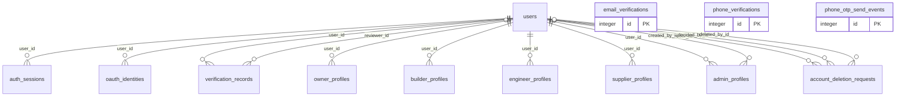

| Table | Target table (arch.txt section 10) | PK type | Parent tables (column -> table.column, ON DELETE) | Child tables (child.column, ON DELETE) | *_id columns with NO foreign key |
|---|---|---|---|---|---|
| `users` (User, app/models/user.py) | users | UUID | none | account_deletion_requests.user_id (SET NULL)<br>account_deletion_requests.decided_by_id (SET NULL)<br>account_deletion_requests.deleted_by_id (SET NULL)<br>admin_profiles.user_id (CASCADE)<br>admin_profiles.created_by_id (none)<br>advertisements.created_by_id (SET NULL)<br>audit_events.actor_id (none)<br>auth_sessions.user_id (CASCADE)<br>oauth_identities.user_id (CASCADE)<br>project_awards.builder_id (none)<br>award_offers.proposed_by_id (none)<br>cart_items.user_id (CASCADE)<br>cart_items.supplier_id (CASCADE)<br>daily_site_records.contractor_id (none)<br>daily_site_records.created_by_id (none)<br>builder_workers.contractor_id (none)<br>builder_offline_suppliers.contractor_id (none)<br>project_material_inventory.contractor_id (none)<br>site_material_usages.engineer_id (none)<br>engineer_profiles.user_id (CASCADE)<br>builder_engineer_memberships.contractor_id (CASCADE)<br>builder_engineer_memberships.engineer_id (CASCADE)<br>builder_engineer_invitations.contractor_id (CASCADE)<br>project_engineer_assignments.engineer_id (CASCADE)<br>equipment_items.supplier_id (CASCADE)<br>equipment_requests.supplier_id (CASCADE)<br>equipment_requests.engineer_id (CASCADE)<br>equipment_requests.contractor_id (CASCADE)<br>equipment_usage_logs.recorded_by_id (CASCADE)<br>estimates.owner_id (none)<br>labor_services.supplier_id (CASCADE)<br>labor_requests.supplier_id (CASCADE)<br>labor_requests.engineer_id (CASCADE)<br>labor_requests.contractor_id (CASCADE)<br>labor_daily_records.recorded_by_id (CASCADE)<br>master_products.created_by (model: none / DB via sql_scripts/master_catalog_seed.sql: SET NULL)<br>material_order_items.engineer_id (CASCADE)<br>material_order_items.supplier_id (CASCADE)<br>conversation_participants.user_id (none)<br>messages.sender_id (none)<br>messages.receiver_id (none)<br>notifications.user_id (none)<br>owner_profiles.user_id (none)<br>builder_profiles.user_id (none)<br>supplier_profiles.user_id (none)<br>projects.owner_id (none)<br>projects.contractor_id (none)<br>requests.sender_id (none)<br>requests.receiver_id (none)<br>project_timelines.created_by_id (none)<br>project_supplier_assignments.supplier_id (CASCADE)<br>project_supplier_assignments.engineer_id (CASCADE)<br>project_supplier_assignments.contractor_id (CASCADE)<br>property_listings.seller_id (CASCADE)<br>reports.reporter_id (none)<br>reports.resolved_by_id (none)<br>reviews.reviewer_id (none)<br>reviews.reviewee_id (none)<br>store_items.store_manager_id (CASCADE)<br>store_site_requests.store_manager_id (CASCADE)<br>store_site_requests.engineer_id (CASCADE)<br>store_purchase_receipts.store_manager_id (CASCADE)<br>store_payment_records.store_manager_id (CASCADE)<br>store_payment_records.supplier_id (SET NULL)<br>store_builder_requests.store_manager_id (CASCADE)<br>store_builder_requests.builder_id (CASCADE)<br>supplier_products.supplier_id (none)<br>support_tickets.user_id (SET NULL)<br>support_ticket_messages.author_user_id (SET NULL)<br>uploaded_files.owner_id (none)<br>verification_records.user_id (CASCADE)<br>verification_records.reviewer_id (none)<br>payment_orders.customer_id (CASCADE)<br>subscription_payments.builder_id (CASCADE)<br>builder_subscriptions.builder_id (CASCADE)<br>daily_record_adjustments.builder_id (SET NULL)<br>subscription_coupons.created_by_id (SET NULL)<br>subscription_coupons.updated_by_id (SET NULL)<br>subscription_coupon_redemptions.builder_id (CASCADE)<br>weather_site_locations.user_id (CASCADE)<br>weather_site_locations.updated_by (SET NULL)<br>weather_snapshots.user_id (CASCADE)<br>weather_alerts.user_id (CASCADE)<br>weather_alert_acknowledgements.user_id (CASCADE) | none |
| `auth_sessions` (AuthSession, app/models/auth_session.py) | user_sessions | UUID | user_id -> users.id (CASCADE) | none | ⚠ NO FK `token_family_id`: groups one refresh-token family; not a row reference<br>⚠ NO FK `replaced_by_session_id`: self-reference to auth_sessions.id without an FK |
| `oauth_identities` (OAuthIdentity, app/models/auth_session.py) | user_oauth_identities | UUID | user_id -> users.id (CASCADE) | none | none |
| `email_verifications` (EmailVerification, app/models/email_verification.py) | email_verification_codes | integer | none | none | none |
| `phone_verifications` (PhoneVerification, app/models/phone_verification.py) | phone_verification_codes | integer | none | none | none |
| `phone_otp_send_events` (PhoneOtpSendEvent, app/models/phone_verification.py) | otp_send_events | integer | none | none | none |
| `verification_records` (VerificationRecord, app/models/verification.py) | user_verification_reviews | integer | user_id -> users.id (CASCADE)<br>reviewer_id -> users.id (none) | none | none |
| `owner_profiles` (OwnerProfile, app/models/profiles.py) | owner_profiles | integer | user_id -> users.id (none) | none | none |
| `builder_profiles` (ContractorProfile, app/models/profiles.py) | builder_profiles | integer | user_id -> users.id (none) | none | none |
| `engineer_profiles` (EngineerProfile, app/models/engineer.py) | engineer_profiles | integer | user_id -> users.id (CASCADE) | none | none |
| `supplier_profiles` (SupplierProfile, app/models/profiles.py) | supplier_profiles | integer | user_id -> users.id (none) | none | none |
| `admin_profiles` (AdminProfile, app/models/admin.py) | admin_profiles | integer | user_id -> users.id (CASCADE)<br>created_by_id -> users.id (none) | none | none |
| `account_deletion_requests` (AccountDeletionRequest, app/models/account_deletion.py) | account_deletion_requests | integer | user_id -> users.id (SET NULL)<br>decided_by_id -> users.id (SET NULL)<br>deleted_by_id -> users.id (SET NULL) | none | ⚠ NO FK `original_user_id`: users.id kept as a plain value after the account is deleted (model comment) |

#### Projects

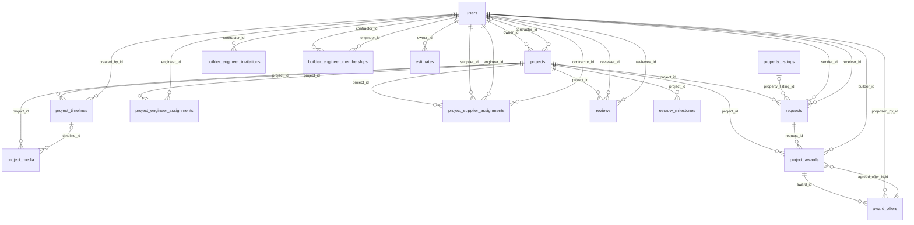

| Table | Target table (arch.txt section 10) | PK type | Parent tables (column -> table.column, ON DELETE) | Child tables (child.column, ON DELETE) | *_id columns with NO foreign key |
|---|---|---|---|---|---|
| `projects` (Project, app/models/project.py) | projects | integer | owner_id -> users.id (none)<br>contractor_id -> users.id (none) | project_awards.project_id (none)<br>cart_items.project_id (CASCADE)<br>daily_site_records.project_id (none)<br>project_material_inventory.project_id (none)<br>site_material_usages.project_id (none)<br>project_engineer_assignments.project_id (CASCADE)<br>equipment_requests.project_id (CASCADE)<br>labor_requests.project_id (CASCADE)<br>material_logs.project_id (none)<br>labour_logs.project_id (none)<br>material_order_items.project_id (CASCADE)<br>requests.project_id (none)<br>project_timelines.project_id (none)<br>project_media.project_id (none)<br>escrow_milestones.project_id (none)<br>project_supplier_assignments.project_id (CASCADE)<br>property_listings.source_project_id (SET NULL)<br>reviews.project_id (none)<br>store_site_requests.project_id (CASCADE)<br>store_payment_records.project_id (SET NULL)<br>daily_record_adjustments.project_id (CASCADE)<br>weather_site_locations.project_id (CASCADE)<br>weather_snapshots.project_id (CASCADE)<br>weather_alerts.project_id (CASCADE) | none |
| `project_media` (ProjectImage, app/models/project.py) | project_photos | integer | project_id -> projects.id (none)<br>timeline_id -> project_timelines.id (none) | none | none |
| `project_timelines` (ProjectTimeline, app/models/project.py) | project_timeline_entries | integer | project_id -> projects.id (none)<br>created_by_id -> users.id (none) | project_media.timeline_id (none) | none |
| `requests` (ProjectRequest, app/models/project.py) | project_requests + property_enquiries (split) | integer | project_id -> projects.id (none)<br>property_listing_id -> property_listings.id (CASCADE)<br>sender_id -> users.id (none)<br>receiver_id -> users.id (none) | project_awards.request_id (none) | none |
| `project_awards` (ProjectAward, app/models/award.py) | project_awards | integer | project_id -> projects.id (none)<br>request_id -> requests.id (none)<br>builder_id -> users.id (none)<br>agreed_offer_id,id -> award_offers.id + award_offers.award_id (none) | award_offers.award_id (none) | none |
| `award_offers` (AwardOffer, app/models/award.py) | project_award_offers | integer | award_id -> project_awards.id (none)<br>proposed_by_id -> users.id (none) | project_awards.agreed_offer_id,id (none) | none |
| `project_engineer_assignments` (ProjectEngineer, app/models/engineer.py) | project_engineer_assignments | integer | project_id -> projects.id (CASCADE)<br>engineer_id -> users.id (CASCADE) | none | none |
| `project_supplier_assignments` (ProjectSupplier, app/models/project_supplier.py) | project_supplier_assignments | integer | project_id -> projects.id (CASCADE)<br>supplier_id -> users.id (CASCADE)<br>engineer_id -> users.id (CASCADE)<br>contractor_id -> users.id (CASCADE) | equipment_requests.supplier_assignment_id (CASCADE)<br>labor_requests.supplier_assignment_id (CASCADE) | none |
| `builder_engineer_invitations` (EngineerInvitation, app/models/engineer.py) | team_invitations | integer | contractor_id -> users.id (CASCADE) | none | none |
| `builder_engineer_memberships` (ContractorEngineer, app/models/engineer.py) | team_memberships | integer | contractor_id -> users.id (CASCADE)<br>engineer_id -> users.id (CASCADE) | none | none |
| `estimates` (Estimate, app/models/estimate.py) | cost_estimates | integer | owner_id -> users.id (none) | none | none |
| `reviews` (Review, app/models/review.py) | (removed) | integer | project_id -> projects.id (none)<br>reviewer_id -> users.id (none)<br>reviewee_id -> users.id (none) | none | none |
| `escrow_milestones` (EscrowMilestone, app/models/project.py) | (removed) | integer | project_id -> projects.id (none) | none | none |

#### Site records (daily records etc.)

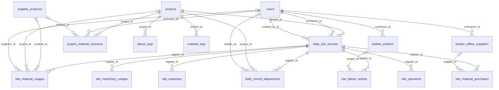

| Table | Target table (arch.txt section 10) | PK type | Parent tables (column -> table.column, ON DELETE) | Child tables (child.column, ON DELETE) | *_id columns with NO foreign key |
|---|---|---|---|---|---|
| `daily_site_records` (DailyCostRegister, app/models/daily_cost.py) | site_daily_records | integer | project_id -> projects.id (none)<br>contractor_id -> users.id (none)<br>created_by_id -> users.id (none) | site_labour_entries.register_id (none)<br>site_material_usages.register_id (none)<br>site_material_purchases.register_id (none)<br>site_expenses.register_id (none)<br>site_machinery_usages.register_id (none)<br>site_payments.register_id (none)<br>daily_record_adjustments.register_id (CASCADE) | none |
| `site_labour_entries` (CostLabourEntry, app/models/daily_cost.py) | site_labour_entries | integer | register_id -> daily_site_records.id (none)<br>worker_id -> builder_workers.id (none) | none | none |
| `site_material_usages` (CostMaterialUsage, app/models/daily_cost.py) | site_material_usages | integer | register_id -> daily_site_records.id (none)<br>product_id -> supplier_products.id (none)<br>project_id -> projects.id (none)<br>engineer_id -> users.id (none) | none | none |
| `site_material_purchases` (CostMaterialPurchase, app/models/daily_cost.py) | site_material_purchases | integer | register_id -> daily_site_records.id (none)<br>supplier_id -> builder_offline_suppliers.id (none) | none | none |
| `site_machinery_usages` (CostMachineryUsage, app/models/daily_cost.py) | site_machinery_usages | integer | register_id -> daily_site_records.id (none) | none | none |
| `site_expenses` (CostExpense, app/models/daily_cost.py) | site_expenses | integer | register_id -> daily_site_records.id (none) | none | none |
| `site_payments` (CostPayment, app/models/daily_cost.py) | site_payments | integer | register_id -> daily_site_records.id (none) | none | none |
| `daily_record_adjustments` (DailyRecordAdjustment, app/subscription/models.py) | site_daily_record_adjustments | integer | register_id -> daily_site_records.id (CASCADE)<br>project_id -> projects.id (CASCADE)<br>builder_id -> users.id (SET NULL) | none | none |
| `project_material_inventory` (CostMaterialInventory, app/models/daily_cost.py) | project_material_stock | integer | project_id -> projects.id (none)<br>contractor_id -> users.id (none)<br>product_id -> supplier_products.id (none) | none | none |
| `builder_workers` (CostWorker, app/models/daily_cost.py) | builder_workers | integer | contractor_id -> users.id (none) | site_labour_entries.worker_id (none) | none |
| `builder_offline_suppliers` (CostSupplier, app/models/daily_cost.py) | builder_offline_suppliers | integer | contractor_id -> users.id (none) | site_material_purchases.supplier_id (none) | none |
| `labour_logs` (LabourLog, app/models/logs.py) | legacy_labour_logs | integer | project_id -> projects.id (none) | none | none |
| `material_logs` (MaterialLog, app/models/logs.py) | legacy_material_logs | integer | project_id -> projects.id (none) | none | none |

#### Catalog

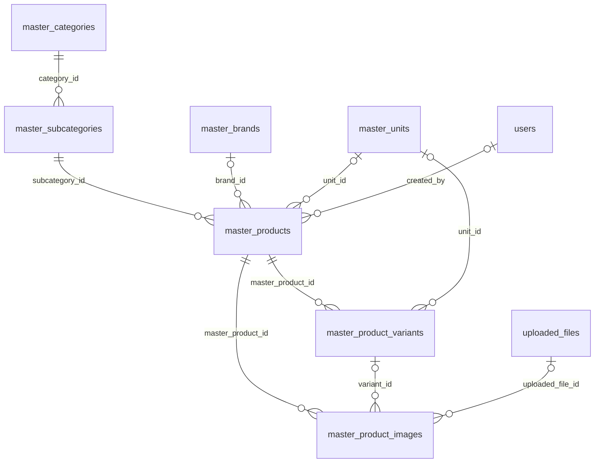

| Table | Target table (arch.txt section 10) | PK type | Parent tables (column -> table.column, ON DELETE) | Child tables (child.column, ON DELETE) | *_id columns with NO foreign key |
|---|---|---|---|---|---|
| `master_categories` (MasterCategory, app/models/master_catalog.py) | catalog_categories | integer | none | master_subcategories.category_id (model: none / DB via sql_scripts/master_catalog_seed.sql: RESTRICT) | none |
| `master_subcategories` (MasterSubcategory, app/models/master_catalog.py) | catalog_subcategories | integer | category_id -> master_categories.id (model: none / DB via sql_scripts/master_catalog_seed.sql: RESTRICT) | master_products.subcategory_id (model: none / DB via sql_scripts/master_catalog_seed.sql: RESTRICT) | none |
| `master_brands` (MasterBrand, app/models/master_catalog.py) | catalog_brands | integer | none | master_products.brand_id (model: none / DB via sql_scripts/master_catalog_seed.sql: RESTRICT) | none |
| `master_units` (MasterUnit, app/models/master_catalog.py) | catalog_units | integer | none | master_products.unit_id (model: none / DB via sql_scripts/master_catalog_seed.sql: RESTRICT)<br>master_product_variants.unit_id (model: none / DB via sql_scripts/master_catalog_seed.sql: RESTRICT) | none |
| `master_products` (MasterProduct, app/models/master_catalog.py) | catalog_products | integer | subcategory_id -> master_subcategories.id (model: none / DB via sql_scripts/master_catalog_seed.sql: RESTRICT)<br>brand_id -> master_brands.id (model: none / DB via sql_scripts/master_catalog_seed.sql: RESTRICT)<br>unit_id -> master_units.id (model: none / DB via sql_scripts/master_catalog_seed.sql: RESTRICT)<br>created_by -> users.id (model: none / DB via sql_scripts/master_catalog_seed.sql: SET NULL) | master_product_variants.master_product_id (CASCADE)<br>master_product_images.master_product_id (CASCADE)<br>supplier_products.master_product_id (model: none / DB via sql_scripts/master_catalog_seed.sql: RESTRICT) | none |
| `master_product_variants` (MasterProductVariant, app/models/master_catalog.py) | catalog_product_variants | integer | master_product_id -> master_products.id (CASCADE)<br>unit_id -> master_units.id (model: none / DB via sql_scripts/master_catalog_seed.sql: RESTRICT) | master_product_images.variant_id (CASCADE)<br>supplier_products.master_variant_id (model: none / DB via sql_scripts/master_catalog_seed.sql: RESTRICT) | none |
| `master_product_images` (MasterProductImage, app/models/master_catalog.py) | catalog_product_media | integer | master_product_id -> master_products.id (CASCADE)<br>variant_id -> master_product_variants.id (CASCADE)<br>uploaded_file_id -> uploaded_files.id (model: none / DB via sql_scripts/master_catalog_seed.sql: SET NULL) | none | none |

#### Marketplace (supplier products, cart, material orders)

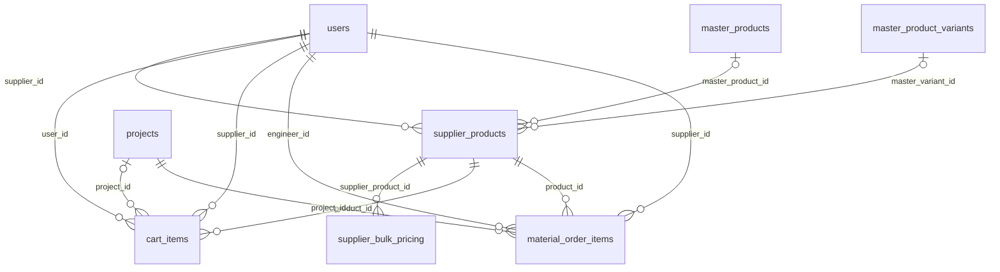

| Table | Target table (arch.txt section 10) | PK type | Parent tables (column -> table.column, ON DELETE) | Child tables (child.column, ON DELETE) | *_id columns with NO foreign key |
|---|---|---|---|---|---|
| `supplier_products` (SupplierProduct, app/models/supplier_product.py) | supplier_listings | integer | supplier_id -> users.id (none)<br>master_product_id -> master_products.id (model: none / DB via sql_scripts/master_catalog_seed.sql: RESTRICT)<br>master_variant_id -> master_product_variants.id (model: none / DB via sql_scripts/master_catalog_seed.sql: RESTRICT) | cart_items.product_id (CASCADE)<br>project_material_inventory.product_id (none)<br>site_material_usages.product_id (none)<br>material_order_items.product_id (none)<br>supplier_bulk_pricing.supplier_product_id (CASCADE) | none |
| `supplier_bulk_pricing` (SupplierBulkPrice, app/models/supplier_bulk_pricing.py) | supplier_listing_price_tiers | integer | supplier_product_id -> supplier_products.id (CASCADE) | none | none |
| `cart_items` (CartItem, app/models/cart.py) | cart_items | integer | user_id -> users.id (CASCADE)<br>project_id -> projects.id (CASCADE)<br>supplier_id -> users.id (CASCADE)<br>product_id -> supplier_products.id (CASCADE) | none | none |
| `material_order_items` (SupplierMaterialRequest, app/models/material_request.py) | purchase_orders + purchase_order_items (split) | integer | project_id -> projects.id (CASCADE)<br>engineer_id -> users.id (CASCADE)<br>supplier_id -> users.id (CASCADE)<br>product_id -> supplier_products.id (none) | store_purchase_receipts.order_line_id (CASCADE) | none |

#### Store

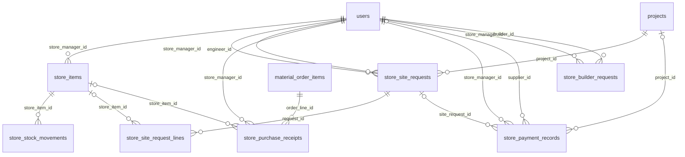

| Table | Target table (arch.txt section 10) | PK type | Parent tables (column -> table.column, ON DELETE) | Child tables (child.column, ON DELETE) | *_id columns with NO foreign key |
|---|---|---|---|---|---|
| `store_items` (StoreItem, app/models/store.py) | store_items | integer | store_manager_id -> users.id (CASCADE) | store_stock_movements.store_item_id (CASCADE)<br>store_site_request_lines.store_item_id (SET NULL)<br>store_purchase_receipts.store_item_id (SET NULL) | none |
| `store_stock_movements` (StoreStockMovement, app/models/store.py) | store_stock_movements | integer | store_item_id -> store_items.id (CASCADE) | none | none |
| `store_site_requests` (StoreSiteRequest, app/models/store.py) | store_site_requests | integer | store_manager_id -> users.id (CASCADE)<br>engineer_id -> users.id (CASCADE)<br>project_id -> projects.id (CASCADE) | store_site_request_lines.request_id (CASCADE)<br>store_payment_records.site_request_id (SET NULL) | ⚠ NO FK `public_request_id`: public UUID for this row (migration 0049); not a reference |
| `store_site_request_lines` (StoreSiteRequestLine, app/models/store.py) | store_site_request_items | integer | request_id -> store_site_requests.id (CASCADE)<br>store_item_id -> store_items.id (SET NULL) | none | none |
| `store_purchase_receipts` (StorePurchaseReceipt, app/models/store.py) | store_goods_receipts | integer | order_line_id -> material_order_items.id (CASCADE)<br>store_manager_id -> users.id (CASCADE)<br>store_item_id -> store_items.id (SET NULL) | none | none |
| `store_payment_records` (StorePaymentRecord, app/models/store.py) | store_payments | integer | store_manager_id -> users.id (CASCADE)<br>supplier_id -> users.id (SET NULL)<br>project_id -> projects.id (SET NULL)<br>site_request_id -> store_site_requests.id (SET NULL) | none | ⚠ NO FK `razorpay_order_id`: Razorpay gateway id (external)<br>⚠ NO FK `razorpay_payment_id`: Razorpay gateway id (external) |
| `store_builder_requests` (StoreBuilderRequest, app/models/store.py) | store_builder_requests | integer | store_manager_id -> users.id (CASCADE)<br>builder_id -> users.id (CASCADE) | none | none |

#### Labour

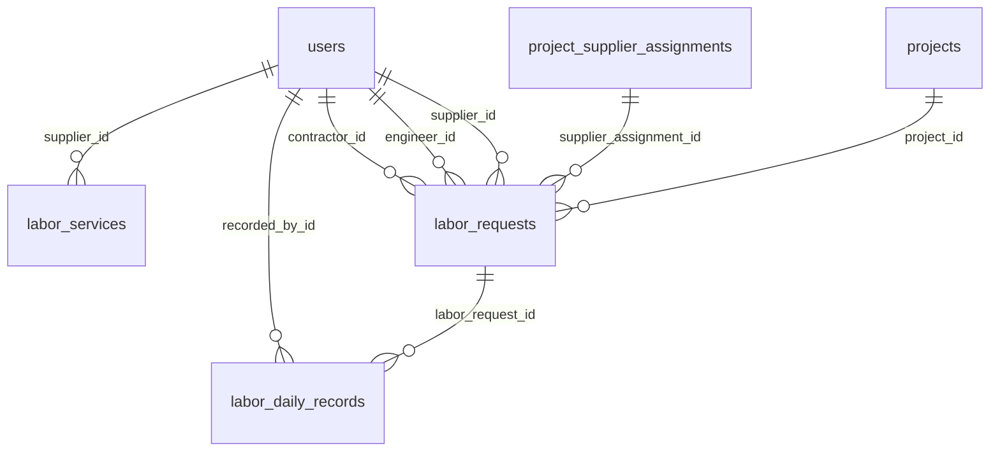

| Table | Target table (arch.txt section 10) | PK type | Parent tables (column -> table.column, ON DELETE) | Child tables (child.column, ON DELETE) | *_id columns with NO foreign key |
|---|---|---|---|---|---|
| `labor_services` (LaborService, app/models/labor.py) | labour_services | integer | supplier_id -> users.id (CASCADE) | none | none |
| `labor_requests` (LaborRequest, app/models/labor.py) | labour_requests | integer | project_id -> projects.id (CASCADE)<br>supplier_assignment_id -> project_supplier_assignments.id (CASCADE)<br>supplier_id -> users.id (CASCADE)<br>engineer_id -> users.id (CASCADE)<br>contractor_id -> users.id (CASCADE) | labor_daily_records.labor_request_id (CASCADE) | none |
| `labor_daily_records` (LaborDailyRecord, app/models/labor.py) | labour_attendance_records | integer | labor_request_id -> labor_requests.id (CASCADE)<br>recorded_by_id -> users.id (CASCADE) | none | none |

#### Equipment

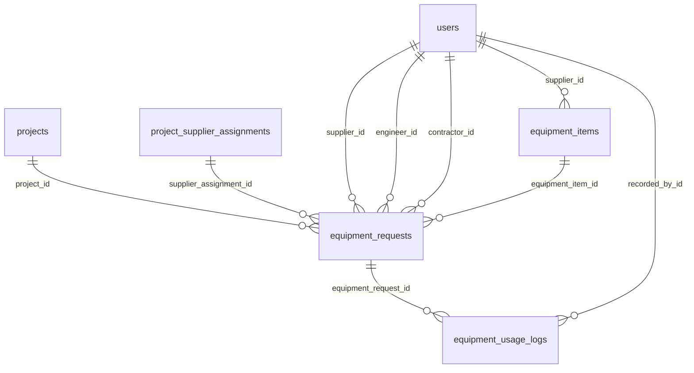

| Table | Target table (arch.txt section 10) | PK type | Parent tables (column -> table.column, ON DELETE) | Child tables (child.column, ON DELETE) | *_id columns with NO foreign key |
|---|---|---|---|---|---|
| `equipment_items` (EquipmentItem, app/models/equipment.py) | equipment_listings | integer | supplier_id -> users.id (CASCADE) | equipment_requests.equipment_item_id (NO ACTION) | none |
| `equipment_requests` (EquipmentRequest, app/models/equipment.py) | equipment_requests | integer | project_id -> projects.id (CASCADE)<br>supplier_assignment_id -> project_supplier_assignments.id (CASCADE)<br>supplier_id -> users.id (CASCADE)<br>engineer_id -> users.id (CASCADE)<br>contractor_id -> users.id (CASCADE)<br>equipment_item_id -> equipment_items.id (NO ACTION) | equipment_usage_logs.equipment_request_id (CASCADE) | none |
| `equipment_usage_logs` (EquipmentUsageLog, app/models/equipment.py) | equipment_usage_logs | integer | equipment_request_id -> equipment_requests.id (CASCADE)<br>recorded_by_id -> users.id (CASCADE) | none | none |

#### Messaging / notifications

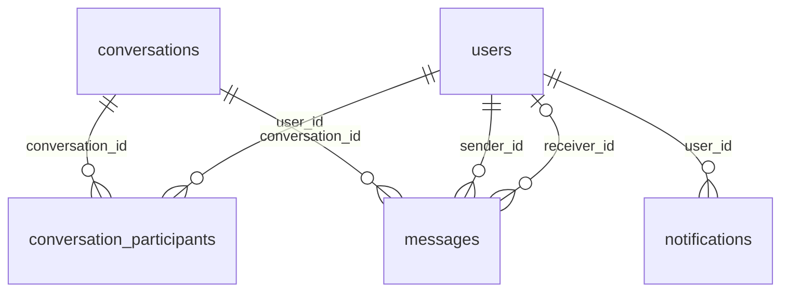

| Table | Target table (arch.txt section 10) | PK type | Parent tables (column -> table.column, ON DELETE) | Child tables (child.column, ON DELETE) | *_id columns with NO foreign key |
|---|---|---|---|---|---|
| `conversations` (Conversation, app/models/messaging.py) | conversations | integer | none | conversation_participants.conversation_id (none)<br>messages.conversation_id (none) | none |
| `conversation_participants` (ConversationParticipant, app/models/messaging.py) | conversation_participants | integer | conversation_id -> conversations.id (none)<br>user_id -> users.id (none) | none | none |
| `messages` (Message, app/models/messaging.py) | messages | integer | conversation_id -> conversations.id (none)<br>sender_id -> users.id (none)<br>receiver_id -> users.id (none) | none | none |
| `notifications` (Notification, app/models/notification.py) | notifications | integer | user_id -> users.id (none) | none | none |

#### CCTV

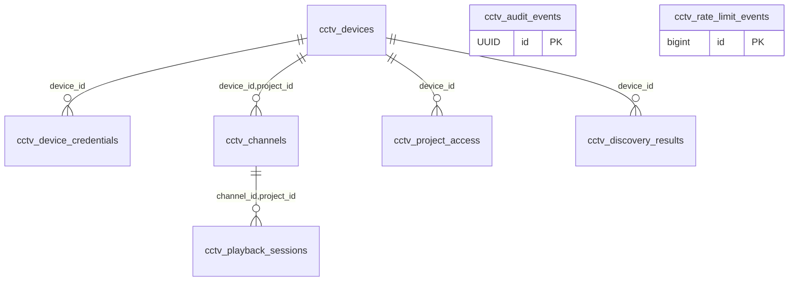

| Table | Target table (arch.txt section 10) | PK type | Parent tables (column -> table.column, ON DELETE) | Child tables (child.column, ON DELETE) | *_id columns with NO foreign key |
|---|---|---|---|---|---|
| `cctv_devices` (CctvDevice, app/models/cctv.py) | cctv_devices (same name) | UUID | none | cctv_device_credentials.device_id (CASCADE)<br>cctv_channels.device_id,project_id (CASCADE)<br>cctv_project_access.device_id (CASCADE)<br>cctv_discovery_results.device_id (CASCADE) | ⚠ NO FK `project_id`: means projects.id; deliberately no FK (cctv.py docstring)<br>⚠ NO FK `created_by_user_id`: means users.id; deliberately no FK (cctv.py docstring)<br>⚠ NO FK `updated_by_user_id`: means users.id; deliberately no FK (cctv.py docstring) |
| `cctv_device_credentials` (CctvDeviceCredential, app/models/cctv.py) | cctv_device_credentials (same name) | UUID | device_id -> cctv_devices.id (CASCADE) | none | ⚠ NO FK `created_by_user_id`: means users.id; deliberately no FK (cctv.py docstring)<br>⚠ NO FK `updated_by_user_id`: means users.id; deliberately no FK (cctv.py docstring) |
| `cctv_channels` (CctvChannel, app/models/cctv.py) | cctv_channels (same name) | UUID | device_id,project_id -> cctv_devices.id + cctv_devices.project_id (CASCADE) | cctv_playback_sessions.channel_id,project_id (CASCADE) | ⚠ NO FK `created_by_user_id`: means users.id; deliberately no FK (cctv.py docstring)<br>⚠ NO FK `updated_by_user_id`: means users.id; deliberately no FK (cctv.py docstring) |
| `cctv_playback_sessions` (CctvPlaybackSession, app/models/cctv.py) | cctv_playback_sessions (same name) | UUID | channel_id,project_id -> cctv_channels.id + cctv_channels.project_id (CASCADE) | none | ⚠ NO FK `viewer_user_id`: means users.id; deliberately no FK (cctv.py docstring) |
| `cctv_audit_events` (CctvAuditEvent, app/models/cctv.py) | cctv_audit_events (same name) | UUID | none | none | ⚠ NO FK `actor_user_id`: means users.id; deliberately no FK (cctv.py docstring)<br>⚠ NO FK `project_id`: means projects.id; deliberately no FK (cctv.py docstring)<br>⚠ NO FK `device_id`: means cctv_devices.id; no FK<br>⚠ NO FK `channel_id`: means cctv_channels.id; no FK<br>⚠ NO FK `playback_session_id`: means cctv_playback_sessions.id; no FK |
| `cctv_project_access` (CctvProjectAccess, app/models/cctv.py) | cctv_project_access (same name) | UUID | device_id -> cctv_devices.id (CASCADE) | none | ⚠ NO FK `project_id`: means projects.id; deliberately no FK (cctv.py docstring)<br>⚠ NO FK `user_id`: means users.id; deliberately no FK (cctv.py docstring) |
| `cctv_discovery_results` (CctvDiscoveryResult, app/models/cctv.py) | cctv_discovery_results (same name) | UUID | device_id -> cctv_devices.id (CASCADE) | none | ⚠ NO FK `project_id`: means projects.id; deliberately no FK (cctv.py docstring)<br>⚠ NO FK `user_id`: means users.id; deliberately no FK (cctv.py docstring) |
| `cctv_rate_limit_events` (CctvRateLimitEvent, app/models/cctv.py) | cctv_rate_limit_events (same name) | bigint (Identity) | none | none | none |

#### Billing (payment_*, subscription_*)

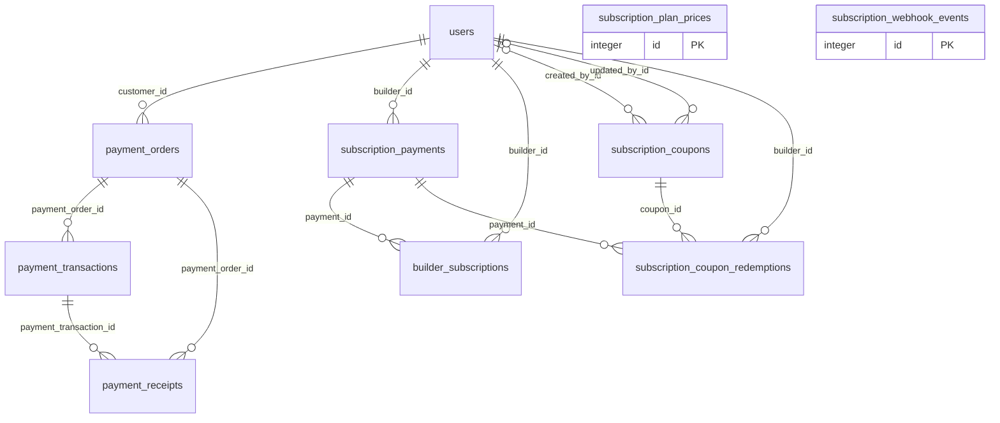

| Table | Target table (arch.txt section 10) | PK type | Parent tables (column -> table.column, ON DELETE) | Child tables (child.column, ON DELETE) | *_id columns with NO foreign key |
|---|---|---|---|---|---|
| `payment_orders` (PaymentOrder, app/payment_gateway/models.py) | booking_payment_orders | UUID | customer_id -> users.id (CASCADE) | payment_transactions.payment_order_id (CASCADE)<br>payment_receipts.payment_order_id (CASCADE) | ⚠ NO FK `booking_id`: Partner booking id (partner.service_requests); no cross-schema FK by design (payment_gateway/models.py docstring)<br>⚠ NO FK `razorpay_order_id`: Razorpay gateway id (external) |
| `payment_transactions` (PaymentTransaction, app/payment_gateway/models.py) | booking_payment_transactions | UUID | payment_order_id -> payment_orders.id (CASCADE) | payment_receipts.payment_transaction_id (CASCADE) | ⚠ NO FK `booking_id`: Partner booking id (partner.service_requests); no cross-schema FK by design (payment_gateway/models.py docstring)<br>⚠ NO FK `razorpay_payment_id`: Razorpay gateway id (external)<br>⚠ NO FK `razorpay_order_id`: Razorpay gateway id (external) |
| `payment_receipts` (PaymentReceipt, app/payment_gateway/models.py) | booking_payment_receipts | UUID | payment_order_id -> payment_orders.id (CASCADE)<br>payment_transaction_id -> payment_transactions.id (CASCADE) | none | ⚠ NO FK `booking_id`: Partner booking id (partner.service_requests); no cross-schema FK by design (payment_gateway/models.py docstring)<br>⚠ NO FK `razorpay_payment_id`: Razorpay gateway id (external)<br>⚠ NO FK `razorpay_order_id`: Razorpay gateway id (external) |
| `subscription_plan_prices` (SubscriptionPlanPrice, app/subscription/models.py) | subscription_plan_prices | integer | none | none | none |
| `subscription_payments` (SubscriptionPayment, app/subscription/models.py) | subscription_payments | UUID | builder_id -> users.id (CASCADE) | builder_subscriptions.payment_id (CASCADE)<br>subscription_coupon_redemptions.payment_id (CASCADE) | ⚠ NO FK `razorpay_order_id`: Razorpay gateway id (external)<br>⚠ NO FK `razorpay_payment_id`: Razorpay gateway id (external) |
| `builder_subscriptions` (BuilderSubscription, app/subscription/models.py) | builder_subscriptions | UUID | builder_id -> users.id (CASCADE)<br>payment_id -> subscription_payments.id (CASCADE) | none | none |
| `subscription_webhook_events` (SubscriptionWebhookEvent, app/subscription/models.py) | payment_webhook_events | integer | none | none | ⚠ NO FK `event_id`: Razorpay webhook event id (external) |
| `subscription_coupons` (SubscriptionCoupon, app/subscription/models.py) | subscription_coupons | integer | created_by_id -> users.id (SET NULL)<br>updated_by_id -> users.id (SET NULL) | subscription_coupon_redemptions.coupon_id (CASCADE) | none |
| `subscription_coupon_redemptions` (SubscriptionCouponRedemption, app/subscription/models.py) | subscription_coupon_redemptions | integer | coupon_id -> subscription_coupons.id (CASCADE)<br>payment_id -> subscription_payments.id (CASCADE)<br>builder_id -> users.id (CASCADE) | none | none |

#### Weather

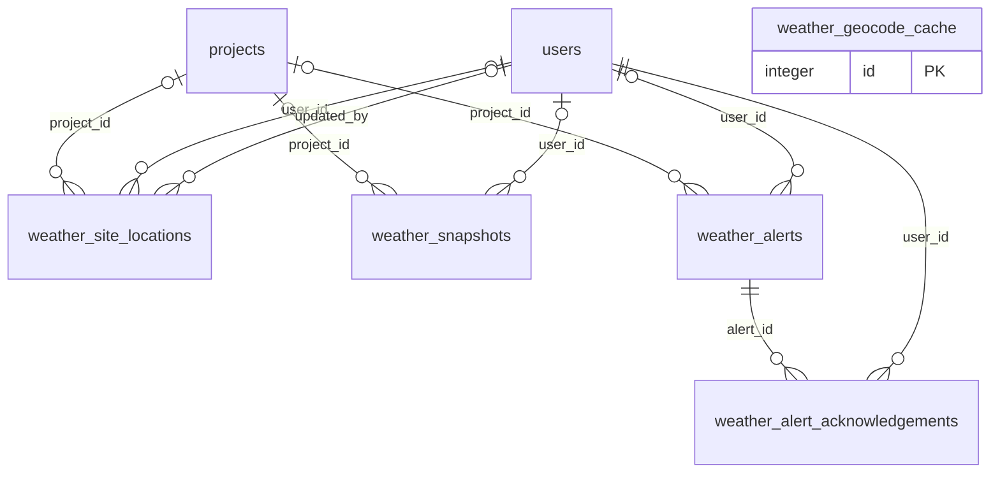

| Table | Target table (arch.txt section 10) | PK type | Parent tables (column -> table.column, ON DELETE) | Child tables (child.column, ON DELETE) | *_id columns with NO foreign key |
|---|---|---|---|---|---|
| `weather_site_locations` (WeatherSiteLocation, app/weather/models/weather_models.py) | weather_site_locations (same name) | integer | project_id -> projects.id (CASCADE)<br>user_id -> users.id (CASCADE)<br>updated_by -> users.id (SET NULL) | none | none |
| `weather_geocode_cache` (WeatherGeocodeCache, app/weather/models/weather_models.py) | weather_geocode_cache (same name) | integer | none | none | none |
| `weather_snapshots` (WeatherSnapshot, app/weather/models/weather_models.py) | weather_snapshots (same name) | integer | project_id -> projects.id (CASCADE)<br>user_id -> users.id (CASCADE) | none | none |
| `weather_alerts` (WeatherAlert, app/weather/models/weather_models.py) | weather_alerts (same name) | integer | project_id -> projects.id (CASCADE)<br>user_id -> users.id (CASCADE) | weather_alert_acknowledgements.alert_id (CASCADE) | ⚠ NO FK `provider_alert_id`: weather provider's alert id (external) |
| `weather_alert_acknowledgements` (WeatherAlertAcknowledgement, app/weather/models/weather_models.py) | weather_alert_acknowledgements (same name) | integer | alert_id -> weather_alerts.id (CASCADE)<br>user_id -> users.id (CASCADE) | none | none |

#### Property

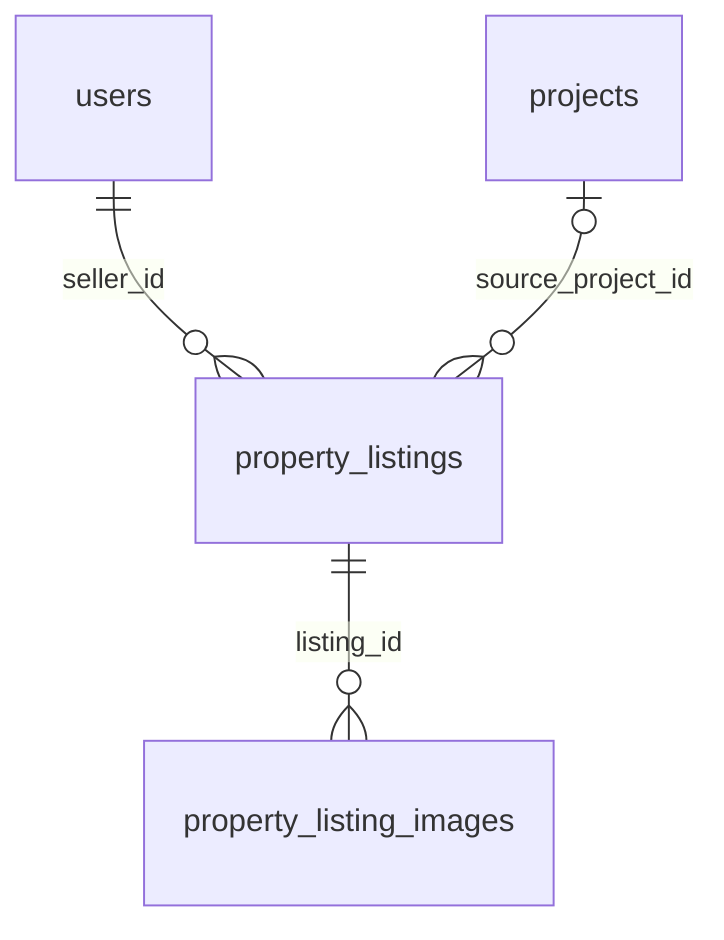

| Table | Target table (arch.txt section 10) | PK type | Parent tables (column -> table.column, ON DELETE) | Child tables (child.column, ON DELETE) | *_id columns with NO foreign key |
|---|---|---|---|---|---|
| `property_listings` (PropertyListing, app/models/property_listing.py) | property_listings | integer | seller_id -> users.id (CASCADE)<br>source_project_id -> projects.id (SET NULL) | requests.property_listing_id (CASCADE)<br>property_listing_images.listing_id (CASCADE) | none |
| `property_listing_images` (PropertyListingImage, app/models/property_listing.py) | property_listing_images | integer | listing_id -> property_listings.id (CASCADE) | none | none |

#### Admin / support / ads

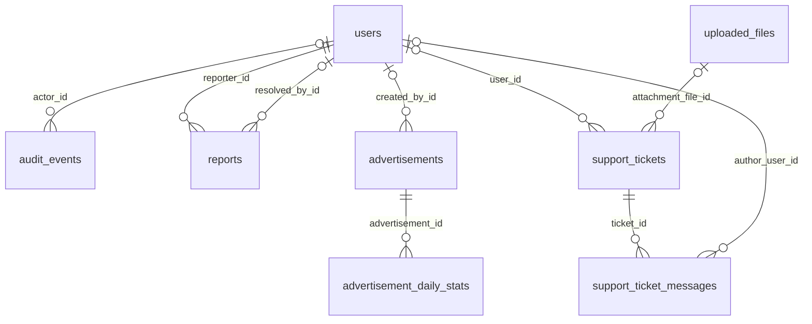

| Table | Target table (arch.txt section 10) | PK type | Parent tables (column -> table.column, ON DELETE) | Child tables (child.column, ON DELETE) | *_id columns with NO foreign key |
|---|---|---|---|---|---|
| `audit_events` (AdminAuditLog, app/models/audit.py) | admin_audit_logs | integer | actor_id -> users.id (none) | none | ⚠ NO FK `target_id`: polymorphic String(64); meaning depends on target_type |
| `reports` (Report, app/models/report.py) | user_reports | integer | reporter_id -> users.id (none)<br>resolved_by_id -> users.id (none) | none | ⚠ NO FK `subject_id`: polymorphic String(64); project id or user UUID depending on subject_type (migration 0007) |
| `advertisements` (Advertisement, app/models/advertisement.py) | ads | integer | created_by_id -> users.id (SET NULL) | advertisement_daily_stats.advertisement_id (CASCADE) | none |
| `advertisement_daily_stats` (AdvertisementStat, app/models/advertisement.py) | ad_daily_stats | integer | advertisement_id -> advertisements.id (CASCADE) | none | none |
| `support_tickets` (SupportTicket, app/models/support.py) | support_tickets | integer | user_id -> users.id (SET NULL)<br>attachment_file_id -> uploaded_files.id (SET NULL) | support_ticket_messages.ticket_id (CASCADE) | ⚠ NO FK `client_request_id`: idempotency key sent by the client; not a reference |
| `support_ticket_messages` (SupportTicketMessage, app/models/support.py) | support_ticket_messages | integer | ticket_id -> support_tickets.id (CASCADE)<br>author_user_id -> users.id (SET NULL) | none | none |

#### Files

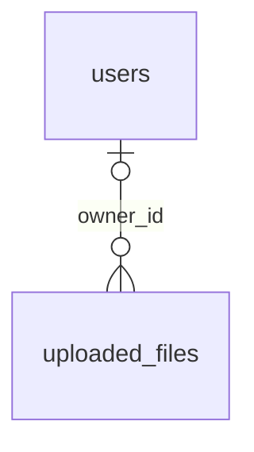

| Table | Target table (arch.txt section 10) | PK type | Parent tables (column -> table.column, ON DELETE) | Child tables (child.column, ON DELETE) | *_id columns with NO foreign key |
|---|---|---|---|---|---|
| `uploaded_files` (UploadedFile, app/models/uploaded_file.py) | files | integer | owner_id -> users.id (none) | master_product_images.uploaded_file_id (model: none / DB via sql_scripts/master_catalog_seed.sql: SET NULL)<br>support_tickets.attachment_file_id (SET NULL) | none |

#### Other

Empty. Every one of the 98 tables belongs to one of the areas above.

### 7.2 Partner (schema `partner`)

Sources read: every file in `Partner/backend/app/models/*.py` (the registry is `app/models/entities.py`), `Partner/backend/app/database/session.py`, `Partner/backend/alembic/env.py`, and every revision in `Partner/backend/alembic/versions/` (0001 to 0015). The model metadata was also loaded in Python (import only, no database connection) to list every column, FK, PK, index and unique constraint. Each model column, index and CHECK name was then checked against the migration sources.

#### Summary counts

| Item | Count | Notes |
|---|---|---|
| Tables mapped by Partner models | 24 | 22 in schema `partner` (owned and migrated by Partner) + 2 in schema `octabuild` (`users`, `engineer_profiles`), mapped read-only and never migrated by Partner |
| Other tables Partner creates | 1 | `partner.partner_alembic_version`, the Alembic version table. It is not a model. |
| Foreign keys created by Partner migrations (live at head 0015) | 28 | 27 inside `partner`, 1 cross-schema `partner` to `octabuild` |
| FK declared only in a Partner model, on an Octabuild table | 1 | `octabuild.engineer_profiles.user_id -> octabuild.users.id`. It is declared in `app/models/octabuild_account.py::OctabuildEngineerProfile` without `ondelete`. The real constraint belongs to Octabuild (`Octabuild/backend/app/models/engineer.py` declares it `ondelete="CASCADE"`). |
| FKs created and later dropped | 1 | `fk_service_request_tracking_technician_id_users` (created in 0003, dropped in 0014) |
| `*_id` columns with no FK | 5 | `auth_sessions.user_id`, `auth_sessions.token_family_id`, `auth_sessions.replaced_by_session_id`, `service_request_media.uploaded_by_requester_id`, `service_request_start_otps.requested_by_user_id` |
| Primary key type | UUID on every `partner` table | All use `gen_random_uuid()` as the server default, except `auth_sessions.id`, which only has the Python `uuid.uuid4` default. 3 tables have no own `id`: composite PKs on `technician_services` and `technician_working_hours` and `service_request_rating_tags`, and a PK that is also an FK on `technician_locations` and `service_request_tracking`. `octabuild.users.id` is UUID and `octabuild.engineer_profiles.id` is INTEGER. |

#### Cross-schema links (both directions)

| # | From | To | Kind | ON DELETE | Created by |
|---|---|---|---|---|---|
| 1 | `partner.service_requests.requested_by_user_id` | `octabuild.users.id` | **Real FK** (`fk_service_requests_requested_by_user_id_octabuild_users`) | CASCADE | `0001_partner_initial.upgrade` creates it as column `house_owner_id` with constraint `fk_service_requests_house_owner_id_octabuild_users`. The column type is read from the catalogue by `octabuild_house_owner_id_type()`, or from `-x octabuild_user_id_type` in offline mode. `0002_onboarding_booking.upgrade` renames the column to `requested_by_user_id`, renames the constraint, and renames the index to `ix_service_requests_requested_by_user_id`. The model is `app/models/service_request.py::ServiceRequest.requested_by_user_id` with `ForeignKey("octabuild.users.id", ondelete="CASCADE")`. |
| 2 | `octabuild.engineer_profiles.user_id` | `octabuild.users.id` | FK inside Octabuild's schema that Partner only mirrors in its model | none in the Partner model; CASCADE in Octabuild's own model | Not created by Partner, because `alembic/env.py::partner_owns` and `include_name` exclude every object outside `partner`. Partner's declaration is in `app/models/octabuild_account.py::OctabuildEngineerProfile`. |
| 3 | `octabuild.payment_orders.booking_id` | `partner.service_requests.id` | Logical reference, **⚠ NO FK** | n/a | Octabuild `app/payment_gateway/models.py` (Octabuild revision 0019_payment_tables, per the docstring). The docstring says "without a foreign key across the two applications' schemas". |
| 4 | `octabuild.payment_transactions.booking_id` | `partner.service_requests.id` | Logical reference, **⚠ NO FK** | n/a | Same file as row 3 |
| 5 | `octabuild.payment_receipts.booking_id` | `partner.service_requests.id` | Logical reference, **⚠ NO FK** (unique) | n/a | Same file as row 3 |
| 6 | `partner.service_request_media.uploaded_by_requester_id` | `octabuild.users.id` (meaning, per the `0006_job_execution` comment "No foreign key: see the module docstring") | Logical reference, **⚠ NO FK** | n/a | `0006_job_execution.upgrade` |
| 7 | `partner.service_request_start_otps.requested_by_user_id` | `octabuild.users.id` (meaning; the requester who asked for the code) | Logical reference, **⚠ NO FK** | n/a | `0012_start_work_otp.upgrade` |
| 8 | `partner.auth_sessions.user_id` | `partner.users.id` when `principal_type='technician'`, `octabuild.users.id` when `principal_type='requester'` | Polymorphic, **⚠ NO FK** | n/a | `0015_auth_sessions.upgrade`. The `app/models/auth_session.py` docstring says it "has no foreign key: it points at one of two tables". |

Cross-schema raw SQL reads that are not FKs but break if tables or columns are renamed:
- Octabuild `app/payment_gateway/repository.py`: the `BOOKING_COLUMNS` and `BOOKING_FROM` constants read `partner.service_requests` (`id, requested_by_user_id, requested_by_role, status, technician_type, quoted_amount, currency, completed_at, service_id, technician_id`), `partner.services` (`service_name`) and `partner.users` (`name`).
- Octabuild `app/shared/account/repositories/purge_repository.py::count_open_partner_bookings` uses `to_regclass('partner.service_requests')` and counts by `requested_by_user_id` and `status`. Its docstring relies on the ON DELETE CASCADE of link 1.
- Octabuild `alembic/versions/0007_user_id_to_uuid.py` (per its docstring) converts every FK into `octabuild.users` in any schema, so it can reach link 1.

Note: target section 11 says `bookings.requested_by_user_id` "FK to professional.users becomes RESTRICT". Today it is CASCADE (migrations 0001 and 0002, and the model). Target 11.1 says Partner stops mapping `professional.users` and `engineer_profiles` and reads the view `professional.v_partner_requesters` instead.

#### Schema configuration and Alembic version table

| Item | Value | Where |
|---|---|---|
| Partner schema | Hard-coded constant `PARTNER_SCHEMA = "partner"`, applied to every model through `MetaData(schema=PARTNER_SCHEMA, naming_convention={"ix": "ix_%(table_name)s_%(column_0_name)s"})`. There is **no setting or env var** for it. | `Partner/backend/app/database/session.py` |
| Octabuild/Professional schema | Hard-coded constant `OCTABUILD_SCHEMA = "octabuild"`, used in `__table_args__` of `OctabuildUser` and `OctabuildEngineerProfile`. There is **no setting or env var**. The string `"octabuild.users.id"` is also written literally in the `ForeignKey(...)` of `ServiceRequest.requested_by_user_id` and `OctabuildEngineerProfile.user_id`, and in `0001_partner_initial` (`["octabuild.users.id"]`). A rename to `professional` has to touch all of these places. | `app/database/session.py`, `app/models/octabuild_account.py`, `app/models/service_request.py`, `alembic/versions/0001_partner_initial.py` |
| Migrations' schema | Every revision defines its own local `SCHEMA = "partner"` constant | each `alembic/versions/00xx_*.py` |
| Database connection | Setting `database_url` (env `DATABASE_URL`), shared with the Octabuild database | `app/core/config.py` (the value is not printed) |
| Alembic version table | `partner.partner_alembic_version`: `VERSION_TABLE = "partner_alembic_version"`, with `version_table_schema=PARTNER_SCHEMA`. `CREATE SCHEMA IF NOT EXISTS "partner"` runs before migrations. The name deliberately avoids the `alembic_version*` prefix so Octabuild's autogenerate filter does not claim it. | `Partner/backend/alembic/env.py::configure`, `run_migrations_online` and `run_migrations_offline` |
| Autogenerate scope | `include_object=partner_owns` (only tables whose schema is `partner`, excluding the version table) and `include_name` (reflects only schema `partner`) | `alembic/env.py` |
| Migration chain | 0001_partner_initial → 0002_onboarding_booking → 0003_service_request_tracking → 0004_nearby_dispatch → 0005_service_catalog → 0006_job_execution → 0007_bank_accounts → 0008_password_reset_otp → 0009_technician_earnings → 0010_work_bills → 0011_technician_work_preferences → 0012_start_work_otp → 0013_technician_ratings → 0014_production_dispatch → 0015_auth_sessions (head). It is linear. `0002` cannot be downgraded (it raises `NotImplementedError`). | `alembic/versions/*` |

Stale comments (code wins):
- The `session.py` docstring says the Octabuild user is mapped in `app/models/house_owner.py`. That file does not exist; the mapping is in `app/models/octabuild_account.py`.
- The `Partner/backend/.env.example` comment says `partner.service_requests.house_owner_id -> octabuild.users.id`. The column has been `requested_by_user_id` since 0002.

#### Differences between models and migrations

| # | Difference | Detail | Impact |
|---|---|---|---|
| 1 | FK constraint names | Migrations give every FK an explicit name, for example `fk_service_request_assignments_service_request_id`, `fk_service_request_start_otps_consumed_by` and `fk_service_request_ratings_technician_id`. The models leave FKs unnamed, except `fk_service_request_media_bill_item_id`. The `MetaData` naming convention only covers `ix`. | `alembic --autogenerate` does not compare FK names, so there is no drift today. A table rename must rename the constraints explicitly in the migration. |
| 2 | `octabuild.engineer_profiles.user_id` FK | Declared in the Partner model without `ondelete`. Octabuild's real FK is CASCADE. Partner never migrates it (it is excluded by `env.py`). | None at runtime, because the table is read-only (the `before_flush` guard `refuse_octabuild_writes` enforces this). |
| 3 | Mapped Octabuild columns | `OctabuildUser.email` is `Mapped[str]` (NOT NULL in the model). `OctabuildEngineerProfile.specialization` is mapped. Partner migrations do not cover these columns (they belong to Octabuild). | Note: doc 11.1 says the view uses `ep.category`, but the Partner code reads `specialization` (`OctabuildUser.requester_role`). Doc 11.1 also says email is nullable. |
| 4 | Dropped columns and CHECKs only in migrations | `service_request_tracking.technician_id`, `latitude`, `longitude`, `accuracy`, `heading`, `speed`, `location_updated_at`, `ck_service_request_tracking_latitude`/`_longitude` and FK `fk_service_request_tracking_technician_id_users` were created in 0003 and dropped in 0014. They are absent from the model. | Consistent at head. |
| 5 | `auth_sessions.id` server default | The model has `default=uuid.uuid4` only. The migration has `primary_key=True` with no `gen_random_uuid()` server default, unlike every other table. | Rows inserted outside the ORM must supply `id`. |
| 6 | Everything else | Each model column name, index name and CHECK name appears in the migrations. PKs, unique constraints, FK targets and ON DELETE rules all match: 0 mismatches found. | — |

UNKNOWN: column types and nullability were not replayed against a live database (`alembic upgrade --sql` was not run, because the rules forbid running migrations). To confirm, run `alembic check` or autogenerate against a non-production copy.

---

#### Area 1: Technicians and identity (accounts, sessions, OTPs, identity, technician_* tables)

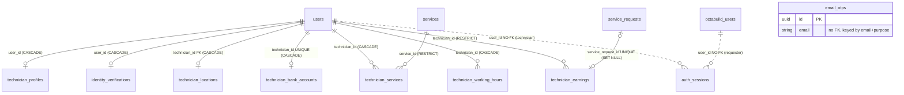

| Table | Target table (sec. 11) | PK type | Parent tables (column -> table.column, ON DELETE) | Child tables | `*_id` with NO FK |
|---|---|---|---|---|---|
| `partner.users` (model `PartnerUser`, `app/models/user.py`) | `technicians` (add `deleted_at`) | UUID `id` | none | `technician_profiles.user_id`, `identity_verifications.user_id`, `technician_locations.technician_id`, `technician_bank_accounts.technician_id`, `technician_services.technician_id`, `technician_working_hours.technician_id`, `technician_earnings.technician_id`, `service_requests.technician_id`, `service_request_assignments.technician_id`, `service_request_media.uploaded_by_technician_id`, `service_request_start_otps.consumed_by_technician_id`, `service_request_ratings.technician_id`. Also logically `auth_sessions.user_id` (no FK). | none |
| `partner.auth_sessions` (`AuthSession`, `app/models/auth_session.py`) | `sessions` | UUID `id` (no server default) | none | none (`replaced_by_session_id` is a logical self-reference, no FK) | `user_id` ⚠ NO FK (polymorphic: `partner.users` or `octabuild.users`, chosen by `principal_type`); `token_family_id` ⚠ NO FK (groups rows, no parent table); `replaced_by_session_id` ⚠ NO FK (logically `auth_sessions.id`) |
| `partner.email_otps` (`EmailOtp`, `app/models/email_otp.py`) | `email_otp_codes` | UUID `id` | none (keyed by `email` + `purpose`, unique `uq_email_otps_email_purpose`) | none | none |
| `partner.identity_verifications` (`IdentityVerification`, `app/models/identity_verification.py`) | `technician_identity_verifications` (FK `technician_id` CASCADE; add `_key_version`) | UUID `id` | `user_id -> partner.users.id`, CASCADE, UNIQUE (0002) | none | none |
| `partner.technician_profiles` (`TechnicianProfile`, `app/models/technician_profile.py`) | `technician_profiles` (`user_id` → `technician_id`) | UUID `id` (INTEGER identity in 0001, converted to UUID in 0002) | `user_id -> partner.users.id`, CASCADE, UNIQUE (0001) | none | none |
| `partner.technician_services` (`TechnicianService`, `app/models/technician_work_preferences.py`) | `technician_services` (composite PK `technician_id`, `catalog_service_id`) | Composite (`technician_id`, `service_id`) UUID | `technician_id -> partner.users.id`, CASCADE; `service_id -> partner.services.id`, RESTRICT (0011) | none | none |
| `partner.technician_working_hours` (`TechnicianWorkingHours`, same file) | `technician_working_hours` (composite PK `technician_id`, `weekday`) | Composite (`technician_id` UUID, `weekday` SMALLINT) | `technician_id -> partner.users.id`, CASCADE (0011) | none | none |
| `partner.technician_locations` (`TechnicianLocation`, `app/models/technician_location.py`) | `technician_locations` (PK `technician_id`) | UUID `technician_id` (PK and FK) | `technician_id -> partner.users.id`, CASCADE (0004) | none | none |
| `partner.technician_bank_accounts` (`TechnicianBankAccount`, `app/models/technician_bank_account.py`) | `technician_payout_accounts` | UUID `id` | `technician_id -> partner.users.id`, CASCADE, UNIQUE (0007) | none | none |
| `partner.technician_earnings` (`TechnicianEarning`, `app/models/technician_earning.py`) | `technician_earnings` (`service_request_id` → `booking_id`, SET NULL) | UUID `id` | `technician_id -> partner.users.id`, RESTRICT; `service_request_id -> partner.service_requests.id`, SET NULL, UNIQUE (0009) | none | none |

#### Area 2: Catalog

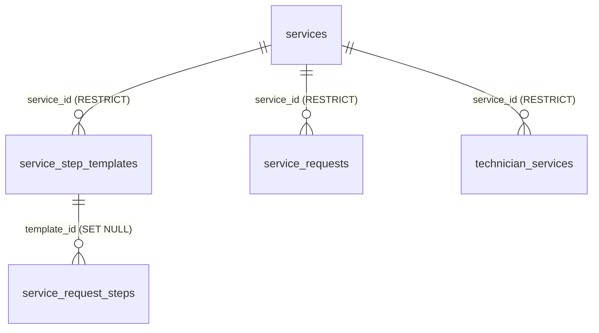

| Table | Target table (sec. 11) | PK type | Parent tables (column -> table.column, ON DELETE) | Child tables | `*_id` with NO FK |
|---|---|---|---|---|---|
| `partner.services` (`Service`, `app/models/service.py`) | `catalog_services` | UUID `id` | none | `service_step_templates.service_id` (RESTRICT), `service_requests.service_id` (RESTRICT), `technician_services.service_id` (RESTRICT) | none |
| `partner.service_step_templates` (`ServiceStepTemplate`, `app/models/service_step_template.py`) | `catalog_service_checklist_steps` | UUID `id` | `service_id -> partner.services.id`, RESTRICT (0006) | `service_request_steps.template_id` (SET NULL) | none |

#### Area 3: Bookings (requests, offers or assignments, tracking)

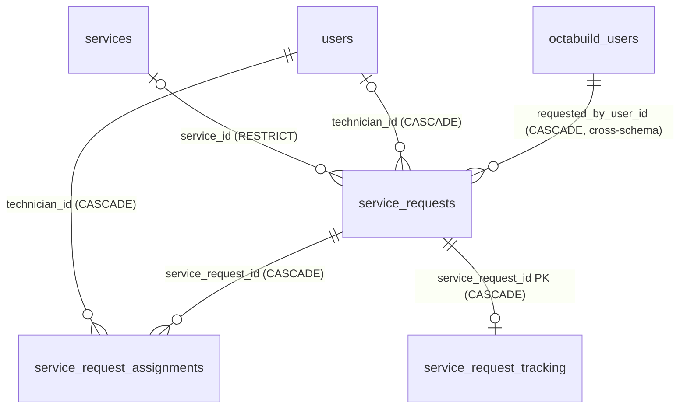

| Table | Target table (sec. 11) | PK type | Parent tables (column -> table.column, ON DELETE) | Child tables | `*_id` with NO FK |
|---|---|---|---|---|---|
| `partner.service_requests` (`ServiceRequest`, `app/models/service_request.py`) | `bookings` (`requested_by_user_id` FK to `professional.users` becomes RESTRICT) | UUID `id` (INTEGER identity in 0001, converted to UUID in 0002) | `requested_by_user_id -> octabuild.users.id`, CASCADE (**cross-schema**, 0001/0002); `technician_id -> partner.users.id`, CASCADE, nullable (0001); `service_id -> partner.services.id`, RESTRICT, nullable (0005) | `service_request_assignments`, `service_request_tracking`, `service_request_steps`, `service_request_media`, `service_request_start_otps`, `service_request_bills`, `service_request_ratings` (all CASCADE); `technician_earnings` (SET NULL). Logical, no FK: Octabuild `payment_orders`, `payment_transactions`, `payment_receipts` `.booking_id`. | none |
| `partner.service_request_assignments` (`ServiceRequestAssignment`, `app/models/service_request_assignment.py`) | `booking_offers` | UUID `id` | `service_request_id -> partner.service_requests.id`, CASCADE; `technician_id -> partner.users.id`, CASCADE (0002) | none | none |
| `partner.service_request_tracking` (`ServiceRequestTracking`, `app/models/service_request_tracking.py`) | `booking_destinations` (PK `booking_id`) | UUID `service_request_id` (PK and FK) | `service_request_id -> partner.service_requests.id`, CASCADE (0003). The FK `technician_id -> partner.users.id` CASCADE was dropped in 0014. | none | none |

#### Area 4: Job execution (steps, media, start OTPs, bills, bill items, ratings, rating tags)

```mermaid
erDiagram
    service_requests ||--o{ service_request_steps : "service_request_id (CASCADE)"
    service_step_templates |o--o{ service_request_steps : "template_id (SET NULL)"
    service_requests ||--o{ service_request_media : "service_request_id (CASCADE)"
    users |o--o{ service_request_media : "uploaded_by_technician_id (CASCADE)"
    service_request_bill_items |o--o{ service_request_media : "bill_item_id (CASCADE)"
    octabuild_users ||..o{ service_request_media : "uploaded_by_requester_id NO FK"
    service_requests ||--o{ service_request_start_otps : "service_request_id (CASCADE)"
    users |o--o{ service_request_start_otps : "consumed_by_technician_id (SET NULL)"
    octabuild_users ||..o{ service_request_start_otps : "requested_by_user_id NO FK"
    service_requests ||--o| service_request_bills : "service_request_id UNIQUE (CASCADE)"
    service_request_bills ||--o{ service_request_bill_items : "bill_id (CASCADE)"
    service_requests ||--o| service_request_ratings : "service_request_id UNIQUE (CASCADE)"
    users ||--o{ service_request_ratings : "technician_id (RESTRICT)"
    service_request_ratings ||--o{ service_request_rating_tags : "rating_id (CASCADE)"
```

| Table | Target table (sec. 11) | PK type | Parent tables (column -> table.column, ON DELETE) | Child tables | `*_id` with NO FK |
|---|---|---|---|---|---|
| `partner.service_request_steps` (`ServiceRequestStep`, `app/models/service_request_step.py`) | `booking_checklist_steps` | UUID `id` | `service_request_id -> partner.service_requests.id`, CASCADE; `template_id -> partner.service_step_templates.id`, SET NULL (0006) | none | none |
| `partner.service_request_media` (`ServiceRequestMedia`, `app/models/service_request_media.py`) | `booking_media` (`storage_key` points to S3) | UUID `id` | `service_request_id -> partner.service_requests.id`, CASCADE (0006); `uploaded_by_technician_id -> partner.users.id`, CASCADE (0006); `bill_item_id -> partner.service_request_bill_items.id`, CASCADE, named `fk_service_request_media_bill_item_id` (0010) | none | `uploaded_by_requester_id` ⚠ NO FK (Octabuild requester; deliberate, see the 0006 comment) |
| `partner.service_request_start_otps` (`ServiceRequestStartOtp`, `app/models/service_request_start_otp.py`) | `booking_start_codes` | UUID `id` | `service_request_id -> partner.service_requests.id`, CASCADE; `consumed_by_technician_id -> partner.users.id`, SET NULL (0012) | none | `requested_by_user_id` ⚠ NO FK (Octabuild requester) |
| `partner.service_request_bills` (`ServiceRequestBill`, `app/models/service_request_bill.py`) | `booking_work_bills` | UUID `id` | `service_request_id -> partner.service_requests.id`, CASCADE, UNIQUE (0010) | `service_request_bill_items.bill_id` (CASCADE) | none |
| `partner.service_request_bill_items` (`ServiceRequestBillItem`, same file) | `booking_work_bill_items` | UUID `id` | `bill_id -> partner.service_request_bills.id`, CASCADE (0010) | `service_request_media.bill_item_id` (CASCADE) | none |
| `partner.service_request_ratings` (`ServiceRequestRating`, `app/models/service_request_rating.py`) | `booking_ratings` | UUID `id` | `service_request_id -> partner.service_requests.id`, CASCADE, UNIQUE; `technician_id -> partner.users.id`, RESTRICT (0013) | `service_request_rating_tags.rating_id` (CASCADE) | none |
| `partner.service_request_rating_tags` (`ServiceRequestRatingTag`, same file) | `booking_rating_tags` (composite PK `rating_id`, `tag`) | Composite (`rating_id` UUID, `tag` VARCHAR(40)) | `rating_id -> partner.service_request_ratings.id`, CASCADE (0013) | none | none |

Note on the target mapping: the section 11 table in `arch.txt` is garbled by the PDF layout. Its "Change" column appears shifted by one row; for example, "composite PK (rating_id, tag)" is printed on the `booking_ratings` row. Here it is assigned to `booking_rating_tags`, whose current PK is `(rating_id, tag)`. The table pairs above follow the order of the current names in the doc.

#### Area 5: Mapped Octabuild tables (read-only, schema `octabuild`)

```mermaid
erDiagram
    octabuild_users ||--o| octabuild_engineer_profiles : "user_id (Octabuild-owned FK; Partner model: no ondelete)"
    octabuild_users ||--o{ service_requests : "requested_by_user_id (CASCADE)"
```

| Table | Target table (sec. 11) | PK type | Parent tables (column -> table.column, ON DELETE) | Child tables | `*_id` with NO FK |
|---|---|---|---|---|---|
| `octabuild.users` (`OctabuildUser`, `app/models/octabuild_account.py`). Mapped columns: `id, name, email, phone, role, status, address, pincode, location`. | Not a Partner table. It becomes `professional.users`, and per 11.1 Partner reads it through the view `professional.v_partner_requesters` instead of mapping it. | UUID `id` | none (from Partner's view) | `octabuild.engineer_profiles.user_id` (FK, Octabuild-owned); `partner.service_requests.requested_by_user_id` (FK, CASCADE). Logical, no FK: `partner.auth_sessions.user_id` (requester rows), `partner.service_request_media.uploaded_by_requester_id`, `partner.service_request_start_otps.requested_by_user_id`. | none |
| `octabuild.engineer_profiles` (`OctabuildEngineerProfile`, same file). Mapped columns: `id, user_id, specialization`. | Not a Partner table. It becomes `professional.engineer_profiles`, which the view 11.1 joins. | INTEGER `id` | `user_id -> octabuild.users.id`, no ondelete in the Partner model (Octabuild's own model: CASCADE); UNIQUE | none | none |

Write protection: `app/models/octabuild_account.py::refuse_octabuild_writes` (a `before_flush` listener) raises `RuntimeError` on any insert, update or delete of either class. Relationships: `OctabuildUser.engineer_profile` (viewonly) and `ServiceRequest.requester` (viewonly, `foreign_keys=[requested_by_user_id]`).

#### Area 6: Other tables

| Table | Target table | PK type | Parent tables | Child tables | `*_id` with NO FK |
|---|---|---|---|---|---|
| `partner.partner_alembic_version` (Alembic version table; created by `alembic/env.py`, no model) | UNKNOWN: section 11 does not name it (check section 9 conventions for the version-table name) | `version_num` (Alembic standard) | none | none | none |

No other `__tablename__` exists in `Partner/backend/app` besides the 24 listed above (checked with a grep for `__tablename__` across `app/`).

## 8. Background jobs

There is no scheduler library in either backend. A search for `apscheduler`, `schedule.`, `Timer(`, `ThreadPoolExecutor`, `lifespan` and cron entries in the code found nothing. Recurring jobs are started from FastAPI `@app.on_event("startup")` handlers in each API process. Both backends use only `on_event` and no `lifespan`.

Note: arch.txt (sections 4.3 and SC-01) moves the jobs into separate scheduler units: `professional/backend/app/jobs/subscription_renewal_sweep.py`, `weather_alert_monitor.py`, `run_scheduler.py`, and Partner `modules/dispatch/dispatch_sweeper.py`. Each job is to run under `pg_try_advisory_lock(<job key>)` so that only one copy is active. **None of the current jobs takes an advisory lock.** They run once per API worker process.

#### Summary

| # | Job | Backend | Kind | Started from | Interval | On/off control |
|---|---|---|---|---|---|---|
| J1 | Dispatch sweeper | Partner | recurring, asyncio task + `asyncio.to_thread` | `app/main.py` `start_realtime` (startup) → `_dispatch_worker.start()` | `DISPATCH_SWEEP_INTERVAL_SECONDS` (3.0, min 0.5) | `DISPATCH_WORKER_ENABLED` (True) |
| J2 | Realtime LISTEN relay | Partner | long-running daemon thread | `app/main.py` `start_realtime` → `get_realtime().attach(...)` | continuous (1 s select; 2 s reconnect) | `REALTIME_CROSS_PROCESS` (True) |
| J3 | Face-capture purge | Partner | **one-off at startup only** | `app/main.py` `startup` → `purge_expired_face_captures` | none (once per process start) | runs only when no Partner table is missing |
| J4 | Subscription lifecycle sweep | Octabuild | recurring daemon thread | `app/main.py` `startup` → `app/subscription/sweep.py` `start_background_sweep` | `SUBSCRIPTION_SWEEP_INTERVAL_MINUTES` (60) | interval 0 = off; also blocked by missing tables |
| J5 | Weather monitor | Octabuild | recurring daemon thread | `app/main.py` `startup` → `app/weather/monitor.py` `start_background_monitor` | min(`WEATHER_MONITORING_INTERVAL_MINUTES` 30, `WEATHER_SEVERE_CHECK_INTERVAL_MINUTES` 10) | `WEATHER_MONITORING_ENABLED` (True); interval 0 = off; blocked by missing tables |
| J6 | Weather alert e-mail sender | Octabuild | one-shot daemon thread per refresh | `app/weather/services/weather_notification_service.py` `send_emails_later` | per refresh with e-mails | `WEATHER_EMAIL_ALERTS_ENABLED` (False) |
| J7 | WebSocket session guards | both | asyncio task per open socket | the socket handlers | `WEBSOCKET_SESSION_RECHECK_SECONDS` (30.0) | always on |
| J8 | Partner socket sender pumps | Partner | asyncio task per open socket | `dispatch_routes.technician_stream`, `tracking_routes.tracking_stream` | event-driven | always on |
| J9 | Request-scoped `BackgroundTasks` | both | runs after the HTTP response | see the J9 table | per request | see the J9 table |
| J10 | Manual / cron-able scripts | both | `python -m ...` by hand | no schedule | n/a | n/a |

Settings files: Partner `Partner/backend/app/core/config.py`; Octabuild `Octabuild/backend/app/core/config.py`, `app/subscription/config.py` (`get_subscription_settings`) and `app/weather/config.py` (`get_weather_settings`). Env names are the uppercase field names (pydantic-settings).

---

#### J1: Partner dispatch sweeper

| Aspect | Detail |
|---|---|
| Code | `Partner/backend/app/shared/bookings/services/dispatch_worker.py` `DispatchWorker` (`start`, `stop`, `_run`). The pass is `app/dependencies/dependencies.py` `sweep_once`, which builds `build_dispatch_service(SessionLocal())` and calls `.sweep()`. The work is `app/shared/bookings/services/dispatch_service.py` `DispatchService.sweep` |
| Started | `Partner/backend/app/main.py`: module-level `_dispatch_worker = DispatchWorker(sweep_once, settings.dispatch_sweep_interval_seconds)`. `@app.on_event("startup") start_realtime` calls `_dispatch_worker.start()` if `settings.dispatch_worker_enabled`. `@app.on_event("shutdown") stop_realtime` calls `await _dispatch_worker.stop()`. The task name is `dispatch-sweeper`. Each pass runs in a thread through `asyncio.to_thread` |
| Interval / settings | `DISPATCH_SWEEP_INTERVAL_SECONDS` = 3.0 (floor 0.5 in `DispatchWorker.__init__`). `DISPATCH_STUCK_SEARCH_SECONDS` = 10 (a SEARCHING booking older than this with no dispatch gets redispatched). `LOCATION_PURGE_AFTER_SECONDS` = 3600. `limit=200` bookings per phase per pass (hard-coded default). Dispatch itself also uses `DISPATCH_BATCH_SIZE` (3), `DISPATCH_OFFER_TIMEOUT_SECONDS` (30), `MAX_DISPATCH_ATTEMPTS` (3), `DISPATCH_CANDIDATE_POOL_SIZE` (20), the `DISPATCH_WEIGHT_*` settings, `DISPATCH_ETA_PROVIDER` (`none`/`osrm`) and `DISPATCH_ETA_TIMEOUT_SECONDS`. Validated in `core/config.py` `validate_dispatch_settings` |
| Enable flag | `DISPATCH_WORKER_ENABLED` (`dispatch_worker_enabled`, default True) |
| What a pass does | (1) `bookings.with_lapsed_offers(now, limit)` finds bookings with assignments in status OFFERED and `expires_at <= now`. For each it calls `lock(id, skip_locked=True)`, then `expire_lapsed`, which closes the offer as EXPIRED and calls `_next_batch_if_unanswered` → `_dispatch` (next batch, or `_close_round` to EXPIRED / NO_TECHNICIAN_FOUND), then `_commit(outbox)`. (2) `bookings.stuck_searching(cutoff, limit)` finds SEARCHING bookings with no recent dispatch. For each it locks with SKIP LOCKED, calls `_dispatch` and commits. (3) `locations.purge_older_than(now - LOCATION_PURGE_AFTER_SECONDS)` deletes stale positions and commits |
| Tables read | schema `partner`: `service_requests`, `service_request_assignments`, `technician_profiles` (`lock_technician`, `eligible_near`), `technician_locations` (`eligible_near`), `users` (Partner `PartnerUser`). `dispatch_stats` for ranking reads `service_requests` and `service_request_assignments` (`TechnicianRepository`). Other joins inside `TechnicianRepository.eligible_near`: UNKNOWN, check `Partner/backend/app/technician/repositories/technician_repository.py` lines 122-245 |
| Tables written | `service_requests` (status, `technician_id`, `dispatch_attempts`, `last_dispatched_at`, `assigned_at`); `service_request_assignments` (expired offers closed; new offer rows inserted); `technician_locations` (DELETE where `last_location_at < cutoff`) |
| External calls | ETA provider (`self.eta.estimate`) when `DISPATCH_ETA_PROVIDER=osrm` |
| Messages sent | Real-time only, through `RealtimeHub.publish`. To technicians: `booking_offer`, `booking_offer_expired`. To the booking room: `booking_status`. No WhatsApp, e-mail or notifications rows |
| Multi-process safety | One sweeper runs in **every** worker process (documented in the module docstring). Safety comes from row locks: `ServiceRequestRepository.lock(..., skip_locked=True)` (`SELECT ... FOR UPDATE SKIP LOCKED` on `service_requests`) and `TechnicianRepository.lock_technician` (`FOR UPDATE SKIP LOCKED` on `technician_profiles`). Partial unique indexes stop a second accepted offer or a second active job. There is no advisory lock |
| Failure handling | Each booking is its own transaction. On an exception it rolls back and logs `dispatch.sweep_failed request_id=...`. A failed purge rolls back and logs `location.purge_failed`. A crash of the whole pass is logged as `dispatch.sweep_crashed` and retried on the next tick; the loop never stops. Only `CancelledError` (shutdown) ends it. Non-empty counts are logged as `dispatch.sweep` |
| Target | arch.txt: `partner/backend/app/modules/dispatch/dispatch_sweeper.py` (with `offer_ranking.py`), run in `partner-scheduler`, "every 3 s", "one active copy (advisory lock)" |

#### J2: Partner realtime LISTEN relay (listener thread)

| Aspect | Detail |
|---|---|
| Code | `Partner/backend/app/shared/realtime/services/realtime.py` `RealtimeHub.attach` / `_listen` / `detach` |
| Started | `main.py` `start_realtime` → `get_realtime().attach(loop, cross_process=settings.realtime_cross_process)`. It starts the daemon thread `realtime-listener` once per process. `stop_realtime` → `detach()` joins it with a 5 s timeout |
| Settings | `REALTIME_CROSS_PROCESS` (True), `REALTIME_CHANNEL` (`partner_realtime`). Constants `LISTENER_RECONNECT_SECONDS` = 2.0, `MAX_NOTIFY_BYTES` = 7900 |
| DB use | Its own psycopg2 connection outside the pool, built from `engine.url` (credentials not shown). Runs `LISTEN "partner_realtime"`. Reads and writes no tables. The publishers run `SELECT pg_notify(...)` |
| Failure handling | Logs `realtime.listener_down` and reconnects after 2 s. While it is down, `relaying` is False and `publish` delivers in this process only. A failed `pg_notify` logs `realtime.notify_failed` and falls back to local delivery |

#### J3: Partner face-capture purge

| Aspect | Detail |
|---|---|
| Code | `Partner/backend/app/technician/services/identity_service.py` `purge_expired_face_captures(database)`. It calls `IdentityRepository.list_expired_face_captures(now)` (`app/technician/repositories/identity_repository.py`), then `delete_face_capture(identity)` for each, then commits |
| Started | `Partner/backend/app/main.py` `@app.on_event("startup") startup()`, only in the branch where every Partner table exists, inside `with SessionLocal() as session`. **It runs once per process start and has no periodic schedule.** Captures that expire while the server is running are not purged until the next restart. Note: arch.txt lists "face-capture purge" as a scheduler job |
| Settings | `FACE_CAPTURE_RETENTION_DAYS` = 7 (sets `face_capture_expires_at` in `IdentityService.submit_face`). `FACE_CAPTURE_DIRECTORY` = `private/face_captures` (encrypted files). Encryption key setting `DATA_ENCRYPTION_KEY` (name only) |
| Tables read / written | `identity_verifications`: reads rows with `face_provider_reference IS NOT NULL AND face_capture_expires_at < now`, then sets `face_provider_reference = NULL` and `face_capture_expires_at = NULL` |
| Files | Deletes the encrypted file at `_capture_path(face_provider_reference)` under `FACE_CAPTURE_DIRECTORY` (`unlink(missing_ok=True)`) |
| Messages | None. Logs `Purged %d expired face capture(s).` |
| Multi-process safety | Every worker runs it at startup. There is no lock. It is idempotent (a missing file is ignored and the columns are nulled) |
| Failure handling | An OSError or ValueError on a file delete is logged (`Could not delete a face capture for identity record ...`) and the row is still cleared. A DB error at this point is not caught inside `startup` and would surface as a startup exception. UNKNOWN: whether uvicorn then aborts the start; check the runtime behaviour |

#### J4: Octabuild subscription lifecycle sweep

| Aspect | Detail |
|---|---|
| Code | `Octabuild/backend/app/subscription/sweep.py`: `run()` (one pass) and `start_background_sweep(interval_minutes)` (daemon thread `subscription-lifecycle-sweep`, guarded once per process by the module `threading.Event` `_started`). The work is `app/subscription/entitlements.py` `sync_lifecycle(database, builder)` |
| Started | `Octabuild/backend/app/main.py` `@app.on_event("startup") startup()` (sync) at its end: `start_background_sweep(get_subscription_settings().subscription_sweep_interval_minutes)`. It is **skipped entirely** (along with J5) if the DB is unreachable, or if any table in `Base.metadata` is missing from schema `octabuild`. Exceptions are `SELF_GUARDED_TABLES` (`support_tickets` models plus `WEATHER_TABLES`) and `OPTIONAL_FEATURE_TABLES` (`PhoneVerification`, `PhoneOtpSendEvent`) while `PhoneVerificationService.required()` is false |
| Interval | `SUBSCRIPTION_SWEEP_INTERVAL_MINUTES` (default 60, 0..1440; 0 = off). The first pass runs at once, then it sleeps `interval*60` s |
| Other settings | `SUBSCRIPTION_REMINDER_DAYS` (3; 0 turns reminders off), `SUBSCRIPTION_GRACE_DAYS` (0) in `app/subscription/config.py` |
| Manual run | `python -m app.subscription.sweep` (from `Octabuild/backend`), "or from cron" per the docstring |
| What it does | For each `users` row with `role == BUILDER_ROLE` and `status == "ACTIVE"`: `sync_lifecycle` computes `subscription_state`. It then sends (a) the renewal reminder once per period, `reminder_sent_at`; (b) the plan-ended notice once per period, `expiry_notified_at`; (c) the free-access-ended notice, de-duplicated by an existing `notifications` row with title `FREE_ACCESS_EXPIRED_TITLE`. It then commits |
| Tables read | `users`, `builder_subscriptions`, `projects`, `project_engineer_assignments`, `notifications` |
| Tables written | `notifications` (via `create_notification`, category ACCOUNT, to the builder, the owners of the builder's active awarded projects (`_notify_owners`) and the assigned Site Engineers (`_notify_engineers`)); `builder_subscriptions` (`reminder_sent_at`, `expiry_notified_at`) |
| Messages sent | In-app `notifications` rows only. It uses `create_notification`, not `create_request_notification`, so **no** `/events/ws` live hint is sent. No WhatsApp or e-mail |
| Multi-process safety | One thread per worker process, so N workers sweep N times per interval. There is no advisory lock in the sweep. Duplicate sends are prevented inside `sync_lifecycle` by `SELECT ... FOR UPDATE` on the builder's `users` row, followed by a re-read of the marker. (The separate `pg_advisory_xact_lock(hashtext('subscription:<id>'))` in `app/subscription/service.py` belongs to payment flows, not the sweep) |
| Failure handling | A failure for one builder rolls back and logs `subscription.sweep_failed builder=...`, then the pass continues. A failure of the whole pass logs `subscription.sweep_error`. The thread keeps looping. It is a daemon thread, so it dies with the process |
| Target | `professional/backend/app/jobs/subscription_renewal_sweep.py` (arch.txt 4.6), "Subscription sweep (60 min)" in `professional-scheduler` |

#### J5: Octabuild weather monitor

| Aspect | Detail |
|---|---|
| Code | `Octabuild/backend/app/weather/monitor.py`: `run()` (one pass), `_check`, and `start_background_monitor()` (daemon thread `weather-monitor`, once per process via `_started`). The per-site work is `app/weather/services/weather_service.py` `WeatherService.monitor_site` → `monitor_due` → `refresh` → `reconcile`. Announcements are `app/weather/services/weather_notification_service.py` `WeatherNotificationService.announce` |
| Started | `Octabuild/backend/app/main.py` `startup()` calls `start_background_monitor()` just before J4, under the same missing-table gate. `WEATHER_TABLES` alone do not block it; the monitor checks `weather_installed()` itself on every pass and logs `weather.monitor_skipped` if they are missing |
| Interval / settings | Pass tick = `min(WEATHER_MONITORING_INTERVAL_MINUTES (30), WEATHER_SEVERE_CHECK_INTERVAL_MINUTES (10))`, so 10 min by default. A site is refreshed when its snapshot is not fresh, when `interval-1` minutes have passed since `fetched_at`, or when it has a WARNING/SEVERE active alert and is older than the severe interval. Related settings: `WEATHER_API_PROVIDER` (`open-meteo`), `WEATHER_CACHE_MINUTES` (25), `WEATHER_NOTIFY_MIN_SEVERITY` (WATCH), `WEATHER_REOPEN_WINDOW_HOURS` (6), `WEATHER_EMAIL_ALERTS_ENABLED` (False), `WEATHER_TIMEOUT_SECONDS`, `WEATHER_MAX_RETRIES`, `WEATHER_THRESHOLD_OVERRIDES` |
| Enable flags | `WEATHER_MONITORING_ENABLED` (True). `WEATHER_MONITORING_INTERVAL_MINUTES = 0` also turns it off |
| Manual run | `python -m app.weather.monitor` (one pass) |
| Sites | `WeatherRepository.monitored_project_ids()` (open `projects`) plus `monitored_personal_user_ids()` (`weather_site_locations.user_id` joined to ACTIVE `users`) |
| Tables read | `projects`, `users`, `weather_site_locations`, `weather_snapshots`, `weather_alerts`, `project_engineer_assignments`, `admin_profiles`, plus `StoreSiteRequest` and supplier-order models for linked recipients (`supplier_order_recipient_ids`, `store_request_recipient_ids`; exact table names UNKNOWN, check `app/weather/repositories/weather_repository.py`). `weather_geocode_cache` is possibly read or written by `WeatherService.lookup` during `locate_automatically` (UNKNOWN; check `lookup`) |
| Tables written | `weather_site_locations` (auto location, `source="AUTO_CITY"`); `weather_snapshots` (data, `fetched_at`, `expires_at`, `last_attempt_at`, `last_error`); `weather_alerts` (insert, update, reopen, resolve; `notified_severity`, `notified_at`); `notifications` (category PROJECT or ANNOUNCEMENT). `weather_alert_acknowledgements` is written only by the user acknowledge path (`weather_service.py` ~line 910), not by the monitor |
| Messages sent | In-app `notifications` rows to the project owner, builder, active Site Engineers, linked suppliers and Store Managers, and admins with `projects.view` in that locality (personal site: the account itself). For each recipient a `queue_live_hint`, so `{"event":"requests_changed"}` goes on `/events/ws` after commit. **E-mail** for WARNING/SEVERE when `WEATHER_EMAIL_ALERTS_ENABLED` and the user has an e-mail, sent through J6 (`EmailService.send_email`, SMTP). No WhatsApp. External HTTP: weather provider (Open-Meteo by default) and geocoding |
| Multi-process safety | One thread per worker. Per-site serialisation uses an **in-process** `threading.Lock` (`weather_service._site_lock`), with a re-check of `monitor_due` inside it. Across processes, a duplicate alert insert is caught as an `IntegrityError` inside `begin_nested()` ("Another process raised this event ... it is theirs to announce"). There is no advisory lock. Two workers can each fetch the same site from the provider in the same window |
| Failure handling | `_check`: `WeatherRateLimited` rolls back, logs `weather.monitor_paused`, and **stops the rest of the pass** (the remaining sites wait for the next tick). `WeatherProviderError` rolls back and logs `weather.monitor_failed` (the snapshot keeps `last_error`, and `cooling_down` (`FAILURE_COOLDOWN`) skips the site for a while). Any other exception rolls back and logs `weather.monitor_error`. A failure of the whole pass logs `weather.monitor_pass_error`. The loop continues |
| Target | `professional/backend/app/jobs/weather_alert_monitor.py`, "weather monitor (30 min, severe 10 min)" in `professional-scheduler` |

#### J6: Octabuild weather alert e-mail thread

| Aspect | Detail |
|---|---|
| Code | `Octabuild/backend/app/weather/services/weather_notification_service.py` `send_emails_later(emails)`, which starts the daemon thread `weather-alert-email`. Called from `WeatherService.refresh` after `database.commit()` |
| Sends | `app/shared/email/services/email_service.py` `EmailService.send_email(to, subject, body)` for each e-mail |
| Failure handling | Each failure is logged as `weather.alert_email_failed`. There is no retry and nothing is recorded in the DB, so an e-mail lost here is not re-sent (the alert is already marked notified) |

#### J7 / J8: per-socket background tasks

| Task | Code | Interval | Effect |
|---|---|---|---|
| Session guard (Octabuild) | `app/shared/messaging/services/websocket_service.py` `guard_session`, started with `asyncio.create_task` in `event_routes.events_websocket` and `message_routes.conversation_websocket` | `WEBSOCKET_SESSION_RECHECK_SECONDS` (30.0) | re-checks `auth_sessions` (session family) and `users.status` in a thread; closes the socket with 1008 when invalid |
| Session guard (Partner) | `app/shared/realtime/services/realtime.py` `guard_session`, started in `dispatch_routes.technician_stream` and `tracking_routes.tracking_stream` | same setting (Partner config, 30.0) | re-checks `auth_sessions` and the user/requester; closes with 1008 |
| Sender pump (Partner) | `realtime.pump`, one per socket | event-driven | drains the `Subscription` queue (max 64) to `websocket.send_json` |
| Live-hint send (Octabuild) | `live_events.UserEventManager.notify` → `asyncio.run_coroutine_threadsafe(_send)` from the `after_commit` hook | per commit | sends `requests_changed` |

#### J9: request-scoped `BackgroundTasks` (run after the response, inside the same process)

| Backend | Route (file, function) | Task | Sends | Condition |
|---|---|---|---|---|
| Octabuild | POST `/auth/signup`, `app/shared/auth/routes/auth_routes.py` `signup_user` | `send_welcome_message(user.phone, user.name)` (`app/shared/auth/services/phone_verification_service.py`) | WhatsApp welcome template (Dovesoft client; template setting `WHATSAPP_WELCOME_TEMPLATE`) | only when `PhoneVerificationService.required()`. It never raises; failures are logged |
| Octabuild | POST `/internal/cctv/media-gateway/auth`, `app/shared/cctv/routes/cctv_routes.py` `media_gateway_auth` (loopback clients only) | `playback.remove_gateway_path_quietly(gateway_path)` for each stale path | HTTP call to the media gateway (`media_gateway.remove_path`) | stale playback sessions found by `playback.gateway_authorization`. A `GatewayError` is logged as a warning |
| Partner | POST `/auth/password-reset/send-code`, `app/technician/routes/auth_routes.py` `send_password_reset_code` | `PasswordService.send_reset_code(..., defer=background.add_task)` → `OtpService.send(..., defer=...)` (`app/technician/services/otp_service.py`) | password-reset e-mail code (the `email_otps` row is written in the request; the e-mail is sent after the response) | always (the deferred send keeps response timing uniform) |

#### J10: manual scripts (no schedule)

| Script | Purpose | Notes |
|---|---|---|
| `Octabuild/backend/app/subscription/sweep.py` (`__main__`) | one J4 pass | cron-able per docstring |
| `Octabuild/backend/app/weather/monitor.py` (`__main__`) | one J5 pass | cron-able per docstring |
| `Partner/backend/app/scripts/job_media_orphans.py` | reports, and with `--delete-orphan-files [--min-age-minutes 60]` deletes, orphan encrypted job-photo files under `JOB_MEDIA_DIRECTORY` against `service_request_media` | "There is no schedule: run it by hand." Never changes DB rows |
| `Partner/backend/app/scripts/identity_review.py`, `seed_service_catalog.py`, `seed_service_checklists.py`, `set_password.py`; `Octabuild/backend/seed_admins.py`, `seed_otp_test_accounts.py`, `seed_verification_demo.py`, `app/subscription/seed_dev_prices.py` | admin/seed tools | not background jobs |

#### Lazy (on-request) clean-ups that look like jobs but are not scheduled

- `Octabuild/backend/app/shared/cctv/services/playback.py` `_expire_stale_sessions` expires stale CCTV playback sessions when playback/gateway code runs. No timer.
- Subscription notices are also written on read (`GET /subscriptions/me` calls `sync_lifecycle`), per the `sweep.py` docstring.

#### Restructure risks

1. Moving J1, J4 and J5 to a separate scheduler process (arch.txt SC-01) **also needs the real-time path to cross processes**. J5's `queue_live_hint` sends hints only through the in-memory `live_events` of the process that commits, so a weather hint raised in a scheduler process would reach no browser. J1 is fine once `REALTIME_CROSS_PROCESS=true`, because the API processes receive its `pg_notify`.
2. None of the jobs uses `pg_try_advisory_lock` today. With N workers there are N sweepers and monitors. That is safe for J1 (SKIP LOCKED) and J4 (row lock and markers), and only partly safe for J5 (duplicate provider calls).
3. J3 is startup-only. A scheduler move should make it periodic.
4. J4 and J5 never start if any non-exempt Octabuild table is missing at startup (`main.py` `blocking` list). A renamed table or schema (`octabuild` → `professional`) that leaves `Base.metadata` names out of step with the DB silently disables both jobs. Only an error is logged.

## 9. Settings map

Sources read:
- **Settings classes:** `Octabuild/backend/app/core/config.py` `Settings`, `Octabuild/backend/app/payment_gateway/config.py` `PaymentGatewaySettings`, `Octabuild/backend/app/subscription/config.py` `SubscriptionSettings`, `Octabuild/backend/app/weather/config.py` `WeatherSettings`, `Partner/backend/app/core/config.py` `Settings` and `Partner/backend/app/shared/weather/services/weather_config.py` `WeatherSettings`. Every class loads `backend/.env` (`env_file=BACKEND_ROOT / ".env"`, `extra="ignore"`), and the variable name is the field name in upper case.
- **Direct environment reads:** a search for `os.getenv` and `os.environ` finds them **only in tests**; application code never reads the environment directly.
- **Alembic:** `alembic/env.py` in both backends reads `settings.database_url`.
- **Frontends:** every `import.meta.env.*` reference, both `vite.config.js` files, `Partner/frontend/playwright.config.js` and all four `.env.example` files.

Abbreviations: `OB` = `Octabuild/backend/app`, `PB` = `Partner/backend/app`, `OF` = `Octabuild/frontend 7/frontend`, `PF` = `Partner/frontend`.

In the "Default?" column:
- **yes** means a usable default exists.
- **empty** means the default is an empty string or `None`, so the variable is effectively unset.
- **unsafe** means a default exists but production refuses it.

No value is reproduced anywhere in this section.

#### Octabuild backend: `OB/core/config.py` `Settings`

Startup validators in the same file, called by `get_settings()`: `validate_environment`, `validate_dev_account_recovery`, `validate_dev_otp_preview`, `validate_jwt_secret`, `validate_session_cookies`, `validate_partner_handoff_key`, `validate_whatsapp` and `validate_production`.

| Variable | Read in (file + function) | Default? | Feature that breaks without it | In .env.example? |
|---|---|---|---|---|
| APP_NAME | `OB/main.py` (FastAPI title) | yes | nothing | no |
| ENVIRONMENT | `validate_environment`; `OB/main.py`; `OB/payment_gateway/config.py` `PaymentGatewaySettings.environment` (separate default `development`); `OB/shared/auth/services/email_verification_service.py`; `otp_test_accounts.py` | empty | **The app refuses to start** (`InsecureConfigurationError`). It also drives the production checks, the console fallback for email codes and the Razorpay mock refusal. | **no** |
| DEBUG | `OB/core/logging.py`; `OB/dependencies/dependencies.py`; `validate_production` | yes | nothing (production requires false) | no |
| DATABASE_URL | `OB/database/session.py`; `Octabuild/backend/alembic/env.py` | unsafe (local default; production refuses it) | everything | yes |
| JWT_SECRET_KEY | `OB/utils/security.py`; `OB/shared/cctv/services/credentials.py`; `validate_jwt_secret` | empty | **The app refuses to start** if the value is empty, shorter than 32 characters or a known placeholder | yes |
| JWT_ALGORITHM | `OB/utils/security.py` | yes | — | yes |
| ACCESS_TOKEN_MINUTES | `OB/utils/security.py`, `OB/utils/session_cookies.py` | yes | — | yes |
| REFRESH_TOKEN_DAYS | `OB/shared/auth/services/session_service.py` | yes | — | yes |
| SESSION_IDLE_DAYS | `session_service.py` | yes | — | no |
| REFRESH_REUSE_GRACE_SECONDS | `session_service.py` | yes | — | no |
| AUTH_COOKIE_SECURE | `OB/utils/session_cookies.py`; `validate_session_cookies` | yes | production requires true | no |
| AUTH_COOKIE_SAMESITE | `session_cookies.py`; `validate_session_cookies` | yes | must be lax, strict or none | no |
| WEBSOCKET_SESSION_RECHECK_SECONDS | `OB/shared/messaging/routes/event_routes.py`, `message_routes.py` | yes | — | no |
| PARTNER_HANDOFF_SECONDS | `OB/shared/auth/routes/auth_routes.py`, `OB/utils/security.py` | yes | — | no |
| PARTNER_HANDOFF_PRIVATE_KEY | `OB/utils/security.py`; `validate_partner_handoff_key` | empty | **Book Technician** handoff to Partner answers 503 (config comment); **production refuses to start** | **no** |
| UPLOAD_DIRECTORY | **not read anywhere** (only defined) | yes | nothing (dead setting) | yes |
| FRONTEND_ORIGIN | `OB/utils/origins.py` (CORS), `OB/shared/auth/services/oauth_service.py` `redirect_with_session`, `OB/site_engineer/services/engineer_team_service.py` (invite links); `validate_production` | yes (localhost) | Production refuses a non-https or local origin. CORS, OAuth return and invite links depend on it. | yes |
| GOOGLE_CLIENT_ID / GOOGLE_CLIENT_SECRET | `oauth_service.py` `provider_settings` | empty | Google sign-in answers **503** | yes / yes |
| GOOGLE_REDIRECT_URI | `provider_settings` | yes (localhost) | Google callback goes to the wrong host | yes |
| MICROSOFT_CLIENT_ID / MICROSOFT_CLIENT_SECRET | `provider_settings` | empty | Microsoft sign-in answers **503** | yes / yes |
| MICROSOFT_REDIRECT_URI | `provider_settings` | yes (localhost) | as for Google | yes |
| SMTP_HOST / SMTP_USER / SMTP_PASSWORD | `OB/shared/email/services/email_service.py` `EmailService` (`SMTP_USER` also in `OB/shared/account_deletion/services/self_deletion_service.py` as the last-resort support address) | empty | Email codes, password reset, contact form, support and weather emails stop (502/503, or the code goes to the console outside production). See the outside-services section. | yes |
| SMTP_PORT, SMTP_FROM_NAME, SMTP_USE_TLS | `EmailService` | yes | — | yes |
| ACCOUNT_DELETION_PROCESSING_DAYS | **not read** (the config comment says it is kept only so old `.env` files load) | empty | nothing | no |
| ACCOUNT_DELETION_NOTIFY_EMAIL | `self_deletion_service.py` | empty | Support address shown on the deletion pages falls back to `CONTACT_DESTINATION_EMAIL`, then `SMTP_USER` | no |
| RESEND_API_KEY | `EmailService._send_via_resend` (read with `getattr`) | empty | Resend is skipped and SMTP only is used (Resend is not in requirements.txt in any case) | **no** |
| DEV_ACCOUNT_RECOVERY_ENABLED | `dev_account_recovery_on` (used by `auth_routes.py`, `OB/shared/auth/services/auth_service.py`); `validate_dev_account_recovery` | yes (off) | refuses to start if true outside development | yes |
| WHATSAPP_ENABLED | `OB/shared/whatsapp/services/dovesoft_client.py`, `phone_verification_service.py`; `validate_whatsapp` | yes (off) | WhatsApp OTP and welcome message not sent | yes |
| WHATSAPP_TRANSPORT | `validate_whatsapp` only | yes | must be `direct` when sign-up OTP is on | yes |
| WHATSAPP_API_URL, WHATSAPP_API_KEY, WHATSAPP_WABA_NUMBER | `dovesoft_client.py` `DovesoftWhatsAppClient` (`configured`, `build_template_request`, `auth_headers`) | empty | WhatsApp OTP: `NOT_CONFIGURED` → 502. If `WHATSAPP_SIGNUP_OTP_ENABLED=true`, **startup refuses**. | yes |
| WHATSAPP_DEFAULT_LANG, WHATSAPP_DEBUG, WHATSAPP_TIMEOUT_SECONDS | `dovesoft_client.py` | yes | — | yes |
| WHATSAPP_DEV_OTP_PREVIEW | `phone_verification_service.py`; `validate_dev_otp_preview` | yes (off) | refuses to start if true outside development | yes |
| TEST_OTP_LOGIN_ENABLED | `OB/shared/auth/services/otp_test_accounts.py` | yes (off) | — | yes |
| WHATSAPP_SIGNUP_OTP_ENABLED | `OB/main.py` (`log_readiness`), `phone_verification_service.py`; `validate_whatsapp` | yes (off) | Sign-up phone check off; when true, all the Dovesoft settings become mandatory at startup | yes |
| TRUSTED_PROXY_IPS | `auth_routes.py`, `OB/shared/auth/services/client_address.py` | yes | per-IP OTP limits count the proxy instead of the visitor | no |
| WHATSAPP_OTP_TEMPLATE | `phone_verification_service.py`, `dovesoft_client.py` | empty | OTP not sent; startup refuses when sign-up OTP is on | yes |
| WHATSAPP_WELCOME_TEMPLATE | `phone_verification_service.py` `send_welcome_message` | empty | no welcome message (silent) | yes |
| WHATSAPP_OTP_URL_BUTTON | `dovesoft_client.py` `template_body` | yes | provider refuses if it does not match the template | yes |
| WHATSAPP_AUTH_HEADER, WHATSAPP_AUTH_SCHEME, WHATSAPP_SENDER_HEADER, WHATSAPP_SUCCESS_FIELD, WHATSAPP_SUCCESS_VALUE | `dovesoft_client.py` `auth_headers`, `success_path`, `accepted` | empty | `WhatsAppNotReady` → 503. The header and field are mandatory at startup when sign-up OTP is on. | yes (all five) |
| AWS_REGION | `OB/shared/files/services/upload_service.py` `build_s3_client` | yes | — | yes |
| AWS_ACCESS_KEY_ID / AWS_SECRET_ACCESS_KEY | `build_s3_client` | empty | boto3 default credential chain is used; without one, S3 calls fail → 503 | yes |
| AWS_SESSION_TOKEN, AWS_ENDPOINT_URL | `build_s3_client` | empty | only for temporary credentials or S3-compatible services | no |
| AWS_DEFAULT_LOCALITY | `OB/core/countries.py` | yes | — | yes |
| AWS_PRESIGNED_URL_EXPIRY_SECONDS | **not read** (the advert presign uses the code constant `ADVERT_IMAGE_LINK_SECONDS`) | yes | nothing | yes |
| AWS_USER_IMAGES_BUCKET_IN, AWS_SUPPLIER_DATA_BUCKET_IN, AWS_SITE_IMAGES_BUCKET_IN, AWS_SITE_VIDEOS_BUCKET_IN | `upload_service.py` `bucket_for` (dynamic `getattr(settings, f"{prefix}_{locality}")`; a plain text search for the names finds no user) | empty | Every upload in that category answers **503** "File storage is not configured" | yes (all four) |
| LOCAL_TIMEZONE, LOCAL_UTC_OFFSET_MINUTES | `OB/utils/local_time.py`, `OB/site_engineer/services/daily_cost_service.py`, `OB/shared/cctv/services/recordings.py` | yes | — | no |
| DAILY_WORK_CUTOFF | `daily_cost_service.py` | yes | — | no |
| CAMERA_CREDENTIALS_KEY | `OB/shared/cctv/services/credentials.py` | empty | CCTV credential operations fail closed with **503** | yes |
| CCTV_ALLOWED_NETWORKS | `OB/shared/cctv/services/network_policy.py` | yes | — | no |
| CCTV_CONNECT_TIMEOUT_SECONDS | `OB/shared/cctv/services/connectivity.py`, `devices.py` | yes | — | no |
| CCTV_RECONNECT_MIN_INTERVAL_SECONDS, CCTV_RECONNECT_MAX_PER_MINUTE | `OB/shared/cctv/services/devices.py`, `rate_limits.py` | yes | — | no |
| CCTV_DENIED_AUDIT_MAX_PER_MINUTE | `OB/shared/cctv/services/audit.py` | yes | — | no |
| CCTV_DISCOVERY_ENABLED | **not read** | yes | nothing | no |
| CCTV_PLAYBACK_SESSION_TTL_SECONDS, CCTV_MAX_OPEN_SESSIONS_PER_USER, CCTV_MAX_OPEN_SESSIONS_PER_CHANNEL | `OB/shared/cctv/services/playback.py` | yes | — | no |
| CCTV_MEDIA_GATEWAY_API_URL, CCTV_MEDIA_GATEWAY_WEBRTC_URL, CCTV_MEDIA_GATEWAY_HLS_URL, CCTV_MEDIA_GATEWAY_API_SECRET | `OB/shared/cctv/services/media_gateway.py` `api_base_url`, `playback_base_url`, `_api_secret`, `configured` | empty | Live view and recording playback answer **503 `CCTV_MEDIA_GATEWAY_NOT_CONFIGURED`** | yes (all four) |
| OPENAI_API_KEY | `OB/shared/translation/services/translation_service.py` `configured`, `_call_model`; `OB/shared/vastu/services/gemini_client.py` `configured`, `extract_plan` | empty | Translation silently off (original text shown). Vastu plan analysis answers **503**. | yes |
| OPENAI_TRANSLATION_MODEL | translation; Vastu fallback model in `gemini_client.vision_model` | yes | — | yes |
| OPENAI_BASE_URL | translation; `gemini_client._native_base` / `configured` | yes (api.openai.com) | Vastu requires a `generativelanguage.googleapis.com` host and stays 503 on the default | yes |
| CONTACT_DESTINATION_EMAIL | `OB/shared/contact/routes/contact_routes.py`; `self_deletion_service.py` | empty | `POST /contact` answers **503** "Enquiries are temporarily unavailable" | yes |
| CONTACT_MAX_PER_HOUR_PER_IP | `contact_routes.py` | yes | — | no |
| SUPPORT_EMAIL, SUPPORT_PHONE, SUPPORT_WHATSAPP, SUPPORT_HOURS, SUPPORT_RESPONSE_TIME | `OB/shared/support/services/support_service.py` (`SUPPORT_EMAIL` also in `self_deletion_service.py`) | empty | The matching card or line on the Contact & Support page is hidden; no inbox notification for new tickets | no |
| SUPPORT_MAX_TICKETS_PER_HOUR | `support_service.py` | yes | — | no |
| VASTU_VISION_MODEL, VASTU_GEMINI_BASE_URL | `gemini_client.py` | empty (falls back to `OPENAI_TRANSLATION_MODEL` / `OPENAI_BASE_URL`) | — | no |
| VASTU_ANALYSIS_TIMEOUT_SECONDS, VASTU_ANALYSIS_MAX_ATTEMPTS, VASTU_ANALYSIS_DEADLINE_SECONDS | `gemini_client.extract_plan` | yes | — | no |
| VASTU_MIN_CONFIDENCE, VASTU_DIRECTION_MARGIN_DEGREES | `OB/shared/vastu/services/analysis.py` | yes | — | no |
| VASTU_PDF_RENDER_LONG_SIDE_PX, VASTU_PDF_MIN_SCALE, VASTU_PDF_MAX_SCALE | `OB/shared/vastu/services/files.py` | yes | — | no |
| VASTU_ANALYSIS_MAX_PER_HOUR_PER_IP | `OB/shared/vastu/routes/vastu_routes.py` | yes | — | no |
| TRANSLATION_CACHE_DIRECTORY | `translation_service.py` `_cache_directory` | yes | — | no |

#### Octabuild backend: `OB/payment_gateway/config.py` `PaymentGatewaySettings`

These are read through `get_payment_gateway_settings()`, then `resolve_gateway()` and `webhook_secret()`. The callers are `OB/payment_gateway/router.py` `_gateway_client` and `razorpay_webhook`, and `OB/subscription/router.py` `subscription_razorpay_webhook`.

| Variable | Read in | Default? | Feature that breaks without it | In .env.example? |
|---|---|---|---|---|
| RAZORPAY_MODE | `resolve_gateway` | yes (test) | anything other than test → **503 `PAYMENT_GATEWAY_MISCONFIGURED`** for every payment | yes |
| RAZORPAY_KEY_ID / RAZORPAY_KEY_SECRET | `resolve_gateway` | empty | Booking payments, builder subscriptions and store purchases answer **503**, unless `RAZORPAY_ALLOW_MOCK=true` outside production | yes / yes |
| RAZORPAY_WEBHOOK_SECRET | `webhook_secret` (both webhook routes) | empty | Both webhooks answer **503 `WEBHOOK_NOT_CONFIGURED`** | yes |
| RAZORPAY_API_BASE_URL | `resolve_gateway` | yes | — | no |
| RAZORPAY_TIMEOUT_SECONDS | `resolve_gateway` → `RazorpayTestClient` | yes | — | no |
| RAZORPAY_ALLOW_MOCK | `resolve_gateway` | yes (off) | — | yes |
| ENVIRONMENT (second reader) | `PaymentGatewaySettings.is_production` | yes (`development`; this class does **not** inherit the main class's empty default) | — | no |

#### Octabuild backend: `OB/subscription/config.py` `SubscriptionSettings`

| Variable | Read in | Default? | Feature that breaks without it | In .env.example? |
|---|---|---|---|---|
| SUBSCRIPTION_GRACE_DAYS | `OB/subscription/entitlements.py`, `OB/subscription/router.py` | yes | — | yes |
| SUBSCRIPTION_REMINDER_DAYS | `entitlements.py` | yes | — | yes |
| SUBSCRIPTION_SWEEP_INTERVAL_MINUTES | `OB/main.py` (in-process sweep) | yes | — | no |

#### Octabuild backend: `OB/weather/config.py` `WeatherSettings`

| Variable | Read in | Default? | Feature that breaks without it | In .env.example? |
|---|---|---|---|---|
| WEATHER_API_PROVIDER | `WeatherSettings.provider` (used by `OB/weather/services/weather_provider_service.py` `build_provider`, `weather_service.py`, `monitor.py`) | yes (open-meteo) | — | yes |
| WEATHER_API_KEY | `weather_provider_service.py` | empty | OpenWeatherMap provider raises "not configured"; Open-Meteo free tier works without it | yes |
| WEATHER_API_BASE_URL | `WeatherSettings.base_url` | empty (falls back to `DEFAULT_BASE_URLS`) | — | yes |
| WEATHER_GEOCODING_BASE_URL, WEATHER_AIR_QUALITY_BASE_URL | `weather_provider_service.py` | yes | — | no |
| WEATHER_REVERSE_GEOCODING_BASE_URL | `weather_provider_service.py` `Geocoder.postal_code`; `public_weather_service.py` `describe` | yes (Nominatim) | Set empty: PIN-to-place lookup and the public "your town" name turn off | yes |
| WEATHER_TIMEOUT_SECONDS, WEATHER_MAX_RETRIES | `HttpJson`, `public_weather_service.py` | yes | — | yes |
| WEATHER_CACHE_MINUTES, WEATHER_MAX_STALE_MINUTES, WEATHER_FORECAST_DAYS | `weather_service.py`, `public_weather_service.py`, provider | yes | — | yes |
| WEATHER_MONITORING_ENABLED, WEATHER_MONITORING_INTERVAL_MINUTES, WEATHER_SEVERE_CHECK_INTERVAL_MINUTES | `OB/weather/monitor.py`, `weather_service.py` | yes | — | yes |
| WEATHER_NOTIFY_MIN_SEVERITY | `weather_notification_service.py` | yes | — | yes |
| WEATHER_REOPEN_WINDOW_HOURS | `weather_service.py` | yes | — | no |
| WEATHER_EMAIL_ALERTS_ENABLED | `weather_notification_service.py` | yes (off) | — | yes |
| WEATHER_THRESHOLD_OVERRIDES | `WeatherSettings.overrides()` (JSON) | empty | — | yes |

#### Partner backend: `PB/core/config.py` `Settings`

Startup checks in `get_settings()`: `validate_environment`, `validate_secret("JWT_SECRET_KEY")`, `validate_session_cookies`, `validate_handoff_public_key`, a production requirement for `DATA_ENCRYPTION_KEY`, `validate_production` and `validate_dispatch_settings`.

| Variable | Read in | Default? | Feature that breaks without it | In .env.example? |
|---|---|---|---|---|
| APP_NAME | `PB/main.py` | yes | — | no |
| ENVIRONMENT | `validate_environment`; `PB/main.py`; `PB/technician/services/otp_service.py` (`is_production`) | empty | **The app refuses to start** | **no** |
| DEBUG | `PB/core/logging.py`; `validate_production` | yes | — | no |
| DATABASE_URL | `PB/database/session.py`, `PB/main.py`, `Partner/backend/alembic/env.py` | unsafe (local default; production refuses it) | everything | yes |
| JWT_SECRET_KEY | `PB/utils/security.py`, `PB/main.py`; `validate_secret` | empty | **The app refuses to start** if the value is empty, short or a placeholder | yes |
| JWT_ALGORITHM, ACCESS_TOKEN_MINUTES | `PB/utils/security.py` | yes | — | yes |
| REFRESH_TOKEN_DAYS | `PB/shared/sessions/services/session_service.py` | yes | — | yes |
| SESSION_IDLE_DAYS, REFRESH_REUSE_GRACE_SECONDS | `session_service.py` | yes | — | no |
| REQUESTER_SESSION_MINUTES | `PB/requester/services/requester_service.py`, `session_service.py` | yes | — | yes |
| AUTH_COOKIE_SECURE, AUTH_COOKIE_SAMESITE | `PB/utils/session_cookies.py`; `validate_session_cookies` | yes | — | no |
| OCTABUILD_HANDOFF_PUBLIC_KEY | `PB/utils/security.py`, `PB/main.py`; `validate_handoff_public_key` | empty | Octabuild → Partner Book Technician handoffs are refused; **production refuses to start** | **no** |
| LOGIN_FAILURE_WINDOW_SECONDS, LOGIN_MAX_FAILURES_PER_EMAIL, LOGIN_MAX_FAILURES_PER_CLIENT | `PB/technician/services/auth_service.py` | yes | — | no |
| WEBSOCKET_SESSION_RECHECK_SECONDS | `PB/shared/bookings/routes/dispatch_routes.py`, `PB/shared/tracking/routes/tracking_routes.py` | yes | — | no |
| FRONTEND_ORIGIN | `PB/utils/origins.py` (CORS), `PB/main.py`; `validate_production` | yes (localhost:5373) | production refuses a non-https or local origin | yes |
| UPLOAD_DIRECTORY | `PB/shared/files/services/upload_service.py` `upload_root`; `PB/main.py` static mount | yes | — | yes |
| PINCODE_DIRECTORY_URL | `PB/shared/locations/services/location_service.py` `PincodeDirectory`; `PB/main.py` (startup log) | yes (India Post) | — | yes |
| SMTP_HOST, SMTP_USER, SMTP_PASSWORD | `PB/shared/email/services/email_service.py`; `Settings.email_configured` | empty | Technician sign-up and reset OTP emails: **503** in production, console output elsewhere | yes |
| SMTP_PORT, SMTP_FROM_NAME, SMTP_USE_TLS | `email_service.py` | yes | — | yes |
| OTP_TTL_MINUTES, OTP_MAX_ATTEMPTS, OTP_RESEND_COOLDOWN_SECONDS, OTP_MAX_SENDS_PER_HOUR | `PB/technician/services/otp_service.py`, `password_service.py` | yes | — | yes |
| START_OTP_TTL_MINUTES, START_OTP_MAX_ATTEMPTS, START_OTP_REGENERATE_COOLDOWN_SECONDS, START_OTP_MAX_CODES_PER_HOUR | `PB/shared/bookings/services/start_otp_service.py` | yes | — | no |
| PASSWORD_RESET_TOKEN_MINUTES | `password_service.py`, `PB/utils/security.py` | yes | — | no |
| DATA_ENCRYPTION_KEY | `PB/technician/services/identity_service.py` `_cipher`; `PB/shared/bookings/services/job_media_storage.py`; `start_otp_service.py`; `PB/technician/services/bank_account_service.py`; `PB/main.py`; `get_settings` | empty | Face and Aadhaar submission, job photos, start-work OTP and bank account answer **503**; **production refuses to start** | yes (**listed twice**: a placeholder first, then a real-looking key; the last one wins) |
| FACE_CAPTURE_DIRECTORY, FACE_CAPTURE_RETENTION_DAYS | `identity_service.py` | yes | — | yes |
| REQUIRE_VERIFIED_IDENTITY_FOR_JOBS | `PB/shared/bookings/services/eligibility.py` | yes | — | yes |
| PARTNER_COMMISSION_RATE_PERCENT | `PB/technician/services/earnings_service.py`; `validate_commission_rate` | yes | — | no |
| JOB_MEDIA_DIRECTORY, JOB_MEDIA_MAX_INPUT_BYTES, JOB_MEDIA_MAX_DIMENSION, JOB_MEDIA_MAX_PIXELS | `job_media_storage.py` | yes | — | no |
| JOB_MEDIA_MAX_CUSTOMER_PHOTOS, JOB_MEDIA_MAX_BEFORE_PHOTOS, JOB_MEDIA_MAX_AFTER_PHOTOS | `PB/shared/bookings/services/job_execution_service.py` | yes | — | no |
| WORK_BILL_MAX_ITEMS, WORK_BILL_MAX_MATERIAL_PHOTOS, WORK_BILL_MAX_ATTACHMENTS | `PB/shared/bookings/services/work_bill_service.py` | yes | — | no |
| TECHNICIAN_SEARCH_RADIUS_KM, TECHNICIAN_SEARCH_RADIUS_STEP_KM, TECHNICIAN_MAX_SEARCH_RADIUS_KM | `Settings.search_radii_meters` → `PB/shared/bookings/services/dispatch_service.py` | yes | — | yes |
| DISPATCH_CANDIDATE_POOL_SIZE, DISPATCH_BATCH_SIZE, DISPATCH_OFFER_TIMEOUT_SECONDS, MAX_DISPATCH_ATTEMPTS, DISPATCH_STUCK_SEARCH_SECONDS, DISPATCH_STATS_LOOKBACK_DAYS | `dispatch_service.py`; `validate_dispatch_settings` | yes | an invalid combination stops startup | yes |
| DISPATCH_WORKER_ENABLED, DISPATCH_SWEEP_INTERVAL_SECONDS | `PB/main.py` (dispatch sweeper) | yes | — | yes |
| DISPATCH_ETA_PROVIDER, DISPATCH_ETA_TIMEOUT_SECONDS | `PB/shared/bookings/services/eta_provider.py` `eta_provider_for`; `validate_dispatch_settings` | yes (none) | — | yes |
| DISPATCH_WEIGHT_DISTANCE, DISPATCH_WEIGHT_RATING, DISPATCH_WEIGHT_AVAILABILITY, DISPATCH_WEIGHT_ACCEPTANCE, DISPATCH_WEIGHT_COMPLETION, DISPATCH_WEIGHT_CANCELLATION, DISPATCH_WEIGHT_EXPERIENCE, DISPATCH_WEIGHT_FAIRNESS, DISPATCH_EXPERIENCE_CAP_YEARS, DISPATCH_FAIRNESS_DAILY_CAP, DISPATCH_PRIOR_WEIGHT, DISPATCH_RATING_PRIOR | `PB/shared/bookings/services/dispatch_ranking.py` | yes | — | yes (all) |
| LOCATION_UPDATE_INTERVAL_SECONDS | `PB/main.py`, `PB/technician/services/technician_location_service.py` | yes | — | yes |
| LOCATION_STALE_THRESHOLD_SECONDS | `PB/main.py`, `dispatch_ranking.py`, `dispatch_service.py`, `PB/shared/tracking/services/tracking_service.py` and more | yes | must exceed the heartbeat and twice the update interval (`validate_dispatch_settings`) | yes |
| LOCATION_PERSIST_HEARTBEAT_SECONDS, LOCATION_PERSIST_MIN_MOVE_METERS, LOCATION_MAX_SPEED_KMPH, LOCATION_JUMP_CHECK_WINDOW_SECONDS, LOCATION_MAX_CLOCK_SKEW_SECONDS | `technician_location_service.py` | yes | — | yes |
| LOCATION_PURGE_AFTER_SECONDS | `dispatch_service.py` | yes | — | yes |
| REALTIME_CROSS_PROCESS, REALTIME_CHANNEL | `PB/main.py`, `PB/dependencies/dependencies.py` | yes | — | yes |
| MAX_LOCATION_ACCURACY_METERS | `dispatch_ranking.py`, `PB/shared/tracking/services/location_accuracy.py` | yes | — | yes |
| GEOCODER_BASE_URL, GEOCODER_USER_AGENT, GEOCODER_TIMEOUT_SECONDS, GEOCODER_COUNTRY_CODES, GEOCODER_MAX_RESULTS | `PB/shared/locations/services/geocoding_service.py` | yes (public Nominatim) | — | yes |
| OSRM_BASE_URL | `PB/shared/tracking/services/routing_service.py`, `eta_provider.py` | yes (public OSRM demo) | — | yes |
| OSRM_TIMEOUT_SECONDS | `routing_service.py` | yes | — | yes |
| ROUTE_REFRESH_DEVIATION_METERS | `tracking_service.py` | yes | — | yes |
| ROUTE_REFRESH_MIN_INTERVAL_SECONDS | `routing_service.py` | yes | — | yes |
| TRACKING_FALLBACK_SPEED_KMPH | `routing_service.py`, `tracking_service.py`, `dispatch_ranking.py` | yes | — | yes |
| ARRIVAL_THRESHOLD_METERS, ARRIVAL_MAX_ACCURACY_METERS | `tracking_service.py` | yes | — | yes |
| ARRIVAL_MANUAL_THRESHOLD_METERS | `dispatch_service.py` | yes | — | yes |

#### Partner backend: `PB/shared/weather/services/weather_config.py` `WeatherSettings`

| Variable | Read in | Default? | Feature that breaks without it | In .env.example? |
|---|---|---|---|---|
| WEATHER_API_KEY | `PB/shared/weather/services/weather_provider.py` | empty | — (keyless Open-Meteo) | no |
| WEATHER_API_BASE_URL | `WeatherSettings.base_url` | yes | — | no |
| WEATHER_AIR_QUALITY_BASE_URL, WEATHER_GEOCODING_BASE_URL, WEATHER_TIMEOUT_SECONDS, WEATHER_MAX_RETRIES, WEATHER_FORECAST_DAYS | `weather_provider.py` | yes | — | no |
| WEATHER_CACHE_MINUTES, WEATHER_MAX_STALE_MINUTES | `PB/shared/weather/services/weather_service.py` | yes | — | no |

#### Octabuild frontend (`OF`): Vite build-time variables

| Variable | Read in | Default? | Feature that breaks without it | In .env.example? |
|---|---|---|---|---|
| VITE_API_BASE_URL | `OF/src/services/apiClient.js` (`apiClient` baseURL; also `OF/src/services/oauth.js` via `apiClient.defaults.baseURL`) | falls back to `http://localhost:8000` or `127.0.0.1:8000` (`defaultApiBaseUrl`) | A production build without it calls localhost and every API call fails | yes |
| VITE_PARTNER_URL | `OF/src/services/partnerBooking.js` | none | The Book Technician button reports "not configured" | yes |
| VITE_PLAY_STORE_URL, VITE_APP_STORE_URL | `OF/src/components/catalog/AppDownloadBanner.jsx` | none | Store badges shown as "Coming soon" | **no** |
| DEV (Vite built-in) | `OF/src/pages/site/calculators/VastuAutoAnalysis.jsx`, `VastuCalculator.jsx` | built-in | — | n/a |

`OF/vite.config.js` reads no environment variables; it fixes the port at 5173 with `strictPort`.

#### Partner frontend (`PF`): Vite build-time variables

| Variable | Read in | Default? | Feature that breaks without it | In .env.example? |
|---|---|---|---|---|
| VITE_API_BASE_URL | `PF/src/services/apiClient.js` `resolveApiBaseUrl` | falls back to `localhost:8200`; in dev a loopback URL is replaced by the `/partner-api` proxy (`PF/vite.config.js`, target hard-coded to `http://127.0.0.1:8200`) | Production build calls localhost | yes |
| VITE_OCTABUILD_ORIGIN | `PF/src/services/booking.js` `OCTABUILD_ORIGINS` (comma-separated allow-list) | none | Every handoff from Octabuild is ignored, so a House Owner cannot book | yes |
| VITE_MAP_TILE_URL, VITE_MAP_TILE_ATTRIBUTION | `PF/src/constants/tracking.js` `MAP_TILES` | yes (OSM tiles) | — | only as commented examples |
| VITE_MAP_DEFAULT_CENTER | `tracking.js` `MAP_DEFAULT_CENTER` | none (null) | — | only as a commented example |
| VITE_MAPBOX_ACCESS_TOKEN | **not read by any source file**; only forced empty in `PF/playwright.config.js` | — | nothing | yes (empty) |
| DEV (Vite built-in) | `apiClient.js`, `PF/src/pages/auth/onboarding/FaceStep.jsx` | built-in | — | n/a |

`PF/vite.config.js` reads no environment variables. It uses a `mode === 'https'` switch for `npm run dev:https`, which needs certificates in `PF/.certs`.

#### Test-only environment variables (not application settings)

- `SUBSCRIPTION_TEST_POSTGRES`, in `Octabuild/backend/tests/subscription/*`.
- `PARTNER_TEST_COMMITTED_CONCURRENCY`, in `Partner/backend/tests/test_*.py`.
- Many tests set application variables with `os.environ` before importing the app, for example `RAZORPAY_ALLOW_MOCK`, `WHATSAPP_SIGNUP_OTP_ENABLED` and `DATABASE_URL=sqlite://`.

#### Drift between code and .env.example

**Read in code but missing from `Octabuild/backend/.env.example` (53, including the two dead ones):**
- **Required to start or critical:** `ENVIRONMENT` (startup fails without it) and `PARTNER_HANDOFF_PRIVATE_KEY` (required in production).
- **Optional feature switches and tuning:** `ACCOUNT_DELETION_NOTIFY_EMAIL`, `APP_NAME`, `AUTH_COOKIE_SAMESITE`, `AUTH_COOKIE_SECURE`, `AWS_ENDPOINT_URL`, `AWS_SESSION_TOKEN`, every `CCTV_*` tuning variable (`CCTV_ALLOWED_NETWORKS`, `CCTV_CONNECT_TIMEOUT_SECONDS`, `CCTV_DENIED_AUDIT_MAX_PER_MINUTE`, `CCTV_MAX_OPEN_SESSIONS_PER_CHANNEL`, `CCTV_MAX_OPEN_SESSIONS_PER_USER`, `CCTV_PLAYBACK_SESSION_TTL_SECONDS`, `CCTV_RECONNECT_MAX_PER_MINUTE`, `CCTV_RECONNECT_MIN_INTERVAL_SECONDS`), `CONTACT_MAX_PER_HOUR_PER_IP`, `DAILY_WORK_CUTOFF`, `DEBUG`, `LOCAL_TIMEZONE`, `LOCAL_UTC_OFFSET_MINUTES`, `PARTNER_HANDOFF_SECONDS`, `RAZORPAY_API_BASE_URL`, `RAZORPAY_TIMEOUT_SECONDS`, `REFRESH_REUSE_GRACE_SECONDS`, `RESEND_API_KEY`, `SESSION_IDLE_DAYS`, `SUBSCRIPTION_SWEEP_INTERVAL_MINUTES`, `SUPPORT_EMAIL`, `SUPPORT_HOURS`, `SUPPORT_MAX_TICKETS_PER_HOUR`, `SUPPORT_PHONE`, `SUPPORT_RESPONSE_TIME`, `SUPPORT_WHATSAPP`, `TRANSLATION_CACHE_DIRECTORY`, `TRUSTED_PROXY_IPS`, all eleven `VASTU_*` variables, `WEATHER_AIR_QUALITY_BASE_URL`, `WEATHER_GEOCODING_BASE_URL`, `WEATHER_REOPEN_WINDOW_HOURS`, `WEBSOCKET_SESSION_RECHECK_SECONDS`.
- **Defined but unused:** `ACCOUNT_DELETION_PROCESSING_DAYS` and `CCTV_DISCOVERY_ENABLED`.

**In `Octabuild/backend/.env.example` but never read by code (2):** `UPLOAD_DIRECTORY` and `AWS_PRESIGNED_URL_EXPIRY_SECONDS`. Both are defined in `Settings` but have no reader.

**Read in code but missing from `Partner/backend/.env.example` (37):**
- **Required to start or critical:** `ENVIRONMENT` (startup fails without it) and `OCTABUILD_HANDOFF_PUBLIC_KEY` (required in production).
- **Optional:** `APP_NAME`, `AUTH_COOKIE_SAMESITE`, `AUTH_COOKIE_SECURE`, `DEBUG`, all seven `JOB_MEDIA_*` variables, `LOGIN_FAILURE_WINDOW_SECONDS`, `LOGIN_MAX_FAILURES_PER_CLIENT`, `LOGIN_MAX_FAILURES_PER_EMAIL`, `PARTNER_COMMISSION_RATE_PERCENT`, `PASSWORD_RESET_TOKEN_MINUTES`, `REFRESH_REUSE_GRACE_SECONDS`, `SESSION_IDLE_DAYS`, all four `START_OTP_*` variables, all nine Partner `WEATHER_*` variables, `WEBSOCKET_SESSION_RECHECK_SECONDS`, and the three `WORK_BILL_*` variables.

**In `Partner/backend/.env.example` but not read (2):** `OCTABUILD_JWT_SECRET_KEY` and `OCTABUILD_JWT_ALGORITHM`. The `PB/core/config.py` comment says "OCTABUILD_JWT_SECRET_KEY is no longer read", because the handoff moved to an ES256 public key. The file also lists `SMTP_HOST`, `SMTP_PORT`, `SMTP_USER`, `SMTP_PASSWORD`, `SMTP_USE_TLS`, `SMTP_FROM_NAME` and `DATA_ENCRYPTION_KEY` **twice**; the later line wins.

**Frontends:**
- Octabuild: `VITE_PLAY_STORE_URL` and `VITE_APP_STORE_URL` are missing from `OF/.env.example`.
- Partner: `VITE_MAPBOX_ACCESS_TOKEN` is in `PF/.env.example` but unused. `VITE_MAP_*` appear only as comments.

#### Secrets in .env.example files

Method:
- **Files checked.** `git ls-files | grep -i env` lists exactly four committed env files: `Octabuild/backend/.env.example`, `Partner/backend/.env.example`, `Octabuild/frontend 7/frontend/.env.example` and `Partner/frontend/.env.example`. The two `alembic/env.py` files are code. The real `Octabuild/backend/.env` and `Partner/backend/.env` exist locally but are git-ignored and untracked (`git status --ignored` shows `!!`).
- **Classification.** Each value was classified by shape only (length, character classes, known key prefixes, placeholder words), in both the working copy and `git show HEAD:<file>`, without printing any value.
- **Working copy versus HEAD.** `git diff --stat` shows the working-copy changes to both backend `.env.example` files are **insertions only** (+159 and +186 lines of comments and layout). For every variable below, the working-copy value is byte-identical to the value at `HEAD`. **The real values are therefore committed at HEAD and pushed** (remote `origin` is `github.com/avinash-tech25/Kuwait-Version`).
- **History.** A per-commit check of `Octabuild/backend/.env.example` shows the AWS secret key and SMTP password present since commit `7b13a16` (2026-08-31), the OpenAI/Gemini key since `f2982d7` (2026-09-22) and the 86-character JWT secret since `e5a3126` (2026-10-01). In `Partner/backend/.env.example`, the JWT secret dates from `bf72a03` (2026-09-17) and the Fernet `DATA_ENCRYPTION_KEY` from `e5a3126` (2026-10-01). **Removing them from the file does not remove them from history.**

| File | Variable | Status | Notes (no values) |
|---|---|---|---|
| Octabuild/backend/.env.example | AWS_ACCESS_KEY_ID | **EXPOSED - rotate** | Real IAM access key id format; identical to the local untracked `backend/.env`, so it is the live key |
| Octabuild/backend/.env.example | AWS_SECRET_ACCESS_KEY | **EXPOSED - rotate** | 40-character secret key; identical to local `.env` |
| Octabuild/backend/.env.example | SMTP_PASSWORD | **EXPOSED - rotate** | Gmail app-password format (four groups of four letters); identical to local `.env`. Revoke the app password. |
| Octabuild/backend/.env.example | OPENAI_API_KEY | **EXPOSED - rotate** | 53-character Google-style API key (used for Gemini through `OPENAI_BASE_URL`); identical to local `.env` |
| Octabuild/backend/.env.example | CAMERA_CREDENTIALS_KEY | **EXPOSED - rotate** | Valid Fernet key; identical to local `.env`. It encrypts stored camera passwords, so rotating needs a re-encryption of `cctv_device_credentials`, and those camera passwords should be changed too. |
| Octabuild/backend/.env.example | CCTV_MEDIA_GATEWAY_API_SECRET | **EXPOSED - rotate** | 64-character random secret; identical to local `.env` |
| Octabuild/backend/.env.example | JWT_SECRET_KEY | **EXPOSED - rotate** | 86-character random secret, not a placeholder (the local `.env` uses a different value). Anyone using this file as-is can forge Octabuild sessions. |
| Partner/backend/.env.example | JWT_SECRET_KEY | **EXPOSED - rotate** | Same value as the Octabuild `JWT_SECRET_KEY` above (shared secret) |
| Partner/backend/.env.example | OCTABUILD_JWT_SECRET_KEY | **EXPOSED - rotate** | Same value again; no longer read by code |
| Partner/backend/.env.example | SMTP_PASSWORD (both occurrences) | **EXPOSED - rotate** | Gmail app-password format. The two occurrences differ, so there are two different app passwords. The first equals the Octabuild `SMTP_PASSWORD` and the local Partner `.env`; the later one is the value that wins when the file is loaded. |
| Partner/backend/.env.example | DATA_ENCRYPTION_KEY (second occurrence) | **EXPOSED - rotate** | Valid Fernet key; identical to the local Partner `.env`. It encrypts Aadhaar numbers, face captures, job photos, bank details and start OTPs, so rotation needs a re-encryption plan. The first occurrence is a placeholder. |
| Octabuild/backend/.env.example and Partner/backend/.env.example | DATABASE_URL | **EXPOSED - rotate (low risk)** | localhost URL with the user `postgres` and a short, non-placeholder password. Local development only, but rotate it if the same password is used anywhere else. |
| both backend .env.example | SMTP_USER, CONTACT_DESTINATION_EMAIL | not a secret; personal data | Real personal Gmail addresses. These are not credentials, but they pair with the exposed SMTP password. |

Checked and **not** secret: every `GOOGLE_*`, `MICROSOFT_*`, `RAZORPAY_KEY_ID`, `RAZORPAY_KEY_SECRET`, `RAZORPAY_WEBHOOK_SECRET`, `WHATSAPP_API_KEY`, `WHATSAPP_WABA_NUMBER` and `WEATHER_API_KEY` value is empty. Bucket names and URLs are configuration. The two frontend `.env.example` files contain only URLs and an empty `VITE_MAPBOX_ACCESS_TOKEN`. The `sqlalchemy.url` in both `alembic.ini` files is a placeholder, and `env.py` overrides it.

## 10. Risk list

The risks are ordered by how likely they are to break something during the restructure, then by how much damage they would do. Each risk comes from the sections above.

| # | Risk | What breaks | Files involved | Mitigation |
|---|---|---|---|---|
| R1 | **Schema rename `octabuild` → `professional` is hard-coded in many places** | Octabuild app, its migrations, the catalog seed, Partner's read-only mapping and Partner's FK. Each of these fails on first use rather than at startup. | `Octabuild/backend/app/database/session.py` (`OCTABUILD_SCHEMA`), `Octabuild/backend/alembic/env.py`, 43 files in `Octabuild/backend/alembic/versions`, `sql_scripts/master_catalog_seed.sql`, raw SQL in `app/payment_gateway/repository.py`, `app/shared/cctv/services/{audit,playback,rate_limits}.py`, `app/supplier/repositories/bulk_price_repository.py`, `app/subscription/plans.py`, `app/shared/auth/services/oauth_service.py`, `app/dependencies/dependencies.py`, `app/weather/repositories/weather_repository.py`, `app/main.py`; `Partner/backend/app/database/session.py` (`OCTABUILD_SCHEMA`), `Partner/backend/app/models/octabuild_account.py`, `Partner/backend/app/models/service_request.py` (`ForeignKey("octabuild.users.id")`), `Partner/backend/alembic/versions/0001_partner_initial.py` | Search for the literal `octabuild.` in both backends. Rename the schema in one migration and update both services in the same release. |
| R2 | **Octabuild reads Partner tables with raw SQL** | Technician booking payment (list, order, verify, receipt) and account deletion (`count_open_partner_bookings`). Renaming `service_requests` → `bookings`, `services` → `catalog_services` or `users` → `technicians` breaks them at runtime. No migration error warns of it. | `Octabuild/backend/app/payment_gateway/repository.py` (`PaymentRepository.booking`, `completed_bookings_for`), `Octabuild/backend/app/shared/account/repositories/purge_repository.py` | Release the Partner table renames together with these queries, or put a view in front of the tables. Add a contract test. |
| R3 | **Integer → UUID primary-key change (82 Octabuild tables)** | Every path and body typed `*_id: int` (604 type hints in `Octabuild/backend/app`), every FK column (167 FKs), the WebSocket path `/messages/ws/{conversation_id}`, frontend code that calls `Number()` or `parseInt()` on IDs, and `conversations.direct_key`, which embeds user IDs. | Backend routers and schemas under `Octabuild/backend/app/**/routes`, `app/schemas`; frontend `src/components/shop/CartPanel.jsx`, `src/components/shop/ProductCatalogPage.jsx`, `src/pages/owner/ownerSections.jsx`, `src/pages/store-manager/StoreBuySection.jsx`, `src/pages/store-manager/StoreCatalogSection.jsx`, `src/pages/supplier/supplierCatalogPicker.jsx`; `cctv_rate_limit_events.subject` (ID stored as text) | Change table by table. Add a column-mapping migration. Remove the numeric parsing in the frontend first. |
| R4 | **The only real cross-schema FK changes name and delete rule** | Partner `service_requests.requested_by_user_id` → `octabuild.users.id` is **ON DELETE CASCADE** today. The target is `partner.bookings.requested_by_user_id` → `professional.users.id` **RESTRICT**. The account-deletion purge relies on the cascade. The Octabuild `users.id` retype migration (`0007_user_uuid`) rewrote this FK across schemas. | `Partner/backend/app/models/service_request.py`, `Partner/backend/alembic/versions/0001_partner_initial.py`, `0002_onboarding_booking.py`; `Octabuild/backend/alembic/versions/0007_user_uuid.py`; `Octabuild/backend/app/shared/account/repositories/purge_repository.py` | Decide the purge behaviour before switching to RESTRICT (the target uses soft delete with `deleted_at`). |
| R5 | **Book Technician hand-off contract** | Signing algorithm (ES256 today, EdDSA in the target), issuer string `"octabuild"`, audience, key settings (`PARTNER_HANDOFF_PRIVATE_KEY` / `OCTABUILD_HANDOFF_PUBLIC_KEY`), postMessage names (`PARTNER_BOOKING_READY`, `OCTABUILD_HOUSE_OWNER_HANDOFF`), origins (`VITE_PARTNER_URL`, `VITE_OCTABUILD_ORIGIN`) and the `auth_sessions.handoff_jti` replay check. Changing any one side alone breaks the hand-off. Neither backend `.env.example` lists the key settings. | `Octabuild/frontend 7/frontend/src/services/partnerBooking.js`; Octabuild handler for `POST /auth/partner-handoff` (see 2.1); `Partner/frontend/src/services/booking.js`; `Partner/backend/app/utils/security.py` (`OCTABUILD_ISSUER`); Partner `POST /requester/session` handler and `partner.auth_sessions` | Change both sides in one release. Version the message names. |
| R6 | **Partner reads Octabuild user tables directly** (target: the view `professional.v_partner_requesters`) | Requester sign-in, booking creation and the technician's view of the requester (name, phone). The target view filters on `ep.category = 'SITE_ENGINEER'`, but the code checks `engineer_profiles.specialization == "Site Engineer"`. The view has `email` as nullable, but the Partner model has it as NOT NULL. | `Partner/backend/app/models/octabuild_account.py` (mapping and `before_flush` write guard) and the 12 read paths listed in 2.2; `Octabuild/backend/app/models/user.py`, the engineer profile model | Create the view with the same column semantics before changing the Partner mapping. Fix the category/specialization mismatch. |
| R7 | **Split tables** `requests` → `project_requests` + `property_enquiries`, and `material_order_items` → `purchase_orders` + `purchase_order_items` | Project requests and awards; property enquiries (which also write conversations, messages and notifications); cart checkout; supplier order flows; store purchases (which create `material_order_items` on payment); the supplier respond flow that writes `project_material_inventory`, `material_logs` and `project_timelines` | `app/shared/project_requests/**`, `app/shared/property/**`, `app/shared/shop/**`, `app/shared/marketplace/**`, `app/supplier/**`, `app/store_manager/**`; frontend `src/services/requests.js`, `properties.js`, `cart.js`, `materialRequests.js`, `storeManager.js` | Split behind the repository layer first, then move the callers. |
| R8 | **Tables the target removes are still used**: `reviews`, `escrow_milestones` | Project creation writes `escrow_milestones` and resizes it on award. `GET /contractors/nearby` reads `reviews`. Account-deletion purge deletes from both. Note: the doc says "No API or screen uses it"; the code disagrees. | Project create and award services (see section 3, Projects); contractor discovery; `Octabuild/backend/app/shared/account/repositories/purge_repository.py` | Remove these code paths first, or keep both tables. |
| R9 | **Real-time fan-out is per process in Octabuild, and jobs run in every worker** | With more than one worker, or once jobs move to a separate scheduler (target SC-01), chat messages and `requests_changed` hints from `after_commit` reach only sockets on the same process. Weather hints raised in a scheduler process reach nobody. The weather monitor's per-site lock works only within one process. | `Octabuild/backend/app/shared/messaging/routes/message_routes.py`, `event_routes.py` (`ChatConnectionManager`, `UserEventManager`), `app/weather/monitor.py`, `app/subscription/sweep.py`, `app/main.py` startup | Add a LISTEN/NOTIFY relay like Partner's `RealtimeHub` before scaling or moving jobs. |
| R10 | **Background jobs silently don't start if any table is missing** | `app/main.py` checks that tables exist at startup. If a renamed table leaves `Base.metadata` out of step with the database, the subscription sweep and weather monitor never start. Only an error is logged. Partner's face-capture purge has the same gate. | `Octabuild/backend/app/main.py` (startup `blocking` list), `Partner/backend/app/main.py` (`startup`) | Turn the gate into a hard health-check failure during the migration. |
| R11 | **Cookie, CSRF and subprotocol names are shared between frontend and backend** | Cookies `octabuild-access`, `partner-access` and `partner-requester-access` (and their refresh partners) authenticate both REST and WebSockets. The target names them `__Host-pro_at` and `__Host-ptr_at`. Subprotocols `partner.dispatch.v1` and `partner.tracking.v1` must match on both sides. The `apiClient.js` 401/refresh logic matches on paths (`/auth/`, `/requester/session`, `/requester/refresh`). | See section 5. `Octabuild/frontend 7/frontend/src/services/apiClient.js`, `Partner/frontend/src/services/apiClient.js`, the cookie helpers in both backends, `Partner/backend/app/shared/bookings/routes/dispatch_routes.py`, `app/shared/tracking/routes/tracking_routes.py`, `Partner/frontend/src/hooks/useJobOffers.js`, `useBookingTracking.js` | Rename cookies with a dual-read period. Update the path matchers when you add the `/api/v1` prefix. |
| R12 | **The new `/api/v1` prefixes change every path** | Both frontends (no prefix today), the Partner dev proxy `/partner-api` (`ws: true`), the WebSocket URL builders, OAuth redirect URIs (`GOOGLE_REDIRECT_URI`, `MICROSOFT_REDIRECT_URI`), the Razorpay webhook URLs set in the Razorpay dashboard, and the media gateway's auth callback `/internal/cctv/media-gateway/auth` | `Partner/frontend/vite.config.js`, both `apiClient.js` files, `Octabuild/frontend 7/frontend/src/services/liveEvents.js`, `src/components/dashboard/MessageThread.jsx`; outside-service consoles (Razorpay, Google, Microsoft); the media gateway configuration | Keep the old paths as aliases during the cut-over. Update the outside consoles in the same change window. |
| R13 | **Route order matters** | Partner's catch-all `POST /jobs/{request_id}/{action}` must stay last. Partner `app/main.py` says `module_routers` order must not change. Octabuild registers `GET /projects/{project_id}/suppliers` three times. | `Partner/backend/app/technician/routes/technician_routes.py`, `Partner/backend/app/main.py`, Octabuild `app/shared/project_suppliers/**` | Keep the order explicit in the new `api/v1/router.py`. Add a test that the specific routes still match. |
| R14 | **Catalog tables are not created by Alembic** | `alembic upgrade head` on an empty database creates no `master_*` tables. Only `sql_scripts/master_catalog_seed.sql` does, and its delete rules (SET NULL on `created_by` and `uploaded_file_id`) differ from the models. A baseline taken from the models alone would change delete behaviour. | `Octabuild/backend/sql_scripts/master_catalog_seed.sql`, `app/models/master_catalog.py`, revisions 0014, 0018 and 0042 | Build the new baseline from the live database, not from the models alone. |
| R15 | **The renamed booking payment tables gain a cross-schema FK** | The target adds `booking_payment_*.booking_id` → `partner.bookings` RESTRICT. Today there is no FK, and Partner has no idea that payments exist. The new FK needs cross-schema `REFERENCES` grants, and the migration order must handle two services. | `Octabuild/backend/app/payment_gateway/models.py`, `alembic/versions/0019_payment_tables.py` | Create the FK in a migration that runs after Partner's rename. Grant `REFERENCES`. |
| R16 | **Duplicate and stale settings** | `OPENAI_API_KEY` and `OPENAI_BASE_URL` are shared by translation and Vastu, which only works on a Gemini host. Several settings are defined but never read (`UPLOAD_DIRECTORY` in Octabuild, `AWS_PRESIGNED_URL_EXPIRY_SECONDS`, `VITE_MAPBOX_ACCESS_TOKEN`). Partner's `.env.example` still lists `OCTABUILD_JWT_SECRET_KEY`. | See sections 6 and 9. | Clean up while moving to the single settings class. |
| R17 | **Real secrets are committed in both backend `.env.example` files** (see 9, "EXPOSED - rotate") | Rotating `CAMERA_CREDENTIALS_KEY` means re-encrypting stored camera credentials. Rotating `DATA_ENCRYPTION_KEY` means re-encrypting Aadhaar numbers, face captures, job media, bank details and start codes. If the old key is lost before the re-encryption migration runs, that data becomes unreadable. | `Octabuild/backend/.env.example`, `Partner/backend/.env.example` (the values are also in Git history), `Partner/backend/app/technician/services/identity_service.py`, `Partner/backend/app/shared/bookings/services/job_media_storage.py`, Octabuild CCTV credential encryption | Rotate the keys with key versioning (`_key_version`, arch DB-11). Re-encrypt the data, then purge the old values from history. |
